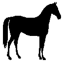

<style>
body { font-size: 16px; line-height: 1.62; }
.main-container { max-width: 1120px !important; }
h1, h2, h3 { font-weight: 650; margin-top: 1.35em; }
h1 { border-bottom: 2px solid #e7e7e7; padding-bottom: 0.22em; }
h2 { border-bottom: 1px solid #eeeeee; padding-bottom: 0.16em; }
blockquote { border-left: 4px solid #4a6fa5; background: #f7f9fc; padding: 0.8em 1.1em; color: #30343b; }
.callout { border: 1px solid #d9e2ef; border-left: 5px solid #4a6fa5; border-radius: 5px; background: #f8fafc; padding: 0.9em 1.1em; margin: 1.1em 0; }
.callout-warning { border-left-color: #b36b00; background: #fffaf2; }
code { font-size: 0.92em; }
</style>

```{r setup, include=FALSE}
knitr::opts_chunk$set(echo = TRUE)
```

# Objetivo

Estudiar la **restauración bayesiana de imágenes** binarias, en escala de grises y RGB mediante modelos que aprovechan la semejanza entre píxeles vecinos. El propósito es formular las distribuciones posteriores, derivar las condicionales completas, implementar algoritmos de inferencia y evaluar la reconstrucción y su incertidumbre.

La pregunta central es:

> **¿Cuánto mejora la restauración al incorporar dependencia espacial y qué información aporta la distribución posterior cuando aumenta el ruido?**

# Datos

Utilice las tres imágenes de referencia incluidas en la carpeta `imagenes/`, obtenidas del conjunto público [`skimage.data`](https://scikit-image.org/docs/stable/api/skimage.data.html): una silueta binaria (`horse`), una fotografía en escala de grises (`camera`) y una fotografía RGB (`astronaut`). Todas se han redimensionado a $128\times128$ píxeles para equilibrar la conservación de detalles y el costo computacional de los algoritmos de inferencia. Se mantienen sus formatos originales (binario, escala de grises y RGB).

| Imagen | Archivo | Datos por píxel |
|:--|:--|:--|
| Binaria | `horse_binaria.png` | Un estado $x_i\in\{-1,+1\}$ |
| Escala de grises | `camera_grises.png` | Una intensidad $x_i\in[0,1]$ |
| RGB | `astronaut_rgb.png` | Un vector $\boldsymbol{x}_i=(R_i,G_i,B_i)^\mathsf{T}\in[0,1]^3$ |

| Binaria | Escala de grises | RGB |
|:--:|:--:|:--:|
| {width=170px} | {width=170px} | {width=170px} |

La imagen binaria se encuentra codificada con valores 0 (silueta negra) y 1 (fondo blanco). Para implementar el modelo de Ising, transfórmelos a $+1$ y $-1$, respectivamente. En las imágenes en escala de grises y RGB, conserve las intensidades normalizadas en $[0,1]$. Opcionalmente, puede sustituir alguna de las imágenes por otra disponible en [`skimage.data`](https://scikit-image.org/docs/stable/api/skimage.data.html), manteniendo la resolución de $128\times128$ píxeles.

<div class="callout callout-warning">
<strong>Nota.</strong> Las imágenes originales representan la verdad conocida. Utilícelas para producir contaminación artificial y calcular errores, <strong>nunca</strong> para seleccionar parámetros, estimar las restauraciones ni escoger la mejor realización del ruido.
</div>

# Actividades

## Representación de imágenes y ruido

Una imagen de $M\times N$ píxeles puede representarse mediante un grafo $G=(V,E)$, donde cada uno de los $P=MN$ píxeles corresponde a un vértice y dos vértices están conectados si sus píxeles comparten un lado (vecindad de cuatro vecinos). Denote por $N_i$ el conjunto de vecinos del píxel $i$, por $d_i$ su cantidad y por $\mathbf{L}=\mathbf{D}-\mathbf{A}$ la matriz Laplaciana, donde $\mathbf{A}$ es la matriz de adyacencia y $\mathbf{D}=\operatorname{diag}(d_1,\ldots,d_P)$.

Construya esta estructura en `R`, utilizando matrices dispersas cuando corresponda, y verifique que los píxeles ubicados en las esquinas tienen dos vecinos, los de los bordes tres y los interiores cuatro. Implemente la transformación de una imagen matricial a un vector y su reconstrucción, conservando el orden de los píxeles. Para las imágenes RGB, identifique además la representación de los tres canales de color.

Visualice las tres imágenes originales y explore sus características mediante las frecuencias de los valores binarios, la distribución de intensidades en escala de grises y las distribuciones de intensidad de los canales RGB. Describa las principales diferencias entre sus representaciones.

## Imagen binaria: modelo de Ising

Considere la imagen binaria original $\boldsymbol{X}^{(0)}\in\{-1,+1\}^P$, donde $+1$ representa el negro y $-1$ el blanco. Para generar una imagen contaminada $\boldsymbol{Y}$, suponga que cada píxel cambia de estado de manera independiente con probabilidad $\rho_0=0.10$. En particular, $Y_i=-X_i^{(0)}$ con probabilidad $\rho_0$ y $Y_i=X_i^{(0)}$ con probabilidad $1-\rho_0$. Simule este mecanismo de contaminación y compare visualmente las imágenes original y contaminada.

El objetivo es recuperar la imagen binaria verdadera $\boldsymbol{X}$ a partir de su versión contaminada $\boldsymbol{Y}$. Para ello, considere el **modelo de Ising**, que incorpora dependencia espacial al asignar mayor probabilidad a configuraciones en las que los píxeles vecinos tienen el mismo estado. El modelo bayesiano se especifica mediante

$$
\begin{aligned}
\textsf{Pr}(Y_i=y_i\mid X_i=x_i,\rho)
&=
\begin{cases}
1-\rho, & y_i=x_i,\\
\rho, & y_i\neq x_i,
\end{cases}
\\[6pt]
p(\boldsymbol{x}\mid\beta)
&=\frac{1}{Z(\beta)}
\exp\left\{\beta\sum_{i\sim j}x_ix_j\right\},
\\[6pt]
\beta&\sim\textsf{G}(a_\beta,b_\beta),\\
\rho&\sim\textsf{Beta}(a_\rho,b_\rho)
\quad\text{truncada en }(0,1/2).
\end{aligned}
$$

Las componentes del modelo son:

- **Modelo de observación:** describe la contaminación de la imagen mediante cambios independientes en los estados de los píxeles, con probabilidad $\rho$.
- **Modelo de Ising:** define la distribución previa de la imagen desconocida $\boldsymbol{X}$. El parámetro $\beta>0$ controla la dependencia espacial, favoreciendo la coincidencia entre píxeles vecinos. La notación $i\sim j$ representa una arista contada una sola vez y $Z(\beta)$ es la constante de normalización, que depende de $\beta$.
- **Distribuciones previas:** representan la incertidumbre sobre los parámetros $\beta$ y $\rho$, considerados independientes a priori. Los valores $a_\beta,b_\beta,a_\rho,b_\rho$ son hiperparámetros conocidos.

Desarrolle las siguientes actividades:

1. Formule la distribución posterior conjunta $p(\boldsymbol{x},\beta,\rho\mid\boldsymbol{y})$ y derive las distribuciones condicionales completas de $X_i$, $\beta$ y $\rho$. Identifique cuáles corresponden a distribuciones conocidas. Explique por qué la actualización de $X_i$ depende únicamente de sus vecinos y de $y_i$, y analice las dificultades que introduce $Z(\beta)$ para estimar $\beta$.

2. Implemente un algoritmo MCMC que combine el muestreador de Gibbs para actualizar los estados de los píxeles y $\rho$, con una versión aproximada del **algoritmo de intercambio** (*exchange algorithm*) para actualizar $\beta$. Para este último, considere el siguiente procedimiento:

     a. Genere una propuesta $\beta^*=\beta+\varepsilon$, donde $\varepsilon\sim\textsf{N}(0,\delta^2)$. Rechace las propuestas $\beta^*\leq0$.
     b. Simule una imagen auxiliar $\boldsymbol{X}^*$ mediante $K$ barridos del muestreador de Gibbs bajo el modelo de Ising con parámetro $\beta^*$, sin utilizar la imagen observada $\boldsymbol{Y}$.
     c. Acepte $\beta^*$ con probabilidad
     
        $$
        \alpha=\min\left\{1,
        \frac{p(\beta^*)}{p(\beta)}
        \exp\left[(\beta^*-\beta)
        \{S(\boldsymbol{x})-S(\boldsymbol{x}^*)\}\right]
        \right\},
        $$
     
        donde $S(\boldsymbol{x})=\sum_{i\sim j}x_ix_j$ y $p(\beta)$ es la densidad previa Gamma.

     Explique por qué esta probabilidad no requiere calcular $Z(\beta)$ y por qué utilizar un número finito de barridos de Gibbs produce una aproximación al algoritmo de intercambio exacto. Seleccione y justifique los hiperparámetros del modelo, la varianza de propuesta $\delta^2$, el número de barridos $K$ y las condiciones de ejecución del algoritmo. Evalúe la convergencia de las cadenas y la tasa de aceptación de $\beta$.

3. Estime las distribuciones posteriores de $\beta$ y $\rho$, así como las probabilidades $\pi_i=\textsf{Pr}(X_i=+1\mid\boldsymbol{y})$. Restaure la imagen asignando a cada píxel el estado con mayor probabilidad posterior. Visualice la imagen restaurada y el mapa de probabilidades $\pi_i$.

4. Compare las imágenes original, contaminada y restaurada. Calcule la proporción de píxeles correctamente recuperados, evalúe la estimación de $\rho$ respecto al valor utilizado en la simulación y analice la influencia de $\beta$ sobre la recuperación de bordes y regiones homogéneas.

5. Repita el procedimiento de contaminación y restauración utilizando dos probabilidades adicionales, $\rho_0=0.05$ y $\rho_0=0.20$, manteniendo la misma imagen original y las demás condiciones del análisis. Compare visualmente las imágenes originales, contaminadas y restauradas para los tres niveles de ruido. Calcule la proporción de píxeles correctamente recuperados y compare las estimaciones posteriores de $\beta$ y $\rho$ en cada escenario. Analice cómo influye el nivel de contaminación sobre la calidad de la restauración, particularmente en la recuperación de bordes, detalles y regiones homogéneas.

## Escala de grises: modelo gaussiano espacial

Considere la imagen original en escala de grises $\boldsymbol{X}^{(0)}\in[0,1]^P$, donde cada valor representa la intensidad de un píxel. Para generar una imagen contaminada $\boldsymbol{Y}$, agregue ruido gaussiano independiente con desviación estándar $\sigma_0=0.10$. En particular, simule $Y_i=X_i^{(0)}+\varepsilon_i$, donde $\varepsilon_i\overset{\text{iid}}{\sim}\textsf{N}(0,\sigma_0^2)$. Compare visualmente las imágenes original y contaminada. No recorte los valores observados fuera de $[0,1]$ durante la inferencia. Limite las intensidades a este intervalo únicamente para su visualización.

El objetivo es recuperar la imagen verdadera $\boldsymbol{X}$ a partir de $\boldsymbol{Y}$. Para ello, considere un **campo aleatorio gaussiano de Markov (GMRF)**, que incorpora dependencia espacial al favorecer intensidades similares entre píxeles vecinos. El modelo bayesiano se especifica mediante

$$
\begin{aligned}
Y_i\mid X_i,\sigma^2
&\overset{\text{ind}}{\sim}\textsf{N}(X_i,\sigma^2),
\\[6pt]
p(\boldsymbol{x}\mid\mu,\tau,\lambda)
&=\frac{|\mathbf{Q}|^{1/2}}{(2\pi)^{P/2}}
\exp\left\{
-\frac{\tau}{2}\sum_{i=1}^{P}(x_i-\mu)^2
-\frac{\lambda}{2}\sum_{i\sim j}(x_i-x_j)^2
\right\},\\[6pt]
\sigma^2&\sim\textsf{IG}(a_\sigma,b_\sigma), \\
\mu&\sim\textsf{N}(m_\mu,s_\mu^2),\\
\tau&\sim\textsf{G}(a_\tau,b_\tau),\\
\lambda&\sim\textsf{G}(a_\lambda,b_\lambda),
\end{aligned}
$$

donde $\mathbf{Q}=\tau\mathbf{I}+\lambda\mathbf{L}$ es la matriz de precisión del campo gaussiano, con $\tau>0$ y $\lambda>0$. Las distribuciones previas de los parámetros se consideran independientes.

Las componentes del modelo son:

- **Modelo de observación:** representa la contaminación mediante ruido gaussiano independiente, cuya varianza $\sigma^2$ determina la intensidad del ruido.
- **Modelo GMRF:** define la distribución previa de la imagen desconocida $\boldsymbol{X}$. El parámetro $\mu$ representa la intensidad de referencia, $\tau$ controla la concentración alrededor de ella y $\lambda$ regula la suavidad espacial, penalizando diferencias entre píxeles vecinos. La matriz $\mathbf{L}$ es la Laplaciana definida anteriormente y $\mathbf{Q}$ es la inversa de la matriz de covarianza. La condición $\tau>0$ garantiza que la distribución sea propia.
- **Distribuciones previas:** representan la incertidumbre sobre $\sigma^2$, $\mu$, $\tau$ y $\lambda$. Los valores $m_\mu,s_\mu^2,a_\tau,b_\tau,a_\lambda,b_\lambda,a_\sigma,b_\sigma$ son hiperparámetros conocidos.

Aunque las intensidades originales pertenecen a $[0,1]$, el campo gaussiano permite valores en $\mathbb{R}$, lo que facilita la inferencia y constituye una aproximación para representar imágenes digitales.

Desarrolle las siguientes actividades:

1. Formule la distribución posterior conjunta $p(\boldsymbol{x},\mu,\tau,\lambda,\sigma^2\mid\boldsymbol{y})$ y derive las distribuciones condicionales completas de $X_i$, $\sigma^2$, $\mu$, $\tau$ y $\lambda$. Identifique cuáles corresponden a distribuciones conocidas. Verifique que la condicional de $X_i$ depende de su observación, de los estados vecinos y de los parámetros del modelo. Explique la importancia del determinante $|\mathbf{Q}|$ para estimar $\tau$ y $\lambda$.

2. Implemente un algoritmo MCMC que utilice el muestreador de Gibbs para actualizar los estados de los píxeles, $\mu$ y $\sigma^2$, y Metropolis-Hastings para $\tau$ y $\lambda$. En estas últimas actualizaciones, calcule el determinante de la matriz de precisión $\mathbf{Q}$ mediante métodos numéricos para matrices dispersas, evitando invertirla explícitamente. Seleccione y justifique los hiperparámetros del modelo, las distribuciones de propuesta y el número de iteraciones, incluido el período de calentamiento. Evalúe la convergencia de las cadenas y las tasas de aceptación de Metropolis-Hastings.

3. Estime las distribuciones posteriores de $\mu$, $\tau$, $\lambda$ y $\sigma^2$, así como las medias posteriores $\hat{x}_i=\textsf{E}(X_i\mid\boldsymbol{y})$. Reconstruya la imagen utilizando estas medias y represente la incertidumbre mediante desviaciones estándar posteriores e intervalos de credibilidad del 95 % para una selección de píxeles. 

4. Compare las imágenes original, contaminada y restaurada. Evalúe la calidad de la restauración mediante el error cuadrático medio (*Mean Squared Error*, MSE) y la relación señal-ruido (*Signal-to-Noise Ratio*, SNR). Compare la estimación posterior de $\sigma^2$ con el valor utilizado en la simulación y analice la influencia de $\tau$ y $\lambda$ sobre la recuperación de bordes, detalles y regiones homogéneas.

5. Repita el procedimiento de contaminación y restauración utilizando dos desviaciones estándar adicionales, $\sigma_0=0.05$ y $\sigma_0=0.20$, manteniendo la misma imagen original y las demás condiciones del análisis. Compare visualmente las imágenes originales, contaminadas y restauradas para los tres niveles de ruido. Calcule el MSE y la SNR, y compare las estimaciones posteriores de $\mu$, $\tau$, $\lambda$ y $\sigma^2$ en cada escenario. Analice cómo influye el nivel de contaminación sobre la calidad de la restauración, particularmente en la recuperación de bordes, detalles y regiones homogéneas.

## Imagen RGB: modelo gaussiano multivariado

Considere la imagen RGB original $\boldsymbol{X}^{(0)}$, donde cada píxel está representado por un vector $\boldsymbol{X}_i^{(0)}=(R_i,G_i,B_i)^\mathsf{T}\in[0,1]^3$. Para generar una imagen contaminada $\boldsymbol{Y}$, agregue ruido gaussiano independiente con desviación estándar $\sigma_0=0.10$ en cada canal. En particular, simule $\boldsymbol{Y}_i=\boldsymbol{X}_i^{(0)}+\boldsymbol{\varepsilon}_i$, donde $\boldsymbol{\varepsilon}_i\overset{\text{iid}}{\sim}\textsf{N}_3(\boldsymbol{0},\sigma_0^2\mathbf{I}_3)$. Compare visualmente las imágenes original y contaminada. No recorte las intensidades observadas fuera de $[0,1]$ durante la inferencia. Limite sus valores únicamente para la visualización.

El objetivo es recuperar la imagen verdadera $\boldsymbol{X}$ a partir de $\boldsymbol{Y}$. Para ello, considere una extensión multivariada del **modelo GMRF**, que incorpora dependencia espacial entre píxeles vecinos y dependencia entre los tres canales de color. El modelo bayesiano se especifica mediante

$$
\begin{aligned}
\boldsymbol{Y}_i\mid\boldsymbol{X}_i,\mathbf{\Sigma}
&\overset{\text{ind}}{\sim}
\textsf{N}_3(\boldsymbol{X}_i,\mathbf{\Sigma}),
\\[6pt]
\boldsymbol{x}\mid\boldsymbol{\mu},\mathbf{\Omega},\lambda
&\sim\textsf{N}_{3P}\left(
\boldsymbol{1}_P\otimes\boldsymbol{\mu},
\mathbf{Q}^{-1}
\right),
\\[6pt]
\mathbf{\Sigma}
&\sim\textsf{IW}_3(\nu_\varepsilon,\mathbf{S}_\varepsilon),
\\
\boldsymbol{\mu}
&\sim\textsf{N}_3(\boldsymbol{m}_\mu,\mathbf{V}_\mu),
\\
\mathbf{\Omega}
&\sim\textsf{W}_3(\nu_\Omega,\mathbf{S}_\Omega),
\\
\lambda
&\sim\textsf{G}(a_\lambda,b_\lambda),
\end{aligned}
$$

donde $\mathbf{Q}=(\mathbf{I}_P+\lambda\mathbf{L})\otimes\mathbf{\Omega}$ es la matriz de precisión del campo gaussiano, con $\lambda>0$ y $\mathbf{\Omega}$ definida positiva. El símbolo $\otimes$ representa el producto de Kronecker, que permite construir matrices por bloques. El modelo supone independencia previa entre los parámetros.

Las componentes del modelo son:

- **Modelo de observación:** representa la contaminación mediante ruido gaussiano independiente entre píxeles. La matriz de covarianza $\mathbf{\Sigma}$ describe la variabilidad del ruido y su posible correlación entre los canales RGB.
- **Modelo GMRF multivariado:** define la distribución previa de la imagen desconocida $\boldsymbol{X}$. El vector $\boldsymbol{\mu}\in\mathbb{R}^3$ representa las intensidades de referencia, $\lambda$ controla la suavidad espacial y $\mathbf{\Omega}$ regula la variabilidad y dependencia entre canales. La matriz $\mathbf{L}$ es la Laplaciana definida anteriormente. La estructura de $\mathbf{Q}$ permite representar simultáneamente las dependencias espaciales y entre colores.
- **Distribuciones previas:** representan la incertidumbre sobre $\mathbf{\Sigma}$, $\boldsymbol{\mu}$, $\mathbf{\Omega}$ y $\lambda$. Las distribuciones Wishart y Wishart Inversa se utilizan para modelar matrices de precisión y covarianza definidas positivas, respectivamente. Sus grados de libertad y matrices de escala, junto con $\boldsymbol{m}_\mu,\mathbf{V}_\mu,a_\lambda,b_\lambda$, son hiperparámetros del modelo.

Desarrolle las siguientes actividades:

1. Formule la distribución posterior conjunta $p(\boldsymbol{x},\boldsymbol{\mu},\mathbf{\Omega},\lambda,\mathbf{\Sigma}\mid\boldsymbol{y})$ y derive las distribuciones condicionales completas de $\boldsymbol{X}_i$, $\mathbf{\Sigma}$, $\boldsymbol{\mu}$, $\mathbf{\Omega}$ y $\lambda$. Identifique cuáles corresponden a distribuciones conocidas. Verifique que la condicional de $\boldsymbol{X}_i$ es normal trivariada y depende de sus vecinos, de la observación y de los parámetros del modelo. Explique el papel del determinante de $\mathbf{Q}$ en la estimación de $\lambda$.

2. Implemente un algoritmo MCMC que utilice el muestreador de Gibbs para actualizar los vectores de intensidades $\boldsymbol{X}_i$, $\boldsymbol{\mu}$, $\mathbf{\Omega}$ y $\mathbf{\Sigma}$, y Metropolis-Hastings para $\lambda$. En esta última actualización, calcule el determinante de $\mathbf{I}_P+\lambda\mathbf{L}$ mediante métodos numéricos para matrices dispersas, evitando invertir matrices explícitamente. Seleccione y justifique los hiperparámetros del modelo, la distribución de propuesta y el número de iteraciones, incluido el período de calentamiento. Evalúe la convergencia de las cadenas y la tasa de aceptación de Metropolis-Hastings.

3. Estime las distribuciones posteriores de $\mathbf{\Sigma}$, $\boldsymbol{\mu}$, $\mathbf{\Omega}$ y $\lambda$, así como las medias posteriores $\hat{\boldsymbol{x}}_i=\textsf{E}(\boldsymbol{X}_i\mid\boldsymbol{y})$. Reconstruya la imagen RGB a partir de estas medias y cuantifique la incertidumbre mediante desviaciones estándar posteriores e intervalos de credibilidad del 95 % para una selección de píxeles y canales.

4. Compare las imágenes original, contaminada y restaurada. Evalúe la calidad de la restauración mediante el error cuadrático medio (*Mean Squared Error*, MSE) y la relación señal-ruido (*Signal-to-Noise Ratio*, SNR), tanto para la imagen completa como para cada canal RGB. Compare la estimación posterior de $\mathbf{\Sigma}$ con la matriz utilizada en la simulación y analice la influencia de $\lambda$ y $\mathbf{\Omega}$ sobre la recuperación de colores, bordes y detalles.

5. Repita el procedimiento de contaminación y restauración utilizando dos desviaciones estándar adicionales, $\sigma_0=0.05$ y $\sigma_0=0.20$, manteniendo la misma imagen original y las demás condiciones del análisis. Compare visualmente las imágenes contaminadas y restauradas para los tres niveles de ruido. Calcule el MSE y la SNR, tanto para la imagen completa como para cada canal RGB, y compare las estimaciones posteriores de $\boldsymbol{\mu}$, $\mathbf{\Sigma}$, $\mathbf{\Omega}$ y $\lambda$. Analice cómo influye el nivel de contaminación sobre la calidad de la restauración, particularmente en la recuperación de colores, bordes, detalles y regiones homogéneas.

# Discusión

Con base en los resultados, discuta de manera concisa la calidad de la restauración de las imágenes binarias, en escala de grises y RGB. Analice cómo influye la dependencia espacial en la recuperación de bordes, detalles, regiones homogéneas y colores, e identifique los píxeles con mayor incertidumbre posterior. Compare el desempeño de los tres modelos y examine las ventajas y limitaciones de los algoritmos MCMC utilizados, especialmente en términos de convergencia, costo computacional y aplicación a imágenes de mayor resolución.

# Instrucciones

- Este caso de estudio debe desarrollarse en grupos de máximo dos estudiantes, quienes recibirán la misma calificación.
- Entregue un único informe en formato PDF, elaborado en LaTeX junto con el código fuente y las semillas necesarias para reproducir todos los resultados. Envíelo a **jcsosam@unal.edu.co** a más tardar el último día de clases del semestre, a las 11:59 p. m.
- El informe debe incluir las derivaciones de las distribuciones posteriores y condicionales completas, la descripción de los algoritmos MCMC, los resultados de restauración de las tres imágenes, los diagnósticos de convergencia y una discusión de los resultados.
- Presente únicamente las ecuaciones, tablas y figuras relevantes. Numere las tablas y figuras, utilice una cantidad apropiada de decimales y cite las fuentes según las normas APA. La organización, redacción, ortografía y presentación forman parte de la evaluación.
- Nombre los archivos y el asunto del correo siguiendo el formato `bayes - caso de estudio - juan sosa - ernesto perez`, reemplazando los nombres por los integrantes del grupo.
- Puede utilizar herramientas de inteligencia artificial como apoyo, siempre que revise, comprenda y verifique su contenido. Los estudiantes son responsables de los resultados y de cualquier error incluido en el informe.
- Cualquier evidencia de plagio o colaboración no autorizada será sancionada conforme al reglamento de la Universidad Nacional de Colombia. En caso de copia entre grupos, la calificación se dividirá proporcionalmente entre los involucrados y ambos recibirán la misma penalidad, sin perjuicio de sanciones adicionales.
