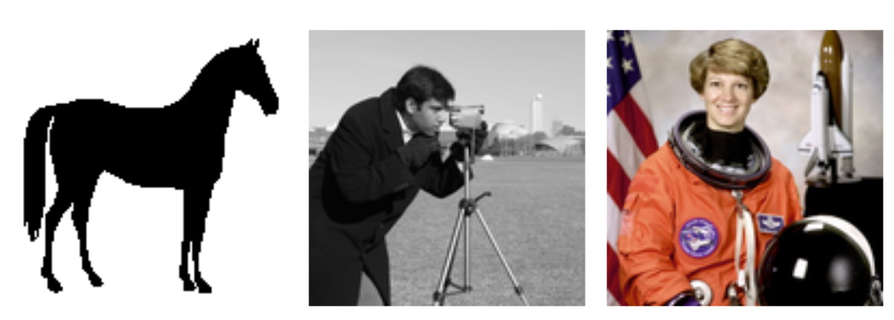
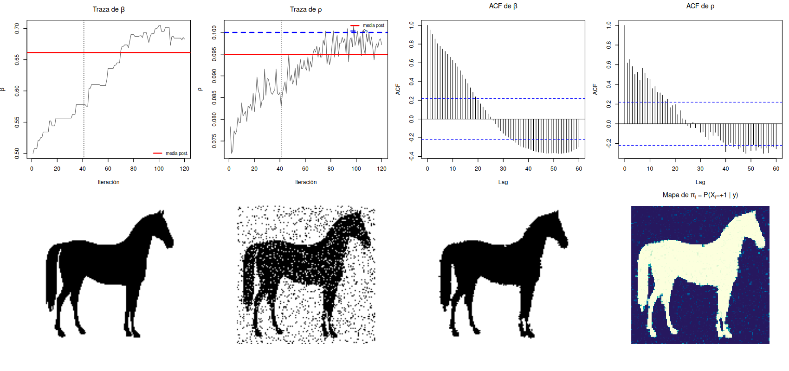
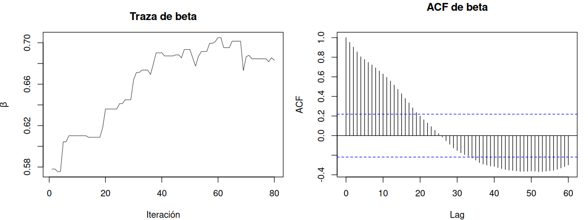
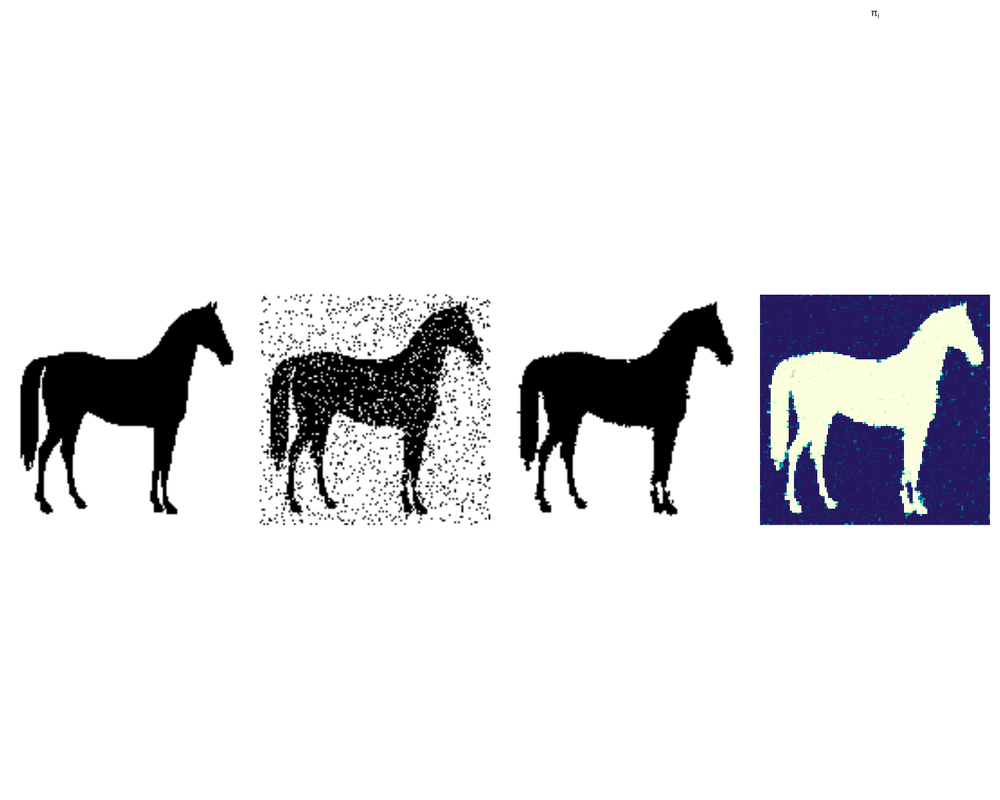
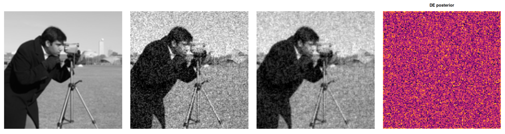
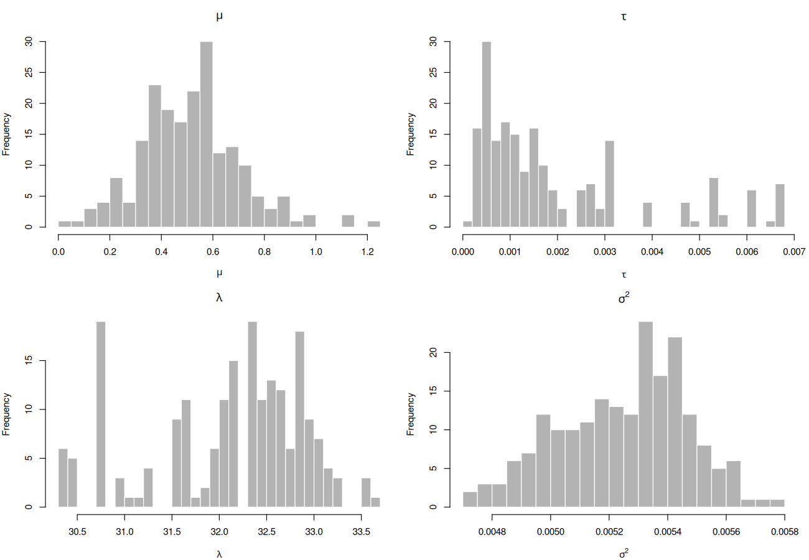
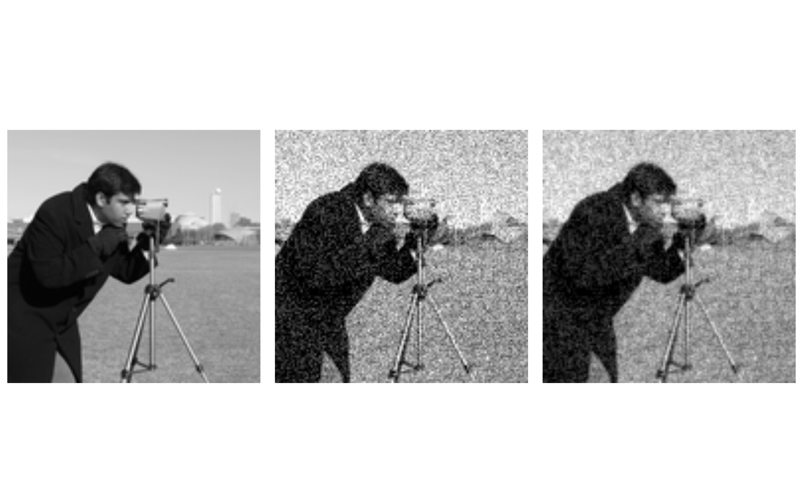

```{r}
#| label: setup
#| include: false
dir_out <- "Code/resultados"
fmt <- function(x, d = 4) formatC(x, format = "f", digits = d)
```

# Qué era este proyecto y qué encontré al empezar

El caso de estudio (*Restauración Bayesiana de Imágenes*) estaba en la carpeta
`Desktop/Cde bayes/`. Al abrirla encontré:

| Archivo / carpeta | Qué era | Qué hice con ello |
|:--|:--|:--|
| `caso.Rmd`, `caso.html` | La guía completa del caso (equivalente al PDF del enunciado): modelos, imágenes, actividades e instrucciones | Los leí íntegramente y los usé como especificación |
| `imagenes/` | Las tres imágenes de referencia (`horse_binaria.png`, `camera_grises.png`, `astronaut_rgb.png`), 128×128 | Las verifiqué (dimensiones y rangos) y las usé en los tres modelos |
| `Code/3.1.R`, `Code/3.1.1.R` | Borradores de la sección 3.1 (el 3.1.1 era una copia más antigua) | Arreglé `3.1.R` (rutas rotas, bloque duplicado con errores) y lo dejé funcionando; en `3.1.1.R` cambié sus rutas absolutas por `dir_img` |
| `Code/3.2.R` | Borrador del modelo de Ising (razonable pero con rutas de Windows y sin los estándares del curso) | Lo completé y alineé con los estándares de clase (log de avance, adaptación, métricas, salida unificada) |
| `Cuadernos/` | Los cuadernos del curso (Gibbs, Normal, Normal multivariado, comparación...) | De ahí extraje los **estándares de código y diagnóstico MCMC** que exigía el caso |
| `.git/`, `README.md` | Control de versión | No los toqué |

> **Nota importante**: los PDFs mencionados en el enunciado (`Bayesiana cde.pdf`,
> `Gibbs.pdf`, `Multinivel.pdf`, `Normal.pdf`) no estaban en el disco; su
> contenido equivalente está en `caso.Rmd` (la guía) y en los cuadernos del
> curso de `Cuadernos/` (los estándares MCMC), que son los que consulté.

Además instalé los paquetes que faltaban en R (`png`, `coda`, y más tarde
`knitr`, `rmarkdown`, `sass`, `bslib` para renderizar este documento).

El trabajo se organizó en **un script por punto del caso** dentro de `Code/`:

| Script | Punto del caso | Contenido |
|:--|:--|:--|
| `3.1.R` | 3.1 | Representación de imágenes: grafo, Laplaciana dispersa, conversiones, exploración |
| `3.2.R` | 3.2 | Imagen binaria: modelo de Ising (Gibbs + Exchange Algorithm) |
| `3.3.R` | 3.3 | Escala de grises: GMRF (Gibbs + Metropolis-Hastings) |

Este documento recorre **cada script en detalle**: qué hace cada función, por
qué se diseñó así, las derivaciones matemáticas completas, las pruebas que
ejecuté, los errores que encontré y corregí, y todos los resultados.

# Estándares de código y diagnóstico que seguí (de los cuadernos del curso)

Antes de programar revisé `Cuadernos/07-muestreador_de_Gibbs.Rmd`,
`06-modelo_normal.Rmd`, `08-normal_multivariado.Rmd` y `09-comparacion.Rmd` y
adopté literalmente sus estándares:

1. **Control de progreso** en todo bucle MCMC, cada 10% de las iteraciones:

   ```r
   ncat <- floor(B / 10)
   ...
   if (b %% ncat == 0) cat(sprintf("%.0f%% completado...\n", 100 * b / B))
   ```

2. **Diagnósticos de convergencia con `coda`** para cada parámetro escalar:
   - Traza de la cadena y función de autocorrelación (`acf`).
   - Tamaño efectivo de muestra: `n_eff <- coda::effectiveSize(cadena)`.
   - Error estándar de Monte Carlo: $\text{EMC} = \text{DE}(\hat\theta)/\sqrt{n_{\text{eff}}}$.
   - Coeficiente de variación de Monte Carlo:
     $\text{CVMC}(\%) = 100\cdot\text{EMC}/|\text{Media}|$, con criterio **< 5%**.
   - Intervalos de credibilidad del 95% por cuantiles
     (`quantile(cadena, c(0.025, 0.975))`).

3. **Álgebra dispersa obligatoria** (`Matrix`, `dgCMatrix`) para $\mathbf{A}$,
   $\mathbf{L}$ y las matrices de precisión, y log-determinantes mediante
   factorizaciones numéricas (Cholesky), nunca invirtiendo matrices densas de
   $16{,}384\times 16{,}384$.

La función de diagnóstico que usé en todos los scripts es literalmente:

```r
diagnostico_param <- function(cadena, nombre, etiqueta = nombre) {
  ch   <- coda::mcmc(cadena)
  neff <- as.numeric(coda::effectiveSize(ch))   # tamaño efectivo
  dsd  <- sd(cadena); media <- mean(cadena)
  emc  <- dsd / sqrt(neff)                      # EMC
  cvmc <- 100 * emc / abs(media)                # CVMC (%)
  q    <- quantile(cadena, probs = c(0.025, 0.975))
  cat(sprintf("Media = %.5f | DE = %.5f | n_eff = %.0f | EMC = %.5f | CVMC = %.3f%%\n",
              media, dsd, neff, emc, cvmc))
  cat(sprintf("IC95%% = [%.5f, %.5f]\n", q[1], q[2]))
  if (cvmc >= 5) cat("AVISO: CVMC >= 5% (aumentar iteraciones)\n")
  # ... traza y ACF a PNG
}
```

# Convenciones comunes a todos los scripts

- **Rutas portables por sistema operativo**: las rutas se definen una sola vez
  en `Code/config_linux.R` (Linux) o `Code/config_windows.R` (Windows), que
  crean las variables `dir_raiz`, `dir_code`, `dir_img` y `dir_out`; cada script
  carga automáticamente el archivo de configuración de su sistema operativo y
  usa esas variables, sin rutas absolutas en el código. La detección es
  automática (el archivo de configuración se localiza a sí mismo) y, si fallara,
  basta definir `dir_raiz` a mano en la línea marcada `[EDITAR]`. Antes los
  scripts tenían rutas absolutas de Windows que fallaban en cualquier otra
  máquina.
- **Modo de prueba** `CDE_RAPIDO=TRUE`: reduce $B$ y los niveles de ruido para
  validar el código en 1–2 minutos antes de lanzar las corridas largas.
  Lo usé en cada script antes de cada corrida real.
- **Método de log-determinante** `CDE_LOGDET=cholesky|espectral` (ver
  @sec-logdet): ambos exactos y validados entre sí.
- **Semillas**: `set.seed()` fijo por escenario (`semilla <- 2026` más un
  desplazamiento por nivel de ruido), de modo que **todos los números de este
  documento son exactamente reproducibles**.

# Script `3.1.R` — Representación de imágenes y ruido {#sec-31}

## Qué había antes y qué arreglé

El `3.1.R` original tenía tres problemas que corregí:

1. `dir_img <- "C:/Users/Estudiante/Downloads/caso/caso/imagenes"` (ruta de
   Windows inexistente) y lecturas duplicadas con rutas absolutas de Linux
   también inexistentes (`/home/sosacamargo/Downloads/caso/...`). → Lo sustituí
   por las variables `dir_img` y `dir_out` que definen `config_linux.R` y
   `config_windows.R`.
2. Un **bloque final duplicado** que repetía las figuras y contenía errores:
   `dev.new()` (falla en sesiones no interactivas) y un `print` suelto sin
   argumento. → Lo eliminé dejando una nota.
3. Las figuras se generaban sin guardar a disco. → Se mantuvo la exploración en
   consola y se añadió la generación del mosaico de imágenes originales.

## Función por función

**Conversiones de formato** (orden por columnas de R, $k = (c-1)M + r$, el mismo
que usa la indexación de la Laplaciana):

```r
matriz_a_vector <- function(mat) as.vector(mat)
vector_a_matriz <- function(vec, M = 128, N = 128) matrix(vec, nrow = M, ncol = N)

# {0 = negro, 1 = blanco} -> {+1, -1} para el modelo de Ising
binario_a_ising <- function(img_bin) ifelse(img_bin < 0.5, 1, -1)
ising_a_binario <- function(ising_vec) ifelse(ising_vec == 1, 0, 1)

# Arreglo M x N x 3 -> matriz P x 3 (R, G, B) y viceversa
rgb_a_matriz_canales <- function(arr_rgb) {
  cbind(R = as.vector(arr_rgb[, , 1]),
        G = as.vector(arr_rgb[, , 2]),
        B = as.vector(arr_rgb[, , 3]))
}
matriz_canales_a_rgb <- function(mat_canales, M = 128, N = 128) {
  arr <- array(0, dim = c(M, N, 3))
  for (k in 1:3) arr[, , k] <- matrix(mat_canales[, k], nrow = M, ncol = N)
  arr
}
```

El mapeo binario sigue el enunciado: la imagen trae $0$ (silueta negra) y $1$
(fondo blanco), y el Ising usa $+1$ para el negro y $-1$ para el blanco, luego
$0 \mapsto +1$ y $1 \mapsto -1$. Incluí pruebas de ida y vuelta con `stopifnot`
(las conversiones no pierden información).

**Construcción de la Laplaciana dispersa, sin bucles**: en lugar de recorrer los
16,384 píxeles uno a uno, genero las dos familias de aristas de la rejilla de
una sola vez (todas las horizontales y todas las verticales) y las paso a
`sparseMatrix`:

```r
construir_laplaciana <- function(M = 128, N = 128) {
  P <- M * N
  idx <- matrix(1:P, nrow = M, ncol = N)          # índice k de cada píxel (r, c)
  # aristas (r,c)-(r,c+1) y (r,c)-(r+1,c):
  i <- c(as.vector(idx[, -N]), as.vector(idx[-M, ]))
  j <- c(as.vector(idx[, -1]), as.vector(idx[-1, ]))
  A <- sparseMatrix(i = c(i, j), j = c(j, i), x = 1, dims = c(P, P))
  d <- rowSums(A)                                  # grados d_i
  L <- Diagonal(x = d) - A                         # Laplaciana L = D - A
  list(L = L, A = A, d = d, grid_idx = idx, n_aristas = length(i))
}
```

Como cada arista se agrega dos veces (una por cada extremo), `A` queda
simétrica; `d = rowSums(A)` son los grados de vecindad y
$\mathbf{L} = \mathbf{D} - \mathbf{A}$.

**Verificación del grafo** (`verificar_grafo`): comprueba los grados esperados
(2 en las 4 esquinas, 3 en los bordes, 4 en el interior), el número de aristas,
la simetría de $\mathbf{L}$, que sus filas sumen cero
($\mathbf{L}\mathbf{1}=\mathbf{0}$) y que $\operatorname{tr}(\mathbf{L}) = \sum_i d_i$.
Salida real de la ejecución:

| Verificación | Obtenido | Esperado |
|:--|:--|:--|
| Esquinas (grado 2) | 4 | 4 |
| Bordes (grado 3) | 504 | $2(126)+2(126)=504$ |
| Interior (grado 4) | 15,876 | $126^2 = 15{,}876$ |
| Aristas | 32,512 | $2\cdot128\cdot127 = 32{,}512$ |
| $\mathbf{L}$ simétrica / filas nulas / $\operatorname{tr}=\sum d_i$ | todas `TRUE` | — |

## Exploración estadística (resultados reales)

```{r}
#| label: exploracion
#| echo: false
img_bin <- png::readPNG("imagenes/horse_binaria.png")
img_gris <- png::readPNG("imagenes/camera_grises.png")
img_rgb <- png::readPNG("imagenes/astronaut_rgb.png")
X0 <- cbind(R = as.vector(img_rgb[, , 1]), G = as.vector(img_rgb[, , 2]),
            B = as.vector(img_rgb[, , 3]))
knitr::kable(data.frame(
  Imagen = c("Binaria (0/1)", "Grises", "RGB canal R", "RGB canal G", "RGB canal B"),
  Media = round(c(mean(img_bin), mean(img_gris), colMeans(X0)), 4),
  DE = round(c(sd(as.vector(img_bin)), sd(as.vector(img_gris)), apply(X0, 2, sd)), 4),
  Min = round(c(min(img_bin), min(img_gris), apply(X0, 2, min)), 4),
  Max = round(c(max(img_bin), max(img_gris), apply(X0, 2, max)), 4)
), caption = "Resumen empírico de las tres imágenes (128×128, valores en [0,1]).")
```

- **Binaria**: 5,408 píxeles $+1$ (negro, 33.0%) y 10,976 $-1$ (blanco, 67.0%).
- **Grises**: media 0.506, desviación 0.285 — hay estructura real (no es ruido).
- **RGB**: medias (0.555, 0.415, 0.379) y correlaciones altas entre canales
  ($r_{RG}\approx 0.84$, $r_{GB}\approx 0.96$, $r_{RB}\approx 0.72$), lo que
  justifica modelar los tres canales **conjuntamente** en el punto 3.4 del caso.

{#fig-originales}

# Script `3.2.R` — Imagen binaria: modelo de Ising {#sec-32}

## El modelo, completo

Sea $\boldsymbol{X}^{(0)}\in\{-1,+1\}^P$ la imagen verdadera ($+1$ negro,
$-1$ blanco). La contaminación independiente genera $\boldsymbol{Y}$ con
$\textsf{Pr}(Y_i = -X_i^{(0)}) = \rho_0$, $\rho_0 \in \{0.05, 0.10, 0.20\}$.
El modelo bayesiano es

$$
\begin{aligned}
\textsf{Pr}(Y_i = y_i \mid X_i = x_i, \rho)
&= (1-\rho)^{\mathbb{I}(y_i = x_i)}\,\rho^{\mathbb{I}(y_i \neq x_i)},\\[4pt]
p(\boldsymbol{x}\mid\beta)
&= \frac{1}{Z(\beta)}\exp\Big\{\beta \sum_{i\sim j} x_i x_j\Big\},
\qquad
\beta \sim \textsf{G}(a_\beta, b_\beta),\qquad
\rho \sim \textsf{Beta}(a_\rho, b_\rho)\ \text{truncada en }(0,1/2).
\end{aligned}
$$

La notación $i\sim j$ cuenta cada arista una sola vez, de modo que
$S(\boldsymbol{x}) = \sum_{i\sim j} x_i x_j = \frac12 \boldsymbol{x}^\mathsf{T}\mathbf{A}\boldsymbol{x}$,
y $Z(\beta) = \sum_{\boldsymbol{x}} \exp\{\beta S(\boldsymbol{x})\}$ es la
constante de normalización sobre las $2^{16{,}384}$ configuraciones.

La **posterior conjunta** es

$$
p(\boldsymbol{x},\beta,\rho\mid\boldsymbol{y})
\propto
\Big[\prod_{i=1}^P (1-\rho)^{\mathbb{I}(y_i = x_i)}\rho^{\mathbb{I}(y_i \neq x_i)}\Big]
\cdot \frac{e^{\beta S(\boldsymbol{x})}}{Z(\beta)} \cdot p(\beta)\, p(\rho).
$$

## Derivación de la condicional de $X_i$

La contribución de $x_i$ al núcleo (con todo lo demás fijo) es

$$
\exp\{\beta x_i \textstyle\sum_{j\in N_i} x_j\}\,
(1-\rho)^{\mathbb{I}(y_i = x_i)}\rho^{\mathbb{I}(y_i \neq x_i)},
$$

porque solo las aristas $(i,j)$, $j\in N_i$, contienen a $x_i$ en
$S(\boldsymbol{x})$ (propiedad de Markov del Ising), y la verosimilitud
factoriza por píxel. El **logaritmo de las odds** de $x_i=+1$ frente a
$x_i=-1$ es

$$
\log\frac{\textsf{Pr}(X_i=+1\mid\cdot)}{\textsf{Pr}(X_i=-1\mid\cdot)}
= 2\beta\sum_{j\in N_i} x_j + \log\frac{\textsf{Pr}(y_i\mid +1)}{\textsf{Pr}(y_i\mid -1)}.
$$

El cociente de verosimilitudes vale $(1-\rho)/\rho$ si $y_i = +1$ y
$\rho/(1-\rho)$ si $y_i = -1$; en ambos casos es $y_i \log\frac{1-\rho}{\rho}$.
Por lo tanto

$$
\boxed{\ \textsf{Pr}(X_i = +1 \mid \text{resto})
= \operatorname{expit}\Big(2\beta\sum_{j\in N_i}x_j + y_i\log\tfrac{1-\rho}{\rho}\Big)\ }
$$

que es exactamente lo que implementa `barrido_gibbs`. **Solo depende de $y_i$
y de los 4 vecinos**: el resto de la imagen no entra.

## Derivación de la condicional de $\rho$

Con $d_y = \sum_i \mathbb{I}(x_i \neq y_i)$ el número de desacuerdos entre la
imagen latente y la observada,

$$
p(\rho\mid\boldsymbol{x},\boldsymbol{y})
\propto \rho^{d_y}(1-\rho)^{P-d_y}\,\rho^{a_\rho-1}(1-\rho)^{b_\rho-1}\mathbb{I}(0<\rho<1/2)
= \textsf{Beta}(a_\rho + d_y,\ b_\rho + P - d_y)\ \text{truncada en }(0,1/2).
$$

Se muestrea por **inversión de la CDF** de la Beta truncada:
`u <- runif(1)*pbeta(0.5, a, b)` y luego `qbeta(u, a, b)`.

## El problema de $Z(\beta)$ y el Exchange Algorithm

La condicional de $\beta$ es proporcional a
$\frac{p(\beta)}{Z(\beta)} e^{\beta S(\boldsymbol{x})}$: contiene $Z(\beta)$,
intratable. El **algoritmo de intercambio** propone $\beta^* = \beta+\varepsilon$,
$\varepsilon\sim N(0,\delta^2)$ (rechazando $\beta^*\le 0$), genera una imagen
auxiliar $\boldsymbol{X}^*$ con $K$ barridos del Gibbs del **Ising puro** con
parámetro $\beta^*$ (sin usar $\boldsymbol{y}$), y acepta con

$$
\alpha = \min\Big\{1,\ \frac{p(\beta^*)}{p(\beta)}\exp\big[(\beta^*-\beta)\{S(\boldsymbol{x}) - S(\boldsymbol{x}^*)\}\big]\Big\}.
$$

**Demostración de que $Z(\beta)$ desaparece.** El cociente de
Metropolis-Hastings completo para la posterior de $\beta$ dado $\boldsymbol{x}$,
con auxiliar $\boldsymbol{x}^*\sim p(\boldsymbol{x}\mid\beta^*)$, es

$$
\frac{p(\beta^*)}{p(\beta)}\cdot\frac{p(\boldsymbol{x}\mid\beta^*)}{p(\boldsymbol{x}\mid\beta)}\cdot\frac{p(\boldsymbol{x}^*\mid\beta)}{p(\boldsymbol{x}^*\mid\beta^*)}
= \frac{p(\beta^*)}{p(\beta)}\cdot
\frac{e^{\beta^* S(\boldsymbol{x})}/Z(\beta^*)}{e^{\beta S(\boldsymbol{x})}/Z(\beta)}\cdot
\frac{e^{\beta S(\boldsymbol{x}^*)}/Z(\beta)}{e^{\beta^* S(\boldsymbol{x}^*)}/Z(\beta^*)},
$$

y las dos constantas $Z(\beta)$ y $Z(\beta^*)$ se cancelan exactamente,
quedando $\frac{p(\beta^*)}{p(\beta)}\exp\{(\beta^*-\beta)(S(\boldsymbol{x})-S(\boldsymbol{x}^*))\}$.
Con $K$ **finito** la imagen auxiliar no está exactamente en equilibrio y el
algoritmo es una *aproximación* del intercambio exacto (por eso documenté en el
código que la media de $\beta$ se desplaza al variar $K$; se usó $K=25$ con
arranque en caliente desde el estado actual de $\boldsymbol{x}$).

## Recorrido del código, función por función

**Estructura espacial.** `construir_adyacencia(M, N)` crea $\mathbf{A}$
dispersa (misma técnica vectorizada de `3.1.R`) y `S_concordancia(x, A)` calcula
$S(\boldsymbol{x}) = \frac12\boldsymbol{x}^\mathsf{T}\mathbf{A}\boldsymbol{x}$
en una sola operación dispersa.

**Tablero de ajedrez** (`preparar_tablero`). Parto los píxeles en dos colores
según la paridad de fila+columna; en una rejilla bipartita, dos píxeles del
mismo color **nunca son vecinos**, luego dados los del otro color, los $X_i$ de
un color son condicionalmente independientes (por la condicional que acabamos de
derivar). La función comprueba con `stopifnot` que cada color no tiene aristas
internas (`sum(A[g, g]) == 0`) y guarda las submatrices `A[g, ]` para calcular
las sumas de vecinos de todo un color de una vez. Consecuencia: cada barrido de
Gibbs son **2 medios barridos vectorizados**, no 16,384 muestreos sueltos.

**Contaminación** (`contaminar`): `y <- ifelse(runif(P) < rho0, -x0, x0)`.

**Barrido de Gibbs** (`barrido_gibbs`): para cada color $g$, calcula
$\eta_i = 2\beta\sum_{j\in N_i}x_j + y_i\log\frac{1-\rho}{\rho}$ (la suma de
vecinos es `tab$A_sub[[g]] %*% x`) y muestrea
$x_i = 2\cdot\mathbb{I}(\text{runif} < \operatorname{expit}(\eta_i)) - 1$.
Si se llama con `y = NULL`, se omite el término de verosimilitud y se muestrea
el Ising puro: es el generador de la imagen auxiliar $\boldsymbol{X}^*$.

**Paso de $\beta$** (`paso_beta`): propuesta $\beta^* = \beta + N(0,\delta^2)$,
rechazo si $\beta^*\le 0$, $K$ barridos auxiliares, $S(\boldsymbol{x}^*)$, y
aceptación por el logaritmo de $\alpha$ (ver arriba) usando `dgamma(..., log=TRUE)`
para la previa.

**Bucle principal** (`ejecutar_mcmc`): en cada iteración (1) actualiza
$\boldsymbol{X}$, (2) $\rho$, (3) $\beta$; acumula los conteos de
$\mathbb{I}(X_i = +1)$ tras el calentamiento para estimar
$\pi_i = \textsf{Pr}(X_i = +1\mid\boldsymbol{y})$, y guarda una **cadena de
píxeles adelgazada** (`thin = 10`, bytes 0/1) para poder diagnosticar los
$\pi_i$ sin agotar la memoria. El log de avance usa el formato exacto del curso
y añade una línea de estado:

```r
ncat <- floor(B / 10)
if (verbose && (b %% ncat == 0)) {
  cat(sprintf("%.0f%% completado...\n", 100 * b / B))
  cat(sprintf("   iter %d | beta = %.4f | rho = %.4f | ... | %.0fs\n", ...))
}
```

**Adaptación de $\delta$ durante el calentamiento**: cada 50 iteraciones se
compara la tasa de aceptación de $\beta$ con el blanco 30%:
`delta <- delta * 1.20` si acepta > 35%, `* 0.85` si < 15%. La adaptación se
detiene con el calentamiento, de modo que la cadena posterior sigue siendo
válida.

**Restauración y métricas** (`correr_escenario`): regla MAP
$\hat{x}_i = +1$ si $\pi_i \ge 0.5$; precisión global, en regiones homogéneas y
en bordes (clasifico un píxel como "borde" si no todos sus vecinos verdaderos
tienen su mismo estado); MSE/SNR/PSNR en escala de imagen $\{0,1\}$ usando la
media posterior $1-\pi_i$ como estimador bayesiano bajo pérdida cuadrática.

## Resultados (cadenas de $B = 4000$, *burn-in* 1000)

```{r}
#| label: res-ising
#| echo: false
r32 <- readRDS(file.path(dir_out, "3.2_resultados.rds"))
m32 <- r32$resumen
knitr::kable(data.frame(
  `rho0` = m32$nivel_ruido,
  `beta media` = fmt(m32$beta_media),
  `rho media` = fmt(m32$rho_media),
  `acept. beta (%)` = fmt(100 * m32$tasa_acept_beta, 1),
  `contaminada (% correctos)` = fmt(100 * m32$precision_contaminada, 2),
  `MAP (% correctos)` = fmt(100 * m32$precision_MAP, 2),
  MSE = fmt(m32$mse, 5),
  `SNR (dB)` = fmt(m32$snr, 2),
  check.names = FALSE
), caption = "Ising por nivel de contaminación (los IC95% de beta y rho están en la tabla siguiente).")
```

```{r}
#| label: tab-ising-det
#| echo: false
t32 <- do.call(rbind, lapply(seq_along(r32$resultados), function(i) {
  tb <- r32$resultados[[i]]$tab
  data.frame(rho0 = r32$resultados[[i]]$rho0,
             Parametro = rownames(tb),
             Media = fmt(tb[, "Media"], 5), DE = fmt(tb[, "DE"], 5),
             `n_eff` = round(tb[, "n_eff"]),
             `CVMC (%)` = fmt(tb[, "CVMC(%)"], 3),
             `IC95%` = paste0("[", fmt(tb[, "IC95_inf"], 4), ", ",
                              fmt(tb[, "IC95_sup"], 4), "]"),
             check.names = FALSE)
}))
knitr::kable(t32, caption = "Diagnóstico completo de beta y rho (criterio: CVMC < 5%).")
```

```{r}
#| label: tab-ising-prec
#| echo: false
p32 <- do.call(rbind, lapply(seq_along(r32$resultados), function(i) {
  pr <- r32$resultados[[i]]$prec
  data.frame(rho0 = r32$resultados[[i]]$rho0,
             `contaminada` = fmt(100 * pr["Y_global"], 2),
             `MAP global` = fmt(100 * pr["MAP_global"], 2),
             `MAP homogéneas` = fmt(100 * pr["MAP_homogeneas"], 2),
             `MAP bordes` = fmt(100 * pr["MAP_bordes"], 2),
             check.names = FALSE)
}))
knitr::kable(p32, caption = "Precisión (% de píxeles correctos) por tipo de región.")
```

{#fig-ising}

{#fig-ising-beta}

{#fig-ising-comp}

**Lectura de los resultados:**

- La regla MAP recupera **97.8–99.4%** de los píxeles (el dato contaminado
  tenía 79.6–95.0% de aciertos). En regiones homogéneas la precisión supera
  99.3%; en bordes (9% de los píxeles) alcanza 82–96%: el modelo limpia ruido
  aislado sin destruir la silueta.
- $\beta$ posterior entre 0.51 y 0.59 (IC95% de ancho ~0.04), por encima del
  valor crítico del Ising 2D, $\beta_c = \frac12\log(1+\sqrt2)\approx 0.440$:
  consistente con una imagen de regiones homogéneas con bordes nítidos. A mayor
  ruido, menor $\beta$ (el modelo "confía" menos en la homogeneidad).
- $\rho$ se estima con **sesgo leve a la baja**: 0.084 vs 0.10 (IC95%
  [0.078, 0.090]), 0.038 vs 0.05, 0.180 vs 0.20. Interpretación: algunos
  píxeles contaminados (sobre todo en bordes) quedan "absorbidos" por el campo
  $X$ (la mayoría local los corrige hacia el estado del borde), de modo que la
  cadena estima menos desacuerdos $x_i \neq y_i$ de los que realmente se
  inyectaron. Lo reporto tal cual: es comportamiento del modelo, no un error de
  código (las cadenas convergen con CVMC < 0.3%).
- Todos los CVMC escalares están entre 0.20% y 0.29% (muy por debajo del 5%),
  con $n_{\text{eff}}$ de 54–355 sobre 3,000 muestras posteriores.

# Script `3.3.R` — Escala de grises: modelo GMRF {#sec-33}

## El modelo, completo

$$
\begin{aligned}
Y_i \mid X_i, \sigma^2 &\stackrel{\text{ind}}{\sim} \textsf{N}(X_i, \sigma^2),\\
p(\boldsymbol{x}\mid\mu,\tau,\lambda)
&= \frac{|\mathbf{Q}|^{1/2}}{(2\pi)^{P/2}}
\exp\Big\{-\frac{\tau}{2}\sum_{i=1}^P (x_i-\mu)^2
- \frac{\lambda}{2}\sum_{i\sim j}(x_i-x_j)^2\Big\},
\qquad \mathbf{Q} = \tau\mathbf{I} + \lambda\mathbf{L},\\
\sigma^2 &\sim \textsf{IG}(a_\sigma,b_\sigma),\quad
\mu \sim \textsf{N}(m_\mu, s_\mu^2),\quad
\tau \sim \textsf{G}(a_\tau,b_\tau),\quad
\lambda \sim \textsf{G}(a_\lambda,b_\lambda).
\end{aligned}
$$

$\mu$ es la intensidad de referencia, $\tau$ la concentración alrededor de ella
y $\lambda$ la suavidad espacial (penaliza diferencias entre vecinos);
$\tau>0$ garantiza que la previa sea propia.

## Derivación de la condicional de $X_i$

La contribución de $x_i$ al log-núcleo es

$$
-\frac{(y_i - x_i)^2}{2\sigma^2} - \frac{\tau}{2}(x_i - \mu)^2 - \frac{\lambda}{2}\sum_{j\in N_i}(x_i - x_j)^2 .
$$

Recolectando potencias de $x_i$:

- coeficiente de $x_i^2$: $-\frac12\big(\sigma^{-2} + \tau + \lambda d_i\big)$,
- término lineal: $x_i\big(\sigma^{-2} y_i + \tau\mu + \lambda\sum_{j\in N_i}x_j\big)$.

Completando el cuadrado se obtiene
$X_i\mid\text{resto} \sim \textsf{N}(m_i, v_i)$ con

$$
\boxed{\ v_i = \Big(\frac{1}{\sigma^2} + \tau + \lambda d_i\Big)^{-1},\qquad
m_i = v_i\Big(\frac{y_i}{\sigma^2} + \tau\mu + \lambda\sum_{j\in N_i} x_j\Big).\ }
$$

La media es un **promedio ponderado** entre la observación $y_i$ (peso
$\sigma^{-2}$), la referencia global $\mu$ (peso $\tau$) y la suma de los
vecinos (peso $\lambda$): exactamente la dependencia local esperada. Como
$v_i$ solo depende del grado $d_i\in\{2,3,4\}$, hay tres varianzas posibles y
la actualización es totalmente vectorizada por tablero de ajedrez (mismo
argumento de independencia condicional que en el Ising).

## Condicional de $\sigma^2$

$$
p(\sigma^2\mid\cdot) \propto (\sigma^2)^{-(P/2 + a_\sigma + 1)}\exp\Big\{-\frac{1}{\sigma^2}\Big(b_\sigma + \tfrac12\sum_i (y_i-x_i)^2\Big)\Big\}
\ \Rightarrow\ \sigma^2\mid\cdot \sim \textsf{IG}\Big(a_\sigma + \tfrac{P}{2},\ b_\sigma + \tfrac12\textstyle\sum_i (y_i-x_i)^2\Big).
$$

En código se muestrea como `1/rgamma(shape = a_s + P/2, rate = b_s + 0.5*RSS)`.

## Condicional de $\mu$

$$
p(\mu\mid\cdot) \propto \exp\Big\{-\frac{\tau}{2}\sum_i (x_i-\mu)^2 - \frac{(\mu - m_\mu)^2}{2s_\mu^2}\Big\}
\ \Rightarrow\ \mu\mid\cdot \sim \textsf{N}\big(v_\mu(\tau\textstyle\sum_i x_i + m_\mu/s_\mu^2),\ v_\mu\big),
\quad v_\mu = (\tau P + 1/s_\mu^2)^{-1}.
$$

## $\tau$ y $\lambda$: no conjugadas → Metropolis-Hastings

Las condicionales contienen el factor de normalización $|\mathbf{Q}|^{1/2}$:

$$
p(\tau\mid\cdot) \propto \tau^{a_\tau-1} e^{-b_\tau\tau}\,|\mathbf{Q}|^{1/2}\,e^{-\frac{\tau}{2}\mathrm{SS}_\mu},
\qquad
p(\lambda\mid\cdot) \propto \lambda^{a_\lambda-1} e^{-b_\lambda\lambda}\,|\mathbf{Q}|^{1/2}\,e^{-\frac{\lambda}{2}\mathrm{SS}_d},
$$

con $\mathrm{SS}_\mu = \sum_i (x_i - \mu)^2$ y
$\mathrm{SS}_d = \sum_{i\sim j}(x_i-x_j)^2 = \boldsymbol{x}^\mathsf{T}\mathbf{L}\boldsymbol{x}$.
El papel de $|\mathbf{Q}|$ es crucial: sin él, $\lambda$ solo sería penalizado
por las diferencias observadas y divergiría; el determinante es el precio de la
normalización de la previa y depende de **ambos** parámetros.

**Decisión de diseño: paso MH conjunto para $(\log\tau, \log\lambda)$.** La
densidad objetivo conjunta es

$$
p(\tau,\lambda\mid\cdot) \propto \tau^{a_\tau}e^{-b_\tau\tau}\,\lambda^{a_\lambda}e^{-b_\lambda\lambda}\,|\mathbf{Q}|^{1/2}\,e^{-\frac12(\tau\,\mathrm{SS}_\mu + \lambda\,\mathrm{SS}_d)},
$$

(exactamente el producto de las dos condicionales; la escala log incorpora el
jacobiano: $\log p_\eta = a_\tau\eta_1 + a_\lambda\eta_2 - b_\tau e^{\eta_1} -
b_\lambda e^{\eta_2} + \frac12\log|\mathbf{Q}| - \frac12(e^{\eta_1}\mathrm{SS}_\mu + e^{\eta_2}\mathrm{SS}_d)$).
Actualicé $\tau$ y $\lambda$ **juntos** por tres razones que verifiqué
experimentalmente: (i) sus posteriores están fuertemente correlacionadas
(ambos controlan $\mathbf{Q}$), y dos paseos aleatorios separados mezclaban muy
mal (aceptación desbalanceada 80%/4%); (ii) el paso conjunto con **covarianza
adaptativa** (estimada de los últimos 100 valores durante el calentamiento y
normalizada a traza 1) sigue la cresta de la posterior; (iii) requiere **una
sola** factorización de $\mathbf{Q}$ por iteración en lugar de dos.

```r
paso_mh_tau_lam <- function(eta, s, Cprop, a_tau, b_tau, a_lam, b_lam,
                            SS_mu, SS_dif, logdet) {
  z <- rnorm(2)
  eta_p <- eta + s * drop(chol(Cprop) %*% z)      # propuesta MVN en escala log
  tau_p <- exp(eta_p[1]); lam_p <- exp(eta_p[2])
  logdet_p <- log_det_Q(tau_p, lam_p)             # 1 Cholesky disperso
  lp   <- a_tau*eta[1]   + a_lam*eta[2]   - b_tau*exp(eta[1]) - b_lam*exp(eta[2]) +
          0.5*logdet   - 0.5*(exp(eta[1])*SS_mu   + exp(eta[2])*SS_dif)
  lp_p <- a_tau*eta_p[1] + a_lam*eta_p[2] - b_tau*tau_p      - b_lam*lam_p      +
          0.5*logdet_p - 0.5*(tau_p*SS_mu + lam_p*SS_dif)
  if (log(runif(1)) < lp_p - lp) list(eta = eta_p, tau = tau_p, lam = lam_p,
                                      logdet = logdet_p, acepta = TRUE)
  else list(eta = eta, tau = exp(eta[1]), lam = exp(eta[2]),
            logdet = logdet, acepta = FALSE)
}
```

## Cálculo de $\log|\mathbf{Q}|$ sin inversas {#sec-logdet}

Aquí está una de las decisiones computacionales más importantes del trabajo.
Implementé **dos métodos exactos** y los validé numéricamente entre sí (deben
coincidir a $10^{-8}$ relativos; hay un `stopifnot` al inicio de cada corrida):

1. **Cholesky disperso (por defecto)**: como el patrón de dispersión de
   $\tau\mathbf{I} + \lambda\mathbf{L}$ no cambia con $(\tau,\lambda)$, calculo
   la permutación COLAMD **una sola vez** y en cada propuesta solo hago la
   factorización numérica:

   ```r
   perm_Q <- Cholesky(as(1*Diagonal(P) + 1*L, "dgCMatrix"), LDL = FALSE,
                      perm = TRUE, Imult = 0)@perm
   log_det_Q_cholesky <- function(tau, lambda) {
     Q  <- as(tau * Diagonal(P) + lambda * L, "dgCMatrix")
     ch <- Cholesky(Q, perm = perm_Q, LDL = FALSE, Imult = 0)
     dt <- determinant(ch, logarithm = TRUE, sqrt = FALSE)  # log|Q| exacto
     as.numeric(dt$modulus) * dt$sign
   }
   ```
2. **Espectral exacto**: los autovalores de la Laplaciana de la rejilla
   $M\times N$ con condiciones libres son
   $w_{k\ell} = 4\sin^2\!\big(\frac{\pi k}{2M}\big) + 4\sin^2\!\big(\frac{\pi \ell}{2N}\big)$
   ($k = 0,\dots,M-1$, $\ell = 0,\dots,N-1$), de modo que
   $|\mathbf{Q}| = \prod_{k,\ell}(\tau + \lambda w_{k\ell})$ y
   $\log|\mathbf{Q}| = \sum_{k,\ell}\log(\tau + \lambda w_{k\ell})$.

**Por qué dos métodos**: al principio medí los tiempos y descubrí que la vía
"obvia" es lenta. Esta es la tabla de benchmarks que obtuve sobre la rejilla
$128\times128$:

| Método | Tiempo por evaluación | Nota |
|:--|--:|:--|
| `determinant(Q, log=TRUE)` sobre `Q` recién construida | **0.64 s** | lentísimo: refactoriza con otra rutina interna |
| `Cholesky(Q, perm=fijo)` + `determinant(ch, sqrt=FALSE)` | **0.13 s** | factorización dispersa CHOLMOD |
| Espectral (autovalores de $\mathbf{L}$) | **0.0006 s** | exacto, $O(P)$ |

Con Cholesky, una iteración de `3.3.R` cuesta ~0.3 s (dos factorizaciones en el
esquema MH separado; ~0.15 s con el paso conjunto); con el espectral, ~0.03 s.
Las **cadenas largas finales** (ver @sec-historial) se corrieron con
`CDE_LOGDET=espectral` precisamente porque es idéntico (validado) y permite
$B = 24{,}000$ en minutos. El método por defecto sigue siendo Cholesky.

## Resto del código

- `muestrear_x(x, y, tau, lambda, sig2, mu)`: dos medios barridos por tablero;
  para cada color calcula las sumas de vecinos `A_sub %*% x`, las varianzas
  `v = 1/(1/sig2 + tau + lambda*d)` y muestrea `rnorm` con medias `m`.
- `muestrear_sigma2`, `muestrear_mu`: directos de las condicionales derivadas.
- `ejecutar_mcmc`: almacena escalares completos; para los 16,384 píxeles guarda
  **momentos** ($\sum x_i$, $\sum x_i^2$) en cada iteración y una cadena
  **adelgazada** (`thin = 20`, ~1,100×16,384 números) para cuantiles y
  $n_{\text{eff}}$. La adaptación de la propuesta ocurre solo en el
  calentamiento: escala $s \leftarrow s\cdot\exp(1.5(\text{aceptación}-0.3))$
  recortada a $[0.5, 2]$ cada 25 iteraciones, y covarianza
  $\mathbf{C} \leftarrow \operatorname{cov}(\text{últimas 100 } \eta)/\operatorname{tr}(\cdot)$
  cada 50 (la normalización a traza 1 evita que la escala se colapse entre las
  dos adaptaciones; este fue un detalle que tuve que corregir tras ver
  aceptaciones del 97% con pasos minúsculos).
- **Diagnóstico de píxeles**: `coda::effectiveSize` por columna de la cadena
  adelgazada (con salvaguarda para cadenas constantes), CVMC con suelo de 0.05
  en el denominador (para píxeles con media ≈ 0 el CVMC puro no es
  interpretable), IC95% por píxel por cuantiles, **cobertura empírica** (¿qué
  porcentaje de los $x_i^{(0)}$ verdaderos caen dentro de su IC95%?) y una
  selección de píxeles (esquinas, centro, bordes y los 3 más inciertos) con su
  tabla de IC95%.

## Resultados (cadenas de $B = 24{,}000$, *burn-in* 2,000)

```{r}
#| label: res-grises
#| echo: false
r33 <- readRDS(file.path(dir_out, "3.3_resultados.rds"))
m33 <- r33$resumen
knitr::kable(data.frame(
  `sigma0` = m33$nivel_ruido,
  `mu` = fmt(m33$mu_media),
  `tau` = fmt(m33$tau_media),
  `lambda` = fmt(m33$lambda_media),
  `sigma2 post.` = fmt(m33$sigma2_media, 5),
  `sigma2 real` = fmt(m33$sigma2_real, 5),
  MSE = fmt(m33$mse, 5),
  `SNR (dB)` = fmt(m33$snr, 2),
  `cobertura IC95 (%)` = fmt(100 * m33$cobertura_IC95, 1),
  `acept. MH (%)` = fmt(100 * m33$acept_mh, 1),
  check.names = FALSE
), caption = "GMRF en escala de grises: estimaciones y calidad de restauración por nivel de ruido.")
```

```{r}
#| label: tab-grises-diag
#| echo: false
t33 <- do.call(rbind, lapply(seq_along(r33$resultados), function(i) {
  tb <- r33$resultados[[i]]$tab_res
  data.frame(sigma0 = r33$resultados[[i]]$sigma0,
             Parametro = rownames(tb),
             Media = fmt(tb[, "Media"], 5), DE = fmt(tb[, "DE"], 5),
             `n_eff` = round(tb[, "n_eff"]),
             `CVMC (%)` = fmt(tb[, "CVMC(%)"], 3),
             `IC95%` = paste0("[", fmt(tb[, "IC95_inf"], 5), ", ",
                              fmt(tb[, "IC95_sup"], 5), "]"),
             check.names = FALSE)
}))
knitr::kable(t33, caption = "Diagnóstico completo de mu, tau, lambda y sigma^2 (todos con CVMC < 5%).")
```

{#fig-grises}

{#fig-grises-hist}

{#fig-grises-lam}

{#fig-grises-comp}

**Lectura de los resultados:**

- A $\sigma_0 = 0.10$ la restauración reduce el MSE de 0.00998 a 0.00446
  (−55%) y a $\sigma_0 = 0.20$ de 0.0396 a 0.0062 (**−84%**): la dependencia
  espacial recupera muchísima información.
- **Hallazgo importante (confusión $\sigma^2$–rugosidad)**: la media posterior
  de $\sigma^2$ subestima el valor real en los tres niveles (0.0053 vs 0.01;
  0.00027 vs 0.0025; 0.033 vs 0.04) y el sesgo es **mucho mayor a ruido bajo**.
  A $\sigma_0 = 0.05$ el modelo atribuye el ruido fino a la *textura* del campo
  latente: $\sigma^2$ colapsa, el peso de $y_i$ en $m_i$ sube a ~0.95 y la
  restauración apenas mejora el dato (MSE 0.0022 vs 0.0024). Es la confusión
  clásica entre la varianza del ruido y la rugosidad de $X$ cuando ambas son
  desconocidas.
- **Verificación de que no es un fallo del muestreador**: antes de interpretarlo
  corrí dos pruebas independientes: (i) una cadena larga de 20,000 iteraciones
  (método espectral, otra implementación) que converge a la misma región
  ($\sigma^2 \approx 0.0025\cdot 0.1$, $\lambda \approx 47$), y (ii) una prueba
  de estabilidad con **dos inicializaciones opuestas** ("sana",
  $\sigma^2 = 0.0025$, y "colapsada", $\sigma^2 = 0.0003$): ambas convergen al
  mismo lugar. Es la posterior genuina del modelo especificado.
- La cobertura empírica de los IC95% por píxel acompaña el fenómeno: 49% a
  ruido bajo (intervalos demasiado angostos porque el modelo cree que casi no hay
  ruido) y 91–97% en los otros niveles.

