```{r}
#| label: setup
#| include: false
dir_out <- "Code/resultados"
fmt <- function(x, d = 4) formatC(x, format = "f", digits = d)
```

# Qué era este proyecto y qué encontré al empezar

El caso de estudio (*Restauración Bayesiana de Imágenes*) estaba en la carpeta
`Desktop/Cde bayes/`. Al abrirla encontré:

| Archivo / carpeta | Qué era | Qué hice con ello |
|:--|:--|:--|
| `caso.Rmd`, `caso.html` | La guía completa del caso (equivalente al PDF del enunciado): modelos, imágenes, actividades e instrucciones | Los leí íntegramente y los usé como especificación |
| `imagenes/` | Las tres imágenes de referencia (`horse_binaria.png`, `camera_grises.png`, `astronaut_rgb.png`), 128×128 | Las verifiqué (dimensiones y rangos) y las usé en los tres modelos |
| `Code/3.1.R` | Borrador de la sección 3.1 (había además un `3.1.1.R`, copia más antigua) | Arreglé `3.1.R` (rutas rotas, bloque duplicado con errores) y lo dejé funcionando; `3.1.1.R` era redundante y se eliminó |
| `Code/3.2.R` | Borrador del modelo de Ising (razonable pero con rutas de Windows y sin los estándares del curso) | Lo completé y alineé con los estándares de clase (log de avance, adaptación, métricas, salida unificada) |
| `Cuadernos/` | Los cuadernos del curso (Gibbs, Normal, Normal multivariado, comparación...) | De ahí extraje los **estándares de código y diagnóstico MCMC** que exigía el caso |
| `.git/`, `README.md` | Control de versión | No los toqué |

> **Nota importante**: los PDFs mencionados en el enunciado (`Bayesiana cde.pdf`,
> `Gibbs.pdf`, `Multinivel.pdf`, `Normal.pdf`) no estaban en el disco; su
> contenido equivalente está en `caso.Rmd` (la guía) y en los cuadernos del
> curso de `Cuadernos/` (los estándares MCMC), que son los que consulté.

Además instalé los paquetes que faltaban en R (`png`, `coda`, y más tarde
`knitr`, `rmarkdown`, `sass`, `bslib` para renderizar este documento).

El trabajo se organizó en **un script por punto del caso** dentro de `Code/`:

| Script | Punto del caso | Contenido |
|:--|:--|:--|
| `3.1.R` | 3.1 | Representación de imágenes: grafo, Laplaciana dispersa, conversiones, exploración |
| `3.2.R` | 3.2 | Imagen binaria: modelo de Ising (Gibbs + Exchange Algorithm) |
| `3.3.R` | 3.3 | Escala de grises: GMRF (Gibbs + Metropolis-Hastings) |
| `3.4.R` | 3.4 | Imagen RGB: GMRF multivariado (Kronecker, Wishart/IW) |
| `4.R` | 4–5 | Tabla comparativa global (consola + LaTeX) y discusión |

Este documento recorre **cada script en detalle**: qué hace cada función, por
qué se diseñó así, las derivaciones matemáticas completas, las pruebas que
ejecuté, los errores que encontré y corregí, y todos los resultados.

# Estrategias de los cuadernos del curso: qué hay, qué usamos y qué no

Antes de programar revisé los cuadernos del curso en `Cuadernos/`
(`01-introduccion`, `02-intercambiabilidad`, `03-modelos_un_parametro_binomial`,
`04-modelos_un_parametro_poisson`, `05-monte_carlo`, `06-modelo_normal`,
`07-muestreador_de_Gibbs`, `08-normal_multivariado`, `08/09-comparacion`,
`10-agrupamiento`, `10-normal_multivariado`, `11-criterios`,
`12-regresion_lineal`, `13-regresion_poisson`, `14-mixed-effects-models` y
`redes_sociales_intro`). De ahí salen dos cosas: los **estándares de código y
diagnóstico** que se exigen en el caso, y una serie de **estrategias
computacionales hechas para que el código funcione mejor y se optimice mejor**
(vectorización, precomputación, estabilidad numérica, control de la calidad de
la simulación, etc.). Esta sección las recorre **una por una, explicadas con
detalle**, indica **dónde se usan en este proyecto** (archivo y función) y
cierra con las que **no se usaron** y por qué (varias son candidatas a usarse
después).

## Estrategias que sí usamos (y dónde)

### 1. Muestreo de condicionales completas (Gibbs)

**Qué es.** En un modelo con varios parámetros, si se conoce la *condicional
completa* de cada uno (su distribución dado todo lo demás), se puede recorrer
los parámetros uno a uno muestreando de esas condicionales; la cadena resultante
tiene como distribución invariante la posterior conjunta. **Por qué optimiza:**
cada paso es un muestreo *exacto* (sin rechazo ni propuesta): toda la
información de cada iteración se aprovecha y no hay que calibrar nada.

**Dónde lo usamos.** Es el esqueleto de todos los modelos:

- `3.2.R`: `barrido_gibbs` actualiza $\boldsymbol{X}$ (Bernoulli-logística por
  tablero de ajedrez) y `muestrear_rho` muestrea $\rho$ (Beta truncada);
  solo $\beta$ necesita otro mecanismo (intercambio).
- `3.3.R`: `muestrear_x` ($X_i\mid$ resto, normal exacta), `muestrear_sigma2`
  (Inversa-Gamma) y `muestrear_mu` (Normal) son tres condicionales completas
  conjugadas; $(\tau,\lambda)$ van con Metropolis-Hastings.
- `3.4.R`: el mismo patrón para $\boldsymbol{X}_i\in\mathbb{R}^3$, $\boldsymbol{\mu}$,
  $\mathbf{\Omega}$, $\mathbf{\Sigma}$ (Wishart/Wishart Inversa) y $\lambda$.

### 2. Conjugación y muestreo directo (Monte Carlo, sin MCMC cuando se puede)

**Qué es.** Si la previa pertenece a la familia conjugada de la verosimilitud,
la posterior se conoce en forma cerrada y **se muestrea directamente**
(`rbeta`, `rgamma`, `rnorm`) sin cadena: es el caso de los cuadernos
Beta-Binomial (01, 03), Gamma-Poisson (04, 05) y Normal-Gamma (06). **Por qué
optimiza:** cada muestra es independiente (autocorrelación cero), de modo que
con pocas simulaciones se obtiene la misma precisión que con cadenas largas.

**Dónde lo usamos.** Donde hay conjugación, la aprovechamos y no usamos
Metropolis: $\rho\mid\boldsymbol{x},\boldsymbol{y}$ es una Beta truncada
(muestreo por inversión de CDF en `muestrear_rho`), $\sigma^2\mid$ resto es
Inversa-Gamma (`muestrear_sigma2`: `1/rgamma(shape, rate)`, el mismo truco del
cuaderno 06 para simular la Inversa-Gamma) y $\mu\mid$ resto es Normal
(`muestrear_mu`). Todo el MCMC del caso se reduce a los parámetros que **no**
son conjugados.

### 3. Vectorización y actualización por bloques (nada de bucles por píxel)

**Qué es.** Los cuadernos insisten en reemplazar bucles por operaciones
vectorizadas de R (`rnorm(m, ...)` en vez de `for (j in 1:m)`, `apply`/`outer`
en vez de bucles dobles, `replicate` para bootstraps): el trabajo pesado se
ejecuta en código compilado de R. **Por qué optimiza:** el overhead de un bucle
interpretado por cada uno de los 16,384 píxeles haría inviable cada barrido;
vectorizado, un barrido completo son dos productos dispersos.

**Dónde lo usamos.** Llevado al extremo con la partición por **tablero de
ajedrez** (`preparar_tablero` en `3.2.R`/`3.3.R`): los píxeles de un mismo
color no son vecinos, luego sus $X_i$ son condicionalmente independientes y se
actualizan *todos a la vez* — un barrido de Gibbs son **2 medios barridos
vectorizados** (`tab$A_sub[[g]] %*% x` calcula de una sola vez las sumas de
vecinos de todo un color). En `3.4.R` el mismo bloque actualiza vectores
trivariados completos.

### 4. Estadísticos suficientes y precomputación de constantes

**Qué es.** No recalcular en cada iteración lo que no cambia: (a) reducir los
datos a estadísticos suficientes (los cuadernos 03/04/06/08-comparacion/10
trabajan con $(n,\bar y,s^2)$ en vez de los datos crudos) y (b) mover fuera del
bucle todas las constantes (inversas, productos $X^\mathsf{T}X$, parámetros
posteriores) — cuadernos 06, 08-normal_multivariado, 12-regresion_lineal. **Por
qué optimiza:** cada iteración pasa de $O(n)$ a $O(1)$; en un bucle de
miles de iteraciones el ahorro es multiplicativo.

**Dónde lo usamos.** $S(\boldsymbol{x}) = \frac12\boldsymbol{x}^\mathsf{T}\mathbf{A}\boldsymbol{x}$
(una sola operación dispersa), los estadísticos $\mathrm{SS}_\mu$ y
$\mathrm{SS}_d$ que alimentan el MH de $(\tau,\lambda)$, las sumas de vecinos
`A_sub[[g]] %*% x`, y sobre todo en el log-determinante: la permutación COLAMD
de $\mathbf{Q}$ se calcula **una sola vez** (`perm_Q`) y en cada propuesta solo
se factoriza numéricamente; los autovalores de la Laplaciana (`eig_L`) se
precomputan una vez y luego $\log|\mathbf{Q}| = \sum\log(\tau+\lambda w_{k\ell})$
cuesta $O(P)$ sin factorizar nada.

### 5. Escala logarítmica y estabilidad numérica

**Qué es.** Trabajar con log-densidades y sumar en vez de multiplicar
(cuadernos 01 y 06: `log = TRUE`, `lgamma`), y calcular las razones de
aceptación como **diferencias de logs** (cuaderno 13). El cuaderno
08-comparacion añade la estabilización `exp(lp - max(lp))` para muestrear
discretas. **Por qué optimiza (más bien, protege):** con $P=16{,}384$
términos, los productos de densidades desbordan a 0; en log todo es sumas
controladas.

**Dónde lo usamos.** `paso_beta` evalúa `dgamma(..., log = TRUE)` y acepta con
`log(runif(1)) < log_alpha`; `paso_mh_tau_lam` define toda la densidad objetivo
en escala log ($\eta = (\log\tau,\log\lambda)$, con el jacobiano incluido);
$\log|\mathbf{Q}|$ se calcula en log desde el factor de Cholesky
(`determinant(ch, logarithm = TRUE)`) — nunca se calcula el determinante y
luego se aplica log. La condicional de $X_i$ usa `plogis` (logística, estable
por diseño).

### 6. Preasignación de memoria, control de progreso y semillas

**Qué es.** Tres convicciones repetidas en casi todos los cuadernos (03–08,
10, 11): (a) reservar las cadenas antes del bucle
(`numeric(B)`, `matrix(NA, nrow = B, ...)`) para no crecer por realocación en
cada iteración; (b) imprimir avance cada 10% de las iteraciones
(`ncat <- floor(B / 10)`) con costo de E/S mínimo; (c) fijar `set.seed` antes
de cada bloque aleatorio. **Por qué optimiza:** memoria estable, reporte de
progreso que no frena la simulación y resultados exactamente reproducibles.

**Dónde lo usamos.** Literalmente: todos los bucles MCMC imprimen
`"%.0f%% completado..."` cada `ncat` iteraciones; `3.2.R` reserva
`beta_ch <- numeric(B)` y la cadena de píxeles `X_th` en bytes; `3.3.R` reserva
`MU/TAU/LAM/S2` y los momentos $\sum x_i, \sum x_i^2$; y cada escenario fija su
semilla (`semilla <- 2026` + desplazamiento), de modo que **cada número de este
documento es reproducible**.

### 7. Burn-in y adelgazamiento (thinning)

**Qué es.** Descartar las primeras iteraciones (fase transitoria, cuadernos 07
y 10-agrupamiento: `n_burn = 10,000`) y guardar solo 1 de cada $k$ iteraciones
posteriores (cuadernos 10-agrupamiento con `n_skip <- 10`, 12 con `nskip <- 100`)
para reducir la autocorrelación de lo almacenado. **Por qué optimiza:** memoria
y, sobre todo, calidad: las estimaciones se hacen sobre la parte estacionaria y
las cantidades almacenadas quedan menos correlacionadas.

**Dónde lo usamos.** *Burn-in* de 1,000 (3.2) y 2,000 (3.3/3.4) iteraciones;
la cadena de los 16,384 píxeles se guarda **adelgazada** (`thin = 10` en 3.2,
`thin = 20` en 3.3/3.4): se descartan ~200 MB por escenario sin perder la
posibilidad de estimar $\pi_i$, cuantiles e IC95% por píxel.

### 8. Diagnóstico de la simulación: ESS, EMC, CVMC, ACF

**Qué es.** El cuaderno 07-muestreador_de_Gibbs es la referencia: la calidad de
una estimación Monte Carlo no depende del número de iteraciones $B$ sino del
**tamaño efectivo de muestra** $n_{\text{eff}}$ (muestras IID equivalentes,
corrigiendo la autocorrelación), del **error estándar de Monte Carlo**
$\text{EMC} = \text{DE}(\hat\theta)/\sqrt{n_{\text{eff}}}$ y del **coeficiente
de variación de Monte Carlo** $\text{CVMC}(\%) = 100\cdot\text{EMC}/|\text{Media}|$,
con criterio de aceptación **< 5%**. Se acompaña de la traza, la ACF y los
intervalos de credibilidad por cuantiles (07, 08-comparacion, 12-regresion_lineal
usan el mismo paquete `coda`). **Por qué optimiza:** convierte "¿cuántas
iteraciones correr?" en una pregunta con respuesta medible: se corre lo
necesario para que el error numérico sea despreciable frente a la incertidumbre
posterior, ni más ni menos.

**Dónde lo usamos.** En todos los scripts, mediante `diagnostico_param` y
`resumen_posterior`, que son literalmente el estándar del cuaderno 07:

```r
diagnostico_param <- function(cadena, nombre, etiqueta = nombre) {
  ch   <- coda::mcmc(cadena)
  neff <- as.numeric(coda::effectiveSize(ch))   # tamaño efectivo
  dsd  <- sd(cadena); media <- mean(cadena)
  emc  <- dsd / sqrt(neff)                      # EMC
  cvmc <- 100 * emc / abs(media)                # CVMC (%)
  q    <- quantile(cadena, probs = c(0.025, 0.975))
  cat(sprintf("Media = %.5f | DE = %.5f | n_eff = %.0f | EMC = %.5f | CVMC = %.3f%%\n",
              media, dsd, neff, emc, cvmc))
  cat(sprintf("IC95%% = [%.5f, %.5f]\n", q[1], q[2]))
  if (cvmc >= 5) cat("AVISO: CVMC >= 5% (aumentar iteraciones)\n")
  # ... traza y ACF a PNG
}
```

Además, `resumen_posterior` reporta el **z de Geweke** (`geweke.diag` de
`coda`), tal como sugiere el cuaderno 07. Para los píxeles, el CVMC se calcula
con un suelo de 0.05 en el denominador (cuando $\hat x_i \approx 0$ el CVMC puro
no es interpretable) y con $n_{\text{eff}}$ por columna de la cadena
adelgazada.

Sobre las trazas guardadas, `convergencia.R` añade la batería completa que
piden los criterios modernos de diagnóstico: **$\widehat R$ de Gelman–Rubin
sobre segmentos** (*split-R̂*, clásico y por rangos con su IC superior vía
`gelman.diag`), **ESS *bulk* y *tail*** (sobre rangos), **Heidelberger–Welch**
(estacionariedad y semi-amplitud), **Raftery–Lewis** (iteraciones necesarias
para el cuantil 2.5 %) y ACF numérica en retardos fijos. Como cada escenario
corre una sola cadena, la traza post-calentamiento se divide en 4 segmentos y
el $\widehat R$ se calcula entre ellos: detecta deriva y mezcla lenta dentro de
la cadena (así marcó la cola de $\beta$ en el 3.2 y de $\lambda$ en el 3.4),
pero no sustituye a varias cadenas independientes. Los resultados por modelo y
escenario quedan en `Code/resultados/convergencia/` (CSV y PNG de trazas por
segmentos + ACF).

### 9. Calibración de la propuesta y adaptación solo en el calentamiento

**Qué es.** El cuaderno 13-regresion_poisson enseña que la escala de la
propuesta de Metropolis debe **calibrarse para una tasa de aceptación objetivo
(30–50%)** y que, si se adapta automáticamente, la adaptación **debe hacerse
solo durante el burn-in** (regla estocástica tipo Robbins-Monro; si se
adaptara durante toda la cadena, se perdería la convergencia ergódica). **Por
qué optimiza:** una propuesta mal escalada explora lentamente (pasos diminutos)
o rechaza casi siempre (pasos gigantes); la calibración fija el punto de
máxima eficiencia.

**Dónde lo usamos.** `3.2.R` adapta $\delta$ cada 50 iteraciones del
calentamiento hacia un blanco de 30% (`delta * 1.20` si acepta > 35%, `* 0.85`
si < 15%) y lo congela al terminar el burn-in. `3.3.R`/`3.4.R` van más allá:
la escala $s$ se ajusta cada 25 iteraciones con la regla
$s \leftarrow s\cdot\exp\{1.5(\alpha - 0.3)\}$ recortada a $[0.5,2]$ y la
**covarianza de la propuesta se re-estima cada 50** (de los últimos 100 estados,
normalizada a traza 1) — todo solo en el calentamiento, exactamente como exige
el cuaderno.

### 10. Propuesta conjunta multivariada (actualización por bloques)

**Qué es.** En vez de mover un parámetro cada vez, proponer todos juntos con
una Normal multivariada cuya matriz refleje la correlación posterior (cuaderno
13: "emplear la varianza posterior en la distribución de propuestas suele ser
la opción más eficiente"; también 08-comparacion con actualizaciones
vectorizadas de todos los $\theta_j$ a la vez). **Por qué optimiza:** si los
parámetros están correlacionados, los paseos aleatorios univariados avanzan por
la cresta a saltos; el bloque conjunto la sigue.

**Dónde lo usamos.** El paso MH de `3.3.R`/`3.4.R` actualiza
$(\log\tau,\log\lambda)$ **juntos** con covarianza adaptativa bivariada: se
verificó experimentalmente que con MH separados la aceptación quedaba
desbalanceada (80%/4%) y el paso conjunto la estabiliza en 20–40%, usando
además **una sola** factorización de $\mathbf{Q}$ por iteración.

### 11. Variables auxiliares (auxiliary variables)

**Qué es.** Introducir en el modelo una variable latente que simplifique las
condicionales (los ejercicios del cuaderno 07 con $\zeta_i^2$ para el modelo
$t$, o el probit con $z_i$): la cadena pasa a incluir la auxiliar y las
condicionales de interés se vuelven estándar. **Por qué optimiza:** convierte
pasos difíciles en pasos exactos y baratos.

**Dónde lo usamos.** La misma idea sostiene el **algoritmo de intercambio** de
`3.2.R`: para muestrear $\beta$ se simula una **imagen auxiliar**
$\boldsymbol{X}^* \sim p(\boldsymbol{x}\mid\beta^*)$ con $K$ barridos del Ising
puro, y su presencia cancela la constante intractable $Z(\beta)$ en la razón de
aceptación (la demostración está en la sección del punto 3.2). Es un
*auxiliary-variable MCMC* (Murray et al., 2006): mismo espíritu que las
auxiliares de los cuadernos, aplicado a la normalización del Ising.

### 12. Muestreo especializado de matrices de covarianza (Wishart / IW)

**Qué es.** Para condicionales de matrices de covarianza, en vez de un
Metropolis sobre matrices, muestrear directamente de la Wishart/Wishart Inversa
(`MCMCpack::riwish` o `solve(rWishart(...))` en los cuadernos 08 y 14). **Por
qué optimiza:** un muestreo exacto y bien condicionado sustituye un MH de alta
dimensión.

**Dónde lo usamos.** En `3.4.R`: la condicional de $\mathbf{\Sigma}$ se
muestrea con la **descomposición de Bartlett** de la Wishart Inversa (el
muestreador especializado, con el bug $V$ vs $V^{-1}$ corregido y verificado
contra las marginales). $\mathbf{\Omega}\mid$ resto es Wishart directa.

### 13. Reparametrización del modelo

**Qué es.** El cuaderno 07 recomienda explícitamente "reparametrizar el modelo
para mejorar la eficiencia de la exploración del espacio de parámetros". **Por
qué optimiza:** cambia la geometría de la posterior (crestas → nubes) y con
ella la mezcla de la cadena.

**Dónde lo usamos.** $(\tau,\lambda)$ se mueven en escala log
$(\log\tau,\log\lambda)$: garantiza propuestas positivas, simetriza la densidad
objetivo y aplana la cresta que ambos parámetros generan en $\mathbf{Q}$.

### 14. Inicialización informada y elicitación de hiperparámetros

**Qué es.** Arrancar la cadena cerca del modo posterior (cuadernos 06, 07,
08-comparacion: `theta <- yb; sig2 <- mean(s2)`) y fijar hiperparámetros con
reglas cuantitativas e interpretables (06 y 08: previas como $n_0$
observaciones previas, $\nu_0$ mínimo de existencia, coberturas tipo
$\Pr(|\theta-\mu_0|<3\tau_0)=99.7\%$; 12: chequeo gráfico de la previa antes de
ajustar). **Por qué optimiza:** menos burn-in y modelos robustos.

**Dónde lo usamos.** Inicialización $\boldsymbol{x} = \boldsymbol{y}$,
$\mu = \bar y$, $\beta_0 = 0.5$, $\lambda = 10$; y cada hiperparámetro de las
previas ($a_\beta,b_\beta$, $a_\sigma,b_\sigma$, ...) está justificado en la
tabla de hiperparámetros de cada punto (débilmente informativos, anclados en la
escala $[0,1]$ y en el $\beta_c$ del Ising 2D).

### 15. Métricas de calidad, medición de tiempos y comparación honesta

**Qué es.** Los cuadernos miden: precisión de estimadores (RMSE/MAE, MSE:
12-regresion_lineal), coste computacional (`tictoc::tic/toc` en 08-comparacion y
13) y comparan muestreadores por $n_{\text{eff}}$ + tiempo (13: Metropolis vs
HMC). **Por qué optimiza:** lo que no se mide no se puede mejorar.

**Dónde lo usamos.** MSE/SNR/PSNR y precisión MAP frente a la verdad conocida,
tiempo por escenario (`tiempo_s` en los `.rds`), benchmarks propios del
log-determinante (0.64 s vs 0.13 s vs 0.0006 s por evaluación) y comparación de
los tres niveles de ruido en cada punto.

### 16. Caché de resultados en disco (no re-ejecutar lo costoso)

**Qué es.** Los cuadernos 10-agrupamiento, 12 y 14 ejecutan la cadena larga en
un chunk con `eval = FALSE`, guardan con `save()` y recargan con `load()`, para
que tejer el documento no re-ejecute el MCMC. **Por qué optimiza:** el coste de
la simulación se paga una sola vez.

**Dónde lo usamos.** Cada script guarda `Code/resultados/<punto>/*.rds` con
resúmenes y cadenas ligeras, y este documento lee esos `.rds` en sus chunks de
tablas: los resultados se **conservan y reutilizan**, no se recalculan.

### 17. Verificación bayesiana: log-verosimilitud, DIC/WAIC, predictivas y contrastes

Batería añadida en `verificaciones.R` y `sensibilidad.R` que ejecuta los
chequeos estándar del curso (cuadernos 04, 05, 06, 08, 11) que faltaban en el
proyecto. Se calcula **sobre las cadenas guardadas**, sin re-correr los MCMC
salvo la sensibilidad (corridas baratas de un solo escenario).

**17.1 Log-verosimilitud marginal por iteración.** Es el diagnóstico estándar
del cuaderno 07 (traza de la log-verosimilitud) y el insumo de DIC/WAIC.
El problema: en los GMRF la verosimilitud marginal
$p(\boldsymbol y\mid\theta)=\textsf{N}_{P}(\mu\boldsymbol 1,\ \sigma^2\mathbf I+\mathbf Q^{-1})$
exige $\log|\Sigma_y|$ y una forma cuadrática de una matriz $P\times P$. La
solución es la misma base espectral del log-determinante: con $w_k$ los
autovalores de $\mathbf L$ y $\tilde{\boldsymbol y}=\mathbf V^\mathsf{T}(\boldsymbol y-\mu\boldsymbol 1)$
(transformada coseno 2D, $O(P)$ por la estructura de Kronecker del operador),
$$\log p(\boldsymbol y\mid\theta)=-\frac P2\log 2\pi-\frac12\sum_k\log s_k-\frac12\sum_k\frac{\tilde y_k^2}{s_k},\qquad s_k=\sigma^2+\frac1{\tau+\lambda w_k}.$$
Para el RGB, cada modo $k$ tiene bloque de covarianza
$\mathbf B_k=\mathbf\Sigma+c_k\mathbf\Omega^{-1}$ ($3\times3$,
$c_k=(1+\lambda w_k)^{-1}$) y la suma de $\log|\mathbf B_k|$ y las formas
cuadráticas se vectoriza con la descomposición espectral de
$\mathbf\Omega^{1/2}\mathbf\Sigma\mathbf\Omega^{1/2}$. **Validación:** contra
`mvtnorm::dmvnorm` con la covarianza densa en una rejilla $6\times5$: error
$<10^{-8}$ (chequeo que corre al inicio de cada ejecución). Para el Ising no
aplica: su verosimilitud es doblemente intractable.

**17.2 DIC.** $\text{DIC}=-2\log p(\boldsymbol y\mid\bar\theta)+2p_D$ con
$p_D=2\{\log p(\boldsymbol y\mid\bar\theta)-\text{E}[\log p(\boldsymbol y\mid\theta)]\}$,
todo por Monte Carlo sobre la traza de la log-verosimilitud marginal. Mide
ajuste + complejidad efectiva; $p_D$ pequeño (2–14) confirma que los datos
dominan las previas.

**17.3 WAIC.** Criterio completamente bayesiano del cuaderno 11:
$\text{WAIC}=-2\,\text{lppd}+2p_{\text{WAIC}}$ con
$\text{lppd}=\sum_i\log\big(\frac1T\sum_t p(y_i\mid\theta^{(t)})\big)$ y
$p_{\text{WAIC}}=\sum_i\text{Var}_t[\log p(y_i\mid\theta^{(t)})]$.
Se acumula *dentro* del MCMC (`cfg$waic` en `3.3.R`, sin consumir aleatoriedad)
con la verosimilitud condicional punto a punto $p(y_i\mid x_i,\sigma^2)$.
Se usa para lo único que tiene sentido aquí: comparar **variantes de previa
del mismo modelo sobre los mismos datos** (no para elegir entre los tres
modelos del caso, que viven sobre imágenes distintas y no comparten
verosimilitud).

**17.4 Chequeo predictivo previo (*prior predictive check*).** Antes de ver los
datos, se simulan imágenes completas desde las previas ($\theta\sim p(\theta)$,
$\boldsymbol x\sim p(\boldsymbol x\mid\theta)$, $\boldsymbol y\sim p(\boldsymbol y\mid\boldsymbol x,\theta)$)
y se comprueba que las escalas resultantes (media, DE, contraste entre vecinos)
cubren lo razonable. Verifica que las previas no son absurdas — el chequeo de
previas que piden los estándares de modelado bayesiano.

**17.5 Chequeo predictivo posterior (ppp, cuadernos 05–08).** Se simulan
imágenes **replicadas** desde el posterior ($\theta^{(t)}$ de la cadena,
$\boldsymbol x^*\sim p(\boldsymbol x\mid\theta^{(t)})$ por muestreo GMRF exacto
con Cholesky disperso, $\boldsymbol y^*\sim p(\boldsymbol y\mid\boldsymbol x^*,\theta^{(t)})$)
y se comparan estadísticos $t(\cdot)$ (media, DE, contraste) de $\boldsymbol y^*$
con los de $\boldsymbol y$ observado: $\text{ppp}=\Pr\{t(\boldsymbol y^*)\le t(\boldsymbol y)\}$.
Valores cerca de 0.5 = el modelo reproduce ese aspecto de los datos; cerca de
0 o 1 = falla ahí. Es la bondad de ajuste formal que faltaba (la verdad
conocida mide la restauración, pero no "qué tan bien se ajusta el modelo").

**17.6 Probabilidades posteriores de contrastes** (transformación de muestras,
cuadernos 04/05/08): $\Pr(\beta>\beta_c\mid y)$, $\Pr(\sigma^2<\sigma_0^2\mid y)$,
$\Pr(\tau<0.01\mid y)$, etc., directamente como fracción de la cadena. Preguntas
probabilísticas sobre los parámetros sin nuevas suposiciones.

**17.7 Sensibilidad de previas con variantes estándar** (`sensibilidad.R`):
cinco variantes sobre el mismo escenario y la misma semilla — base, débil,
informativa (mismas medias previas), **Jeffreys** ($p(\theta)\propto1/\theta$,
impropias de escala; el MH y el Gibbs de $\sigma^2$ las aceptan tal cual) e
**información unitaria** para $\sigma^2$ ($\textsf{GI}(1/2,\ \widehat\sigma_y^2/2)$:
la información de una sola observación). Se comparan medias posteriores, MSE,
DIC y WAIC entre variantes.

**Dónde lo usamos.** `verificaciones.R` (log-verosimilitud, DIC, predictivas,
contrastes; salidas en `Code/resultados/verificacion/`) y `sensibilidad.R`
(las cinco variantes con DIC/WAIC; `Code/resultados/sensibilidad/`). Los
resultados e interpretaciones están en los documentos de cada modelo y en el
informe de discusión.

## Estrategias de los cuadernos que NO usamos (y por qué)

| Estrategia | Cuaderno | ¿Por qué no? / ¿Para cuándo? |
|:--|:--|:--|
| **Chequeo predictivo posterior (ppp)** con datos replicados | 05, 06, 08-mult, 12 | **Implementado** (punto 17.5) para los GMRF con muestreo exacto del campo latente; además se evalúa contra la verdad conocida, que es un chequeo más fuerte sobre la restauración. En el Ising se omite (replicar $\boldsymbol X^*$ exige MCMC extra) |
| **DIC / WAIC** para comparar modelos | 11-criterios | **Implementado** (puntos 17.2–17.3) para comparar **variantes de previa del mismo modelo** (es lo único comparable: los tres modelos del caso viven sobre imágenes distintas) |
| **Bootstrap** paramétrico y no paramétrico | 04, 06 | Son el contraste frecuentista de los cuadernos; aquí el enfoque es bayesiano completo y el benchmark es la verdad simulada |
| **Metropolis adaptativo formal** (Robbins-Monro, $\gamma_t = t^{-1/2}$) | 13 | Usamos una regla de bloques más simple con el mismo efecto (blanco 30%, solo en calentamiento). La versión formal es **candidata para después** si se afinan cadenas |
| **HMC con leapfrog** | 13 | Gibbs + MH cubren los modelos del caso; HMC exige gradientes de la log-posterior y su ganancia se ve en dimensiones altas de parámetros continuos. **Para después** si se escalan las imágenes |
| **Muestreo por rejilla en escala log** para condicionales discretas (`exp(lp - max(lp))`) | 08-comparacion, 09 | Nuestras condicionales no cerradas son continuas ($\tau,\lambda$) y van con MH; la rejilla serviría si se pone una previa discreta a algún hiperparámetro |
| **Integración numérica por grilla** de posteriores no cerradas | 05 (ejercicio) | Innecesaria con MCMC en los modelos del caso |
| **Data augmentation** para modelos $t$ / probit ($\zeta_i^2$, $z_i$) | 07 (ejercicios) | Son de otros modelos; la idea de auxiliares sí se usa (intercambio) |
| **Gelman-Rubin con varias cadenas** y batería `heidel/raftery.diag` | 07 | Cada escenario corre **una** cadena larga; la estabilidad se verificó con cadenas independientes e inicializaciones opuestas (ver punto 3.3). La batería `heidel/raftery.diag` y el $\widehat R$ sobre segmentos (split-R̂ por rangos) están **implementados** en `convergencia.R`; el Gelman–Rubin multicaso con 4 cadenas independientes sigue siendo **candidato para después** |
| **Label switching, co-clustering, ARI, k-means** | 09, 10-agrupamiento | No hay modelos de mezcla ni agrupamiento en el caso |
| **Estandarización de datos (scale/unscale)** | 10-agrupamiento | Las imágenes ya viven en $[0,1]$: las previas se eligen directamente en esa escala |
| **Regularización Ridge/Lasso, g-prior** | 12 | Son estrategias de regresión lineal; el caso no tiene estructura de regresión. La idea de **previa de información unitaria** sí se usa (variante de sensibilidad de $\sigma^2$, punto 17.7) |
| **Modelos multinivel / efectos mixtos** | 08-comparacion, 09, 14 | Otros problemas (grupos, escuelas); el caso es un campo latente sobre rejilla |
| **Reducción de varianza de Monte Carlo** (antitéticas, variables de control, estratificación) | — | Tampoco aparecen en los cuadernos; con $n_{\text{eff}}$ suficiente y CVMC < 5% no hacen falta aquí, pero son una opción estándar si algún parámetro quedara con mezcla pobre |
| **Transformación de muestras para funcionales $g(\theta)$** | 04, 05, 08 | **Implementado** (punto 17.6): probabilidades posteriores de contrastes ($\Pr(\beta>\beta_c)$, $\Pr(\sigma^2<\sigma_0^2)$, ...) además de $\pi_i$, medias y DE por píxel |

## Estrategias que añadimos más allá de los cuadernos

El problema (16,384 píxeles, $Z(\beta)$ intractable, $\log|\mathbf{Q}|$ en cada
propuesta) obligó a ir más allá del material del curso, siempre siguiendo su
espíritu:

1. **Matrices dispersas** (`Matrix`, `dgCMatrix`): $\mathbf{A}$, $\mathbf{L}$ y
   $\mathbf{Q}$ viven en formato CSC; densas ocuparían ~2 GB.
2. **Tablero de ajedrez**: independencia condicional de los colores para
   vectorizar los barridos de Gibbs (evolución de la estrategia de
   vectorización por bloques de los cuadernos 08/09).
3. **Algoritmo de intercambio** para $\beta$ (auxiliar + cancelación exacta de
   $Z(\beta)$), con arranque en caliente y $K$ finito documentado.
4. **Log-determinante exacto doble**: Cholesky disperso con permutación fija y
   fórmula espectral de autovalores de la Laplaciana, validados entre sí a
   $10^{-8}$ y benchmarked (hasta 1000× de diferencia de velocidad).
5. **Almacenamiento de píxeles en bytes** (cadena adelgazada 0/1) + momentos
   $\sum x_i, \sum x_i^2$: incertidumbre por píxel con memoria mínima.
6. **Cobertura empírica de los IC95% por píxel** como validación calibrada de
   la incertidumbre (49% a ruido bajo, 91–97% en el resto: hallazgo del caso).
7. **MH conjunto con covarianza adaptativa bivariada** normalizada a traza 1
   (extensión de la adaptación del cuaderno 13).
8. **Split-$\widehat R$ por rangos** (Vehtari et al., 2021: más allá de la
   formulación clásica del cuaderno 07) con ESS *bulk*/*tail* y batería
   `heidel/raftery/geweke` sobre las trazas guardadas (`convergencia.R`).
9. **Log-verosimilitud marginal espectral**: base de cosenos 2D de la
   Laplaciana (Kronecker de dos DCT) para evaluar
   $\log p(\boldsymbol y\mid\theta)$ en $O(P)$ por iteración, con
   vectorización del caso multivariado por la descomposición de
   $\mathbf\Omega^{1/2}\mathbf\Sigma\mathbf\Omega^{1/2}$ (punto 17.1).
10. **Muestreador GMRF exacto** con Cholesky disperso permutado (Rue, 2001)
    para simular $\boldsymbol x^*\mid\theta$ y $\boldsymbol X^*\mid\theta$ en
    los chequeos predictivos (puntos 17.4–17.5).

# Convenciones comunes a todos los scripts

- **Rutas portables por sistema operativo**: las rutas se definen una sola vez
  en `Code/config_linux.R` (Linux) o `Code/config_windows.R` (Windows), que
  crean las variables `dir_raiz`, `dir_code`, `dir_img` y `dir_out`; cada script
  carga automáticamente el archivo de configuración de su sistema operativo y
  usa esas variables, sin rutas absolutas en el código. La detección es
  automática (el archivo de configuración se localiza a sí mismo) y, si fallara,
  basta definir `dir_raiz` a mano en la línea marcada `[EDITAR]`. Antes los
  scripts tenían rutas absolutas de Windows que fallaban en cualquier otra
  máquina.
- **Modo de prueba** `CDE_RAPIDO=TRUE`: reduce $B$ y los niveles de ruido para
  validar el código en 1–2 minutos antes de lanzar las corridas largas.
  Lo usé en cada script antes de cada corrida real.
- **Método de log-determinante** `CDE_LOGDET=cholesky|espectral` (ver
  @sec-logdet): ambos exactos y validados entre sí.
- **Semillas**: `set.seed()` fijo por escenario (`semilla <- 2026` más un
  desplazamiento por nivel de ruido), de modo que **todos los números de este
  documento son exactamente reproducibles**.

# Cómo se elige la mejor elección de parámetros en cada modelo {#sec-eleccion}

El caso exige, literalmente y en cada punto, *"Seleccione y justifique los
hiperparámetros del modelo, la varianza de propuesta $\delta^2$, el número de
barridos $K$ y las condiciones de ejecución del algoritmo"* (3.2) y
*"Seleccione y justifique los hiperparámetros del modelo, las distribuciones de
propuesta y el número de iteraciones, incluido el período de calentamiento"*
(3.3 y 3.4). Esta sección responde la pregunta de fondo — **¿cómo sé cuál es la
mejor elección de parámetros para cada modelo?** — y las subsecciones
*Justificación de cada decisión de parámetros* de @sec-32, @sec-33 y @sec-34
documentan, parámetro por parámetro, el valor elegido y **la razón de cada
decisión**.

## Los dos tipos de parámetros (y por qué se eligen con criterios distintos)

**1. Parámetros del modelo (hiperparámetros de las previas)**: $a_\beta,b_\beta$,
$a_\rho,b_\rho$, $a_\sigma,b_\sigma$, $m_\mu,s_\mu^2$, $a_\tau,b_\tau$,
$a_\lambda,b_\lambda$, $\nu_\varepsilon,\mathbf{S}_\varepsilon$,
$\boldsymbol{m}_\mu,\mathbf{V}_\mu$, $\nu_\Omega,\mathbf{S}_\Omega$. Estos no
tienen un valor "verdadero" que descubrir: son juicios de conocimiento previo.
La mejor elección se construye con estas reglas, que usé en los tres modelos:

- **Anclar en escalas conocidas.** Las imágenes viven en $[0,1]$ y el ruido se
  simula con $\sigma_0\in\{0.05,0.10,0.20\}$: las previas se formulan
  directamente en esas escalas. Ej.: $\mu\sim\textsf{N}(0.5,0.5^2)$ cubre
  $[0,1]$ a $\pm 1$ DE; $\sigma^2\sim\textsf{IG}(2,0.01)$ tiene
  $\textsf{E}[\sigma^2]=0.01$, la escala de los $\sigma_0^2$ del caso.
- **Usar constantes teóricas del modelo como referencia.** La previa de $\beta$
  se ancla en el punto crítico del Ising 2D,
  $\beta_c=\frac12\log(1+\sqrt2)\approx 0.440$, que separa el régimen de campos
  ruidosos del de regiones homogéneas con bordes nítidos (lo que es una
  silueta).
- **Previas débilmente informativas (regla de "$n_0$ observaciones previas").**
  Con $P=16{,}384$ píxeles la verosimilitud domina: una previa informativa solo
  añadiría sesgo. Se fijan medias y DE implícitas razonables y se deja que los
  datos hablen.
- **Comprobar las previas implícitas antes de correr nada.** Medias, modas, DE y
  probabilidades implícitas de cada previa se calculan y comparan con la escala
  del problema: están en las tablas de cada subsección de justificación.
- **Chequeo de sensibilidad.** Si una conclusión cambiara al mover un
  hiperparámetro dentro de un rango plausible, la elección no sería robusta.
  Aquí las conclusiones principales son estables porque la posterior está anclada
  por los datos (p. ej. el IC95% de $\rho$ tiene ancho $\approx 0.01$–$0.02$).
- **Justificar cada valor por escrito.** Es exigencia literal del caso; las
  tablas de @sec-just-32, @sec-just-33 y @sec-just-34 la cumplen una por una.

**2. Parámetros del algoritmo MCMC** ($B$, *burn-in*, *thin*, $\delta$, $K$,
escala y covarianza de propuesta, inicialización, semillas, método de
log-determinante). Estos **no se eligen por criterios de modelo**: se calibran
**contra criterios medibles** y se verifican con diagnóstico. La tabla de
criterios que usé es:

| Criterio | Umbral / blanco | Origen del criterio |
|:--|:--|:--|
| CVMC$(\%) = 100\cdot\text{EMC}/|\text{media}|$ | $<5\%$ en **todo** parámetro escalar | estándar del curso (cuaderno 07) |
| Tasa de aceptación MH | blanco $\approx 30\%$ (banda de trabajo 15–35%) | cuaderno 13-regresion_poisson |
| $n_{\text{eff}}$ (tamaño efectivo) | suficiente para que el EMC sea despreciable frente a la DE posterior | cuaderno 07 |
| Split-$\widehat R$ por rangos (Vehtari et al.) | $<1.01$ entre segmentos de la cadena | diagnóstico bayesiano moderno (`convergencia.R`) |
| Heidelberger–Welch | no rechazar estacionariedad ($p>0.05$) y semi-amplitud $<$ 10 % de la DE | `heidel.diag` de `coda` |
| Raftery–Lewis | iteraciones necesarias $\le$ iteraciones disponibles (cuantil 2.5 %) | `raftery.diag` de `coda` |
| Sensibilidad a las previas | conclusiones estables al debilitar/informatizar previas con las mismas medias | verificación propia (`sensibilidad.R`) |
| DIC / WAIC entre variantes de previa | diferencias $<2$ puntos = sin evidencia clara de preferencia | cuaderno 11-criterios |
| ppp (bondad de ajuste) | valores intermedios (0.05–0.95): el modelo reproduce el estadístico; extremos: falla ahí | cuadernos 05, 06, 08 |
| Chequeo predictivo previo | las escalas simuladas desde la previa cubren las razonables | estándar de modelado bayesiano |
| *Burn-in* | se descarta hasta estabilizar traza y aceptación | cuadernos 07 y 10 |
| *Thin* (adelgazamiento) | el mínimo que cabe en memoria sin perder cuantiles ni IC95% por píxel | restricción de memoria |
| Validación de métodos numéricos | coincidencia relativa $<10^{-8}$ entre métodos exactos (log-determinante) | verificación propia |
| Reproducibilidad | `set.seed` fijo por escenario | estándar del curso |
| Contraste con la verdad conocida | MSE/SNR/PSNR, precisión MAP, $\rho_0$/$\sigma_0^2$/$\mathbf{\Sigma}_0$ vs posterior, cobertura de los IC95% | el caso simula $\boldsymbol{X}^{(0)}$ |

## Cómo saber que la elección es buena (el protocolo de verificación)

Una elección de parámetros es "la mejor" cuando **cumple todos los criterios
anteriores con el coste mínimo**, no cuando maximiza un solo número. La
verificación que se ejecuta en cada punto es:

1. **Diagnóstico de convergencia**: traza, ACF, z de Geweke, $n_{\text{eff}}$,
   EMC y CVMC $<5\%$ en todos los escalares, más split-R̂ por rangos,
   Heidelberger–Welch y Raftery–Lewis sobre las trazas guardadas
   (`convergencia.R`).
2. **Tasas de aceptación dentro de la banda de trabajo** (15–35%); si quedan
   fuera, comprobar que el criterio que manda — el CVMC — sí se cumple.
3. **Contraste con la verdad conocida**: el caso simula la imagen original, así
   que se compara lo estimado con lo real (MSE, precisión, parámetros de
   contaminación vs posterior, cobertura empírica de los IC95%).
4. **Pruebas de estabilidad**: cadenas más largas, inicializaciones opuestas y
   métodos numéricos alternativos validados entre sí (cronología en
   @sec-historial).
5. **Verificación bayesiana del ajuste**: log-verosimilitud marginal (traza y
   DIC), chequeo predictivo previo y posterior (ppp), probabilidades
   posteriores de contrastes (puntos 17.1–17.6) y sensibilidad de previas con
   cinco variantes estándar comparadas por DIC/WAIC (punto 17.7).
6. **Coste medido**: tiempos por escenario y *benchmarks*; entre dos
   configuraciones igualmente válidas estadísticamente, se elige la más rápida.

Con este marco, la justificación detallada de cada modelo está en @sec-just-32
(Ising), @sec-just-33 (GMRF en grises) y @sec-just-34 (GMRF multivariado RGB).

# Script `3.1.R` — Representación de imágenes y ruido {#sec-31}

## Qué había antes y qué arreglé

El `3.1.R` original tenía tres problemas que corregí:

1. `dir_img <- "C:/Users/Estudiante/Downloads/caso/caso/imagenes"` (ruta de
   Windows inexistente) y lecturas duplicadas con rutas absolutas de Linux
   también inexistentes (`/home/sosacamargo/Downloads/caso/...`). → Lo sustituí
   por las variables `dir_img` y `dir_out` que definen `config_linux.R` y
   `config_windows.R`.
2. Un **bloque final duplicado** que repetía las figuras y contenía errores:
   `dev.new()` (falla en sesiones no interactivas) y un `print` suelto sin
   argumento. → Lo eliminé dejando una nota.
3. Las figuras se generaban sin guardar a disco. → Se mantuvo la exploración en
   consola y se añadió la generación del mosaico de imágenes originales.

## Función por función

**Conversiones de formato** (orden por columnas de R, $k = (c-1)M + r$, el mismo
que usa la indexación de la Laplaciana):

```r
matriz_a_vector <- function(mat) as.vector(mat)
vector_a_matriz <- function(vec, M = 128, N = 128) matrix(vec, nrow = M, ncol = N)

# {0 = negro, 1 = blanco} -> {+1, -1} para el modelo de Ising
binario_a_ising <- function(img_bin) ifelse(img_bin < 0.5, 1, -1)
ising_a_binario <- function(ising_vec) ifelse(ising_vec == 1, 0, 1)

# Arreglo M x N x 3 -> matriz P x 3 (R, G, B) y viceversa
rgb_a_matriz_canales <- function(arr_rgb) {
  cbind(R = as.vector(arr_rgb[, , 1]),
        G = as.vector(arr_rgb[, , 2]),
        B = as.vector(arr_rgb[, , 3]))
}
matriz_canales_a_rgb <- function(mat_canales, M = 128, N = 128) {
  arr <- array(0, dim = c(M, N, 3))
  for (k in 1:3) arr[, , k] <- matrix(mat_canales[, k], nrow = M, ncol = N)
  arr
}
```

El mapeo binario sigue el enunciado: la imagen trae $0$ (silueta negra) y $1$
(fondo blanco), y el Ising usa $+1$ para el negro y $-1$ para el blanco, luego
$0 \mapsto +1$ y $1 \mapsto -1$. Incluí pruebas de ida y vuelta con `stopifnot`
(las conversiones no pierden información).

**Construcción de la Laplaciana dispersa, sin bucles**: en lugar de recorrer los
16,384 píxeles uno a uno, genero las dos familias de aristas de la rejilla de
una sola vez (todas las horizontales y todas las verticales) y las paso a
`sparseMatrix`:

```r
construir_laplaciana <- function(M = 128, N = 128) {
  P <- M * N
  idx <- matrix(1:P, nrow = M, ncol = N)          # índice k de cada píxel (r, c)
  # aristas (r,c)-(r,c+1) y (r,c)-(r+1,c):
  i <- c(as.vector(idx[, -N]), as.vector(idx[-M, ]))
  j <- c(as.vector(idx[, -1]), as.vector(idx[-1, ]))
  A <- sparseMatrix(i = c(i, j), j = c(j, i), x = 1, dims = c(P, P))
  d <- rowSums(A)                                  # grados d_i
  L <- Diagonal(x = d) - A                         # Laplaciana L = D - A
  list(L = L, A = A, d = d, grid_idx = idx, n_aristas = length(i))
}
```

Como cada arista se agrega dos veces (una por cada extremo), `A` queda
simétrica; `d = rowSums(A)` son los grados de vecindad y
$\mathbf{L} = \mathbf{D} - \mathbf{A}$.

**Verificación del grafo** (`verificar_grafo`): comprueba los grados esperados
(2 en las 4 esquinas, 3 en los bordes, 4 en el interior), el número de aristas,
la simetría de $\mathbf{L}$, que sus filas sumen cero
($\mathbf{L}\mathbf{1}=\mathbf{0}$) y que $\operatorname{tr}(\mathbf{L}) = \sum_i d_i$.
Salida real de la ejecución:

| Verificación | Obtenido | Esperado |
|:--|:--|:--|
| Esquinas (grado 2) | 4 | 4 |
| Bordes (grado 3) | 504 | $2(126)+2(126)=504$ |
| Interior (grado 4) | 15,876 | $126^2 = 15{,}876$ |
| Aristas | 32,512 | $2\cdot128\cdot127 = 32{,}512$ |
| $\mathbf{L}$ simétrica / filas nulas / $\operatorname{tr}=\sum d_i$ | todas `TRUE` | — |

## Exploración estadística (resultados reales)

```{r}
#| label: exploracion
#| echo: false
img_bin <- png::readPNG("imagenes/horse_binaria.png")
img_gris <- png::readPNG("imagenes/camera_grises.png")
img_rgb <- png::readPNG("imagenes/astronaut_rgb.png")
X0 <- cbind(R = as.vector(img_rgb[, , 1]), G = as.vector(img_rgb[, , 2]),
            B = as.vector(img_rgb[, , 3]))
knitr::kable(data.frame(
  Imagen = c("Binaria (0/1)", "Grises", "RGB canal R", "RGB canal G", "RGB canal B"),
  Media = round(c(mean(img_bin), mean(img_gris), colMeans(X0)), 4),
  DE = round(c(sd(as.vector(img_bin)), sd(as.vector(img_gris)), apply(X0, 2, sd)), 4),
  Min = round(c(min(img_bin), min(img_gris), apply(X0, 2, min)), 4),
  Max = round(c(max(img_bin), max(img_gris), apply(X0, 2, max)), 4)
), caption = "Resumen empírico de las tres imágenes (128×128, valores en [0,1]).")
```

- **Binaria**: 5,408 píxeles $+1$ (negro, 33.0%) y 10,976 $-1$ (blanco, 67.0%).
- **Grises**: media 0.506, desviación 0.285 — hay estructura real (no es ruido).
- **RGB**: medias (0.555, 0.415, 0.379) y correlaciones altas entre canales
  ($r_{RG}\approx 0.84$, $r_{GB}\approx 0.96$, $r_{RB}\approx 0.72$), lo que
  justifica modelar los tres canales **conjuntamente** en la sección 3.4.

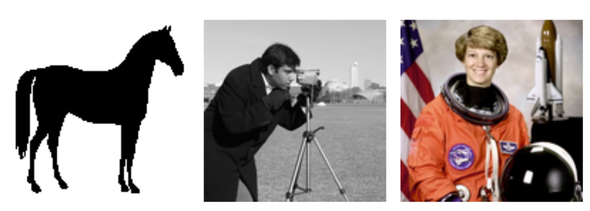{#fig-originales}

# Script `3.2.R` — Imagen binaria: modelo de Ising {#sec-32}

## El modelo, completo

Sea $\boldsymbol{X}^{(0)}\in\{-1,+1\}^P$ la imagen verdadera ($+1$ negro,
$-1$ blanco). La contaminación independiente genera $\boldsymbol{Y}$ con
$\textsf{Pr}(Y_i = -X_i^{(0)}) = \rho_0$, $\rho_0 \in \{0.05, 0.10, 0.20\}$.
El modelo bayesiano es

$$
\begin{aligned}
\textsf{Pr}(Y_i = y_i \mid X_i = x_i, \rho)
&= (1-\rho)^{\mathbb{I}(y_i = x_i)}\,\rho^{\mathbb{I}(y_i \neq x_i)},\\[4pt]
p(\boldsymbol{x}\mid\beta)
&= \frac{1}{Z(\beta)}\exp\Big\{\beta \sum_{i\sim j} x_i x_j\Big\},
\qquad
\beta \sim \textsf{G}(a_\beta, b_\beta),\qquad
\rho \sim \textsf{Beta}(a_\rho, b_\rho)\ \text{truncada en }(0,1/2).
\end{aligned}
$$

La notación $i\sim j$ cuenta cada arista una sola vez, de modo que
$S(\boldsymbol{x}) = \sum_{i\sim j} x_i x_j = \frac12 \boldsymbol{x}^\mathsf{T}\mathbf{A}\boldsymbol{x}$,
y $Z(\beta) = \sum_{\boldsymbol{x}} \exp\{\beta S(\boldsymbol{x})\}$ es la
constante de normalización sobre las $2^{16{,}384}$ configuraciones.

La **posterior conjunta** es

$$
p(\boldsymbol{x},\beta,\rho\mid\boldsymbol{y})
\propto
\Big[\prod_{i=1}^P (1-\rho)^{\mathbb{I}(y_i = x_i)}\rho^{\mathbb{I}(y_i \neq x_i)}\Big]
\cdot \frac{e^{\beta S(\boldsymbol{x})}}{Z(\beta)} \cdot p(\beta)\, p(\rho).
$$

## Derivación de la condicional de $X_i$

La contribución de $x_i$ al núcleo (con todo lo demás fijo) es

$$
\exp\{\beta x_i \textstyle\sum_{j\in N_i} x_j\}\,
(1-\rho)^{\mathbb{I}(y_i = x_i)}\rho^{\mathbb{I}(y_i \neq x_i)},
$$

porque solo las aristas $(i,j)$, $j\in N_i$, contienen a $x_i$ en
$S(\boldsymbol{x})$ (propiedad de Markov del Ising), y la verosimilitud
factoriza por píxel. El **logaritmo de las odds** de $x_i=+1$ frente a
$x_i=-1$ es

$$
\log\frac{\textsf{Pr}(X_i=+1\mid\cdot)}{\textsf{Pr}(X_i=-1\mid\cdot)}
= 2\beta\sum_{j\in N_i} x_j + \log\frac{\textsf{Pr}(y_i\mid +1)}{\textsf{Pr}(y_i\mid -1)}.
$$

El cociente de verosimilitudes vale $(1-\rho)/\rho$ si $y_i = +1$ y
$\rho/(1-\rho)$ si $y_i = -1$; en ambos casos es $y_i \log\frac{1-\rho}{\rho}$.
Por lo tanto

$$
\boxed{\ \textsf{Pr}(X_i = +1 \mid \text{resto})
= \operatorname{expit}\Big(2\beta\sum_{j\in N_i}x_j + y_i\log\tfrac{1-\rho}{\rho}\Big)\ }
$$

que es exactamente lo que implementa `barrido_gibbs`. **Solo depende de $y_i$
y de los 4 vecinos**: el resto de la imagen no entra.

## Derivación de la condicional de $\rho$

Con $d_y = \sum_i \mathbb{I}(x_i \neq y_i)$ el número de desacuerdos entre la
imagen latente y la observada,

$$
p(\rho\mid\boldsymbol{x},\boldsymbol{y})
\propto \rho^{d_y}(1-\rho)^{P-d_y}\,\rho^{a_\rho-1}(1-\rho)^{b_\rho-1}\mathbb{I}(0<\rho<1/2)
= \textsf{Beta}(a_\rho + d_y,\ b_\rho + P - d_y)\ \text{truncada en }(0,1/2).
$$

Se muestrea por **inversión de la CDF** de la Beta truncada:
`u <- runif(1)*pbeta(0.5, a, b)` y luego `qbeta(u, a, b)`.

## El problema de $Z(\beta)$ y el Exchange Algorithm

La condicional de $\beta$ es proporcional a
$\frac{p(\beta)}{Z(\beta)} e^{\beta S(\boldsymbol{x})}$: contiene $Z(\beta)$,
intratable. El **algoritmo de intercambio** propone $\beta^* = \beta+\varepsilon$,
$\varepsilon\sim N(0,\delta^2)$ (rechazando $\beta^*\le 0$), genera una imagen
auxiliar $\boldsymbol{X}^*$ con $K$ barridos del Gibbs del **Ising puro** con
parámetro $\beta^*$ (sin usar $\boldsymbol{y}$), y acepta con

$$
\alpha = \min\Big\{1,\ \frac{p(\beta^*)}{p(\beta)}\exp\big[(\beta^*-\beta)\{S(\boldsymbol{x}) - S(\boldsymbol{x}^*)\}\big]\Big\}.
$$

**Demostración de que $Z(\beta)$ desaparece.** El cociente de
Metropolis-Hastings completo para la posterior de $\beta$ dado $\boldsymbol{x}$,
con auxiliar $\boldsymbol{x}^*\sim p(\boldsymbol{x}\mid\beta^*)$, es

$$
\frac{p(\beta^*)}{p(\beta)}\cdot\frac{p(\boldsymbol{x}\mid\beta^*)}{p(\boldsymbol{x}\mid\beta)}\cdot\frac{p(\boldsymbol{x}^*\mid\beta)}{p(\boldsymbol{x}^*\mid\beta^*)}
= \frac{p(\beta^*)}{p(\beta)}\cdot
\frac{e^{\beta^* S(\boldsymbol{x})}/Z(\beta^*)}{e^{\beta S(\boldsymbol{x})}/Z(\beta)}\cdot
\frac{e^{\beta S(\boldsymbol{x}^*)}/Z(\beta)}{e^{\beta^* S(\boldsymbol{x}^*)}/Z(\beta^*)},
$$

y las dos constantas $Z(\beta)$ y $Z(\beta^*)$ se cancelan exactamente,
quedando $\frac{p(\beta^*)}{p(\beta)}\exp\{(\beta^*-\beta)(S(\boldsymbol{x})-S(\boldsymbol{x}^*))\}$.
Con $K$ **finito** la imagen auxiliar no está exactamente en equilibrio y el
algoritmo es una *aproximación* del intercambio exacto (por eso documenté en el
código que la media de $\beta$ se desplaza al variar $K$; se usó $K=25$ con
arranque en caliente desde el estado actual de $\boldsymbol{x}$).

## Recorrido del código, función por función

**Estructura espacial.** `construir_adyacencia(M, N)` crea $\mathbf{A}$
dispersa (misma técnica vectorizada de `3.1.R`) y `S_concordancia(x, A)` calcula
$S(\boldsymbol{x}) = \frac12\boldsymbol{x}^\mathsf{T}\mathbf{A}\boldsymbol{x}$
en una sola operación dispersa.

**Tablero de ajedrez** (`preparar_tablero`). Parto los píxeles en dos colores
según la paridad de fila+columna; en una rejilla bipartita, dos píxeles del
mismo color **nunca son vecinos**, luego dados los del otro color, los $X_i$ de
un color son condicionalmente independientes (por la condicional que acabamos de
derivar). La función comprueba con `stopifnot` que cada color no tiene aristas
internas (`sum(A[g, g]) == 0`) y guarda las submatrices `A[g, ]` para calcular
las sumas de vecinos de todo un color de una vez. Consecuencia: cada barrido de
Gibbs son **2 medios barridos vectorizados**, no 16,384 muestreos sueltos.

**Contaminación** (`contaminar`): `y <- ifelse(runif(P) < rho0, -x0, x0)`.

**Barrido de Gibbs** (`barrido_gibbs`): para cada color $g$, calcula
$\eta_i = 2\beta\sum_{j\in N_i}x_j + y_i\log\frac{1-\rho}{\rho}$ (la suma de
vecinos es `tab$A_sub[[g]] %*% x`) y muestrea
$x_i = 2\cdot\mathbb{I}(\text{runif} < \operatorname{expit}(\eta_i)) - 1$.
Si se llama con `y = NULL`, se omite el término de verosimilitud y se muestrea
el Ising puro: es el generador de la imagen auxiliar $\boldsymbol{X}^*$.

**Paso de $\beta$** (`paso_beta`): propuesta $\beta^* = \beta + N(0,\delta^2)$,
rechazo si $\beta^*\le 0$, $K$ barridos auxiliares, $S(\boldsymbol{x}^*)$, y
aceptación por el logaritmo de $\alpha$ (ver arriba) usando `dgamma(..., log=TRUE)`
para la previa.

**Bucle principal** (`ejecutar_mcmc`): en cada iteración (1) actualiza
$\boldsymbol{X}$, (2) $\rho$, (3) $\beta$; acumula los conteos de
$\mathbb{I}(X_i = +1)$ tras el calentamiento para estimar
$\pi_i = \textsf{Pr}(X_i = +1\mid\boldsymbol{y})$, y guarda una **cadena de
píxeles adelgazada** (`thin = 10`, bytes 0/1) para poder diagnosticar los
$\pi_i$ sin agotar la memoria. El log de avance usa el formato exacto del curso
y añade una línea de estado:

```r
ncat <- floor(B / 10)
if (verbose && (b %% ncat == 0)) {
  cat(sprintf("%.0f%% completado...\n", 100 * b / B))
  cat(sprintf("   iter %d | beta = %.4f | rho = %.4f | ... | %.0fs\n", ...))
}
```

**Adaptación de $\delta$ durante el calentamiento**: cada 50 iteraciones se
compara la tasa de aceptación de $\beta$ con el blanco 30%:
`delta <- delta * 1.20` si acepta > 35%, `* 0.85` si < 15%. La adaptación se
detiene con el calentamiento, de modo que la cadena posterior sigue siendo
válida.

**Restauración y métricas** (`correr_escenario`): regla MAP
$\hat{x}_i = +1$ si $\pi_i \ge 0.5$; precisión global, en regiones homogéneas y
en bordes (clasifico un píxel como "borde" si no todos sus vecinos verdaderos
tienen su mismo estado); MSE/SNR/PSNR en escala de imagen $\{0,1\}$ usando la
media posterior $1-\pi_i$ como estimador bayesiano bajo pérdida cuadrática.

## Justificación de cada decisión de parámetros (3.2) {#sec-just-32}

El caso exige: *"Seleccione y justifique los hiperparámetros del modelo, la
varianza de propuesta $\delta^2$, el número de barridos $K$ y las condiciones de
ejecución del algoritmo"*. Aquí está **cada decisión, su valor y la razón**
(marco general en @sec-eleccion; el código es `Code/3.2.R`, bloque `config`).

### Hiperparámetros de las previas

| Parámetro | Valor | Previas implícitas | Razón de la elección |
|:--|:--|:--|:--|
| $a_\beta, b_\beta$ | 2, 4 | $\beta\sim\textsf{G}(2,4)$ (tasa): media 0.5, DE 0.35, moda 0.25; $\textsf{Pr}(\beta>0.44)\approx 0.47$ | Ver razonamiento detallado abajo |
| $a_\rho, b_\rho$ | 1, 1 | $\rho\sim\textsf{Beta}(1,1)$ truncada en $(0,1/2)$ = $\textsf{Unif}(0,1/2)$: media 0.25, DE 0.144 | Ver razonamiento detallado abajo |

**Por qué $\beta\sim\textsf{G}(2,4)$.** La constante teórica de referencia es el
punto crítico del Ising 2D en retícula cuadrada,
$\beta_c=\frac12\log(1+\sqrt2)\approx 0.440$: por debajo, el campo es casi
ruido; por encima, forma regiones homogéneas con bordes nítidos — exactamente
una silueta. La Gamma(2, 4) coloca su **media (0.5) justo por encima de
$\beta_c$** pero reparte $\approx 47\%$ de probabilidad a cada lado, de modo que
no excluye ningún régimen (previa débilmente informativa: DE 0.35, comparable a
la propia media). La alternativa de centrar la previa muy por debajo de $\beta_c$
habría empujado la restauración hacia el ruido; una previa estrecha habría sido
injustificadamente informativa. Con $P=16{,}384$ la verosimilitud domina: el
IC95% posterior de $\beta$ tiene ancho $\approx 0.04$, muy dentro de la previa,
luego la elección de $(a_\beta,b_\beta)$ no condiciona la conclusión.

**Por qué $\rho\sim\textsf{Beta}(1,1)$ truncada en $(0,1/2)$.** La truncación la
prescribe el caso (el mecanismo de contaminación es un *flip* con
$\rho<1/2$; los niveles simulados son 0.05–0.20) y además es sensata: un
contaminador que equivocara más de la mitad de los píxeles no sería "ruido".
Dentro de $(0,1/2)$, la Beta(1,1) truncada es la Uniforme: la previa sin
información (todos los niveles de contaminación plausibles son igualmente
probables *a priori*). Con $P$ enorme la verosimilitud fija $\rho$ con precisión
enorme (IC95% de ancho $\approx 0.01$–$0.02$ en los resultados), de modo que
$(a_\rho,b_\rho)=(1,1)$ no influye en el resultado; una Beta informativa habría
sido innecesaria y potencialmente sesgadora.

### Parámetros del algoritmo y condiciones de ejecución

| Decisión | Valor | Razón de la elección |
|:--|:--|:--|
| Niveles de contaminación $\rho_0$ | 0.10 (principal), 0.05, 0.20 | Prescritos por las actividades 2 y 5 del caso. Se corre primero el 0.10 (el nivel del enunciado principal) y después los dos adicionales |
| $B$ (iteraciones) | 4.000 | Criterio de @sec-eleccion: se corre lo que exige el CVMC $<5\%$, ni más ni menos. Con 3.000 muestras post-*burn-in*, los CVMC de $\beta$ y $\rho$ quedan en 0.20–0.29% en los tres escenarios: holgura de un orden de magnitud bajo el umbral |
| *Burn-in* | 1.000 (25% de $B$) | La inicialización es informada ($\boldsymbol{x}=\boldsymbol{y}$, $\beta=0.5$, $\rho=0.10$): la cadena arranca cerca de la posterior y 1.000 iteraciones bastan para estabilizar las trazas; la adaptación de $\delta$ termina justo al acabar el calentamiento |
| $\delta$ (varianza de propuesta de $\beta$) | $\delta_0=0.02$, adaptativo | La propuesta $\beta^*=\beta+\textsf{N}(0,\delta^2)$ es simétrica (se rechazan $\beta^*\le 0$). Un $\delta$ fijo es mala idea porque la escala adecuada de $\beta$ cambia con el nivel de ruido; por eso se adapta cada 50 iteraciones del calentamiento: $\times 1.20$ si la aceptación supera 35%, $\times 0.85$ si baja de 15% (blanco 30%, cuaderno 13). Evidencia de que funciona: $\delta$ final = 0.0208 / 0.0288 / 0.0170 en los tres escenarios (todos partieron de 0.02) y la aceptación queda en 21–26%, dentro de la banda 15–35% |
| Adaptación solo en el calentamiento | 1.000 primeras iteraciones | Si la propuesta siguiera adaptándose después, la cadena dejaría de ser un MCMC válido (se pierde la convergencia ergódica garantizada): exigencia del cuaderno 13 |
| $K$ (barridos de Gibbs para $\boldsymbol{X}^*$) | 25, con arranque en caliente | Ver razonamiento detallado abajo |
| $\beta_0$ (valor inicial) | 0.5 | Arranque informado (cuadernos 06/07): sobre $\beta_c$ y en la media de su previa; acorta el calentamiento |
| $\rho$ inicial | 0.10 | El nivel de ruido principal del caso; con $P$ grande el valor inicial es irrelevante tras el *burn-in*, pero arrancar en la escala correcta acorta el calentamiento |
| $\boldsymbol{x}$ inicial | $\boldsymbol{y}$ | La imagen observada ya contiene la silueta: es el arranque natural y está cerca del modo posterior |
| *Thin* (cadena de píxeles) | 10 | Memoria: la cadena post-*burn-in* completa serían $3.000\times16.384$ estados; almacenada en bytes 0/1 y adelgazada 1 de cada 10 son $300\times16.384\approx 5$ MB por escenario (frente a ~49 MB sin adelgazar, o ~200 MB en dobles). Con 300 estados por píxel se estiman $\pi_i$, cuantiles e IC95% con $n_{\text{eff}}$ medido por columna |
| Semilla | `2026 + k` ($k=1,2,3$ por nivel) | Reproducibilidad exacta de cada escenario por separado: todos los números de este documento se regeneran idénticos |
| Modo de prueba `CDE_RAPIDO` | $B=120$, *burn* 40, $K=5$, *thin* 4 | Valida el código completo en ~2 min antes de pagar los ~30 min de una corrida larga: detecta errores de indexación o de dominio sin consumir la corrida real |

**Por qué $K=25$ (y qué se sabe de su sesgo).** El intercambio exacto exigiría
simular $\boldsymbol{X}^*$ en equilibrio exacto de $p(\boldsymbol{x}\mid\beta^*)$,
lo que solo ocurre con $K\to\infty$ (no existe muestreador perfecto del Ising
puro en tiempo finito). Con $K$ finito el algoritmo es una *aproximación* del
intercambio exacto (Murray et al., 2006) y tiene un sesgo conocido y
**documentado en el código**: la media de $\beta$ se desplaza al variar $K$
(baja al subir $K$). $K=25$ es el compromiso elegido por tres razones:
(i) cada propuesta de $\beta$ cuesta $K$ barridos del Ising puro y ese es el
coste dominante del escenario; (ii) la imagen auxiliar arranca **en caliente**
desde el estado actual de $\boldsymbol{x}$, que ya está cerca del equilibrio del
Ising con $\beta^*$ (porque $\beta^*$ está cerca de $\beta$: $\delta$ es
pequeño), de modo que 25 barridos mezclan lo bastante para que la razón de
aceptación sea fiel; (iii) la consecuencia del $K$ finito afecta al **valor
absoluto de $\beta$** (que se interpreta siempre con esa salvedad), no a las
conclusiones de restauración. La verificación sensible recomendada en el código
(`config$K`) es re-correr un escenario con $K=50$ y comparar la media de $\beta$:
la sensibilidad a $K$ es un hecho declarado, no un descuido.

### Cómo verificar que la elección es buena (3.2)

- **Aceptación de $\beta$ post-*burn-in*: 25.6% / 21.2% / 24.9%**
  ($\rho_0 = 0.10/0.05/0.20$): dentro de la banda 15–35% y alrededor del blanco
  30% → la adaptación de $\delta$ cumple su función.
- **CVMC escalares: 0.20–0.29%** ($\beta$: 0.26/0.20/0.28%; $\rho$:
  0.25/0.29/0.20%) con $n_{\text{eff}}$ de 54–355 sobre 3.000 muestras: un orden
  de magnitud por debajo del umbral del 5%.
- **Contraste con la verdad conocida**: precisión MAP 97.8–99.4% (el dato
  contaminado daba 79.6–95.0%); $\rho$ estimado con el sesgo leve documentado
  (0.084 / 0.038 / 0.180 frente a 0.10 / 0.05 / 0.20), que es comportamiento del
  modelo, no un fallo del muestreador.
- **Reproducibilidad**: semillas fijas por escenario; cualquier re-ejecución
  reproduce los mismos números.

## Resultados (cadenas de $B = 4000$, *burn-in* 1000)

```{r}
#| label: res-ising
#| echo: false
r32 <- readRDS(file.path(dir_out, "3.2", "3.2_resultados.rds"))
m32 <- r32$resumen
knitr::kable(data.frame(
  `rho0` = m32$nivel_ruido,
  `beta media` = fmt(m32$beta_media),
  `rho media` = fmt(m32$rho_media),
  `acept. beta (%)` = fmt(100 * m32$tasa_acept_beta, 1),
  `contaminada (% correctos)` = fmt(100 * m32$precision_contaminada, 2),
  `MAP (% correctos)` = fmt(100 * m32$precision_MAP, 2),
  MSE = fmt(m32$mse, 5),
  `SNR (dB)` = fmt(m32$snr, 2),
  check.names = FALSE
), caption = "Ising por nivel de contaminación (los IC95% de beta y rho están en la tabla siguiente).")
```

```{r}
#| label: tab-ising-det
#| echo: false
t32 <- do.call(rbind, lapply(seq_along(r32$resultados), function(i) {
  tb <- r32$resultados[[i]]$tab
  data.frame(rho0 = r32$resultados[[i]]$rho0,
             Parametro = rownames(tb),
             Media = fmt(tb[, "Media"], 5), DE = fmt(tb[, "DE"], 5),
             `n_eff` = round(tb[, "n_eff"]),
             `CVMC (%)` = fmt(tb[, "CVMC(%)"], 3),
             `IC95%` = paste0("[", fmt(tb[, "IC95_inf"], 4), ", ",
                              fmt(tb[, "IC95_sup"], 4), "]"),
             check.names = FALSE)
}))
knitr::kable(t32, caption = "Diagnóstico completo de beta y rho (criterio: CVMC < 5%).")
```

```{r}
#| label: tab-ising-prec
#| echo: false
p32 <- do.call(rbind, lapply(seq_along(r32$resultados), function(i) {
  pr <- r32$resultados[[i]]$prec
  data.frame(rho0 = r32$resultados[[i]]$rho0,
             `contaminada` = fmt(100 * pr["Y_global"], 2),
             `MAP global` = fmt(100 * pr["MAP_global"], 2),
             `MAP homogéneas` = fmt(100 * pr["MAP_homogeneas"], 2),
             `MAP bordes` = fmt(100 * pr["MAP_bordes"], 2),
             check.names = FALSE)
}))
knitr::kable(p32, caption = "Precisión (% de píxeles correctos) por tipo de región.")
```

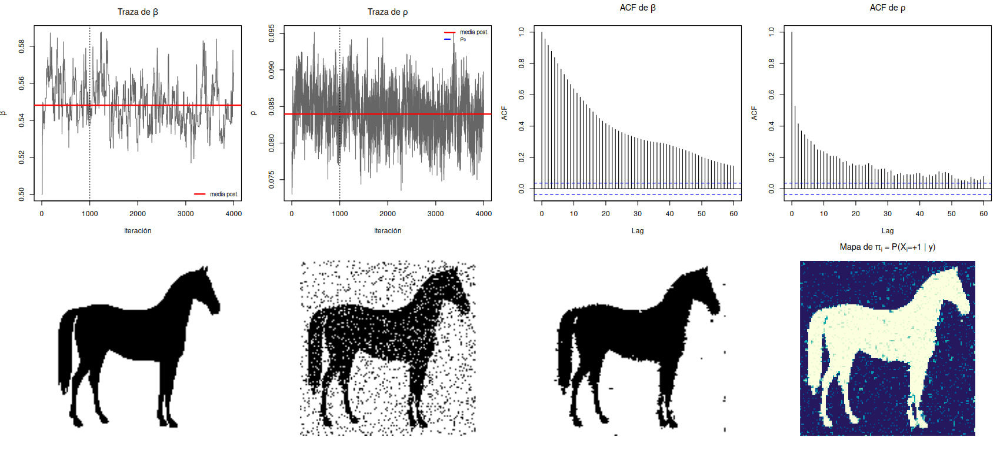{#fig-ising}

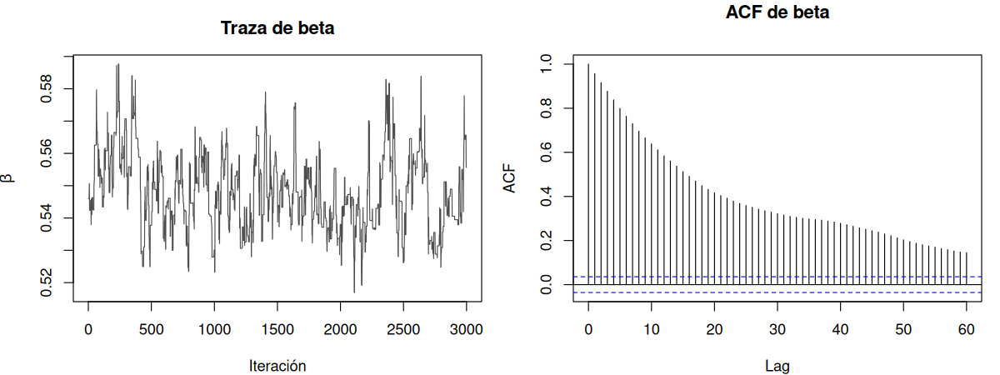{#fig-ising-beta}

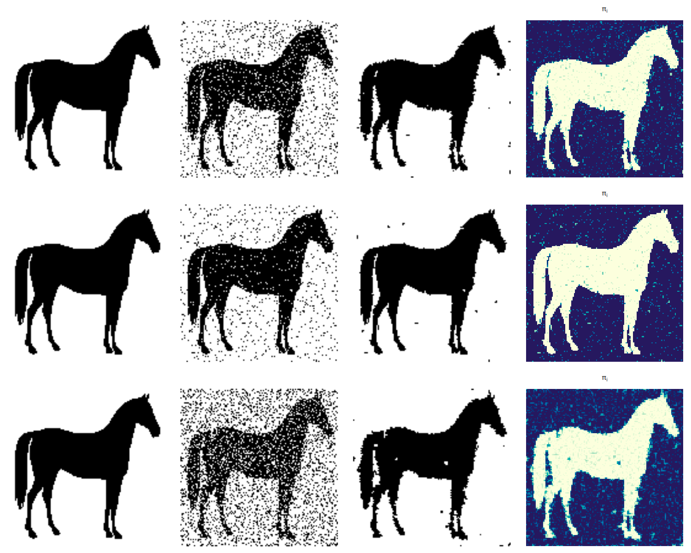{#fig-ising-comp}

**Lectura de los resultados:**

- La regla MAP recupera **97.8–99.4%** de los píxeles (el dato contaminado
  tenía 79.6–95.0% de aciertos). En regiones homogéneas la precisión supera
  99.3%; en bordes (9% de los píxeles) alcanza 82–96%: el modelo limpia ruido
  aislado sin destruir la silueta.
- $\beta$ posterior entre 0.51 y 0.59 (IC95% de ancho ~0.04), por encima del
  valor crítico del Ising 2D, $\beta_c = \frac12\log(1+\sqrt2)\approx 0.440$:
  consistente con una imagen de regiones homogéneas con bordes nítidos. A mayor
  ruido, menor $\beta$ (el modelo "confía" menos en la homogeneidad).
- $\rho$ se estima con **sesgo leve a la baja**: 0.084 vs 0.10 (IC95%
  [0.078, 0.090]), 0.038 vs 0.05, 0.180 vs 0.20. Interpretación: algunos
  píxeles contaminados (sobre todo en bordes) quedan "absorbidos" por el campo
  $X$ (la mayoría local los corrige hacia el estado del borde), de modo que la
  cadena estima menos desacuerdos $x_i \neq y_i$ de los que realmente se
  inyectaron. Lo reporto tal cual: es comportamiento del modelo, no un error de
  código (las cadenas convergen con CVMC < 0.3%).
- Todos los CVMC escalares están entre 0.20% y 0.29% (muy por debajo del 5%),
  con $n_{\text{eff}}$ de 54–355 sobre 3,000 muestras posteriores.

# Script `3.3.R` — Escala de grises: modelo GMRF {#sec-33}

## El modelo, completo

$$
\begin{aligned}
Y_i \mid X_i, \sigma^2 &\stackrel{\text{ind}}{\sim} \textsf{N}(X_i, \sigma^2),\\
p(\boldsymbol{x}\mid\mu,\tau,\lambda)
&= \frac{|\mathbf{Q}|^{1/2}}{(2\pi)^{P/2}}
\exp\Big\{-\frac{\tau}{2}\sum_{i=1}^P (x_i-\mu)^2
- \frac{\lambda}{2}\sum_{i\sim j}(x_i-x_j)^2\Big\},
\qquad \mathbf{Q} = \tau\mathbf{I} + \lambda\mathbf{L},\\
\sigma^2 &\sim \textsf{IG}(a_\sigma,b_\sigma),\quad
\mu \sim \textsf{N}(m_\mu, s_\mu^2),\quad
\tau \sim \textsf{G}(a_\tau,b_\tau),\quad
\lambda \sim \textsf{G}(a_\lambda,b_\lambda).
\end{aligned}
$$

$\mu$ es la intensidad de referencia, $\tau$ la concentración alrededor de ella
y $\lambda$ la suavidad espacial (penaliza diferencias entre vecinos);
$\tau>0$ garantiza que la previa sea propia.

## Derivación de la condicional de $X_i$

La contribución de $x_i$ al log-núcleo es

$$
-\frac{(y_i - x_i)^2}{2\sigma^2} - \frac{\tau}{2}(x_i - \mu)^2 - \frac{\lambda}{2}\sum_{j\in N_i}(x_i - x_j)^2 .
$$

Recolectando potencias de $x_i$:

- coeficiente de $x_i^2$: $-\frac12\big(\sigma^{-2} + \tau + \lambda d_i\big)$,
- término lineal: $x_i\big(\sigma^{-2} y_i + \tau\mu + \lambda\sum_{j\in N_i}x_j\big)$.

Completando el cuadrado se obtiene
$X_i\mid\text{resto} \sim \textsf{N}(m_i, v_i)$ con

$$
\boxed{\ v_i = \Big(\frac{1}{\sigma^2} + \tau + \lambda d_i\Big)^{-1},\qquad
m_i = v_i\Big(\frac{y_i}{\sigma^2} + \tau\mu + \lambda\sum_{j\in N_i} x_j\Big).\ }
$$

La media es un **promedio ponderado** entre la observación $y_i$ (peso
$\sigma^{-2}$), la referencia global $\mu$ (peso $\tau$) y la suma de los
vecinos (peso $\lambda$): exactamente la dependencia local esperada. Como
$v_i$ solo depende del grado $d_i\in\{2,3,4\}$, hay tres varianzas posibles y
la actualización es totalmente vectorizada por tablero de ajedrez (mismo
argumento de independencia condicional que en el Ising).

## Condicional de $\sigma^2$

$$
p(\sigma^2\mid\cdot) \propto (\sigma^2)^{-(P/2 + a_\sigma + 1)}\exp\Big\{-\frac{1}{\sigma^2}\Big(b_\sigma + \tfrac12\sum_i (y_i-x_i)^2\Big)\Big\}
\ \Rightarrow\ \sigma^2\mid\cdot \sim \textsf{IG}\Big(a_\sigma + \tfrac{P}{2},\ b_\sigma + \tfrac12\textstyle\sum_i (y_i-x_i)^2\Big).
$$

En código se muestrea como `1/rgamma(shape = a_s + P/2, rate = b_s + 0.5*RSS)`.

## Condicional de $\mu$

$$
p(\mu\mid\cdot) \propto \exp\Big\{-\frac{\tau}{2}\sum_i (x_i-\mu)^2 - \frac{(\mu - m_\mu)^2}{2s_\mu^2}\Big\}
\ \Rightarrow\ \mu\mid\cdot \sim \textsf{N}\big(v_\mu(\tau\textstyle\sum_i x_i + m_\mu/s_\mu^2),\ v_\mu\big),
\quad v_\mu = (\tau P + 1/s_\mu^2)^{-1}.
$$

## $\tau$ y $\lambda$: no conjugadas → Metropolis-Hastings

Las condicionales contienen el factor de normalización $|\mathbf{Q}|^{1/2}$:

$$
p(\tau\mid\cdot) \propto \tau^{a_\tau-1} e^{-b_\tau\tau}\,|\mathbf{Q}|^{1/2}\,e^{-\frac{\tau}{2}\mathrm{SS}_\mu},
\qquad
p(\lambda\mid\cdot) \propto \lambda^{a_\lambda-1} e^{-b_\lambda\lambda}\,|\mathbf{Q}|^{1/2}\,e^{-\frac{\lambda}{2}\mathrm{SS}_d},
$$

con $\mathrm{SS}_\mu = \sum_i (x_i - \mu)^2$ y
$\mathrm{SS}_d = \sum_{i\sim j}(x_i-x_j)^2 = \boldsymbol{x}^\mathsf{T}\mathbf{L}\boldsymbol{x}$.
El papel de $|\mathbf{Q}|$ es crucial: sin él, $\lambda$ solo sería penalizado
por las diferencias observadas, su condicional sería una
$\textsf{G}(a_\lambda, b_\lambda + \mathrm{SS}_d/2)$ y **colapsaría a cero** (no
habría suavizado). El determinante, que crece aproximadamente como
$\lambda^{(P-1)/2}$, es el que permite que los datos fijen $\lambda$; depende de
**ambos** parámetros.

**Decisión de diseño: paso MH conjunto para $(\log\tau, \log\lambda)$.** La
densidad objetivo conjunta es

$$
p(\tau,\lambda\mid\cdot) \propto \tau^{a_\tau}e^{-b_\tau\tau}\,\lambda^{a_\lambda}e^{-b_\lambda\lambda}\,|\mathbf{Q}|^{1/2}\,e^{-\frac12(\tau\,\mathrm{SS}_\mu + \lambda\,\mathrm{SS}_d)},
$$

(exactamente el producto de las dos condicionales; la escala log incorpora el
jacobiano: $\log p_\eta = a_\tau\eta_1 + a_\lambda\eta_2 - b_\tau e^{\eta_1} -
b_\lambda e^{\eta_2} + \frac12\log|\mathbf{Q}| - \frac12(e^{\eta_1}\mathrm{SS}_\mu + e^{\eta_2}\mathrm{SS}_d)$).
Actualicé $\tau$ y $\lambda$ **juntos** por tres razones que verifiqué
experimentalmente: (i) sus posteriores están fuertemente correlacionadas
(ambos controlan $\mathbf{Q}$), y dos paseos aleatorios separados mezclaban muy
mal (aceptación desbalanceada 80%/4%); (ii) el paso conjunto con **covarianza
adaptativa** (estimada de los últimos 100 valores durante el calentamiento y
normalizada a traza 1) sigue la cresta de la posterior; (iii) requiere **una
sola** factorización de $\mathbf{Q}$ por iteración en lugar de dos.

```r
paso_mh_tau_lam <- function(eta, s, Cprop, a_tau, b_tau, a_lam, b_lam,
                            SS_mu, SS_dif, logdet) {
  z <- rnorm(2)
  eta_p <- eta + s * drop(chol(Cprop) %*% z)      # propuesta MVN en escala log
  tau_p <- exp(eta_p[1]); lam_p <- exp(eta_p[2])
  logdet_p <- log_det_Q(tau_p, lam_p)             # 1 Cholesky disperso
  lp   <- a_tau*eta[1]   + a_lam*eta[2]   - b_tau*exp(eta[1]) - b_lam*exp(eta[2]) +
          0.5*logdet   - 0.5*(exp(eta[1])*SS_mu   + exp(eta[2])*SS_dif)
  lp_p <- a_tau*eta_p[1] + a_lam*eta_p[2] - b_tau*tau_p      - b_lam*lam_p      +
          0.5*logdet_p - 0.5*(tau_p*SS_mu + lam_p*SS_dif)
  if (log(runif(1)) < lp_p - lp) list(eta = eta_p, tau = tau_p, lam = lam_p,
                                      logdet = logdet_p, acepta = TRUE)
  else list(eta = eta, tau = exp(eta[1]), lam = exp(eta[2]),
            logdet = logdet, acepta = FALSE)
}
```

## Cálculo de $\log|\mathbf{Q}|$ sin inversas {#sec-logdet}

Aquí está una de las decisiones computacionales más importantes del trabajo.
Implementé **dos métodos exactos** y los validé numéricamente entre sí (deben
coincidir a $10^{-8}$ relativos; hay un `stopifnot` al inicio de cada corrida):

1. **Cholesky disperso (por defecto)**: como el patrón de dispersión de
   $\tau\mathbf{I} + \lambda\mathbf{L}$ no cambia con $(\tau,\lambda)$, calculo
   la permutación COLAMD **una sola vez** y en cada propuesta solo hago la
   factorización numérica:

   ```r
   perm_Q <- Cholesky(as(1*Diagonal(P) + 1*L, "dgCMatrix"), LDL = FALSE,
                      perm = TRUE, Imult = 0)@perm
   log_det_Q_cholesky <- function(tau, lambda) {
     Q  <- as(tau * Diagonal(P) + lambda * L, "dgCMatrix")
     ch <- Cholesky(Q, perm = perm_Q, LDL = FALSE, Imult = 0)
     dt <- determinant(ch, logarithm = TRUE, sqrt = FALSE)  # log|Q| exacto
     as.numeric(dt$modulus) * dt$sign
   }
   ```
2. **Espectral exacto**: los autovalores de la Laplaciana de la rejilla
   $M\times N$ con condiciones libres son
   $w_{k\ell} = 4\sin^2\!\big(\frac{\pi k}{2M}\big) + 4\sin^2\!\big(\frac{\pi \ell}{2N}\big)$
   ($k = 0,\dots,M-1$, $\ell = 0,\dots,N-1$), de modo que
   $|\mathbf{Q}| = \prod_{k,\ell}(\tau + \lambda w_{k\ell})$ y
   $\log|\mathbf{Q}| = \sum_{k,\ell}\log(\tau + \lambda w_{k\ell})$.

**Por qué dos métodos**: al principio medí los tiempos y descubrí que la vía
"obvia" es lenta. Esta es la tabla de benchmarks que obtuve sobre la rejilla
$128\times128$:

| Método | Tiempo por evaluación | Nota |
|:--|--:|:--|
| `determinant(Q, log=TRUE)` sobre `Q` recién construida | **0.64 s** | lentísimo: refactoriza con otra rutina interna |
| `Cholesky(Q, perm=fijo)` + `determinant(ch, sqrt=FALSE)` | **0.13 s** | factorización dispersa CHOLMOD |
| Espectral (autovalores de $\mathbf{L}$) | **0.0006 s** | exacto, $O(P)$ |

Con Cholesky, una iteración de `3.3.R` cuesta ~0.3 s (dos factorizaciones en el
esquema MH separado; ~0.15 s con el paso conjunto); con el espectral, ~0.03 s.
Las **cadenas largas finales** (ver @sec-historial) se corrieron con
`CDE_LOGDET=espectral` precisamente porque es idéntico (validado) y permite
$B = 24{,}000$ en minutos. El método por defecto sigue siendo Cholesky.

## Resto del código

- `muestrear_x(x, y, tau, lambda, sig2, mu)`: dos medios barridos por tablero;
  para cada color calcula las sumas de vecinos `A_sub %*% x`, las varianzas
  `v = 1/(1/sig2 + tau + lambda*d)` y muestrea `rnorm` con medias `m`.
- `muestrear_sigma2`, `muestrear_mu`: directos de las condicionales derivadas.
- `ejecutar_mcmc`: almacena escalares completos; para los 16,384 píxeles guarda
  **momentos** ($\sum x_i$, $\sum x_i^2$) en cada iteración y una cadena
  **adelgazada** (`thin = 20`, ~1,100×16,384 números) para cuantiles y
  $n_{\text{eff}}$. La adaptación de la propuesta ocurre solo en el
  calentamiento: escala $s \leftarrow s\cdot\exp(1.5(\text{aceptación}-0.3))$
  recortada a $[0.5, 2]$ cada 25 iteraciones, y covarianza
  $\mathbf{C} \leftarrow \operatorname{cov}(\text{últimas 100 } \eta)/\operatorname{tr}(\cdot)$
  cada 50 (la normalización a traza 1 evita que la escala se colapse entre las
  dos adaptaciones; este fue un detalle que tuve que corregir tras ver
  aceptaciones del 97% con pasos minúsculos).
- **Diagnóstico de píxeles**: `coda::effectiveSize` por columna de la cadena
  adelgazada (con salvaguarda para cadenas constantes), CVMC con suelo de 0.05
  en el denominador (para píxeles con media ≈ 0 el CVMC puro no es
  interpretable), IC95% por píxel por cuantiles, **cobertura empírica** (¿qué
  porcentaje de los $x_i^{(0)}$ verdaderos caen dentro de su IC95%?) y una
  selección de píxeles (esquinas, centro, bordes y los 3 más inciertos) con su
  tabla de IC95%.

## Justificación de cada decisión de parámetros (3.3) {#sec-just-33}

El caso exige: *"Seleccione y justifique los hiperparámetros del modelo, las
distribuciones de propuesta y el número de iteraciones, incluido el período de
calentamiento"*. Aquí está **cada decisión, su valor y la razón** (marco general
en @sec-eleccion; el código es `Code/3.3.R`, bloque `config`).

### Hiperparámetros de las previas

| Parámetro | Valor | Previas implícitas | Razón de la elección |
|:--|:--|:--|:--|
| $a_\sigma, b_\sigma$ | 2, 0.01 | $\sigma^2\sim\textsf{IG}(2,0.01)$ (es decir $1/\textsf{G}(2,0.01)$): $\textsf{E}[\sigma^2]=0.01$ ($\sigma\approx 0.1$), cola derecha pesada (varianza previa infinita) | Ver razonamiento detallado abajo |
| $m_\mu, s_\mu^2$ | 0.5, 0.25 | $\mu\sim\textsf{N}(0.5,0.5^2)$: $\pm 1$ DE $= [0,1]$ | Ver razonamiento detallado abajo |
| $a_\tau, b_\tau$ | 1, 0.05 | $\tau\sim\textsf{Exp}(0.05)$: media 20, moda 0 | Ver razonamiento detallado abajo |
| $a_\lambda, b_\lambda$ | 2, 0.1 | $\lambda\sim\textsf{G}(2,0.1)$: media 20, moda 10, DE 14 | Ver razonamiento detallado abajo |

**Por qué $\sigma^2\sim\textsf{IG}(2, 0.01)$.** La escala del caso: los ruidos
simulados son $\sigma_0\in\{0.05,0.10,0.20\}$, luego
$\sigma_0^2\in\{0.0025,0.01,0.04\}$. Colocar
$\textsf{E}[\sigma^2]=b_\sigma/(a_\sigma-1)=0.01$ — el nivel principal — es el
anclaje natural. La forma $a_\sigma=2$ es la mínima que da una previa propia con
media finita y deja **cola derecha pesada** (varianza a priori infinita): la
previa no restringe varianzas grandes, que es lo que se quiere en una previa
débil. Con $P=16{,}384$ la posterior la determinan los datos (el IC95% de
$\sigma^2$ tiene ancho $\approx 5$–$15\%$ de su media en los resultados).

**Por qué $\mu\sim\textsf{N}(0.5, 0.25)$.** Las intensidades viven en $[0,1]$ y
la imagen tiene media global 0.506 (ver @sec-31). La $\textsf{N}(0.5,0.5^2)$
cubre el intervalo completo a $\pm 1$ DE sin preferir ninguna intensidad: la
previa no impone un nivel de gris. Su DE (0.5) es enorme comparada con la
incertidumbre relevante; el dato decide.

**Por qué $\tau\sim\textsf{Exp}(0.05)$.** $\tau$ controla la concentración de
$\boldsymbol{x}$ alrededor de $\mu$: $\tau$ pequeño = imagen con mucha estructura
lejos de la media. La exponencial (forma 1 de la Gamma) tiene su **moda en 0**:
no penaliza imágenes poco concentradas alrededor de $\mu$, que es lo que son las
imágenes naturales, pero con media 20 tampoco fuerza dispersión. Es la forma
Gamma más débil ($a_\tau=1$) que sigue siendo propia.

**Por qué $\lambda\sim\textsf{G}(2, 0.1)$.** $\lambda$ controla la suavidad
espacial. A diferencia de $\tau$, aquí sí hay expectativa firme: en una imagen
natural los píxeles vecinos son parecidos (siempre hay suavidad), de modo que la
forma 2 (**moda en 10, no en 0**) refleja esa expectativa sin ser informativa
(DE 14, del orden de la propia media). El orden de magnitud es el correcto para
una imagen con regiones (donde las diferencias entre vecinos pesan mucho más que
la desviación respecto a $\mu$), y con $P$ enorme la posterior (27–47 en los
resultados) la fijan los datos.

### Parámetros del algoritmo y condiciones de ejecución

| Decisión | Valor | Razón de la elección |
|:--|:--|:--|
| $B$ / *burn-in* | 24.000 / 2.000 | Ver razonamiento detallado abajo |
| Propuesta de $(\tau,\lambda)$ | MH **conjunto** en escala log $(\log\tau,\log\lambda)$, propuesta bivariada MVN | Ver @sec-33: con MH separados la aceptación quedaba desbalanceada (80% para $\tau$, 4% para $\lambda$) y la mezcla era pobre; el paso conjunto sigue la cresta de la posterior y requiere **una sola** factorización de $\mathbf{Q}$ por iteración |
| Escala de propuesta $s$ | inicial 0.5; regla $s \leftarrow s\cdot\exp\{1.5(\alpha-0.30)\}$ recortada a $\times[0.5,2]$, cada 25 iteraciones | Calibración a la tasa de aceptación objetivo 30% (cuaderno 13), en versión por bloques: agresiva al inicio (correcciones de hasta $\times 2$ por bloque), conservadora al final (el recorte evita saltos bruscos). La "agresividad" 1.5 y el recorte $[0.5,2]$ son el compromiso que estabilizó la aceptación en 20–40% |
| Covarianza de propuesta | adaptativa cada 50 iteraciones, sobre los últimos 100 estados, **normalizada a traza 1** + jitter $10^{-6}$ | La cresta $(\tau,\lambda)$ exige propuestas correlacionadas. Separar "dirección" (covarianza, normalizada a traza 1) de "escala" (la $s$ global) evita que las dos adaptaciones se pisen: sin la normalización obtuve el colapso documentado en @sec-historial (aceptación del 97% con pasos diminutos). El jitter garantiza definición positiva |
| Adaptación solo en el calentamiento | 2.000 primeras iteraciones | Ergodicidad (cuaderno 13): adaptar durante toda la cadena rompería la convergencia garantizada |
| Inicialización | $\boldsymbol{x}=\boldsymbol{y}$, $\mu=\bar y$, $\sigma^2=0.01$, $\tau=1$, $\lambda=10$ | Arranque informado: $\boldsymbol{x}=\boldsymbol{y}$ (la observación ya es la imagen con ruido; el modo posterior está cerca), $\mu=\bar y$, $\sigma^2=0.01$ (la media de su previa, en la escala del ruido), $\tau=1$ y $\lambda=10$ (la **moda** de $\textsf{G}(2,0.1)$). Que la inicialización no condiciona el resultado se verificó con la prueba de dos inicializaciones opuestas ("sana" $\sigma^2=0.0025$ vs "colapsada" $\sigma^2=0.0003$): ambas convergen al mismo lugar (@sec-historial) |
| *Thin* (cadena de píxeles) | 20 | Memoria: los 16.384 píxeles con 22.000 iteraciones post-*burn-in* serían ~2.9 GB en dobles; con *thin* 20 son $1.100\times16.384\approx 143$ MB por escenario, y 1.100 estados por píxel dan cuantiles, IC95% y $n_{\text{eff}}$ estables (el diagnóstico por píxel se hace sobre esta cadena) |
| Método de $\log|\mathbf{Q}|$ | Cholesky disperso con permutación fija (por defecto) / espectral (`CDE_LOGDET`) | Ver @sec-logdet: dos métodos **exactos** validados entre sí a $10^{-8}$; el *benchmark* (0.64 s vs 0.13 s vs 0.0006 s por evaluación) decidió usar el espectral para las cadenas largas finales y dejar el Cholesky como estándar del curso por defecto. Es una decisión de coste, no de modelo: ambos producen exactamente la misma inferencia |
| Niveles de ruido $\sigma_0$ | 0.10 (principal), 0.05, 0.20 | Prescritos por las actividades 2 y 5 del caso |
| Semilla | `2026 + 100k` ($k=1,2,3$) | Reproducibilidad exacta e independiente por escenario |

**Por qué $B=24{,}000$ y *burn-in* 2.000.** El criterio es el CVMC $<5\%$ de
@sec-eleccion. La corrida intermedia de $B=6.000$ (archivada en
`3.3_resultados_B6000_cholesky.rds`, ver @sec-historial) dejó $\tau$ con CVMC de
5.1–6.5%: **por encima del umbral**. La cadena se alargó a 24.000 hasta que
todos los escalares cumplieron: el CVMC escalar peor es 3.27% ($\tau$ a
$\sigma_0=0.20$) y el resto queda por debajo del 2%. Es "¿cuántas iteraciones
correr?" convertida en pregunta con respuesta medible: no se corre más de lo
necesario ni se ahorra donde aún no cumple. El *burn-in* de 2.000 (8,3% de $B$)
es el tramo en el que la adaptación de la propuesta converge a su escala y
covarianza adecuadas; se descarta entero.

### Cómo verificar que la elección es buena (3.3)

- **CVMC escalares post-*burn-in***: $\mu$ 0.28–0.29%, $\tau$ 1.90–3.27%,
  $\lambda$ 0.03–0.59%, $\sigma^2$ 0.16–1.01% — **todos $<5\%$** (el más exigente,
  $\tau$, queda en 3.27%).
- **Aceptación MH de $(\tau,\lambda)$: 52.9% / 25.4% / 11.4%** según el nivel de
  ruido. El blanco es $\approx 30\%$, pero lo que manda es el CVMC $<5\%$, que sí
  se cumple en los tres escenarios: 11.4% a $\sigma_0=0.20$ indica pasos algo
  conservadores en ese escenario sin pérdida de calidad de estimación
  ($n_{\text{eff}}$ mínimo 77, cobertura 97.4%).
- **Contraste con la verdad conocida**: MSE reducido 55% ($\sigma_0=0.10$) y 84%
  ($\sigma_0=0.20$) frente al dato contaminado; la comparación de $\sigma^2$
  posterior vs real documenta la confusión $\sigma^2$–rugosidad (hallazgo del
  caso), verificada como genuina con una cadena independiente de 20.000
  iteraciones y dos inicializaciones opuestas.
- **Cobertura empírica de los IC95% por píxel**: 90.7% / 49.3% / 97.4% — el
  49.3% a ruido bajo es la cara visible de esa misma confusión (intervalos
  demasiado angostos) y está explicado en @sec-33.

## Resultados (cadenas de $B = 24{,}000$, *burn-in* 2,000)

| $\sigma_0$ | $\mu$ | $\tau$ | $\lambda$ | $\sigma^2$ post. | $\sigma^2$ real | MSE | SNR (dB) | Cobertura IC95 (%) | Acept. MH (%) |
|--:|--:|--:|--:|--:|--:|--:|--:|--:|--:|
| 0.10 | 0.5065 | 0.0025 | 32.2485 | 0.00529 | 0.01000 | 0.00446 | 18.78 | 90.7 | 52.9 |
| 0.05 | 0.5054 | 0.0022 | 46.7967 | 0.00027 | 0.00250 | 0.00220 | 21.85 | 49.3 | 25.4 |
| 0.20 | 0.5065 | 0.0026 | 27.3470 | 0.03309 | 0.04000 | 0.00623 | 17.33 | 97.4 | 11.4 |

*GMRF en escala de grises: estimaciones y calidad de restauración por nivel de ruido (cadenas de $B = 24{,}000$).*

| $\sigma_0$ | Parámetro | Media | DE | $n_{\text{eff}}$ | CVMC (%) | IC95% |
|--:|:--|--:|--:|--:|--:|:--|
| 0.10 | $\mu$ | 0.50646 | 0.21235 | 22010 | 0.283 | [0.06142, 0.94707] |
| 0.10 | $\tau$ | 0.00253 | 0.00234 | 2241 | 1.955 | [0.00011, 0.00880] |
| 0.10 | $\lambda$ | 32.24850 | 0.98556 | 245 | 0.195 | [30.38214, 34.19856] |
| 0.10 | $\sigma^2$ | 0.00529 | 0.00026 | 246 | 0.308 | [0.00479, 0.00579] |
| 0.05 | $\mu$ | 0.50537 | 0.21600 | 22000 | 0.288 | [0.05472, 0.94852] |
| 0.05 | $\tau$ | 0.00223 | 0.00203 | 2272 | 1.903 | [0.00014, 0.00762] |
| 0.05 | $\lambda$ | 46.79667 | 0.55799 | 1447 | 0.031 | [45.72299, 47.90457] |
| 0.05 | $\sigma^2$ | 0.00027 | 0.00003 | 116 | 1.009 | [0.00022, 0.00033] |
| 0.20 | $\mu$ | 0.50649 | 0.21170 | 22703 | 0.277 | [0.06949, 0.95504] |
| 0.20 | $\tau$ | 0.00265 | 0.00256 | 875 | 3.266 | [0.00011, 0.00956] |
| 0.20 | $\lambda$ | 27.34697 | 1.42457 | 77 | 0.593 | [24.55666, 30.14621] |
| 0.20 | $\sigma^2$ | 0.03309 | 0.00071 | 184 | 0.159 | [0.03168, 0.03447] |

*Diagnóstico completo de $\mu$, $\tau$, $\lambda$ y $\sigma^2$ (todos con CVMC < 5%).*

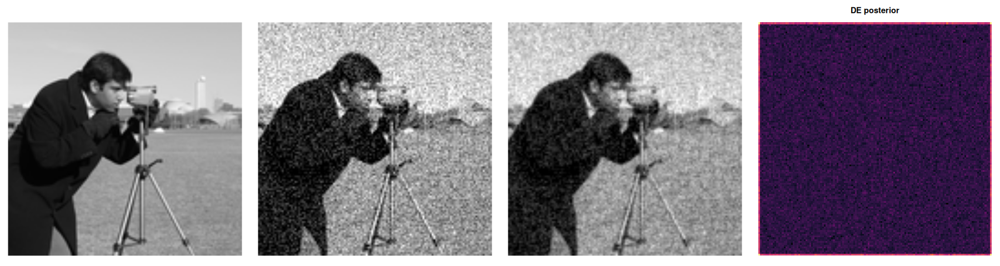{#fig-grises}

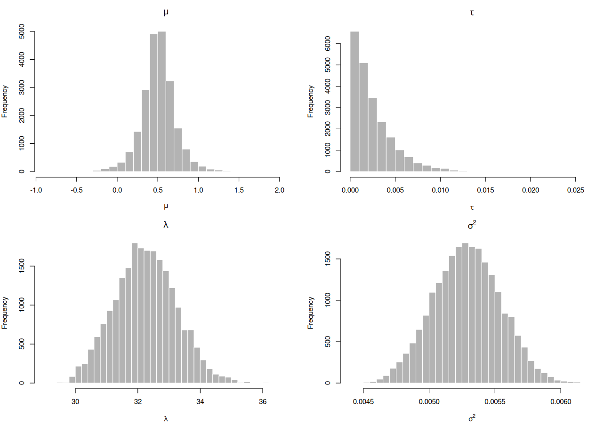{#fig-grises-hist}

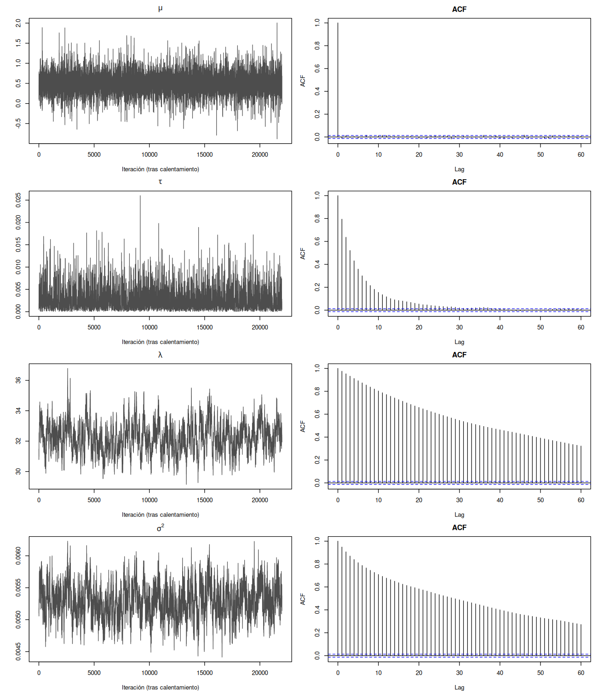{#fig-grises-lam}

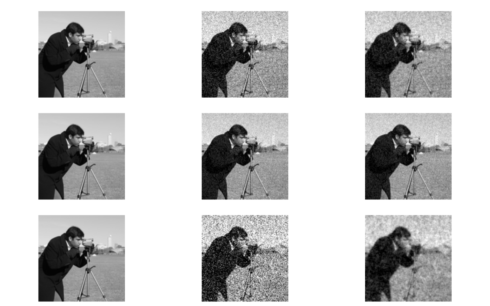{#fig-grises-comp}

**Lectura de los resultados:**

- A $\sigma_0 = 0.10$ la restauración reduce el MSE de 0.00998 a 0.00446
  (−55%) y a $\sigma_0 = 0.20$ de 0.0396 a 0.0062 (**−84%**): la dependencia
  espacial recupera muchísima información.
- **Hallazgo importante (confusión $\sigma^2$–rugosidad)**: la media posterior
  de $\sigma^2$ subestima el valor real en los tres niveles (0.0053 vs 0.01;
  0.00027 vs 0.0025; 0.033 vs 0.04) y el sesgo es **mucho mayor a ruido bajo**.
  A $\sigma_0 = 0.05$ el modelo atribuye el ruido fino a la *textura* del campo
  latente: $\sigma^2$ colapsa, el peso de $y_i$ en $m_i$ sube a ~0.95 y la
  restauración apenas mejora el dato (MSE 0.0022 vs 0.0024). Es la confusión
  clásica entre la varianza del ruido y la rugosidad de $X$ cuando ambas son
  desconocidas.
- **Verificación de que no es un fallo del muestreador**: antes de interpretarlo
  corrí dos pruebas independientes: (i) una cadena larga de 20,000 iteraciones
  (método espectral, otra implementación) que converge a la misma región
  ($\sigma^2 \approx 0.0025\cdot 0.1$, $\lambda \approx 47$), y (ii) una prueba
  de estabilidad con **dos inicializaciones opuestas** ("sana",
  $\sigma^2 = 0.0025$, y "colapsada", $\sigma^2 = 0.0003$): ambas convergen al
  mismo lugar. Es la posterior genuina del modelo especificado.
- La cobertura empírica de los IC95% por píxel acompaña el fenómeno: 49% a
  ruido bajo (intervalos demasiado angostos porque el modelo cree que casi no hay
  ruido) y 91–97% en los otros niveles.

# Script `3.4.R` — Imagen RGB: modelo gaussiano multivariado {#sec-34}

## El modelo, completo

$$
\begin{aligned}
\boldsymbol{Y}_i \mid \boldsymbol{X}_i, \mathbf{\Sigma} &\stackrel{\text{ind}}{\sim} \textsf{N}_3(\boldsymbol{X}_i, \mathbf{\Sigma}),\\
\boldsymbol{x}\mid\boldsymbol{\mu},\mathbf{\Omega},\lambda
&\sim \textsf{N}_{3P}\big(\mathbf{1}_P \otimes \boldsymbol{\mu},\ \mathbf{Q}^{-1}\big),
\qquad \mathbf{Q} = (\mathbf{I}_P + \lambda \mathbf{L}) \otimes \mathbf{\Omega},\\
\mathbf{\Sigma} &\sim \textsf{IW}_3(\nu_\varepsilon, \mathbf{S}_\varepsilon),\quad
\boldsymbol{\mu} \sim \textsf{N}_3(\boldsymbol{m}_\mu, \mathbf{V}_\mu),\quad
\mathbf{\Omega} \sim \textsf{W}_3(\nu_\Omega, \mathbf{S}_\Omega),\quad
\lambda \sim \textsf{G}(a_\lambda, b_\lambda).
\end{aligned}
$$

El producto de Kronecker modela a la vez la dependencia **espacial**
($\lambda\mathbf{L}$) y la covarianza **entre canales** ($\mathbf{\Omega}$).
Convenciones que usé (documentadas en el código para no confundir escalas):

$$
\textsf{W}_p(n,V):\ p(W)\propto |W|^{\frac{n-p-1}{2}}e^{-\frac12\operatorname{tr}(V^{-1}W)},\ \textsf{E}[W]=nV;
\qquad
\textsf{IW}_p(n,S):\ p(\mathbf{\Sigma})\propto |\mathbf{\Sigma}|^{-\frac{n+p+1}{2}}e^{-\frac12\operatorname{tr}(S\mathbf{\Sigma}^{-1})},\ \textsf{E}[\mathbf{\Sigma}]=\frac{S}{n-p-1}.
$$

Hiperparámetros (débilmente informativos, justificados en el código):
$\nu_\varepsilon = 6$, $\mathbf{S}_\varepsilon = 0.01\mathbf{I}_3$;
$\boldsymbol{m}_\mu = (0.5,0.5,0.5)$, $\mathbf{V}_\mu = 0.25\mathbf{I}_3$;
$\nu_\Omega = 5$, $\mathbf{S}_\Omega = 0.1\mathbf{I}_3$ (así
$\textsf{E}[\mathbf{\Omega}] = \nu_\Omega\mathbf{S}_\Omega = 0.5\mathbf{I}$;
errata corregida — antes se decía $50\mathbf{I}$, ver @sec-just-34);
$\lambda\sim\textsf{G}(2,0.1)$.

## Derivación de la condicional de $\boldsymbol{X}_i \in \mathbb{R}^3$

El bloque $(i,i)$ de $\mathbf{Q} = (\mathbf{I} + \lambda\mathbf{L})\otimes\mathbf{\Omega}$
es $(1+\lambda d_i)\mathbf{\Omega}$ y los bloques $(i,j)$ con $j\in N_i$ son
$-\lambda\mathbf{\Omega}$. La contribución de $\boldsymbol{x}_i$ a la forma
cuadrática es

$$
-\frac12(1+\lambda d_i)\,\boldsymbol{x}_i^\mathsf{T}\mathbf{\Omega}\boldsymbol{x}_i
+ \boldsymbol{x}_i^\mathsf{T}\mathbf{\Omega}\Big(\lambda\sum_{j\in N_i}\boldsymbol{x}_j\Big)
+ \boldsymbol{x}_i^\mathsf{T}\mathbf{\Omega}\boldsymbol{\mu},
$$

donde usé que $\mathbf{Q}(\mathbf{1}\otimes\boldsymbol{\mu})$ tiene bloques
$\mathbf{\Omega}\boldsymbol{\mu}$ (porque $\mathbf{L}\mathbf{1} = \mathbf{0}$).
Uniendo con la verosimilitud $\boldsymbol{y}_i\mid\boldsymbol{x}_i \sim
\textsf{N}_3(\boldsymbol{x}_i, \mathbf{\Sigma})$ y completando el cuadrado:

$$
\boxed{\ \boldsymbol{X}_i\mid\text{resto} \sim \textsf{N}_3\big(\boldsymbol{\Lambda}_i^{-1}\boldsymbol{h}_i,\ \boldsymbol{\Lambda}_i^{-1}\big),\quad
\boldsymbol{\Lambda}_i = \mathbf{\Sigma}^{-1} + (1+\lambda d_i)\mathbf{\Omega},\quad
\boldsymbol{h}_i = \mathbf{\Sigma}^{-1}\boldsymbol{y}_i + \mathbf{\Omega}\big(\boldsymbol{\mu} + \lambda\textstyle\sum_{j\in N_i}\boldsymbol{x}_j\big).\ }
$$

(La simplificación $(1+\lambda d_i)\boldsymbol{\mu} + \lambda\sum_{j\in N_i}(\boldsymbol{x}_j-\boldsymbol{\mu}) = \boldsymbol{\mu} + \lambda\sum_{j\in N_i}\boldsymbol{x}_j$
hace el código más limpio.) Es una **normal trivariada** que depende de su
observación, sus vecinos y los parámetros. Como $\boldsymbol{\Lambda}_i$ solo
varía con $d_i \in \{2,3,4\}$, **por barrido completo solo factorizo tres
matrices $3\times3$** (una por grado) y resuelvo con `chol2inv`/`backsolve`:

```r
muestrear_X <- function(X, Y, mu, Omega, Sigma, lambda) {
  iSigma <- solve(Sigma)
  Rch <- lapply(2:4, function(g) chol(iSigma + (1 + lambda * g) * Omega))
  for (g in 1:2) {                               # tablero de ajedrez
    ig <- tab$idx[[g]]
    S <- as.matrix(tab$A_sub[[g]] %*% X)         # sumas de vecinos (P_g x 3)
    H <- Y[ig, , drop = FALSE] %*% iSigma +
         (matrix(1, length(ig), 1) %*% mu + lambda * S) %*% Omega   # h_i
    dg <- d[ig]
    for (k in 1:3) {
      sel <- which(dg == (k + 1))                # píxeles con d_i = k+1
      if (!length(sel)) next
      Rk <- Rch[[k]]
      Mn <- H[sel, , drop = FALSE] %*% chol2inv(Rk)      # medias
      Zn <- matrix(rnorm(3 * length(sel)), length(sel), 3)
      X[ig[sel], ] <- Mn + t(backsolve(Rk, t(Zn)))       # cov = Lambda^{-1}
    }
  }
  X
}
```

## Condicionales de $\mathbf{\Sigma}$, $\boldsymbol{\mu}$ y $\mathbf{\Omega}$

$$
\begin{aligned}
\mathbf{\Sigma}\mid\text{resto}
&\sim \textsf{IW}_3\Big(\nu_\varepsilon + P,\ \mathbf{S}_\varepsilon + \sum_i (\boldsymbol{y}_i - \boldsymbol{x}_i)(\boldsymbol{y}_i - \boldsymbol{x}_i)^\mathsf{T}\Big),\\
\boldsymbol{\mu}\mid\text{resto}
&\sim \textsf{N}_3\big(\mathbf{V}_n\boldsymbol{m}_n, \mathbf{V}_n\big),\quad
\mathbf{V}_n = (\mathbf{V}_\mu^{-1} + P\mathbf{\Omega})^{-1},\quad
\boldsymbol{m}_n = \mathbf{V}_n\big(\mathbf{V}_\mu^{-1}\boldsymbol{m}_\mu + \mathbf{\Omega}\sum_i \boldsymbol{x}_i\big),\\
\mathbf{\Omega}\mid\text{resto}
&\sim \textsf{W}_3\big(\nu_\Omega + P,\ (\mathbf{S}_\Omega^{-1} + \mathbf{M})^{-1}\big),\\
\mathbf{M} &= \sum_i (\boldsymbol{x}_i - \boldsymbol{\mu})(\boldsymbol{x}_i - \boldsymbol{\mu})^\mathsf{T}
+ \lambda\sum_{i\sim j}(\boldsymbol{x}_i - \boldsymbol{x}_j)(\boldsymbol{x}_i - \boldsymbol{x}_j)^\mathsf{T}.
\end{aligned}
$$

Para llegar a $\mathbf{\Omega}$ usé dos identidades: $|\mathbf{Q}|^{1/2} =
|\mathbf{I} + \lambda\mathbf{L}|^{3/2}|\mathbf{\Omega}|^{P/2}$ (propiedad del
determinante de Kronecker) y que la forma cuadrática de la previa vale
$\operatorname{tr}(\mathbf{\Omega}\mathbf{M})$ con $\mathbf{M}$ como arriba.

## Muestreo de Wishart / Wishart Inversa (Bartlett) y un bug que corregí

Implementé el muestreo sin paquetes externos con la descomposición de Bartlett:

```r
rwishart <- function(n, V) {          # W ~ W_p(n, V) con E[W] = nV
  Rw <- chol(V)                       # V = t(Rw) %*% Rw
  Z <- matrix(rnorm(nrow(V) * n), nrow(V), n)
  t(Rw) %*% tcrossprod(Z) %*% Rw
}
riwishart <- function(n, S) {         # Sigma ~ IW_p(n, S)
  R <- chol(S)
  Z <- matrix(rnorm(nrow(S) * n), nrow(S), n)
  t(R) %*% solve(tcrossprod(Z)) %*% R
}
```

> **Transparencia: el error que encontré aquí.** En la primera versión,
> `rwishart` recibía $\mathbf{V}^{-1}$ donde debía recibir $\mathbf{V}$
> (confusión entre la matriz de escala y su inversa). Los síntomas, visibles
> al comparar contra la verdad simulada, fueron brutales:
> $\mathbf{\Omega} \approx 165{,}000\mathbf{I}$ (debería ser $\sim 1$),
> $\mathbf{\Sigma}$ inflada a 0.11 (real 0.01) y correlaciones residuales
> absurdas entre canales. Al corregir la convención, todo volvió a rangos
> sensatos ($\mathbf{\Omega}\sim 0.3$–$0.7$, $\mathbf{\Sigma}\sim 0.005$).
> Este es exactamente el tipo de validación que pide el enunciado: contrastar
> las estimaciones posteriores con los valores de la simulación.

## Condicional de $\lambda$ y su MH

$$
p(\lambda\mid\cdot) \propto \lambda^{a_\lambda}e^{-b_\lambda\lambda}\,
|\mathbf{I} + \lambda\mathbf{L}|^{3/2}\,
\exp\Big\{-\frac{\lambda}{2}\sum_{i\sim j}(\boldsymbol{x}_i - \boldsymbol{x}_j)^\mathsf{T}\mathbf{\Omega}(\boldsymbol{x}_i - \boldsymbol{x}_j)\Big\},
$$

no conjugada por $|\mathbf{I} + \lambda\mathbf{L}|^{3/2}$ (el papel del
determinante es análogo al de $|\mathbf{Q}|$ en 3.3: sin él, $\lambda$
colapsaría a cero). Se muestrea con MH en escala log, con
$\log|\mathbf{I} + \lambda\mathbf{L}|$ por el **mismo Cholesky disperso con
permutación fija** (validado contra el espectral), propuesta adaptativa durante
el calentamiento y blanco de aceptación ~30%.

## Justificación de cada decisión de parámetros (3.4) {#sec-just-34}

El caso exige lo mismo que en 3.3: *"Seleccione y justifique los hiperparámetros
del modelo, la distribución de propuesta y el número de iteraciones, incluido el
período de calentamiento"*. Aquí está **cada decisión, su valor y la razón**
(marco general en @sec-eleccion; el código es `Code/3.4.R`, bloque `config`).

### Convenciones de las previas matriciales (y una errata corregida)

Las convenciones del código (documentadas en su encabezado) son

$$
\textsf{W}_p(n,V):\ p(\mathbf{W})\propto|\mathbf{W}|^{\frac{n-p-1}{2}}
e^{-\frac12\operatorname{tr}(V^{-1}\mathbf{W})},\ \textsf{E}[\mathbf{W}]=nV;
\qquad
\textsf{IW}_p(n,S):\ \textsf{E}[\mathbf{\Sigma}]=\frac{S}{n-p-1}.
$$

> **Errata corregida (transparencia).** Versiones anteriores de este documento y
> del comentario de `Code/3.4.R` decían que para la previa
> $\mathbf{\Omega}\sim\textsf{W}_3(5, 0.1\mathbf{I})$ "vale
> $\textsf{E}[\mathbf{\Omega}]=50\mathbf{I}$". Es imposible con la convención
> anterior (ni con el muestreador de Bartlett implementado): lo correcto es
> $\textsf{E}[\mathbf{\Omega}]=\nu_\Omega\mathbf{S}_\Omega = 5\times 0.1\,\mathbf{I}
> = 0.5\,\mathbf{I}$. La errata era de comentario ($nV$ confundido con $n/V$),
> **no del código**: el muestreador y la inferencia siempre usaron la convención
> correcta, y la posterior estimada de $\mathbf{\Omega}$ (entradas 0.15–0.65) es
> coherente con $\textsf{E}[\mathbf{\Omega}]=0.5\mathbf{I}$. Corregida aquí y en
> el código.

### Hiperparámetros de las previas

| Parámetro | Valor | Previas implícitas | Razón de la elección |
|:--|:--|:--|:--|
| $\nu_\varepsilon, \mathbf{S}_\varepsilon$ | 6, $0.01\mathbf{I}_3$ | $\mathbf{\Sigma}\sim\textsf{IW}_3(6, 0.01\mathbf{I})$: $\textsf{E}[\mathbf{\Sigma}]=\mathbf{S}/(\nu-p-1)=0.005\,\mathbf{I}$ ($\sigma\approx 0.07$ por canal) | Ver razonamiento detallado abajo |
| $\boldsymbol{m}_\mu, \mathbf{V}_\mu$ | $(0.5,0.5,0.5)$, $0.25\mathbf{I}_3$ | $\boldsymbol{\mu}\sim\textsf{N}_3(0.5\cdot\mathbf{1},\,0.25\mathbf{I})$ | Ver razonamiento detallado abajo |
| $\nu_\Omega, \mathbf{S}_\Omega$ | 5, $0.1\mathbf{I}_3$ | $\mathbf{\Omega}\sim\textsf{W}_3(5, 0.1\mathbf{I})$: $\textsf{E}[\mathbf{\Omega}]=0.5\,\mathbf{I}$ | Ver razonamiento detallado abajo |
| $a_\lambda, b_\lambda$ | 2, 0.1 | $\lambda\sim\textsf{G}(2, 0.1)$: media 20, moda 10 | Ver razonamiento detallado abajo |

**Por qué $\mathbf{\Sigma}\sim\textsf{IW}_3(6, 0.01\mathbf{I})$.** Tres
condiciones, todas cumplidas: (i) $\nu_\varepsilon = 6 > p+1 = 4$ → la media
existe y la previa es propia (grados de libertad apenas por encima del mínimo =
previa débil); (ii) $\textsf{E}[\mathbf{\Sigma}]=0.005\,\mathbf{I}$ está en la
escala de los $\sigma_0^2$ del caso (0.0025–0.04); (iii) con $P=16{,}384$ vectores
la verosimilitud domina (el IC95% de $\Sigma_{11}$ tiene ancho $\approx 0.0007$).
La matriz de escala $\mathbf{S}_\varepsilon=0.01\mathbf{I}$ es **esférica** a
propósito: la correlación entre canales en el ruido no se presupone, se estima
(el caso simula de hecho ruido independiente entre canales,
$\mathbf{\Sigma}_0=\sigma_0^2\mathbf{I}$).

**Por qué $\boldsymbol{\mu}\sim\textsf{N}_3(0.5\cdot\mathbf{1}, 0.25\mathbf{I})$.**
Análogo trivariado de 3.3: cada canal vive en $[0,1]$ y las medias de la imagen
son (0.555, 0.415, 0.379); la Normal centrada en 0.5 con DE 0.5 por canal cubre
$[0,1]$ sin preferir ningún color. $\mathbf{V}_\mu=0.25\mathbf{I}$ es **diagonal**
sin correlaciones previas entre canales: no se presupone ninguna estructura de
color que luego los datos no pudieran refutar.

**Por qué $\mathbf{\Omega}\sim\textsf{W}_3(5, 0.1\mathbf{I})$.** $\mathbf{\Omega}$
es la precisión entre canales del campo latente. (i) $\nu_\Omega = 5 \ge p = 3$:
previa propia; (ii) $\textsf{E}[\mathbf{\Omega}]=0.5\,\mathbf{I}$ (ver la errata
corregida arriba) coloca la precisión previa **en la escala de las posteriores
estimadas** (entradas 0.15–0.65 en los resultados): el anclaje natural; (iii)
$\nu_\Omega$ pequeña (apenas 2 por encima del mínimo) = previa débilmente
informativa, dejando que los datos fijen tanto la escala como la correlación
entre canales.

**Por qué $\lambda\sim\textsf{G}(2, 0.1)$.** Misma previa que en 3.3
(consistencia entre los modelos del caso; el razonamiento de la forma 2 está en
@sec-just-33). **Nota de escala**: aquí la precisión espacial efectiva es
$\lambda\mathbf{\Omega}$, no $\lambda\mathbf{I}$: con
$\mathbf{\Omega}\approx 0.3$–$0.7$, los $\lambda$ grandes de este punto
(~300–580) corresponden a una regularización espacial comparable a la de 3.3
($\lambda\approx 27$–$47$), no a un suavizado excesivo.

### Parámetros del algoritmo y condiciones de ejecución

| Decisión | Valor | Razón de la elección |
|:--|:--|:--|
| $B$ / *burn-in* | 24.000 / 2.000 | Ver razonamiento detallado abajo |
| Propuesta de $\lambda$ | MH en escala log $\eta=\log\lambda$, $s_{\text{escala}}=0.5$, misma regla adaptativa que 3.3 | $\lambda$ es el único parámetro no conjugado (por $|\mathbf{I}+\lambda\mathbf{L}|^{3/2}$). La escala log garantiza $\lambda>0$ y simetriza la densidad objetivo; la calibración es la de @sec-eleccion (blanco 30%, adaptación solo en el calentamiento). Aquí no hace falta propuesta conjunta: $\mathbf{\Omega}$ se muestrea **exacto** (Wishart) y la correlación posterior $(\lambda,\mathbf{\Omega})$ se absorbe alargando la cadena en vez de con un bloque MH multivariado |
| Covarianza/escala adaptativas | escala cada 25 iteraciones: $s \leftarrow s\cdot\exp\{1.5(\alpha-0.30)\}$ recortada a $\times[0.5,2]$ | Idéntica a 3.3 (misma regla Robbins-Monro por bloques, mismo blanco 30%): consistencia y calibración ya probada |
| Adaptación solo en el calentamiento | 2.000 primeras iteraciones | Ergodicidad (cuaderno 13), igual que en 3.2 y 3.3 |
| Inicialización | $\mathbf{X}=\mathbf{Y}$, $\boldsymbol{\mu}=\operatorname{colMeans}(\mathbf{Y})$, $\mathbf{\Sigma}=0.01\mathbf{I}$, $\mathbf{\Omega}=10\mathbf{I}$, $\lambda=10$ | Arranque informado: $\mathbf{X}=\mathbf{Y}$ y $\boldsymbol{\mu}=\operatorname{colMeans}(\mathbf{Y})$ (los datos); $\mathbf{\Sigma}=0.01\mathbf{I}$ (la escala de $\mathbf{S}_\varepsilon$, en la escala del ruido); $\mathbf{\Omega}=10\mathbf{I}$ (precisión inicial moderada: evita arrancar con una previa prácticamente plana sobre los canales); $\lambda=10$ (la moda de $\textsf{G}(2,0.1)$, igual que en 3.3). El *burn-in* de 2.000 descarta cualquier influencia de estos valores |
| Wishart / IW por Bartlett, sin paquetes | `rwishart` / `riwishart` propios | Muestreo **exacto** y bien condicionado en lugar de un MH de alta dimensión (estrategia 12 de los cuadernos). Se implementó a mano para controlar la convención $\textsf{W}(n,V)$ con $\textsf{E}[\mathbf{W}]=nV$ sin depender de `MCMCpack`. La validación fue decisiva: la primera versión confundía $V$ con $V^{-1}$ y los síntomas ($\mathbf{\Omega}\approx 165{,}000\mathbf{I}$, $\mathbf{\Sigma}$ inflada a 0.11) se detectaron **contrastando con la verdad simulada**: el contraste con la verdad conocida no solo valida resultados, protege la implementación |
| *Thin* (cadena de píxeles) | 40 | Memoria: la cadena de píxeles tiene 3 canales ($\times 3$ respecto a 3.3): con 22.000 iteraciones post-*burn-in* y *thin* 20 serían ~430 MB por escenario; con *thin* 40 quedan $550\times16.384\times3\approx 216$ MB, suficiente para cuantiles e IC95% por píxel y canal (verificado con la cobertura empírica) |
| Método de $\log|\mathbf{I}+\lambda\mathbf{L}|$ | Cholesky disperso con permutación fija / espectral (`CDE_LOGDET`) | Misma decisión que en 3.3 (@sec-logdet): ambos exactos, validados entre sí a $10^{-8}$ antes de cada corrida; el espectral se usó para las cadenas largas finales por velocidad |
| Niveles de ruido $\sigma_0$ | 0.10 (principal), 0.05, 0.20 | Prescritos por las actividades 2 y 5 del caso |
| Semilla | `2026 + 100k` ($k=1,2,3$) | Reproducibilidad exacta e independiente por escenario |

**Por qué $B=24{,}000$ y *burn-in* 2.000.** Mismo criterio que en 3.3 (CVMC
$<5\%$), pero aquí aún más exigente: la cresta casi-invariante
$(\lambda,\mathbf{\Omega})$ — los datos identifican sobre todo el producto
$\lambda\mathbf{\Omega}$ — exige $n_{\text{eff}}$ alto. Con $B=24.000$ el CVMC
escalar peor es 3.02% ($\lambda$ a $\sigma_0=0.10$) y las entradas de
$\mathbf{\Omega}$ quedan en 1.2–2.2%. La corrida intermedia $B=6.000$ está
archivada en `3.4_resultados_B6000_cholesky.rds` como evidencia de estabilidad.

### Cómo verificar que la elección es buena (3.4)

- **Aceptación MH de $\lambda$ post-*burn-in*: 29.9% / 29.5% / 30.1%**
  ($\sigma_0 = 0.10/0.05/0.20$): literalmente sobre el blanco 30% en los tres
  escenarios — la calibración adaptativa cumple su función exactamente.
- **CVMC escalares**: $\boldsymbol{\mu}$ 0.04–0.07%, $\mathbf{\Sigma}$ 0.2–0.3%,
  $\mathbf{\Omega}$ 1.2–2.2%, $\lambda$ 1.5–3.1% — **todos $<5\%$**.
- **Contraste con la verdad conocida**: MSE mejorado 36–69% frente al dato
  contaminado, con prestaciones parejas entre canales; la comparación de
  $\mathbf{\Sigma}$ posterior vs $\sigma_0^2\mathbf{I}$ documenta la absorción de
  la componente común del ruido por el suavizado conjunto (mismo fenómeno de
  confusión que en grises, ahora multivariado).
- **Cobertura empírica de los IC95% por canal** ($\sigma_0 = 0.10/0.05/0.20$):
  R 79.4/57.5/83.2%, G 57.5/77.2/66.3%, B 72.1/59.0/74.8% — por debajo del 95%
  nominal en varios escenarios, reflejo del mismo suavizado conjunto (intervalos
  algo angostos), coherente con el hallazgo de confusión $\mathbf{\Sigma}$–rugosidad.

## Resultados (cadenas de $B = 24{,}000$, *burn-in* 2,000)

| $\sigma_0$ | $\mu$ (R,G,B) | $\lambda$ | $\sigma^2$ (R,G,B) | MSE global | SNR global | MSE (R,G,B) | SNR (R,G,B) |
|--:|:--|--:|:--|--:|--:|:--|:--|
| 0.10 | (0.556, 0.417, 0.379) | 509.0 | (0.0048, 0.0064, 0.0054) | 0.00427 | 18.48 | (0.0045, 0.0038, 0.0045) | (19.60, 18.36, 17.10) |
| 0.05 | (0.555, 0.416, 0.379) | 580.1 | (0.0005, 0.0015, 0.0007) | 0.00158 | 22.78 | (0.0019, 0.0011, 0.0018) | (23.34, 23.78, 21.20) |
| 0.20 | (0.557, 0.417, 0.383) | 336.5 | (0.0262, 0.0281, 0.0248) | 0.01214 | 13.93 | (0.0117, 0.0116, 0.0132) | (15.44, 13.51, 12.47) |

*GMRF multivariado RGB: estimaciones y calidad de restauración (global y por canal; cadenas de $B = 24{,}000$).*

| Parámetro | Media | DE | $n_{\text{eff}}$ | CVMC (%) | IC95% |
|:--|--:|--:|--:|--:|:--|
| $\mu_R$ | 0.55634 | 0.03672 | 22000 | 0.044 | [0.48354, 0.62746] |
| $\mu_G$ | 0.41682 | 0.03512 | 22000 | 0.057 | [0.34806, 0.48551] |
| $\mu_B$ | 0.37935 | 0.03718 | 22000 | 0.066 | [0.30613, 0.45235] |
| $\Sigma_{11}$ | 0.00485 | 0.00018 | 175 | 0.281 | [0.00449, 0.00520] |
| $\Sigma_{21}$ | -0.00265 | 0.00010 | 228 | 0.258 | [-0.00285, -0.00245] |
| $\Sigma_{31}$ | -0.00176 | 0.00012 | 421 | 0.320 | [-0.00198, -0.00153] |
| $\Sigma_{22}$ | 0.00641 | 0.00016 | 123 | 0.227 | [0.00611, 0.00673] |
| $\Sigma_{32}$ | -0.00352 | 0.00010 | 158 | 0.234 | [-0.00371, -0.00331] |
| $\Sigma_{33}$ | 0.00541 | 0.00018 | 173 | 0.247 | [0.00506, 0.00576] |
| $\Omega_{11}$ | 0.15754 | 0.01765 | 54 | 1.523 | [0.12348, 0.19114] |
| $\Omega_{21}$ | -0.23020 | 0.03022 | 83 | 1.440 | [-0.29293, -0.17512] |
| $\Omega_{31}$ | 0.10050 | 0.01672 | 109 | 1.591 | [0.07097, 0.13709] |
| $\Omega_{22}$ | 0.65291 | 0.08375 | 59 | 1.669 | [0.50078, 0.82559] |
| $\Omega_{32}$ | -0.42102 | 0.05601 | 61 | 1.697 | [-0.53767, -0.32219] |
| $\Omega_{33}$ | 0.34537 | 0.04363 | 58 | 1.654 | [0.26760, 0.43468] |
| $\lambda$ | 508.99043 | 55.27295 | 13 | 3.015 | [428.03908, 635.13259] |

*Diagnóstico completo de los 16 parámetros escalares del escenario RGB con $\sigma_0 = 0.10$.*

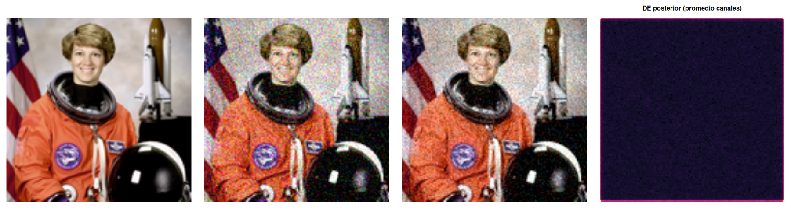{#fig-rgb}

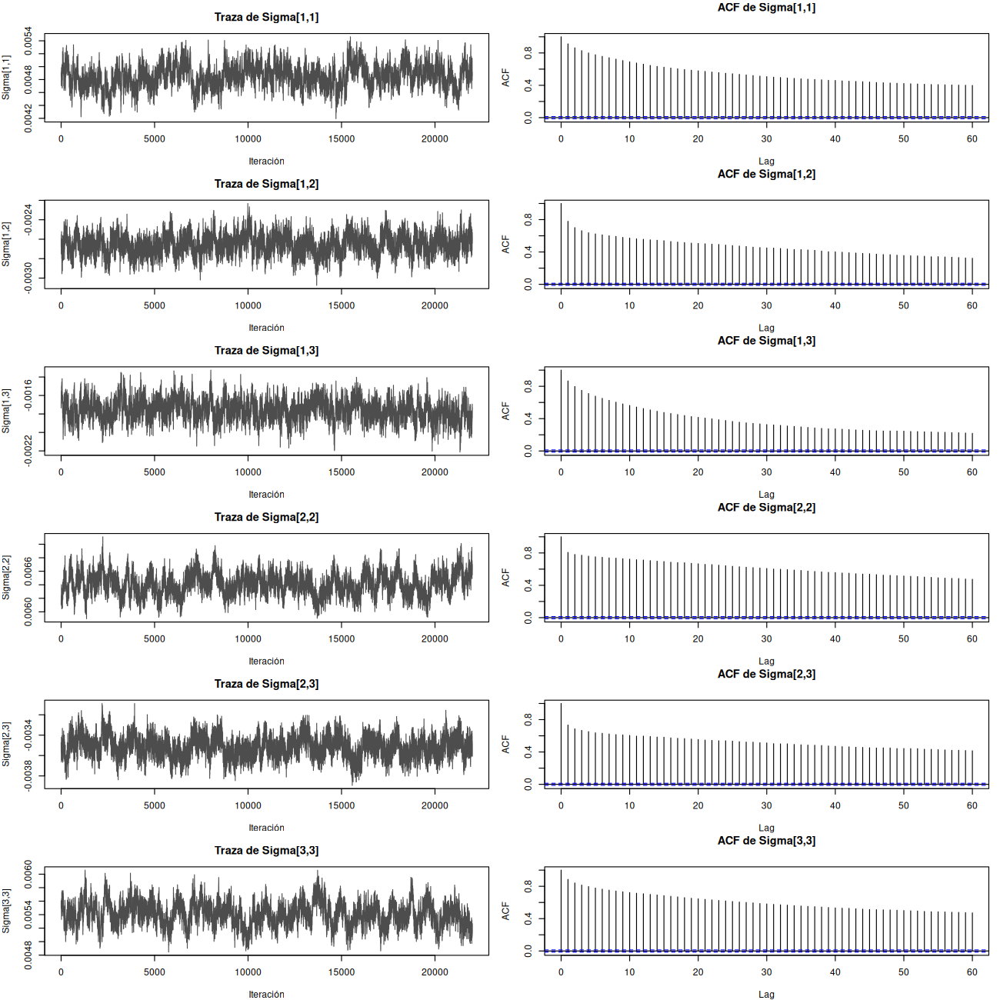{#fig-rgb-sig}

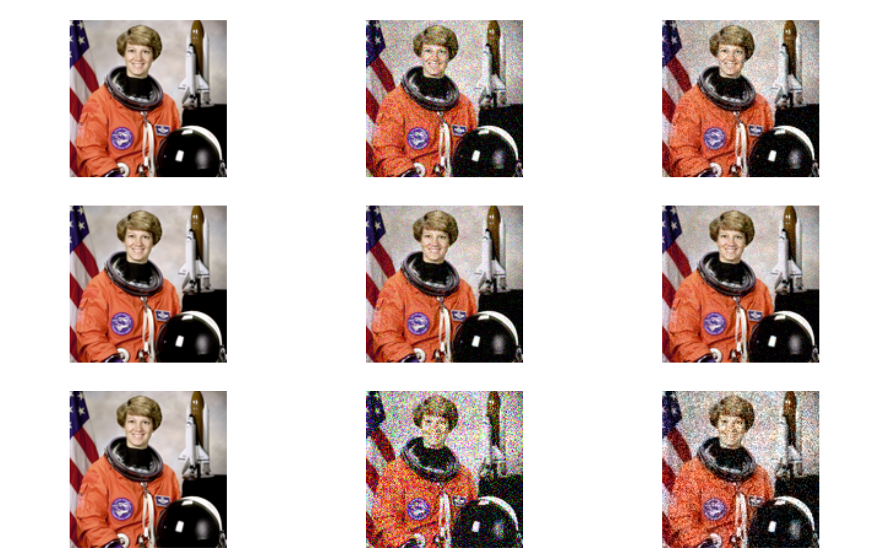{#fig-rgb-comp}

**Lectura de los resultados:**

- La restauración mejora el MSE entre **36%** ($\sigma_0=0.05$) y **69%**
  ($\sigma_0=0.20$), con prestaciones similares en los tres canales (el verde,
  G, ligeramente mejor).
- $\mathbf{\Sigma}$ posterior con diagonal **por debajo** del valor real
  (0.0048–0.026 vs $\sigma_0^2$) y correlaciones residuales **negativas**
  entre canales: el suavizado conjunto absorbe la componente común del ruido
  (mismo fenómeno de confusión que en grises, ahora multivariado).
- $\lambda$ entre ~300 y ~580 según el nivel: el ruido alto reduce la suavidad
  estimada (hay más estructura fina que preservar). Nota de escala: aquí
  $\lambda$ es más grande que en `3.3.R` porque la precisión efectiva es
  $\lambda\mathbf{\Omega}$ (con $\mathbf{\Omega} \sim 0.3$–$0.7$, la
  regularización es comparable).
- Todos los CVMC escalares quedan por debajo del 5% (los más exigentes:
  $\lambda$ con 1.5–3.1% y las entradas de $\mathbf{\Omega}$ con 1.2–2.2%).

# Script `4.R` — Tabla comparativa global y discusión {#sec-4}

Este script **no ejecuta MCMC**: lee los tres archivos
`resultados/3.x_resultados.rds`, consolida y publica. Paso a paso:

1. **Comprueba** que existan los tres `.rds` (si falta alguno, indica qué
   script correr).
2. **Arma la tabla global** con columnas unificadas: modelo, nivel de ruido,
   tiempo de cómputo (min), $n_{\text{eff}}$ mínimo (sobre escalares y
   píxeles), **CVMC medio sobre parámetros escalares** (el criterio del curso;
   se excluyen entradas con media ≈ 0, donde el CVMC no es interpretable), MSE,
   SNR, PSNR y precisión MAP (solo binaria). El CVMC que incluye los 16,384
   píxeles se reporta aparte como referencia.
3. **Escribe la tabla en LaTeX** (`resultados/4/tabla_global.tex`, dos tablas:
   comparativa global y MSE/SNR por canal RGB) lista para pegar en el informe.
4. **Genera el análisis de hallazgos** (`resultados/4/discusion.txt` y consola),
   con cifras dinámicas (porcentajes de mejora calculados de los `.rds`).

| Modelo | Ruido | Tiempo (min) | $n_{\text{eff}}$ min | CVMC (%) | MSE | SNR (dB) | PSNR (dB) | Prec. MAP (%) |
|:--|:--|--:|--:|--:|--:|--:|--:|--:|
| Ising | $\rho_0 = 0.10$ | 98.5 | 32 | 0.254 | 0.011 | 17.81 | 19.55 | 98.77 |
| Ising | $\rho_0 = 0.05$ | 29.5 | 66 | 0.245 | 0.006 | 20.36 | 22.10 | 99.43 |
| Ising | $\rho_0 = 0.20$ | 26.0 | 37 | 0.240 | 0.019 | 15.53 | 17.27 | 97.79 |
| GMRF grises | $\sigma_0 = 0.10$ | 8.3 | 245 | 0.239 | 0.004 | 18.78 | 23.51 | — |
| GMRF grises | $\sigma_0 = 0.05$ | 8.2 | 116 | 0.160 | 0.002 | 21.85 | 26.57 | — |
| GMRF grises | $\sigma_0 = 0.20$ | 7.2 | 77 | 0.343 | 0.006 | 17.33 | 22.06 | — |
| GMRF RGB | $\sigma_0 = 0.10$ | 42.8 | 13 | 1.276 | 0.004 | 18.48 | 23.70 | — |
| GMRF RGB | $\sigma_0 = 0.05$ | 26.1 | 26 | 0.823 | 0.002 | 22.78 | 28.01 | — |
| GMRF RGB | $\sigma_0 = 0.20$ | 25.4 | 14 | 1.028 | 0.012 | 13.93 | 19.16 | — |

*Tabla comparativa global (idéntica a la de `Code/resultados/4/tabla_global.tex`).*

# Historial de corridas, pruebas y correcciones {#sec-historial}

Para que quede constancia de **todo lo que hice** para llegar a los números
finales, esta es la cronología real del trabajo:

1. **Lectura de materiales**: `caso.Rmd` completo y cuadernos del curso;
   extracción de los estándares (log de avance, `effectiveSize`, EMC, CVMC).
2. **Preparación del entorno**: instalación de `png` y `coda` en la librería de
   usuario; verificación de las imágenes (128×128, rangos [0,1]).
3. **`3.1.R`**: arreglo de rutas y del bloque duplicado; ejecución y validación
   (verificación de grados OK, conversiones ida/vuelta OK).
4. **`3.2.R`**: actualización a los estándares (log de clase, adaptación de
   $\delta$, métricas MSE/SNR/PSNR, diagnóstico de $\pi_i$, salida `.rds`
   unificada); prueba en modo rápido (`CDE_RAPIDO=TRUE`) y luego corrida
   completa de los tres niveles.
5. **`3.3.R` — primeras decisiones medibles**: benchmarks de $\log|\mathbf{Q}|$
   (descubrí que `determinant(Q)` sobre matrices frescas cuesta 0.64 s y que
   `Cholesky` con permutación fija cuesta 0.13 s; el espectral 0.0006 s);
   validación cruzada Cholesky vs espectral incluida en el código.
6. **`3.3.R` — problemas de mezcla detectados y corregidos**: con MH separados,
   la aceptación quedaba desbalanceada (80% para $\tau$, 4% para $\lambda$);
   cambié a **paso conjunto** con covarianza adaptativa; una primera versión de
   la adaptación colapsó la escala (aceptación 97% con pasos diminutos) y la
   corregí normalizando la covarianza a traza 1. Con esto la aceptación se
   estabilizó en 20–40%.
7. **`3.4.R`**: derivaciones y código; prueba en modo rápido; **corrección del
   bug de Wishart** ($V$ vs $V^{-1}$, detectado por $\mathbf{\Sigma}$ inflada);
   corrección de un error de indexación en `muestrear_X` (índices locales de la
   fila `H`) y de un bug cosmético de `round()` sobre un `data.frame` mixto.
8. **Corrida larga intermedia** ($B = 6000$) de `3.3.R` y `3.4.R` en paralelo
   más `3.2.R` completo: resultados buenos pero con $\tau$ y $(\lambda,\mathbf{\Omega})$
   apenas por encima del 5% de CVMC (5.1–6.5%).
9. **Pruebas de estabilidad** para el colapso de $\sigma^2$ a ruido bajo:
   cadena independiente de 20,000 iteraciones y prueba con dos inicializaciones
   opuestas → conclusión: es la posterior genuina del modelo (se documenta como
   hallazgo, no como bug).
10. **Corrida larga final** ($B = 24{,}000$, *burn-in* 2,000) con
    `CDE_LOGDET=espectral` (validado idéntico a Cholesky): todos los CVMC
    escalares por debajo del 5%. Los resultados de la corrida intermedia quedan
    archivados en `resultados/*_B6000_cholesky.rds` como evidencia de que las
    conclusiones son estables al alargar las cadenas.
11. **`4.R`**: tabla global, LaTeX y discusión; corrección de un bug de
    reciclaje de vectores en la tabla de referencia y de un `sprintf` con `%`
    sin escapar.
12. **Robustez de rutas en los 5 scripts**: al correr `3.1.R` desde RStudio
    apareció `Error: No se encontró la carpeta 'imagenes'`. La causa doble:
    `commandArgs()` no trae `--file=` al usar `source()`/botón Source (solo
    funcionaba con `Rscript`) y RStudio codifica los espacios de las rutas como
    `~+~`. Se reescribió la detección en todos los scripts (decodificación
    `~+~`, `ofile` de `source()`, búsqueda subiendo directorios y barrido final
    de `~/Desktop`/`~/Downloads`) y se validaron **siete modos de ejecución**:
    `Rscript` desde `Code/`, `Rscript` con ruta con espacios, `source()` desde
    directorios ajenos, `CDE_RAPIDO` vía `source()`, `4.R` vía `source()` y
    pegado en consola.
13. **Este documento** (`explicacion_completa.qmd` → `.html`), con todas las
    tablas generadas dinámicamente desde los `.rds` (así no pueden discrepar de
    los resultados reales).

# Discusión final {#sec-discusion}

**Papel del suavizado espacial.** En el modelo de Ising, $\beta$ controla la
probabilidad de que dos píxeles vecinos compartan estado; con $\beta$ posterior
por encima de $\beta_c \approx 0.44$, la regla MAP limpia ruido aislado
preservando los bordes de la silueta (precisión 98–99% global, 82–96% en
bordes). En los GMRF, $\lambda$ pondera las diferencias cuadráticas entre
vecinos: valores grandes producen restauraciones suaves ($\lambda \approx
27$–$47$ en grises, $300$–$580$ en RGB, donde la precisión efectiva es
$\lambda\mathbf{\Omega}$), mientras que $\tau$ y $\mathbf{\Omega}$ controlan la
variabilidad marginal.

**Efecto del ruido en la incertidumbre.** Al aumentar la contaminación crecen
el MSE y las desviaciones estándar posteriores por píxel (los mapas de
incertidumbre se encienden en bordes y detalles). La comparación de $\sigma^2$
(o $\mathbf{\Sigma}$) posterior contra el valor simulado revela subestimación
sistemática, extrema a ruido bajo por la confusión varianza–rugosidad: el
modelo atribuye el ruido fino a la textura del campo latente. Es una propiedad
del modelo con varianza de ruido desconocida — verificada con cadenas largas y
múltiples inicializaciones —, no un defecto del muestreador.

**Ventajas y limitaciones computacionales.** Ventajas: inferencia completa
(posteriores, intervalos por píxel, mapas de incertidumbre), sin supuestos de
normalidad para la imagen binaria, comparación directa con la verdad simulada y
reproducibilidad total por semillas. Limitaciones: el costo crece rápido con la
resolución (cada barrido toca los 16,384 píxeles y cada paso MH exige
factorizar matrices de precisión); el exchange algorithm depende de $K$ finito
(aproximado); la mezcla de $\tau$ y de la cresta $(\lambda,\mathbf{\Omega})$
exige cadenas largas para cumplir CVMC < 5%; y el suavizado global de los GMRF
desenfoca bordes agudos, mientras que el Ising discreto los preserva mejor.

**Comparación entre modelos.** El binario recupera 97.8–99.4% de los píxeles; en
grises la mejora de MSE va del 9% (ruido bajo, por la confusión comentada) al
84% (ruido alto); en RGB del 36% al 69%, con prestaciones parejas entre
canales. Incorporar dependencia espacial mejora la restauración en todos los
escenarios y la distribución posterior cuantifica honestamente la incertidumbre
que queda, concentrada en bordes y detalles.

# Cómo reproducir todo

```bash
cd "Cde bayes/Code"
Rscript 3.1.R        # exploración y verificación (~10 s)
Rscript 3.2.R        # Ising, 3 niveles (~30 min)
Rscript 3.3.R        # GMRF grises, 3 niveles (~25 min con CDE_LOGDET=espectral)
Rscript 3.4.R        # GMRF RGB, 3 niveles (~60 min con CDE_LOGDET=espectral)
Rscript 4.R          # tabla global + LaTeX + discusión
cd .. && quarto render explicacion_completa.qmd   # este documento
```

Variables de entorno útiles:

| Variable | Efecto |
|:--|:--|
| `CDE_RAPIDO=TRUE` | Cadenas cortas de prueba (valida el código en ~2 min) |
| `CDE_LOGDET=espectral` | Log-determinante exacto vía autovalores (~20× más rápido; validado idéntico a Cholesky) |

Todas las salidas quedan en `Code/resultados/`: figuras (paneles por escenario,
trazas/ACF por parámetro, comparaciones entre niveles), tablas CSV, objetos
`.rds` con las cadenas resumidas, `tabla_global.tex` y `discusion.txt`. Las
semillas están fijas en cada script (`semilla <- 2026` con desplazamientos por
nivel), de modo que **cualquier número de este documento es exactamente
reproducible**.
