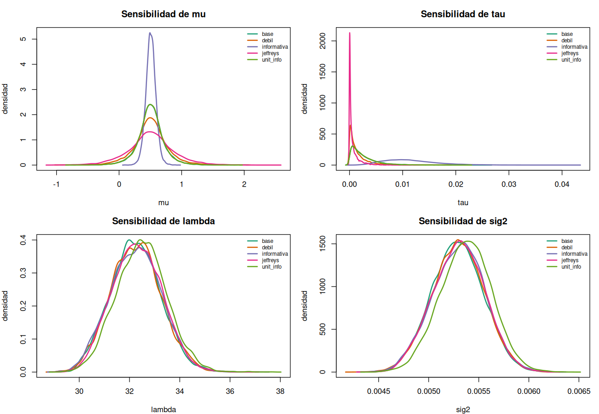
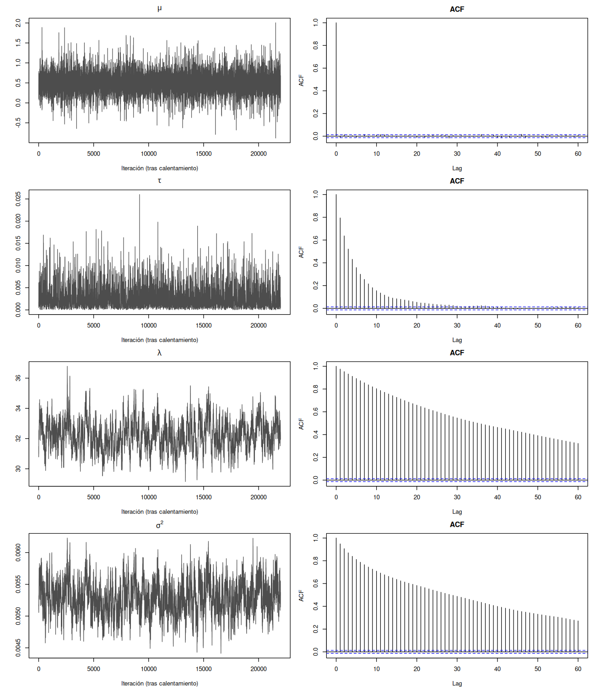
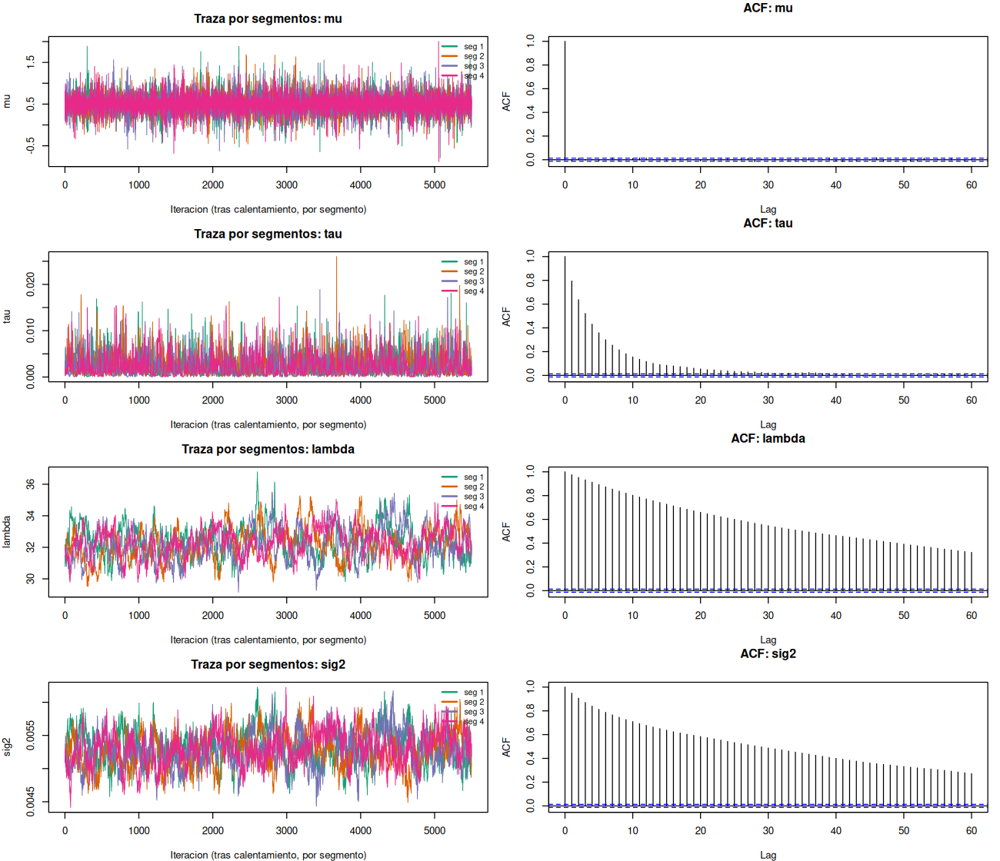
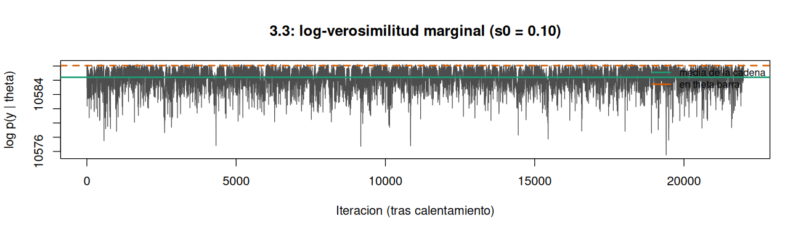
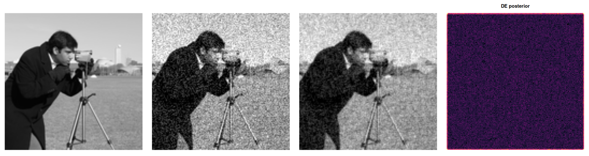
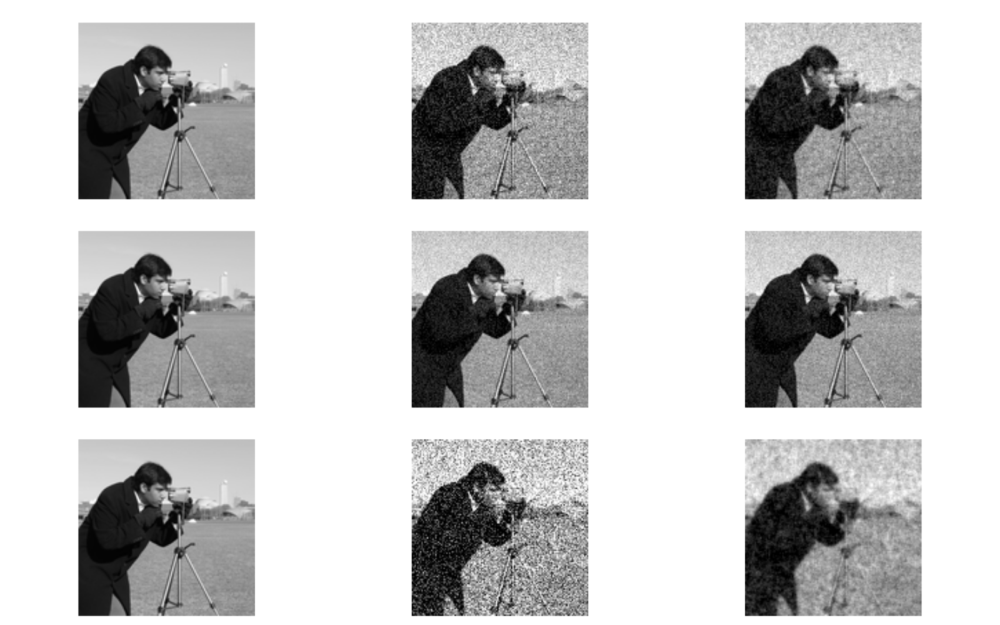
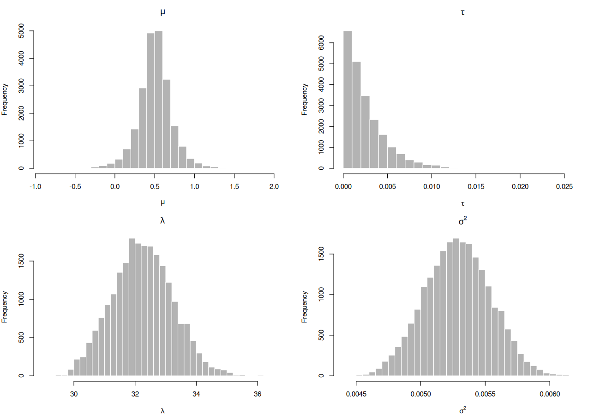

# Objetivo y planteamiento

Se dispone de una imagen verdadera en escala de grises
$\boldsymbol{X}^{(0)}\in[0,1]^P$ de $128\times128$ píxeles (`camera_grises.png`,
media 0.506, varianza 0.081). Se contamina sumando a cada píxel un ruido gaussiano
independiente,

$$
Y_i = X_i^{(0)} + \varepsilon_i,\qquad \varepsilon_i\overset{\text{iid}}{\sim}\textsf{N}(0,\sigma_0^2),\qquad \sigma_0\in\{0.05,\,0.10,\,0.20\},
$$

sin recortar los valores que caen fuera de $[0,1]$ (solo se recortan para
dibujar). El problema es **estimar $\boldsymbol{X}$ a partir de $\boldsymbol{Y}$
únicamente**, junto con la varianza del ruido $\sigma^2$ y los parámetros
$(\mu,\tau,\lambda)$ del modelo espacial, y cuantificar la incertidumbre de la
reconstrucción píxel a píxel.

Como en el punto 3.2, la imagen original solo se usa para generar la
contaminación y para evaluar el resultado (MSE, SNR, cobertura de los intervalos).

El documento sigue la misma organización que el del modelo de Ising. La
**primera parte** (secciones 2 a 6) es la formulación matemática: modelo,
posterior conjunta, condicionales completas, papel del determinante $|\mathbf{Q}|$
y el paso de Metropolis–Hastings. La **segunda parte** (secciones 7 a 12) es la
parte computacional: cómo se implementa cada paso en `Code/3.3.R`, cómo se
calcula $\log|\mathbf{Q}|$ sin invertir matrices, cómo se eligieron los ajustes,
los diagnósticos y los resultados.

::: {.callout-note}
## Diferencia de fondo con el modelo de Ising
En el Ising, la constante de normalización $Z(\beta)$ es **incalculable** (suma
sobre $2^{16{,}384}$ configuraciones) y hubo que esquivarla con el algoritmo de
intercambio. Aquí la previa es gaussiana y su constante, $|\mathbf{Q}|^{1/2}/(2\pi)^{P/2}$,
**sí se puede calcular exactamente**; el reto es solo de costo: es el determinante
de una matriz de $16{,}384\times16{,}384$, que hay que evaluar en cada iteración.
:::

# Formulación del modelo

## Grafo, matriz de adyacencia y Laplaciana

Se usa el mismo grafo de 4 vecinos del punto 3.1: $P=16{,}384$ vértices,
$|E|=32{,}512$ aristas, grados $d_i\in\{2,3,4\}$. Con la matriz de adyacencia
$\mathbf{A}$ y $\mathbf{D}=\operatorname{diag}(d_1,\dots,d_P)$ se define la
**Laplaciana** $\mathbf{L}=\mathbf{D}-\mathbf{A}$. Los píxeles se ordenan por
columnas, $k=(c-1)M+r$.

::: {#prp-lap}
## Forma cuadrática de la Laplaciana
Para todo $\boldsymbol{x}\in\mathbb{R}^P$,
$$
\boldsymbol{x}^\mathsf{T}\mathbf{L}\boldsymbol{x}=\sum_{i\sim j}(x_i-x_j)^2 .
$$
En consecuencia, $\mathbf{L}$ es simétrica semidefinida positiva, $\mathbf{L}\boldsymbol{1}=\boldsymbol{0}$
y, como el grafo es conexo, su núcleo es exactamente el conjunto de vectores constantes.
:::

::: {.proof}
$\boldsymbol{x}^\mathsf{T}\mathbf{D}\boldsymbol{x}=\sum_i d_ix_i^2=\sum_{i\sim j}(x_i^2+x_j^2)$,
porque cada arista aporta un cuadrado a cada uno de sus dos extremos, y
$\boldsymbol{x}^\mathsf{T}\mathbf{A}\boldsymbol{x}=2\sum_{i\sim j}x_ix_j$. Restando,
$\sum_{i\sim j}(x_i^2-2x_ix_j+x_j^2)=\sum_{i\sim j}(x_i-x_j)^2\ge0$. La suma se
anula si y solo si $x_i=x_j$ en toda arista, es decir (grafo conexo), si
$\boldsymbol{x}$ es constante.
:::

$\boldsymbol{x}^\mathsf{T}\mathbf{L}\boldsymbol{x}$ mide la **rugosidad** de la
imagen: es pequeña si los vecinos tienen intensidades parecidas. Es el análogo
continuo de las aristas discordantes $D(\boldsymbol{x})$ del Ising. Para la imagen
verdadera vale $\sum_{i\sim j}(x^{(0)}_i-x^{(0)}_j)^2 = 206.8$.

## Modelo de observación

$$
Y_i\mid X_i,\sigma^2\overset{\text{ind}}{\sim}\textsf{N}(X_i,\sigma^2)
\quad\Longrightarrow\quad
p(\boldsymbol{y}\mid\boldsymbol{x},\sigma^2)=(2\pi\sigma^2)^{-P/2}\exp\Big\{-\frac{1}{2\sigma^2}\sum_{i=1}^P(y_i-x_i)^2\Big\}.
$$

## Distribución previa de la imagen: GMRF

$$
p(\boldsymbol{x}\mid\mu,\tau,\lambda)=\frac{|\mathbf{Q}|^{1/2}}{(2\pi)^{P/2}}
\exp\Big\{-\frac{\tau}{2}\sum_{i=1}^P(x_i-\mu)^2-\frac{\lambda}{2}\sum_{i\sim j}(x_i-x_j)^2\Big\},
\qquad \mathbf{Q}=\tau\mathbf{I}+\lambda\mathbf{L}.
$$

::: {#prp-normal}
## La previa es una normal multivariada propia
$p(\boldsymbol{x}\mid\mu,\tau,\lambda)$ es la densidad de
$\textsf{N}_P(\mu\boldsymbol{1},\mathbf{Q}^{-1})$. $\mathbf{Q}$ es definida positiva
si y solo si $\tau>0$; sus valores propios son $\tau+\lambda w_k$, donde
$0=w_0<w_1\le\dots\le w_{P-1}$ son los valores propios de $\mathbf{L}$.
:::

::: {.proof}
Como $\mathbf{L}\boldsymbol{1}=\boldsymbol{0}$,
$(\boldsymbol{x}-\mu\boldsymbol{1})^\mathsf{T}\mathbf{L}(\boldsymbol{x}-\mu\boldsymbol{1})=\boldsymbol{x}^\mathsf{T}\mathbf{L}\boldsymbol{x}$.
Entonces, por la @prp-lap,
$$
(\boldsymbol{x}-\mu\boldsymbol{1})^\mathsf{T}\mathbf{Q}(\boldsymbol{x}-\mu\boldsymbol{1})
=\tau\sum_i(x_i-\mu)^2+\lambda\sum_{i\sim j}(x_i-x_j)^2,
$$
que es menos dos veces el exponente. La constante $|\mathbf{Q}|^{1/2}(2\pi)^{-P/2}$
es justamente la de la normal con precisión $\mathbf{Q}$. $\mathbf{Q}$ y $\mathbf{L}$
comparten vectores propios, con valores propios $\tau+\lambda w_k$; el menor es
$\tau+\lambda\cdot0=\tau$, positivo si y solo si $\tau>0$.
:::

Interpretación de los tres parámetros:

- $\mu$: intensidad de referencia (nivel de gris "promedio").
- $\tau$: concentración alrededor de $\mu$. Penaliza alejarse de $\mu$ **píxel a píxel**, sin mirar vecinos.
- $\lambda$: suavidad espacial. Penaliza las **diferencias entre vecinos**.

Si $\tau=0$, $\mathbf{Q}=\lambda\mathbf{L}$ es singular: el vector
$\boldsymbol{1}$ es su único vector nulo, de modo que
$\operatorname{rango}(\mathbf{L})=P-1$ y la previa es **intrínseca**
(impropia): sumarle una constante a toda la imagen no cambia su densidad. Dos
consecuencias que conviene explicitar. Primera, esa impropiedad no contamina la
inferencia: la verosimilitud gaussiana fija la localización y la posterior
conjunta es propia incluso en el caso intrínseco; con la previa real
($\tau>0$ con probabilidad 1 bajo $\textsf{G}(a_\tau,b_\tau)$) la previa de
$\boldsymbol{x}$ ya es propia, porque $\tau\mathbf{I}+\lambda\mathbf{L}$ es
definida positiva. Segunda, el rango $P-1$ explica por qué el log-determinante
se evalúa sobre $|\mathbf{I}+\lambda\mathbf{L}|$ (o sobre
$\prod_k(\tau+\lambda w_k)$ con $w_1=0$): el cero de la Laplaciana está
neutralizado por la identidad (o por $\tau$) y no hay que invertir
$\mathbf{Q}$ nunca.

::: {#prp-markov-gmrf}
## Propiedad de Markov del GMRF
$$
X_i\mid\boldsymbol{x}_{-i},\mu,\tau,\lambda\;\sim\;\textsf{N}\!\left(\frac{\tau\mu+\lambda\sum_{j\in N_i}x_j}{\tau+\lambda d_i},\ \frac{1}{\tau+\lambda d_i}\right).
$$
:::

::: {.proof}
Para una normal con precisión $\mathbf{Q}$, se cumple
$\textsf{E}(X_i\mid\boldsymbol{x}_{-i})=\mu_i-Q_{ii}^{-1}\sum_{j\ne i}Q_{ij}(x_j-\mu_j)$ y
$\textsf{Var}(X_i\mid\boldsymbol{x}_{-i})=Q_{ii}^{-1}$. Aquí $Q_{ii}=\tau+\lambda d_i$,
$Q_{ij}=-\lambda$ si $j\sim i$ y $Q_{ij}=0$ en otro caso. Sustituyendo,
$\textsf{E}=\mu+\frac{\lambda}{\tau+\lambda d_i}\sum_{j\in N_i}(x_j-\mu)=\frac{\tau\mu+\lambda\sum_{j}x_j}{\tau+\lambda d_i}$.
:::

Los ceros de $\mathbf{Q}$ fuera de la vecindad equivalen a independencia
condicional: **$X_i$ solo "ve" a sus 4 vecinos**. Esto es lo que hace que el
modelo sea un campo de Markov y que $\mathbf{Q}$ sea dispersa (5 entradas no nulas
por fila como máximo), aunque la covarianza $\mathbf{Q}^{-1}$ sea densa.

## Distribuciones previas de los parámetros

$$
\sigma^2\sim\textsf{IG}(a_\sigma,b_\sigma),\qquad
\mu\sim\textsf{N}(m_\mu,s_\mu^2),\qquad
\tau\sim\textsf{G}(a_\tau,b_\tau),\qquad
\lambda\sim\textsf{G}(a_\lambda,b_\lambda),
$$

independientes a priori. La estructura de dependencia es

$$
(\mu,\tau,\lambda)\;\longrightarrow\;\boldsymbol{X}\;\longrightarrow\;\boldsymbol{Y}\;\longleftarrow\;\sigma^2 .
$$

# Distribución posterior conjunta

Por el teorema de Bayes,

$$
\boxed{\;
\begin{aligned}
p(\boldsymbol{x},\mu,\tau,\lambda,\sigma^2\mid\boldsymbol{y})\;\propto\;&
(\sigma^2)^{-P/2}\exp\Big\{-\frac{1}{2\sigma^2}\sum_i(y_i-x_i)^2\Big\}
\cdot|\tau\mathbf{I}+\lambda\mathbf{L}|^{1/2}\exp\Big\{-\frac{\tau}{2}\sum_i(x_i-\mu)^2-\frac{\lambda}{2}\boldsymbol{x}^\mathsf{T}\mathbf{L}\boldsymbol{x}\Big\}\\
&\cdot(\sigma^2)^{-a_\sigma-1}e^{-b_\sigma/\sigma^2}
\cdot e^{-(\mu-m_\mu)^2/(2s_\mu^2)}
\cdot\tau^{a_\tau-1}e^{-b_\tau\tau}
\cdot\lambda^{a_\lambda-1}e^{-b_\lambda\lambda}.
\end{aligned}\;}
$$

::: {.callout-important}
## $|\mathbf{Q}|$ no es una constante de la posterior
Igual que $Z(\beta)$ en el Ising, $|\mathbf{Q}|^{1/2}=|\tau\mathbf{I}+\lambda\mathbf{L}|^{1/2}$
depende de parámetros desconocidos ($\tau$ y $\lambda$) y **no puede omitirse**.
Solo $(2\pi)^{-P/2}$ y $p(\boldsymbol{y})$ se van a la constante.
:::

## Interpretación: mínimos cuadrados penalizados y filtro de Wiener

Para parámetros fijos,

$$
-2\log p(\boldsymbol{x}\mid\boldsymbol{y},\theta)=\frac{1}{\sigma^2}\|\boldsymbol{y}-\boldsymbol{x}\|^2+\tau\|\boldsymbol{x}-\mu\boldsymbol{1}\|^2+\lambda\,\boldsymbol{x}^\mathsf{T}\mathbf{L}\boldsymbol{x}+\text{cte}.
$$

Es un problema de **mínimos cuadrados penalizados** (regularización de
Tikhonov): fidelidad a los datos más dos penalizaciones. Como todo es cuadrático:

::: {#prp-post-x}
## Posterior de la imagen dados los parámetros
$$
\boldsymbol{X}\mid\boldsymbol{y},\mu,\tau,\lambda,\sigma^2\;\sim\;\textsf{N}_P\Big(\boldsymbol{m},\ (\sigma^{-2}\mathbf{I}+\mathbf{Q})^{-1}\Big),
\qquad
\boldsymbol{m}=(\sigma^{-2}\mathbf{I}+\mathbf{Q})^{-1}(\sigma^{-2}\boldsymbol{y}+\tau\mu\boldsymbol{1}).
$$
:::

::: {.proof}
El exponente es $-\frac12[\boldsymbol{x}^\mathsf{T}(\sigma^{-2}\mathbf{I}+\mathbf{Q})\boldsymbol{x}-2\boldsymbol{x}^\mathsf{T}(\sigma^{-2}\boldsymbol{y}+\mathbf{Q}\mu\boldsymbol{1})]+\text{cte}$,
y $\mathbf{Q}\mu\boldsymbol{1}=\tau\mu\boldsymbol{1}$ porque $\mathbf{L}\boldsymbol{1}=\boldsymbol{0}$.
Completando el cuadrado se obtiene la normal indicada.
:::

Esta proposición da una lectura muy útil. Sea $\mathbf{L}=\mathbf{U}\mathbf{W}\mathbf{U}^\mathsf{T}$
la descomposición espectral de la Laplaciana (las columnas de $\mathbf{U}$ son
"frecuencias espaciales": $w_k$ pequeño = variación lenta, $w_k$ grande =
variación rápida, como el ruido). En esa base, para toda frecuencia $k\ge1$,

$$
\tilde m_k=g_k\,\tilde y_k,\qquad g_k=\frac{1}{1+\sigma^2\tau+\sigma^2\lambda\,w_k}.
$$

**La media posterior es un filtro pasa-bajos** (un filtro de Wiener): conserva
las frecuencias bajas ($g_k\approx1$) y atenúa las altas. La fuerza del filtro la
controla el producto $\sigma^2\lambda$: mucho ruido o mucha suavidad implican un
filtrado más fuerte. Esta lectura explica casi todos los resultados de la
sección 12.

# Condicionales completas

::: {#prp-cond-x}
## Condicional de $X_i$
$$
X_i\mid\text{resto}\;\sim\;\textsf{N}(m_i,v_i),\qquad
v_i=\Big(\frac{1}{\sigma^2}+\tau+\lambda d_i\Big)^{-1},\qquad
m_i=v_i\Big(\frac{y_i}{\sigma^2}+\tau\mu+\lambda\sum_{j\in N_i}x_j\Big).
$$
Depende de su observación $y_i$, de los vecinos $\{x_j\}_{j\in N_i}$ y de los parámetros.
:::

::: {.proof}
Los factores de la posterior que contienen a $x_i$ son el término $i$ de la
verosimilitud y, por la @prp-markov-gmrf, la condicional previa de $X_i$. La
suma de sus logaritmos es
$$
-\frac{(y_i-x_i)^2}{2\sigma^2}-\frac{\tau}{2}(x_i-\mu)^2-\frac{\lambda}{2}\sum_{j\in N_i}(x_i-x_j)^2 .
$$
El coeficiente de $x_i^2$ es $-\frac12(\sigma^{-2}+\tau+\lambda d_i)=-\frac{1}{2v_i}$
y el de $x_i$ es $\sigma^{-2}y_i+\tau\mu+\lambda\sum_{j\in N_i}x_j=m_i/v_i$.
Completando el cuadrado, $p(x_i\mid\cdot)\propto\exp\{-(x_i-m_i)^2/(2v_i)\}$.
:::

$m_i$ es un **promedio ponderado** de tres fuentes de información:

$$
m_i=\underbrace{\frac{\sigma^{-2}}{\sigma^{-2}+\tau+\lambda d_i}}_{\text{peso de }y_i}\,y_i
+\underbrace{\frac{\tau}{\sigma^{-2}+\tau+\lambda d_i}}_{\text{peso de }\mu}\,\mu
+\underbrace{\frac{\lambda d_i}{\sigma^{-2}+\tau+\lambda d_i}}_{\text{peso de los vecinos}}\,\bar x_{N_i},
\qquad \bar x_{N_i}=\frac{1}{d_i}\sum_{j\in N_i}x_j .
$$

Cuanto más ruido (mayor $\sigma^2$), menos se confía en $y_i$ y más en los vecinos.
La actualización de $X_i$ depende solo de sus vecinos y de $y_i$ por la misma
razón que en el Ising: la verosimilitud factoriza por píxel y la previa es de
Markov.

::: {#prp-cond-s2}
## Condicional de $\sigma^2$
$$
\sigma^2\mid\text{resto}\;\sim\;\textsf{IG}\Big(a_\sigma+\frac P2,\ b_\sigma+\frac12\sum_{i=1}^P(y_i-x_i)^2\Big).
$$
:::

::: {.proof}
Los factores con $\sigma^2$ son
$(\sigma^2)^{-P/2-a_\sigma-1}\exp\{-[b_\sigma+\frac12\sum_i(y_i-x_i)^2]/\sigma^2\}$,
núcleo de la gamma inversa indicada (previa conjugada).
:::

::: {#prp-cond-mu}
## Condicional de $\mu$
$$
\mu\mid\text{resto}\;\sim\;\textsf{N}\Big(v_\mu\big(\tau\textstyle\sum_ix_i+m_\mu/s_\mu^2\big),\ v_\mu\Big),\qquad v_\mu=\big(\tau P+1/s_\mu^2\big)^{-1}.
$$
:::

::: {.proof}
$\mu$ aparece solo en $-\frac{\tau}{2}\sum_i(x_i-\mu)^2-\frac{(\mu-m_\mu)^2}{2s_\mu^2}$:
coeficiente de $\mu^2$ igual a $-\frac12(\tau P+s_\mu^{-2})$ y de $\mu$ igual a
$\tau\sum_ix_i+m_\mu/s_\mu^2$. Se completa el cuadrado.
:::

**Observación.** La precisión que los datos aportan sobre $\mu$ es $\tau P$. Si
$\tau$ es casi cero, $\mu$ queda prácticamente determinado por su previa. Como se
verá en la sección 12, eso es exactamente lo que ocurre: $\hat\tau\approx0.0025$,
luego $\tau P\approx41$, y el IC 95 % de $\mu$ es $[0.06,\,0.94]$. No es un problema:
el peso de $\mu$ en $m_i$ es del orden de $10^{-5}$ y $\mu$ no influye en la restauración.

::: {#prp-cond-tl}
## Condicionales de $\tau$ y $\lambda$
Con $\mathrm{SS}_\mu=\sum_i(x_i-\mu)^2$ y $\mathrm{SS}_d=\boldsymbol{x}^\mathsf{T}\mathbf{L}\boldsymbol{x}=\sum_{i\sim j}(x_i-x_j)^2$,
$$
p(\tau\mid\cdot)\propto\tau^{a_\tau-1}e^{-b_\tau\tau}\,|\tau\mathbf{I}+\lambda\mathbf{L}|^{1/2}e^{-\tau\,\mathrm{SS}_\mu/2},
\qquad
p(\lambda\mid\cdot)\propto\lambda^{a_\lambda-1}e^{-b_\lambda\lambda}\,|\tau\mathbf{I}+\lambda\mathbf{L}|^{1/2}e^{-\lambda\,\mathrm{SS}_d/2}.
$$
Ninguna pertenece a una familia conocida, por el factor $|\mathbf{Q}|^{1/2}$, que
depende **a la vez** de $\tau$ y de $\lambda$.
:::

## El papel del determinante $|\mathbf{Q}|$

Por la @prp-normal,

$$
\log|\mathbf{Q}|=\sum_{k=0}^{P-1}\log(\tau+\lambda w_k)=\log\tau+\sum_{k\ge1}\log(\tau+\lambda w_k).
$$

**Qué pasaría si se omitiera.** Sin $|\mathbf{Q}|^{1/2}$, el núcleo de $\lambda$
sería $\lambda^{a_\lambda-1}e^{-\lambda(b_\lambda+\mathrm{SS}_d/2)}$, una
$\textsf{G}(a_\lambda,\,b_\lambda+\mathrm{SS}_d/2)$ con media
$\approx2a_\lambda/\mathrm{SS}_d\approx0.01$. Es decir, $\lambda$ **colapsaría a
cero** y no habría suavizado. Lo mismo le pasaría a $\tau$. (En el Ising ocurría
lo contrario: sin $Z(\beta)$, $\beta$ se iba a infinito. El signo cambia porque
aquí el exponente penaliza a $\lambda$ y allá premiaba a $\beta$.)

**Qué aporta.** El determinante "premia" valores grandes de $\tau$ y $\lambda$:
es el volumen de la distribución previa. Una heurística útil: en las frecuencias
$k\ge1$ en que $\tau\ll\lambda w_k$, $\log(\tau+\lambda w_k)\approx\log\lambda+\log w_k$, de modo que

$$
|\mathbf{Q}|^{1/2}\approx\tau^{1/2}\,\lambda^{(P-1)/2}\prod_{k\ge1}w_k^{1/2},
$$

y entonces, aproximadamente,

$$
\lambda\mid\cdot\;\overset{\text{aprox}}{\sim}\;\textsf{G}\Big(a_\lambda+\frac{P-1}{2},\ b_\lambda+\frac{\mathrm{SS}_d}{2}\Big),
\qquad
\tau\mid\cdot\;\overset{\text{aprox}}{\sim}\;\textsf{G}\Big(a_\tau+\frac12,\ b_\tau+\frac{\mathrm{SS}_\mu}{2}\Big).
$$

Esta aproximación explica dos hechos centrales del caso:

1. **$\lambda$ está muy bien identificado.** Recibe $(P-1)/2\approx8{,}191$
   "grados de libertad" del determinante, uno por cada contraste entre píxeles.
   Su media es aproximadamente $(P-1)/\mathrm{SS}_d$, es decir, el inverso de la
   rugosidad media por arista, y la previa es irrelevante.
2. **$\tau$ está casi sin identificar.** Recibe solo $\frac12$ grado de libertad:
   la única dirección que penaliza $\tau$ y no $\lambda$ es la del nivel medio
   de la imagen. Con $\mathrm{SS}_\mu\approx1{,}327$ (la suma de cuadrados de la
   imagen alrededor de su media), la aproximación da
   $\textsf{G}(1.5,\,663.5)$: media $0.0023$, DE $0.0018$. Los valores estimados
   (media 0.0022–0.0027, DE 0.0020–0.0026) coinciden muy bien: **la DE de $\tau$
   es tan grande como su media**.

::: {.callout-note}
## ¿Por qué es exacta la condición $\tau>0$ pero $\tau$ sale casi cero?
Las imágenes naturales no se concentran alrededor de un nivel de gris: tienen
zonas claras y oscuras. El modelo lo "descubre" y lleva $\tau$ casi a cero,
acercándose a un GMRF intrínseco. La previa $\textsf{Exp}(0.05)$, con moda en 0,
lo permite sin forzarlo.
:::

# Metropolis–Hastings conjunto para $(\tau,\lambda)$

## Por qué en bloque y en escala logarítmica

$\tau$ y $\lambda$ comparten el factor $|\mathbf{Q}|^{1/2}$ y sus posteriores están
correlacionadas. En las primeras pruebas, dos caminatas aleatorias separadas
dieron una aceptación desbalanceada (80 % para $\tau$, 4 % para $\lambda$) y una
mezcla pobre. Por eso se actualizan **juntos**, con una propuesta bivariada, lo
que además requiere **una sola** evaluación de $\log|\mathbf{Q}|$ por iteración.

Se trabaja en $\boldsymbol{\eta}=(\eta_1,\eta_2)=(\log\tau,\log\lambda)\in\mathbb{R}^2$
para que las propuestas nunca salgan del dominio $\tau,\lambda>0$.

::: {#prp-jacob}
## Densidad objetivo en escala logarítmica
La densidad de $\boldsymbol{\eta}$ condicional al resto es
$$
\log p(\boldsymbol{\eta}\mid\cdot)=a_\tau\eta_1+a_\lambda\eta_2-b_\tau e^{\eta_1}-b_\lambda e^{\eta_2}
+\tfrac12\log|e^{\eta_1}\mathbf{I}+e^{\eta_2}\mathbf{L}|-\tfrac12\big(e^{\eta_1}\mathrm{SS}_\mu+e^{\eta_2}\mathrm{SS}_d\big)+\text{cte}.
$$
:::

::: {.proof}
Por cambio de variable, $p_{\boldsymbol\eta}(\boldsymbol\eta)=p_{\tau,\lambda}(e^{\eta_1},e^{\eta_2})\,|\partial(\tau,\lambda)/\partial\boldsymbol\eta|$,
con jacobiano $e^{\eta_1}e^{\eta_2}=\tau\lambda$. Ese factor convierte los
exponentes $a_\tau-1$ y $a_\lambda-1$ de las previas gamma en $a_\tau$ y $a_\lambda$.
:::

Olvidar el jacobiano es un error común: sesgaría $\tau$ y $\lambda$ hacia abajo.
El código usa correctamente `a_tau * eta[1] + a_lam * eta[2]`.

## Propuesta y aceptación

$$
\boldsymbol\eta^*=\boldsymbol\eta+s\,\boldsymbol\varepsilon,\qquad \boldsymbol\varepsilon\sim\textsf{N}_2(\boldsymbol0,\mathbf{C}),
\qquad
\alpha=\min\Big\{1,\ \frac{p(\boldsymbol\eta^*\mid\cdot)}{p(\boldsymbol\eta\mid\cdot)}\Big\}.
$$

La propuesta es simétrica, así que el cociente de propuestas se cancela. Durante
el calentamiento se adaptan dos cosas por separado:

- **La forma** $\mathbf{C}$: cada 50 iteraciones, la covarianza empírica de los
  últimos 100 valores de $\boldsymbol\eta$, normalizada para que su diagonal
  promedie 1 (más $10^{-6}\mathbf{I}$ para garantizar que sea definida positiva).
  Así la propuesta se orienta a lo largo de la cresta de la posterior.
- **El tamaño** $s$: cada 25 iteraciones, $s\leftarrow s\cdot\exp\{1.5(\hat\alpha-0.30)\}$,
  con el factor recortado a $[0.5,\,2]$, para acercar la aceptación al 30 %.

Separar forma y tamaño evitó un colapso observado en una versión previa (aceptación
del 97 % con pasos minúsculos). Al terminar el calentamiento, $s$ y $\mathbf{C}$ se
congelan, para que la cadena sea de Markov homogénea y conserve la posterior como
distribución estacionaria.

# Algoritmo MCMC completo

Todos los pasos son de Gibbs exactos salvo el de $(\tau,\lambda)$, que es un
Metropolis–Hastings: un esquema *Metropolis dentro de Gibbs*. A diferencia del
Ising, **no hay ninguna aproximación**: la cadena tiene exactamente la posterior
como distribución estacionaria.

> **Algoritmo 1.** MCMC para el GMRF en escala de grises
>
> **Entrada:** $\boldsymbol{y}$, hiperparámetros, $B$, calentamiento.
>
> **Inicializar:** $\boldsymbol{x}=\boldsymbol{y}$, $\mu=\bar y$, $\sigma^2=0.01$, $\tau=1$, $\lambda=10$, $s=0.5$, $\mathbf{C}=\mathbf{I}_2$.
>
> **Para** $t=1,\dots,B$:
>
> 1. **Imagen.** Para $\mathcal{C}_1$ y luego $\mathcal{C}_2$ (tablero de ajedrez), y simultáneamente para todo $i$ del color: $x_i\sim\textsf{N}(m_i,v_i)$.
> 2. **Ruido.** $\sigma^2\sim\textsf{IG}(a_\sigma+P/2,\ b_\sigma+\frac12\sum_i(y_i-x_i)^2)$.
> 3. **Nivel.** $\mu\sim\textsf{N}(v_\mu(\tau\sum_ix_i+m_\mu/s_\mu^2),\,v_\mu)$.
> 4. **Precisiones.** Calcular $\mathrm{SS}_\mu$ y $\mathrm{SS}_d$; proponer $\boldsymbol\eta^*$; calcular $\log|\mathbf{Q}(\boldsymbol\eta^*)|$; aceptar con probabilidad $\alpha$.
> 5. Si $t\le$ calentamiento, adaptar $s$ y $\mathbf{C}$. Si $t>$ calentamiento, acumular $\sum x_i$, $\sum x_i^2$ y guardar una de cada 20 imágenes.
>
> **Salida:** cadenas de $\mu,\tau,\lambda,\sigma^2$; medias y DE posteriores por píxel; cuantiles por píxel.

---

# Implementación computacional

Todo está en `Code/3.3.R` (paquetes `Matrix`, `png` y `coda`).

## Laplaciana dispersa y tablero de ajedrez

La Laplaciana se construye sin bucles, igual que la adyacencia del Ising:

```r
construir_laplaciana <- function(M, N) {
  idx <- matrix(seq_len(M * N), M, N)
  i <- c(as.vector(idx[, -N]), as.vector(idx[-M, ]))   # aristas horizontales y verticales
  j <- c(as.vector(idx[, -1]), as.vector(idx[-1, ]))
  A <- sparseMatrix(i = c(i, j), j = c(j, i), x = 1, dims = c(M * N, M * N))
  d <- rowSums(A)
  L <- Diagonal(x = d) - A                               # L = D - A
  list(A = A, L = L, d = d)
}
```

La partición en tablero de ajedrez (`preparar_tablero`) es idéntica a la del
3.2, y el argumento de independencia condicional también: toda arista une un
píxel de $\mathcal{C}_1$ con uno de $\mathcal{C}_2$, y la condicional de $X_i$
(@prp-cond-x) solo depende de los vecinos. Por tanto, dados los píxeles de un
color, los del otro son **condicionalmente independientes** y se actualizan todos
a la vez de forma exacta.

## Paso de la imagen

```r
muestrear_x <- function(x, y, tau, lambda, sig2, mu) {
  inv_sig2 <- 1 / sig2
  for (g in 1:2) {                                      # dos medios barridos
    ig <- tab$idx[[g]]
    s  <- drop(tab$A_sub[[g]] %*% x)                    # sumas de vecinos
    v  <- 1 / (inv_sig2 + tau + lambda * d[ig])         # v_i
    m  <- v * (y[ig] * inv_sig2 + tau * mu + lambda * s)  # m_i
    x[ig] <- rnorm(length(ig), m, sqrt(v))
  }
  x
}
```

Es la traducción literal de la @prp-cond-x. `rnorm` está vectorizada: genera los
8,192 valores de un color en una sola llamada.

## Pasos de $\sigma^2$ y $\mu$

```r
muestrear_sigma2 <- function(x, y, a_s, b_s)        # IG = 1 / Gamma(shape, rate)
  1 / rgamma(1, shape = a_s + P / 2, rate = b_s + 0.5 * sum((y - x)^2))

muestrear_mu <- function(x, tau, m_mu, s_mu2) {
  v_mu <- 1 / (tau * P + 1 / s_mu2)
  rnorm(1, v_mu * (tau * sum(x) + m_mu / s_mu2), sqrt(v_mu))
}
```

Si $G\sim\textsf{G}(a,b)$ (forma, tasa), entonces $1/G\sim\textsf{IG}(a,b)$; por
eso se invierte una gamma.

## Cálculo de $\log|\mathbf{Q}|$ sin invertir la matriz

El enunciado pide evaluar el determinante con métodos para matrices dispersas,
sin invertir $\mathbf{Q}$. El script implementa **dos métodos exactos** y verifica
al inicio que coinciden con error relativo menor que $10^{-8}$.

### Método 1: factorización de Cholesky dispersa

Toda matriz simétrica definida positiva admite $\mathbf{Q}=\mathbf{R}^\mathsf{T}\mathbf{R}$
con $\mathbf{R}$ triangular superior. Entonces

$$
\log|\mathbf{Q}|=\log|\mathbf{R}|^2=2\sum_{j=1}^P\log R_{jj}.
$$

La factorización de una matriz dispersa puede generar muchas entradas nuevas
(*relleno*). Para reducirlas, se reordenan filas y columnas con una permutación
$\boldsymbol\Pi$ y se factoriza $\boldsymbol\Pi\mathbf{Q}\boldsymbol\Pi^\mathsf{T}$,
lo que no cambia el determinante. El patrón de ceros de $\tau\mathbf{I}+\lambda\mathbf{L}$
es el mismo para todo $(\tau,\lambda)$, así que la permutación se calcula una vez:

```r
perm_Q <- Cholesky(as(1 * Diagonal(P) + 1 * L, "dgCMatrix"), LDL = FALSE,
                   perm = TRUE, Imult = 0)@perm

log_det_Q_cholesky <- function(tau, lambda) {
  Q  <- as(tau * Diagonal(P) + lambda * L, "dgCMatrix")
  ch <- Cholesky(Q, perm = perm_Q, LDL = FALSE, Imult = 0)      # CHOLMOD
  dt <- determinant(ch, logarithm = TRUE, sqrt = FALSE)          # log|Q| = 2 sum log R_jj
  as.numeric(dt$modulus) * dt$sign
}
```

Nunca se calcula $\mathbf{Q}^{-1}$, que sería una matriz densa de 2 GB.

### Método 2: fórmula espectral exacta

::: {#prp-espectral}
## Valores propios de la Laplaciana de la rejilla
Para la rejilla $M\times N$ con 4 vecinos, los valores propios de $\mathbf{L}$ son
$$
w_{k\ell}=4\sin^2\!\Big(\frac{\pi k}{2M}\Big)+4\sin^2\!\Big(\frac{\pi\ell}{2N}\Big),\qquad k=0,\dots,M-1,\quad \ell=0,\dots,N-1,
$$
y por tanto $\log|\mathbf{Q}|=\sum_{k,\ell}\log(\tau+\lambda w_{k\ell})$.
:::

::: {.proof}
Con el orden por columnas, $\mathbf{L}=\mathbf{I}_N\otimes\mathbf{L}_M+\mathbf{L}_N\otimes\mathbf{I}_M$,
donde $\mathbf{L}_n$ es la Laplaciana de un camino de $n$ vértices: los vecinos
verticales de un píxel están en su misma columna y los horizontales en la misma
fila. La Laplaciana del camino tiene vectores propios
$u_k(r)=\cos\big(\pi k(r-\frac12)/n\big)$ (los de la transformada coseno discreta)
con valores propios $4\sin^2(\pi k/2n)$. Si $\mathbf{L}_M\boldsymbol u=a\boldsymbol u$ y
$\mathbf{L}_N\boldsymbol v=b\boldsymbol v$, entonces
$(\mathbf{I}\otimes\mathbf{L}_M+\mathbf{L}_N\otimes\mathbf{I})(\boldsymbol v\otimes\boldsymbol u)=(a+b)(\boldsymbol v\otimes\boldsymbol u)$,
y los $MN$ productos $\boldsymbol v\otimes\boldsymbol u$ forman una base.
:::

```r
eig_L <- outer(4 * sin(pi * (0:(M - 1)) / (2 * M))^2,
               4 * sin(pi * (0:(N - 1)) / (2 * N))^2, "+")
log_det_Q_espectral <- function(tau, lambda) sum(log(tau + lambda * eig_L))
```

Los $w_{k\ell}$ se calculan una vez; cada evaluación es una suma de 16,384
logaritmos. Esta fórmula vale solo para la rejilla rectangular completa; para
grafos irregulares (una región de interés, un mapa) solo sirve el Cholesky.

| Método | Tiempo por evaluación | Comentario |
|:--|--:|:--|
| `determinant(Q)` directo | ≈ 0.64 s | refactoriza desde cero |
| Cholesky disperso | ≈ 0.13 s | estándar del curso; generalizable a cualquier grafo |
| Espectral | ≈ 0.0006 s | exacto, pero solo para la rejilla |

: Costo de $\log|\mathbf{Q}|$ en la rejilla $128\times128$ (mediciones registradas en `explicacion_completa.qmd`). {#tbl-logdet}

Las corridas finales de $B=24{,}000$ se hicieron con `CDE_LOGDET=espectral`.
Como ambos métodos dan el mismo número, la inferencia es idéntica; solo cambia
el tiempo (unos 8 minutos por escenario en lugar de horas).

## Paso de Metropolis–Hastings

```r
paso_mh_tau_lam <- function(eta, s, Cprop, a_tau, b_tau, a_lam, b_lam,
                            SS_mu, SS_dif, logdet) {
  z <- rnorm(2)
  eta_p <- eta + s * drop(chol(Cprop) %*% z)            # propuesta bivariada
  tau_p <- exp(eta_p[1]); lam_p <- exp(eta_p[2])
  logdet_p <- log_det_Q(tau_p, lam_p)                   # una evaluación de log|Q|
  lp   <- a_tau * eta[1]   + a_lam * eta[2]   - b_tau * exp(eta[1]) - b_lam * exp(eta[2]) +
          0.5 * logdet   - 0.5 * (exp(eta[1]) * SS_mu + exp(eta[2]) * SS_dif)
  lp_p <- a_tau * eta_p[1] + a_lam * eta_p[2] - b_tau * tau_p      - b_lam * lam_p      +
          0.5 * logdet_p - 0.5 * (tau_p * SS_mu + lam_p * SS_dif)
  if (log(runif(1)) < lp_p - lp) list(eta = eta_p, tau = tau_p, lam = lam_p,
                                      logdet = logdet_p, acepta = TRUE)
  else                           list(eta = eta, tau = exp(eta[1]), lam = exp(eta[2]),
                                      logdet = logdet, acepta = FALSE)
}
```

- `lp` y `lp_p` son la @prp-jacob evaluada en el estado actual y en el propuesto.
- $\log|\mathbf{Q}|$ del estado actual no se recalcula: se guarda y solo se
  actualiza cuando se acepta una propuesta.
- En el bucle, $\mathrm{SS}_d$ se calcula como `crossprod(x, L %*% x)`, un
  producto disperso de costo $O(P)$.

::: {.callout-warning}
## Detalle técnico en la propuesta
`chol(Cprop)` devuelve $\mathbf{R}$ triangular superior con $\mathbf{C}=\mathbf{R}^\mathsf{T}\mathbf{R}$;
el vector `chol(Cprop) %*% z` tiene covarianza $\mathbf{R}\mathbf{R}^\mathsf{T}$, que en
general **no** es $\mathbf{C}$. La cadena sigue siendo válida (la propuesta sigue
siendo una normal simétrica alrededor de $\boldsymbol\eta$), pero la forma de la
propuesta no es exactamente la covarianza adaptada. Lo correcto sería
`t(chol(Cprop)) %*% z`, como ya se hace en `muestrear_mu` del 3.4. Corregirlo
probablemente mejoraría la mezcla de $\tau$ y $\lambda$.
:::

## Bucle principal y almacenamiento

- **Momentos en lugar de cadenas completas.** Tras el calentamiento se acumulan
  $\sum_tx_i^{(t)}$ y $\sum_t(x_i^{(t)})^2$, de donde salen la media y la DE
  posterior de cada píxel sin guardar las 22,000 imágenes (serían 2.9 GB).
- **Cadena de píxeles adelgazada** (`thin = 20`): 1,100 imágenes por escenario
  (≈ 143 MB) para calcular cuantiles, IC 95 % y $n_{\text{eff}}$ por píxel.
- **Semillas**: el ruido del escenario $k$ usa `2026 + 100k` y la cadena `2026 + 100k + 1`.

## Costo computacional

Por iteración: dos medios barridos (dos productos dispersos y 16,384 normales),
dos sumas de cuadrados, un producto $\mathbf{L}\boldsymbol{x}$ y una evaluación
de $\log|\mathbf{Q}|$. Todo es $O(P)$ salvo el Cholesky, cuyo costo depende del
relleno ($O(P^{3/2})$ en rejillas 2D con un buen orden). Con el método espectral,
unos 0.02 s por iteración y unos 8 minutos por escenario de 24,000 iteraciones,
mucho menos que los ~26 minutos del Ising, porque aquí no hay barridos auxiliares.

# Elección de hiperparámetros y ajustes

| Elemento | Valor | Justificación |
|:--|:--|:--|
| $\sigma^2\sim\textsf{IG}(a_\sigma,b_\sigma)$ | $\textsf{IG}(2,\,0.01)$ | $\textsf{E}[\sigma^2]=0.01$ (el nivel principal, $\sigma_0=0.1$); $a_\sigma=2$ es la forma mínima con media finita; cola derecha pesada (varianza previa infinita). |
| $\mu\sim\textsf{N}(m_\mu,s_\mu^2)$ | $\textsf{N}(0.5,\,0.5^2)$ | Cubre $[0,1]$ a $\pm1$ DE sin preferir un nivel de gris. |
| $\tau\sim\textsf{G}(a_\tau,b_\tau)$ | $\textsf{G}(1,\,0.05)=\textsf{Exp}(0.05)$ | Moda en 0: no fuerza a la imagen a concentrarse alrededor de $\mu$. Es la gamma propia más débil. |
| $\lambda\sim\textsf{G}(a_\lambda,b_\lambda)$ | $\textsf{G}(2,\,0.1)$ | Media 20, moda 10, DE 14: refleja que siempre hay algo de suavidad, sin ser informativa. |
| Iteraciones $B$ | 24,000 | Con $B=6{,}000$, el CVMC de $\tau$ quedó en 5.1–6.5 %, por encima del umbral. |
| Calentamiento | 2,000 | Periodo de adaptación de $s$ y $\mathbf{C}$; se descarta completo. |
| Propuesta | MVN en $(\log\tau,\log\lambda)$, $s_0=0.5$, adaptativa | Ver sección 5. |
| Inicialización | $\boldsymbol{x}=\boldsymbol{y}$, $\mu=\bar y$, $\sigma^2=0.01$, $\tau=1$, $\lambda=10$ | Valores razonables; dos inicializaciones opuestas de $\sigma^2$ convergieron al mismo lugar. |
| Adelgazamiento de píxeles | 20 | Memoria. |
| $\log|\mathbf{Q}|$ | espectral (validado contra Cholesky) | Costo. |

: Hiperparámetros y ajustes del algoritmo. {#tbl-hiper}

**Sensibilidad a la previa.** $\lambda$ y $\sigma^2$ los determinan los datos
(miles de grados de libertad). $\tau$ y $\mu$, en cambio, sí dependen de su
previa (sección 4.1 y @prp-cond-mu), pero no afectan la restauración: el peso
de $\mu$ en $m_i$ es despreciable. Esto se verificó cuantitativamente
(`sensibilidad.R`): el escenario $\sigma_0=0.10$ se re-corrió con la misma
semilla de ruido bajo **cinco variantes de previa** —las tres primeras
conservan las medias previas del modelo base (débil e informativa), más dos
estándares de la literatura: **Jeffreys**
($p(\theta)\propto1/\theta$ para $\sigma^2$, $\tau$ y $\lambda$: las previas
impropias de escala que el MH y el Gibbs de $\sigma^2$ aceptan tal cual) e
**información unitaria** para $\sigma^2$
($\textsf{GI}(1/2,\ \widehat\sigma_y^2/2)$: la información de una sola
observación; para $\tau$ y $\lambda$ no hay unitaria estándar y se conservan
las de base)—:

| Variante | $\hat\mu$ | $\hat\tau$ | $\hat\lambda$ | $\hat\sigma^2$ | MSE | DIC | WAIC |
|:--|--:|--:|--:|--:|--:|--:|--:|
| base | 0.5065 | 0.00253 | 32.25 | 0.005287 | 0.004460 | −21,169.5 | −29,995 |
| débil | 0.5061 | 0.00154 | 32.26 | 0.005293 | 0.004457 | −21,169.5 | −29,984 |
| informativa | 0.5071 | 0.01132 | 32.26 | 0.005300 | 0.004455 | −21,163.6 | −29,972 |
| Jeffreys | 0.5048 | 0.00065 | 32.31 | 0.005301 | 0.004451 | −21,168.4 | −29,964 |
| unit-info | 0.5063 | 0.00254 | 32.49 | 0.005370 | 0.004414 | −21,169.4 | −29,821 |

: Sensibilidad de medias posteriores, MSE y criterios de comparación a la
elección de previas ($\sigma_0=0.10$, misma semilla de ruido;
`sensibilidad_dic_waic.csv`). El DIC es el marginal de la sección anterior y
el WAIC es el condicional punto a punto acumulado en el MCMC (los 16,384
$x_i$ latentes cuentan como parámetros: por eso $p_{\text{WAIC}}\approx7,000$
y las diferencias deben leerse por observación, $\sim0.001$–$0.005$ nats por
píxel). {#tbl-sens}

**Lectura.** $\mu$, $\lambda$ y $\sigma^2$ se mueven menos de un 1 % entre las
cinco variantes: los datos los dominan. $\tau$ cambia un orden de magnitud
(0.0007–0.0113): es el único parámetro con información débil y su valor
numérico depende de su previa. El MSE de restauración varía menos de un 1 %.
Los criterios dan el mismo mensaje: las diferencias de DIC son de al más
6 puntos (la previa informativa queda algo peor, coherente con que los datos
prefieren $\tau$ pequeño), y las de WAIC, leves al pesarlas por observación.
**Ninguna conclusión del modelo cambia con la previa**: lo que sí debe
advertirse es que $\tau$ no es interpretable como una magnitud puntual.

{#fig-sens}

# Estimación posterior y restauración

- **Restauración:** $\hat x_i=\textsf{E}(X_i\mid\boldsymbol y)\approx\frac1T\sum_tx_i^{(t)}$,
  el estimador bayesiano bajo pérdida cuadrática. A diferencia del Ising, aquí
  media, mediana y moda coinciden aproximadamente, porque la posterior es casi gaussiana.
- **Incertidumbre:** DE posterior $\sqrt{\overline{x_i^2}-\bar x_i^2}$ e IC 95 %
  con los cuantiles 2.5 % y 97.5 % de la cadena adelgazada.
- **Cobertura empírica:** porcentaje de los 16,384 píxeles cuyo valor verdadero
  $x_i^{(0)}$ cae dentro de su IC 95 %. Si el modelo estuviera bien calibrado,
  debería rondar el 95 %. Solo se puede calcular porque se conoce la verdad.
- **MSE** $=\frac1P\sum_i(\hat x_i-x_i^{(0)})^2$, **SNR** $=10\log_{10}\big(\overline{(x^{(0)})^2}/\text{MSE}\big)$
  y **PSNR** $=10\log_{10}(1/\text{MSE})$.

# Diagnósticos de convergencia

Se usan las mismas herramientas que en el 3.2: traza, ACF, $n_{\text{eff}}$, EMC
y CVMC (criterio < 5 %). Además se calcula $n_{\text{eff}}$ y CVMC de cada píxel
sobre la cadena adelgazada.

| $\sigma_0$ | Parámetro | Media | DE | $n_{\text{eff}}$ | CVMC (%) | IC 95 % |
|--:|:--|--:|--:|--:|--:|:--|
| 0.05 | $\mu$ | 0.5054 | 0.2160 | 22,000 | 0.29 | [0.055, 0.949] |
| 0.05 | $\tau$ | 0.00223 | 0.00203 | 2,272 | 1.90 | [0.00014, 0.00762] |
| 0.05 | $\lambda$ | 46.80 | 0.56 | 1,447 | 0.03 | [45.72, 47.90] |
| 0.05 | $\sigma^2$ | 0.00027 | 0.00003 | 116 | 1.01 | [0.00022, 0.00033] |
| 0.10 | $\mu$ | 0.5065 | 0.2124 | 22,010 | 0.28 | [0.061, 0.947] |
| 0.10 | $\tau$ | 0.00253 | 0.00234 | 2,241 | 1.96 | [0.00011, 0.00880] |
| 0.10 | $\lambda$ | 32.25 | 0.99 | 245 | 0.20 | [30.38, 34.20] |
| 0.10 | $\sigma^2$ | 0.00529 | 0.00026 | 246 | 0.31 | [0.00479, 0.00579] |
| 0.20 | $\mu$ | 0.5065 | 0.2117 | 22,703 | 0.28 | [0.069, 0.955] |
| 0.20 | $\tau$ | 0.00265 | 0.00256 | 875 | 3.27 | [0.00011, 0.00956] |
| 0.20 | $\lambda$ | 27.35 | 1.42 | 77 | 0.59 | [24.56, 30.15] |
| 0.20 | $\sigma^2$ | 0.03309 | 0.00071 | 184 | 0.16 | [0.03168, 0.03447] |

: Diagnóstico de los parámetros (22,000 muestras tras el calentamiento; `log_3.3.txt`). {#tbl-diag}

| $\sigma_0$ | Aceptación MH | $n_{\text{eff}}$ píxeles (mín / mediana) | CVMC píxeles (mediana / máx, %) |
|--:|--:|:--|:--|
| 0.05 | 25.4 % | 460 / 1,100 | 0.08 / 1.30 |
| 0.10 | 52.9 % | 522 / 1,100 | 0.30 / 4.43 |
| 0.20 | 11.4 % | 362 / 1,100 | 0.49 / 10.10 |

: Aceptación de $(\tau,\lambda)$ y diagnóstico de los píxeles. {#tbl-diag-pix}

{#fig-diag}

**Lectura.** Todos los CVMC de los parámetros están por debajo del 5 %; el peor
es $\tau$ con $\sigma_0=0.20$ (3.27 %). $\mu$ y $\tau$ tienen $n_{\text{eff}}$
alto: se mueven casi libremente dentro de una posterior ancha. $\lambda$ y
$\sigma^2$ tienen $n_{\text{eff}}$ más bajo (77–1,447) porque dependen de toda la
imagen, que cambia lentamente de una iteración a otra.

Dos observaciones honestas:

- **La aceptación final se alejó del 30 %** (52.9 % y 11.4 % en dos escenarios).
  La adaptación terminó en la iteración 2,000, cuando la cadena aún no había
  estabilizado la escala de la posterior. No invalida la cadena, porque el CVMC
  se cumple, pero un calentamiento más largo daría una propuesta mejor calibrada.
- **Algunos píxeles tienen CVMC alto** (máximo 10.1 % con $\sigma_0=0.20$).
  Son píxeles con media cercana a cero (el denominador se acota en 0.05); el
  CVMC mediano de los píxeles es menor que 0.5 % en los tres escenarios.

## Tests de convergencia sobre las trazas

Batería completa calculada sobre las trazas post-calentamiento
(`convergencia.R`, `convergencia_3.3.csv`). El CVMC < 5 % solo garantiza que la
media de *esta cadena* está bien calculada; los tests siguientes evalúan algo
distinto: que la cadena sea estacionaria, explore bien la posterior y alcance
sus colas.

- **Split-$\widehat R$ (Gelman–Rubin sobre segmentos; clásico y por rangos,
  Vehtari et al. 2021).** La cadena post-calentamiento se divide en 4
  segmentos contiguos tratados como cadenas independientes y se compara la
  varianza entre segmentos con la interna:
  $\widehat R=\sqrt{\widehat\sigma^2/W}$. La versión por rangos transforma la
  muestra a la escala normal estándar y usa el máximo entre el $\widehat R$ de
  la muestra y el de su versión plegada $|x-\text{mediana}|$ (robusto a colas
  pesadas). Umbral: $<1.01$. También se reporta el IC superior 97.5 %
  (`gelman.diag`). Con una sola cadena, mide deriva/mezcla lenta *dentro* de
  la cadena; la validación definitiva sigue siendo multicaso.
- **ESS *bulk* y ESS *tail*.** Tamaño efectivo corregido por autocorrelación:
  el *bulk* mide la precisión de la media; el *tail*, la de las colas 5 %/95 %
  de donde salen los intervalos.
- **Heidelberger–Welch (`heidel.diag`).** (a) Test de estacionariedad
  (Cramér–von Mises de la cadena contra su versión truncada; $p>0.05$ = no se
  rechaza); (b) semi-amplitud: el error de MC de la media debe ser $<10$ % de
  la DE posterior.
- **Raftery–Lewis (`raftery.diag`).** Iteraciones necesarias para estimar el
  cuantil 2.5 % con precisión $\pm0.0125$ y probabilidad 0.95; el mínimo
  teórico (~600) se infla con la autocorrelación. Si pide más de las
  disponibles, las colas quedan poco estimadas.
- **Geweke $z$** (medias del primer 10 % vs último 50 %; $|z|>1.96$ sugiere
  deriva) y **ACF numérica** en retardos 1, 5, 10, 20, 50.

Resumen por escenario:

| $\sigma_0$ | Parámetro | $\widehat R$ rangos | $\widehat R$ sup | ESS bulk | ESS tail | Geweke $z$ | HW $p$ estac. | Raftery $N$ | ACF(1) | ACF(20) |
|--:|:--|--:|--:|--:|--:|--:|--:|--:|--:|--:|
| 0.05 | $\mu$ | 1.00 | 1.00 | 22,000 | 12,092 | −1.95 | 0.21 | 1,240 | −0.01 | 0.01 |
| 0.05 | $\tau$ | 1.00 | 1.00 | 1,839 | 2,834 | −0.38 | 0.53 | 4,505 | 0.81 | 0.03 |
| 0.05 | $\lambda$ | 1.00 | 1.01 | 1,444 | 2,767 | 0.69 | 0.06 | 3,069 | 0.79 | 0.11 |
| 0.05 | $\sigma^2$ | 1.03 | 1.12 | 120 | 235 | 0.05 | 0.14 | 21,791 | 0.99 | 0.82 |
| 0.10 | $\mu$ | 1.00 | 1.00 | 21,995 | 8,759 | 0.44 | 0.63 | 2,244 | −0.01 | −0.01 |
| 0.10 | $\tau$ | 1.00 | 1.00 | 1,561 | 1,765 | 0.94 | 0.33 | 6,180 | 0.79 | 0.05 |
| 0.10 | $\lambda$ | 1.00 | 1.02 | 248 | 484 | 0.85 | 0.47 | 11,116 | 0.98 | 0.66 |
| 0.10 | $\sigma^2$ | 1.00 | 1.02 | 248 | 784 | 0.86 | 0.39 | 7,915 | 0.95 | 0.58 |
| 0.20 | $\mu$ | 1.00 | 1.00 | 22,433 | 6,685 | −0.03 | 0.47 | 1,378 | −0.02 | −0.01 |
| 0.20 | $\tau$ | 1.00 | 1.00 | 741 | 933 | −0.52 | 0.61 | 10,468 | 0.91 | 0.21 |
| 0.20 | $\lambda$ | 1.00 | 1.01 | 81 | 193 | −0.43 | 0.88 | 34,381 | 0.99 | 0.86 |
| 0.20 | $\sigma^2$ | 1.00 | 1.01 | 185 | 563 | −0.66 | 0.68 | 5,706 | 0.74 | 0.47 |

: Tests de convergencia de los cuatro parámetros (22,000 muestras tras el calentamiento). {#tbl-conv}

{#fig-conv}

**Lectura.** Todos los parámetros pasan el test de estacionariedad de
Heidelberger–Welch ($p$ entre 0.06 y 0.88) y Geweke queda dentro de
$\pm1.96$; el $\widehat R$ por segmentos es 1.00–1.01 salvo $\sigma^2$ con
$\sigma_0=0.05$ (1.03, con IC superior 1.12), cuya cola decae muy lento
(ACF(20) = 0.82, ESS *bulk* 120). Raftery–Lewis pide más iteraciones de las
disponibles para el cuantil 2.5 % de $\lambda$ con $\sigma_0=0.20$ (34,381
frente a 22,000) y queda en el límite para $\sigma^2$ con $\sigma_0=0.05$
(21,791). En conjunto, los tests **confirman la convergencia de la corrida**
para medias e intervalos de los cuatro parámetros; solo las colas de
$\sigma^2$ ($\sigma_0=0.05$) y $\lambda$ ($\sigma_0=0.20$) exigirían más
iteraciones para cuantiles finos, y el $\widehat R$ multicaso con cadenas
independientes seguiría siendo la validación definitiva (limitación ya
declarada).

## Log-verosimilitud marginal y DIC

Otro diagnóstico estándar del curso (cuaderno 07: la traza de la
log-verosimilitud) y el insumo de los criterios de comparación del cuaderno 11.
Aquí la verosimilitud **marginal** de los datos tiene forma cerrada:
$\boldsymbol y\mid\mu,\sigma^2,\tau,\lambda\sim\textsf{N}_P(\mu\boldsymbol 1,\
\sigma^2\mathbf I+\mathbf Q^{-1})$, y su log-densidad se evalúa en $O(P)$ con
la base de autovalores de la Laplaciana ($s_k=\sigma^2+(\tau+\lambda w_k)^{-1}$,
transformada coseno de $\boldsymbol y$): verificada contra la densa de
`mvtnorm` en una rejilla pequeña con error $<10^{-8}$. La traza resultante se
calcula por iteración sobre la cadena guardada (`verificaciones.R`):

| $\sigma_0$ | $\log p(\boldsymbol y\mid\theta)$ media | $p_D$ | DIC |
|--:|--:|--:|--:|
| 0.05 | 17,333.0 | 2.3 | −34,663.7 |
| 0.10 | 10,586.4 | 3.3 | −21,169.5 |
| 0.20 | 1,598.0 | 3.6 | −3,192.4 |

: Log-verosimilitud marginal media por escenario y DIC
($\text{DIC}=-2\log p(\boldsymbol y\mid\bar\theta)+2p_D$; valores negativos
grandes porque son log-densidades). {#tbl-dic}

{#fig-ll}

**Lectura.** El número efectivo de parámetros $p_D$ es 2.3–3.6 (de 4
parámetros): los datos dominan las previas, como era de esperar con 16,384
observaciones. La traza (@fig-ll) es estable y sin deriva — el mismo mensaje
que los tests anteriores, visto desde la verosimilitud. Los DIC entre
escenarios **no se comparan** (cada uno tiene su propia realización de
ruido); el uso legítimo del DIC aquí es comparar variantes del modelo sobre
los mismos datos (sección de sensibilidad).

## Probabilidades posteriores de contrastes

Preguntas probabilísticas directas sobre los parámetros, como fracción de la
cadena (transformación de muestras; `contrastes.csv`):

| $\sigma_0$ | $\Pr(\sigma^2<\sigma_0^2\mid y)$ | $\Pr(\tau<0.01\mid y)$ | $\Pr(\lambda>20\mid y)$ |
|--:|--:|--:|--:|
| 0.05 | 1.000 | 0.993 | 1.000 |
| 0.10 | 1.000 | 0.985 | 1.000 |
| 0.20 | 1.000 | 0.979 | 1.000 |

: Probabilidades posteriores de los contrastes más relevantes. {#tbl-contr}

**Lectura.** Que $\Pr(\sigma^2<\sigma_0^2\mid y)=1$ en los tres escenarios
confirma en lenguaje probabilístico el sesgo documentado: el modelo absorbe
parte de la señal (textura real) dentro del campo latente y **subestima el
ruido con certeza posterior**. $\Pr(\tau<0.01\mid y)=0.98$–$0.99$: es casi
seguro que el atraer los píxeles hacia $\mu$ no aporta (la imagen vive lejos
de un gris homogéneo). $\Pr(\lambda>20\mid y)=1$: el suavizado espacial está
presente con certeza en los tres escenarios.

## Chequeos predictivos: previo y posterior

Dos verificaciones estándar del modelado bayesiano (cuadernos 05–08) que se
añadieron en `verificaciones.R`. Ambas simulan imágenes completas con el
**muestreador GMRF exacto** (Cholesky disperso permutado de
$\mathbf Q=\tau\mathbf I+\lambda\mathbf L$, Rue 2001): se extraen
$\boldsymbol x^*\sim\textsf{N}(\mu\boldsymbol 1,\mathbf Q^{-1})$ y luego
$\boldsymbol y^*=\boldsymbol x^*+\boldsymbol\epsilon$.

**Chequeo predictivo previo.** Antes de ver los datos: se simulan 30 imágenes
completas con los hiperparámetros de las previas
($\mu\sim\textsf{N}(0.5,0.25)$, $\sigma^2\sim\textsf{IG}(2,0.01)$,
$\tau\sim\textsf{G}(1,0.05)$, $\lambda\sim\textsf{G}(2,0.1)$) y se comprueban
las escalas:

| Estadístico | Rango de las 30 imágenes previas | Observado (3 escenarios) | ¿Cubierto? |
|:--|:--|:--|:--|
| media | [−0.25, 1.67] | 0.506–0.507 | sí, con holgura |
| DE | [0.10, 0.28] | 0.289–0.348 | ligeramente por debajo |
| contraste entre vecinos | [0.10, 0.25] | 0.074–0.232 | casi (falta el extremo bajo) |

: Chequeo predictivo previo (30 simulaciones; `prior_predictivo.csv`). {#tbl-pprev}

**Lectura.** Las previas son débilmente informativas como se pretendía (medias
simuladas de −0.25 a 1.67 cubren de sobra la imagen). Hay una **tensión leve
en la DE**: la imagen real tiene más variabilidad global que un campo típico
de estas previas (0.289–0.348 frente a un máximo previo de 0.28) — coherente
con que las previas suavizan más que la textura real. Con 16,384 datos la
previa pesa poco ($p_D\approx3$), pero el chequeo lo hace explícito en lugar
de darlo por supuesto.

**Chequeo predictivo posterior (ppp).** Con $\theta^{(t)}$ de la cadena se
simulan 30 réplicas completas de los datos
($\boldsymbol x^*\sim p(\boldsymbol x\mid\theta^{(t)})$,
$\boldsymbol y^*\sim p(\boldsymbol y\mid\boldsymbol x^*,\theta^{(t)})$) y se
comparan estadísticos $t$ con los de $\boldsymbol y$ observado;
$\text{ppp}=\Pr\{t(\boldsymbol y^*)\le t(\boldsymbol y)\}$ (0.5 = bien
calibrado; cercano a 0 o 1 = el modelo no reproduce ese aspecto):

| $\sigma_0$ | ppp (media) | ppp (DE) | ppp (contraste) |
|--:|--:|--:|--:|
| 0.05 | 0.60 | 1.00 | 0.00 |
| 0.10 | 0.40 | 1.00 | 0.00 |
| 0.20 | 0.40 | 1.00 | 0.53 |

: Chequeo predictivo posterior (30 réplicas por escenario; `ppp.csv`,
figuras `ppp_3.3_*.png`). {#tbl-ppp}

{#fig-ppp}

**Lectura.** El modelo reproduce bien la **media** (ppp 0.4–0.6), pero los dos
estadísticos de variabilidad delatan la falta de ajuste que ya se conocía por
otros medios — y esta vez sin usar la verdad conocida:

- **DE (ppp = 1.00 en los tres escenarios):** ninguna réplica alcanza la DE
  observada (p. ej. con $\sigma_0=0.10$: réplicas 0.17–0.24 frente a 0.30
  observada). Un campo latente típico del modelo no cubre el rango dinámico
  de la imagen real: la estructura (bordes, textura) se le escapa al
  suavizado cuadrático. Es la misma raíz de la subestimación de $\sigma^2$.
- **Contraste entre vecinos (ppp = 0.00 con poco y medio ruido; 0.53 con
  $\sigma_0=0.20$):** las réplicas tienen sistemáticamente algo más de
  contraste local que lo observado con poco ruido (0.128–0.131 frente a
  0.126) y se calzan cuando el ruido domina (0.20). El modelo con un solo
  $\lambda$ no puede reproducir a la vez las regiones planas y los bordes
  fuertes de la imagen: el compromiso del suavizado es uniforme donde los
  datos no lo son.

En conjunto: los chequeos predictivos **confirman con números lo que las
limitaciones declaraban** (confusión ruido–textura, bordes difuminados,
$\sigma^2$ subestimado) y muestran que el ajuste de la media es sólido.

# Resultados

| $\sigma_0$ | MSE contaminada | MSE restaurada | Reducción | SNR (dB) cont. → rest. | $\hat\sigma^2$ | $\sigma_0^2$ | Cobertura IC 95 % |
|--:|--:|--:|--:|:--|--:|--:|--:|
| 0.05 | 0.00242 | 0.00220 | 9 % | 21.44 → 21.85 | 0.00027 | 0.0025 | 49.3 % |
| 0.10 | 0.00998 | 0.00446 | 55 % | 15.29 → 18.78 | 0.00529 | 0.0100 | 90.7 % |
| 0.20 | 0.03960 | 0.00623 | 84 % | 9.30 → 17.33 | 0.03309 | 0.0400 | 97.4 % |

: Calidad de la restauración por nivel de ruido. {#tbl-res}

{#fig-panel}

{#fig-comp}

{#fig-hist}

## La ganancia depende del ruido: el filtro de Wiener

La sección 3.1 mostró que la media posterior filtra cada frecuencia con ganancia
$g_k=1/(1+\sigma^2\tau+\sigma^2\lambda w_k)$. Con los valores estimados:

| $\sigma_0$ | $\hat\lambda$ | $\hat\sigma^2\hat\lambda$ | Ganancia en la frecuencia más alta ($w=8$) | Peso de $y_i$ en $m_i$ ($d_i=4$) |
|--:|--:|--:|--:|--:|
| 0.05 | 46.8 | 0.013 | 0.91 | 0.95 |
| 0.10 | 32.2 | 0.171 | 0.42 | 0.59 |
| 0.20 | 27.3 | 0.905 | 0.12 | 0.22 |

: Fuerza efectiva del suavizado. {#tbl-wiener}

- Con $\sigma_0=0.05$, el filtro deja pasar el 91 % incluso de la frecuencia más
  alta y cada píxel restaurado es en un 95 % su propia observación. **Casi no hay
  suavizado**, por eso el MSE solo baja un 9 %.
- Con $\sigma_0=0.20$, la frecuencia más alta se reduce al 12 % y la observación
  pesa solo un 22 %: suavizado fuerte, MSE −84 %.

**$\hat\lambda$ baja al aumentar el ruido, pero el suavizado sube.** $\lambda$
es la precisión de la *previa*, estimada a partir de la rugosidad de las imágenes
muestreadas ($\hat\lambda\approx(P-1)/\mathrm{SS}_d$). Con más ruido, cada
muestra de $\boldsymbol{x}$ es más rugosa y $\hat\lambda$ baja. Lo que determina el
suavizado efectivo es el producto $\sigma^2\lambda$, que crece de 0.013 a 0.905.

## Subestimación de $\sigma^2$: confusión entre ruido y textura

$\hat\sigma^2$ subestima $\sigma_0^2$ en los tres niveles, y el IC 95 % no contiene
el valor real en ninguno. El sesgo es enorme con poco ruido (0.00027 frente a
0.0025, un 11 % del valor real) y moderado con mucho (0.033 frente a 0.04, un 83 %).

**Explicación.** Integrando $\boldsymbol{x}$, el modelo marginal es
$\boldsymbol{Y}\sim\textsf{N}_P\big(\mu\boldsymbol1,\ \mathbf{Q}^{-1}+\sigma^2\mathbf{I}\big)$.
En la base de frecuencias de $\mathbf{L}$, las componentes de $\boldsymbol{y}$ son
independientes con varianza

$$
\textsf{Var}(\tilde Y_k)=\sigma^2+\frac{1}{\tau+\lambda w_k}.
$$

El modelo debe repartir la varianza de cada frecuencia entre **ruido** (constante,
$\sigma^2$) y **campo** ($1/(\tau+\lambda w_k)$, decreciente). En las frecuencias
altas, la imagen real tiene textura y bordes (pasto, el trípode, la ropa) que un
GMRF de primer orden no anticipa. El modelo absorbe parte del ruido en el campo,
pero conserva aproximadamente la **varianza total** de las frecuencias altas.
Comprobación con la frecuencia más alta ($w\approx8$):

| $\sigma_0$ | $\hat\sigma^2$ | $1/(8\hat\lambda)$ | Suma | $\sigma_0^2$ |
|--:|--:|--:|--:|--:|
| 0.05 | 0.00027 | 0.00267 | 0.00294 | 0.0025 |
| 0.10 | 0.00529 | 0.00388 | 0.00917 | 0.0100 |
| 0.20 | 0.03309 | 0.00457 | 0.03766 | 0.0400 |

: La suma ruido + campo en las frecuencias altas reproduce $\sigma_0^2$. {#tbl-confusion}

La suma se aproxima a $\sigma_0^2$ en los tres casos. Con poco ruido, la textura
real de la imagen es comparable al ruido, y el modelo atribuye casi todo al
campo: $\sigma^2$ colapsa. Con mucho ruido, el ruido domina y se identifica mejor.

Este comportamiento se verificó como propiedad del modelo y no del muestreador:
una cadena independiente de 20,000 iteraciones y dos inicializaciones opuestas
($\sigma^2=0.0025$ y $\sigma^2=0.0003$) convergieron a la misma región.

## Cobertura de los intervalos

La cobertura sigue al sesgo de $\sigma^2$. La DE posterior de cada píxel es
aproximadamente $\sqrt{v_i}$:

| $\sigma_0$ | $\sqrt{v_i}$ ($d_i=4$) | DE posterior típica | $\sqrt{\text{MSE}}$ | Cobertura |
|--:|--:|--:|--:|--:|
| 0.05 | 0.016 | 0.016 | 0.047 | 49.3 % |
| 0.10 | 0.056 | 0.057–0.064 | 0.067 | 90.7 % |
| 0.20 | 0.085 | 0.094–0.122 | 0.079 | 97.4 % |

: Ancho de los intervalos frente al error real. {#tbl-cob}

Con $\sigma_0=0.05$, el modelo cree que casi no hay ruido ($\hat\sigma^2$ pequeño),
por eso sus intervalos son unas tres veces más angostos que el error real, y la
mitad de ellos no contiene el valor verdadero. **La posterior es demasiado
confiada.** Con $\sigma_0=0.20$, los intervalos son algo conservadores.

## Dónde está la incertidumbre

El mapa de DE posterior (@fig-panel) es casi uniforme en el interior y aumenta en
**bordes y esquinas** de la imagen (los píxeles del borde tienen $d_i=3$ y las
esquinas $d_i=2$, menos vecinos, mayor $v_i$). A diferencia del Ising, el GMRF no
distingue bordes de la escena: su incertidumbre depende sobre todo del número de
vecinos y de los parámetros, no del contenido.

## Influencia de $\tau$ y $\lambda$ en bordes, detalles y regiones homogéneas

- **Regiones homogéneas** (cielo, pasto lejano): la penalización $\lambda(x_i-x_j)^2$
  elimina el ruido casi por completo, porque la señal verdadera tiene pocas
  diferencias entre vecinos.
- **Bordes** (silueta del camarógrafo, trípode): la penalización cuadrática castiga
  mucho los saltos grandes, así que los **difumina**. Un $\lambda$ mayor limpia
  mejor las regiones homogéneas, pero desenfoca más los bordes.
- **Detalles finos** (edificios del fondo, patas del trípode): se pierden con el
  mismo mecanismo; con $\sigma_0=0.20$ casi desaparecen (@fig-comp).
- **$\tau$**: con $\hat\tau\approx0.0025$, su contribución al suavizado es nula;
  la imagen no se
  atrae hacia ningún nivel de gris global. Un $\tau$ grande la volvería grisácea.
  Que $\hat\tau$ sea pequeño no implica que el modelo "explique" la variabilidad
  total de la imagen: solo dice que el atraer los píxeles hacia $\mu$ no aporta
  frente al término espacial y a los datos.

# Limitaciones y recomendaciones

1. **Confusión ruido–textura.** Es una limitación del modelo, no del algoritmo.
   Se reduciría con información externa sobre $\sigma^2$ (una previa informativa,
   o estimar el ruido en una región plana) o con un modelo de la imagen que
   represente mejor las texturas.
2. **Bordes difuminados.** La penalización cuadrática no preserva discontinuidades.
   Alternativas: penalizaciones robustas (variación total, previas de Laplace o
   $t$ sobre las diferencias) o un $\lambda$ que varíe espacialmente.
3. **Propuesta de MH.** Corregir `chol(Cprop)` por `t(chol(Cprop))` y alargar la
   adaptación para que la aceptación final quede cerca del 30 %.
4. **Escalabilidad.** El Gibbs de un sitio mezcla lento en imágenes grandes;
   como $\boldsymbol{X}\mid\theta$ es gaussiana (@prp-post-x), podría
   muestrearse la imagen completa en bloque con un Cholesky de
   $\sigma^{-2}\mathbf{I}+\mathbf{Q}$ (Rue, 2001), o integrarla analíticamente y
   muestrear solo los parámetros.
5. **Varias cadenas.** Los tests sobre la cadena única (split-R̂ por rangos,
   Heidelberger–Welch, Raftery–Lewis; sección de tests de convergencia)
   confirman la convergencia de medias e intervalos salvo en las colas ya
   señaladas; el $\widehat R$ de Gelman–Rubin multicaso con cadenas desde
   valores iniciales dispersos queda como validación definitiva.

# Tests que no pasan y cosas a mejorar

Resumen ejecutivo de toda la batería (`convergencia_3.3.csv`, `ppp.csv`,
`prior_predictivo.csv`, `sensibilidad_dic_waic.csv`; 22,000 muestras por
cadena; umbrales: $\widehat R<1.01$, $|z|<1.96$ en Geweke,
Raftery–Lewis $N_{\text{req}}\le22{,}000$, HW $p>0.05$, ppp en $[0.4,0.6]$):

| Test | Resultado | Detalle |
|:--|:--|:--|
| $\widehat R$ por segmentos | **No pasa sólo en $\sigma^2$ a 0.05** | 1.031 (por segmentos máx. 1.121); el resto de parámetros $\le1.005$. $\mu$, $\tau$, $\lambda$ pasan en los tres escenarios |
| Raftery–Lewis | **No pasa para $\lambda$ a 0.20** | $N_{\text{req}}=34{,}381>22{,}000$. $\sigma^2$ a 0.05 lo pide justo al límite (21,791) |
| Efectivos (ESS) | **Bajos en colas** | $\lambda$ a 0.20: sólo 77 efectivos; $\lambda$ a 0.10: 245; $\sigma^2$ a 0.05: 116. Las medias de $\mu$ tienen 22,000 |
| Geweke | Pasa (al límite en un caso) | Los 12 tests OK; $\mu$ a 0.05 con $z=-1.95$ (umbral 1.96) |
| Heidelberger–Welch | Pasa | 12/12; $\lambda$ a 0.05 con $p=0.055$ (al límite) |
| Chequeo predictivo previo | **Tensión en la DE** | DE observada 0.289–0.348 frente a rango previo $[0.10,0.28]$: las previas son algo más planas que los datos |
| ppp — DE | **No pasa (3/3)** | ppp = 1.00: ninguna réplica alcanza la DE observada |
| ppp — contraste vecinal | **No pasa a 0.05 y 0.10** | ppp = 0.00 (a 0.20 pasa con 0.53) |
| Sensibilidad de previas (DIC) | Aviso leve | La previa informativa queda 6 puntos peor en DIC ($\tau$ se mueve un orden de magnitud); conclusiones inalteradas |
| Sesgo de $\sigma^2$ | Confirmado a posteriori | $\Pr(\sigma^2<\sigma_0^2\mid y)=1$ en los tres escenarios |
| $\widehat R$ multicaseno, sensibilidad de previas con más variantes en otros escenarios | **Pendiente** | Sólo cadena única; `sensibilidad.R` corrió sólo a 0.10 |

**Qué tener en cuenta / qué mejorar:**

1. **Las colas de $\lambda$ y $\sigma^2$ en ruido alto/bajo no están bien
   resueltas** (ESS de 77–246, ACF$_{50}$ de 0.62–0.69). Las medias están
   seguras; los cuantiles no tanto. **Mejora:** cadenas 5–10× más largas o
   reparametrizar $(\tau,\lambda)$ (cambiar de dirección MH) para mejorar la
   mezcla de $\lambda$.
2. **Los dos fallos de ppp (DE y contraste) y la tensión previa en la DE
   apuntan a la misma raíz:** el suavizado con un solo $\lambda$ no reproduce
   la variabilidad de la imagen real. **Mejora:** $\lambda$ espacial, previas
   de Laplace/$t$ sobre las diferencias (borres preservados) o una previa de
   $\sigma^2$ mejor calibrada (zonas planas de la imagen).
3. **El sesgo de $\sigma^2$ es estructural, no de muestreo** (prob = 1 en
   todos los escenarios y ppp de DE = 1.00). **Mejora:** previa informativa
   de $\sigma^2$ o estimación del ruido en regiones homogéneas.
4. **Bug conocido en la propuesta de MH:** `chol(Cprop)` debería ser
   `t(chol(Cprop))` y alargar la adaptación hacia 30 % de aceptación.
5. **Pendientes declarados:** $\widehat R$ multicaseno (varias cadenas),
   sensibilidad de previas en los escenarios 0.05 y 0.20, y ppp con más de 30
   réplicas para mayor resolución (0.40 vs 0.60 con 30 muestras sólo da dos
   cifras).

# Referencias

Besag, J. (1974). Spatial interaction and the statistical analysis of lattice
systems. *Journal of the Royal Statistical Society: Series B*, 36(2), 192–236.

Gelman, A., Carlin, J. B., Stern, H. S., Dunson, D. B., Vehtari, A., y Rubin, D. B.
(2013). *Bayesian data analysis* (3.ª ed.). CRC Press.

Geman, S., y Geman, D. (1984). Stochastic relaxation, Gibbs distributions, and
the Bayesian restoration of images. *IEEE Transactions on Pattern Analysis and
Machine Intelligence*, 6(6), 721–741.

Haario, H., Saksman, E., y Tamminen, J. (2001). An adaptive Metropolis algorithm.
*Bernoulli*, 7(2), 223–242.

Roberts, G. O., y Rosenthal, J. S. (2009). Examples of adaptive MCMC. *Journal of
Computational and Graphical Statistics*, 18(2), 349–367.

Rue, H. (2001). Fast sampling of Gaussian Markov random fields. *Journal of the
Royal Statistical Society: Series B*, 63(2), 325–338.

Rue, H., y Held, L. (2005). *Gaussian Markov random fields: Theory and
applications*. Chapman & Hall/CRC.

Strang, G. (1999). The discrete cosine transform. *SIAM Review*, 41(1), 135–147.

Vehtari, A., Gelman, A., Simpson, D., Carpenter, B., y Bürkner, P.-C. (2021).
Rank-normalization, folding, and localization: An improved $\widehat R$ for
assessing convergence of MCMC. *Bayesian Analysis*, 16(2), 667–718.
