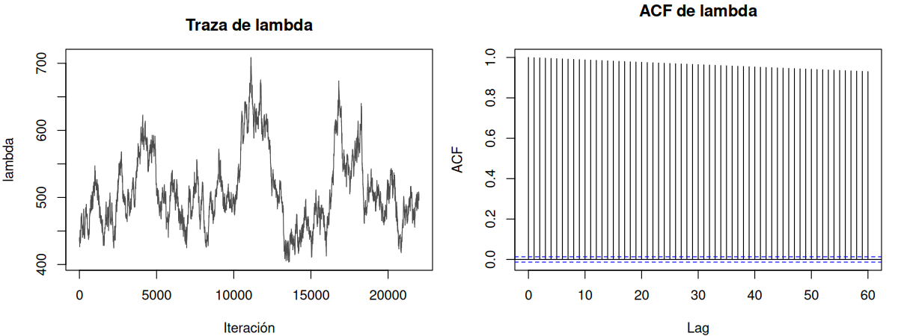
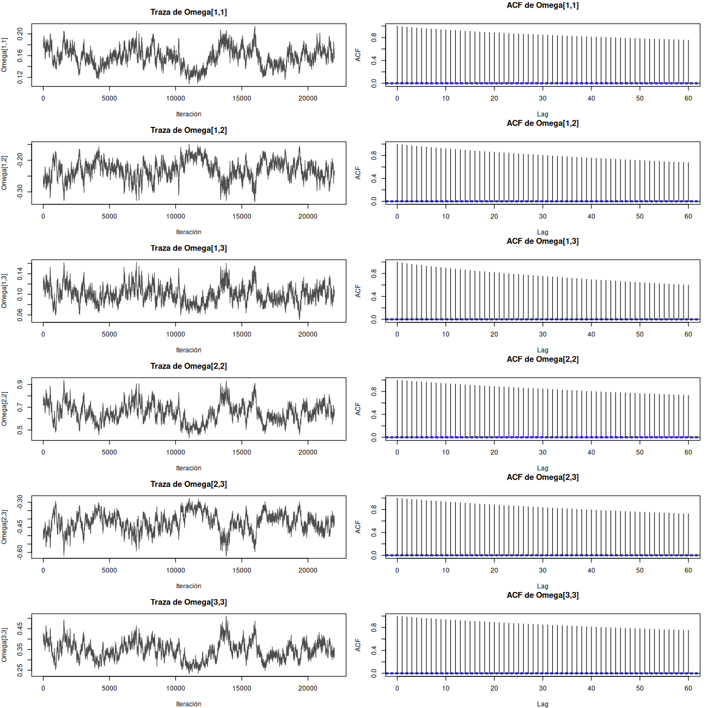
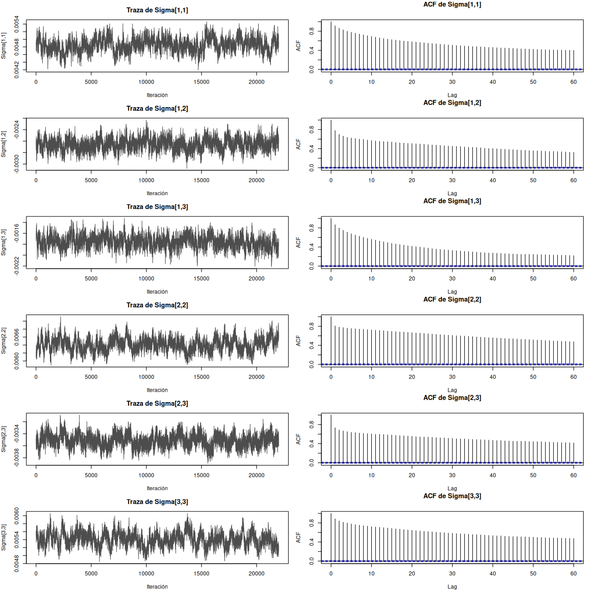
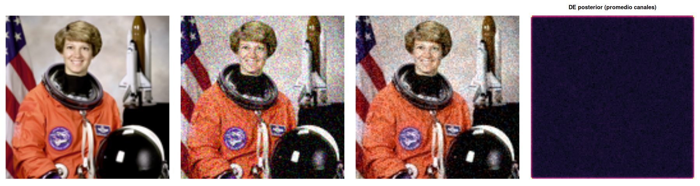
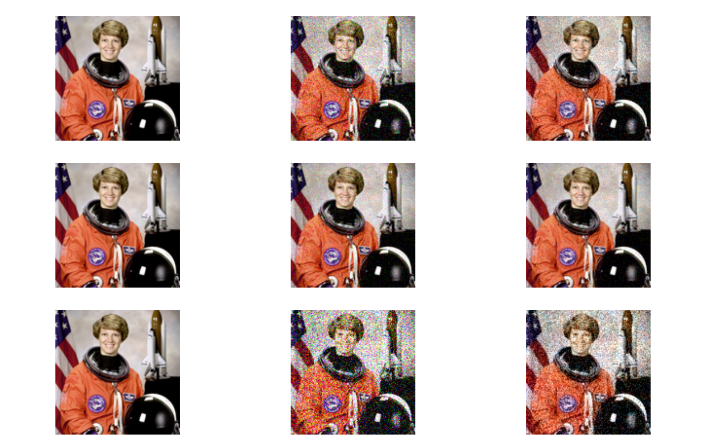

# Objetivo y planteamiento

Se dispone de una imagen RGB verdadera de $128\times128$ píxeles
(`astronaut_rgb.png`). Cada píxel es un vector
$\boldsymbol{X}^{(0)}_i=(R_i,G_i,B_i)^\mathsf{T}\in[0,1]^3$; las medias por canal
son $(0.555,\,0.415,\,0.379)$ y los canales están muy correlacionados
($r_{RG}\approx0.84$, $r_{GB}\approx0.96$, $r_{RB}\approx0.72$). Se contamina con
ruido gaussiano independiente en cada canal,

$$
\boldsymbol{Y}_i=\boldsymbol{X}_i^{(0)}+\boldsymbol\varepsilon_i,\qquad
\boldsymbol\varepsilon_i\overset{\text{iid}}{\sim}\textsf{N}_3(\boldsymbol0,\sigma_0^2\mathbf{I}_3),\qquad
\sigma_0\in\{0.05,\,0.10,\,0.20\},
$$

sin recortar fuera de $[0,1]$. El objetivo es estimar $\boldsymbol{X}$ a partir de
$\boldsymbol{Y}$, junto con la covarianza del ruido $\mathbf{\Sigma}$, la media
$\boldsymbol\mu$, la precisión entre canales $\mathbf{\Omega}$ y la suavidad
$\lambda$, y cuantificar la incertidumbre por píxel y canal.

Este modelo **generaliza el del 3.3**: cada píxel pasa de un número a un vector de
3 componentes, las varianzas escalares se vuelven matrices $3\times3$ y la
gamma inversa se vuelve Wishart inversa. Todo lo que se explicó en el documento
del 3.3 (Laplaciana, propiedad de Markov, papel del determinante, tablero de
ajedrez, cálculo espectral de $\log|\cdot|$) sigue valiendo; aquí se enfatiza lo
nuevo.

La **primera parte** (secciones 2 a 6) es la formulación: producto de Kronecker,
posterior conjunta, condicionales completas y la identificación de $\lambda$.
La **segunda parte** (secciones 7 a 12) es la implementación en `Code/3.4.R`, los
diagnósticos y los resultados.

# Formulación del modelo

## Representación de la imagen

Se apilan los 3 canales de cada píxel y luego los píxeles en orden por columnas:

$$
\boldsymbol{x}=(\boldsymbol{x}_1^\mathsf{T},\boldsymbol{x}_2^\mathsf{T},\dots,\boldsymbol{x}_P^\mathsf{T})^\mathsf{T}\in\mathbb{R}^{3P},
\qquad \boldsymbol{x}_i=(R_i,G_i,B_i)^\mathsf{T}.
$$

En el código la imagen se guarda como una matriz $\mathbf{X}$ de $P\times3$ (una
fila por píxel, una columna por canal), de modo que $\boldsymbol{x}=\operatorname{vec}(\mathbf{X}^\mathsf{T})$.

## Producto de Kronecker

::: {#def-kron}
## Producto de Kronecker
Para $\mathbf{A}$ de $p\times p$ y $\mathbf{B}$ de $q\times q$, $\mathbf{A}\otimes\mathbf{B}$
es la matriz de $pq\times pq$ formada por los bloques $A_{ij}\mathbf{B}$:
$$
\mathbf{A}\otimes\mathbf{B}=\begin{pmatrix}A_{11}\mathbf{B}&\cdots&A_{1p}\mathbf{B}\\\vdots&\ddots&\vdots\\A_{p1}\mathbf{B}&\cdots&A_{pp}\mathbf{B}\end{pmatrix}.
$$
:::

Propiedades que se usan (todas estándar): $(\mathbf{A}\otimes\mathbf{B})(\mathbf{C}\otimes\mathbf{D})=\mathbf{AC}\otimes\mathbf{BD}$;
$(\mathbf{A}\otimes\mathbf{B})^{-1}=\mathbf{A}^{-1}\otimes\mathbf{B}^{-1}$; los
valores propios de $\mathbf{A}\otimes\mathbf{B}$ son los productos $a_kb_l$; y por tanto

$$
|\mathbf{A}\otimes\mathbf{B}|=|\mathbf{A}|^{q}\,|\mathbf{B}|^{p}.
$$

Con $\mathbf{Q}=(\mathbf{I}_P+\lambda\mathbf{L})\otimes\mathbf{\Omega}$, el bloque
$(i,j)$ de $3\times3$ es:

$$
\mathbf{Q}_{ii}=(1+\lambda d_i)\,\mathbf{\Omega},\qquad
\mathbf{Q}_{ij}=-\lambda\,\mathbf{\Omega}\ \ (j\sim i),\qquad
\mathbf{Q}_{ij}=\mathbf{0}\ \ \text{en otro caso}.
$$

## Modelo de observación

$$
\boldsymbol{Y}_i\mid\boldsymbol{X}_i,\mathbf{\Sigma}\overset{\text{ind}}{\sim}\textsf{N}_3(\boldsymbol{X}_i,\mathbf{\Sigma})
\ \Longrightarrow\
p(\boldsymbol{y}\mid\boldsymbol{x},\mathbf{\Sigma})\propto|\mathbf{\Sigma}|^{-P/2}\exp\Big\{-\frac12\sum_i(\boldsymbol{y}_i-\boldsymbol{x}_i)^\mathsf{T}\mathbf{\Sigma}^{-1}(\boldsymbol{y}_i-\boldsymbol{x}_i)\Big\}.
$$

$\mathbf{\Sigma}$ es una matriz completa: el modelo permite que el ruido esté
correlacionado entre canales, aunque en la simulación no lo esté
($\mathbf{\Sigma}_0=\sigma_0^2\mathbf{I}_3$).

## Distribución previa de la imagen: GMRF multivariado

$$
\boldsymbol{x}\mid\boldsymbol\mu,\mathbf{\Omega},\lambda\sim\textsf{N}_{3P}\big(\boldsymbol1_P\otimes\boldsymbol\mu,\ \mathbf{Q}^{-1}\big),\qquad
\mathbf{Q}=(\mathbf{I}_P+\lambda\mathbf{L})\otimes\mathbf{\Omega}.
$$

::: {#prp-forma}
## Forma cuadrática y determinante
Sea $\mathbf{M}(\boldsymbol\mu,\lambda)=\sum_i(\boldsymbol{x}_i-\boldsymbol\mu)(\boldsymbol{x}_i-\boldsymbol\mu)^\mathsf{T}+\lambda\sum_{i\sim j}(\boldsymbol{x}_i-\boldsymbol{x}_j)(\boldsymbol{x}_i-\boldsymbol{x}_j)^\mathsf{T}$,
una matriz de $3\times3$. Entonces
$$
(\boldsymbol{x}-\boldsymbol1\otimes\boldsymbol\mu)^\mathsf{T}\mathbf{Q}(\boldsymbol{x}-\boldsymbol1\otimes\boldsymbol\mu)
=\sum_i(\boldsymbol{x}_i-\boldsymbol\mu)^\mathsf{T}\mathbf{\Omega}(\boldsymbol{x}_i-\boldsymbol\mu)
+\lambda\sum_{i\sim j}(\boldsymbol{x}_i-\boldsymbol{x}_j)^\mathsf{T}\mathbf{\Omega}(\boldsymbol{x}_i-\boldsymbol{x}_j)
=\operatorname{tr}(\mathbf{\Omega}\mathbf{M}),
$$
y
$$
|\mathbf{Q}|=|\mathbf{I}_P+\lambda\mathbf{L}|^{3}\,|\mathbf{\Omega}|^{P}.
$$
En particular, $\mathbf{Q}$ es definida positiva si y solo si $\mathbf{\Omega}$ lo es.
:::

::: {.proof}
Sea $\mathbf{Z}=\mathbf{X}-\boldsymbol1\boldsymbol\mu^\mathsf{T}$ ($P\times3$). Para
$\boldsymbol z=\operatorname{vec}(\mathbf{Z}^\mathsf{T})$ y cualquier $\mathbf{A}$
simétrica de $P\times P$,
$\boldsymbol z^\mathsf{T}(\mathbf{A}\otimes\mathbf{\Omega})\boldsymbol z=\sum_{i,j}A_{ij}\boldsymbol z_i^\mathsf{T}\mathbf{\Omega}\boldsymbol z_j=\operatorname{tr}(\mathbf{\Omega}\,\mathbf{Z}^\mathsf{T}\mathbf{A}\mathbf{Z})$.
Con $\mathbf{A}=\mathbf{I}+\lambda\mathbf{L}$: $\mathbf{Z}^\mathsf{T}\mathbf{Z}=\sum_i(\boldsymbol x_i-\boldsymbol\mu)(\boldsymbol x_i-\boldsymbol\mu)^\mathsf{T}$
y, como $\mathbf{L}\boldsymbol1=\boldsymbol0$,
$\mathbf{Z}^\mathsf{T}\mathbf{L}\mathbf{Z}=\mathbf{X}^\mathsf{T}\mathbf{L}\mathbf{X}=\sum_{i\sim j}(\boldsymbol x_i-\boldsymbol x_j)(\boldsymbol x_i-\boldsymbol x_j)^\mathsf{T}$
(versión matricial de la Proposición de la Laplaciana del 3.3). El determinante
sale de $|\mathbf{A}\otimes\mathbf{B}|=|\mathbf{A}|^q|\mathbf{B}|^p$ con $p=P$, $q=3$.
Los valores propios de $\mathbf{Q}$ son $(1+\lambda w_k)\,\omega_l$, positivos si y
solo si todos los $\omega_l$ (valores propios de $\mathbf{\Omega}$) lo son.
:::

**Interpretación.** La covarianza es
$\mathbf{Q}^{-1}=(\mathbf{I}+\lambda\mathbf{L})^{-1}\otimes\mathbf{\Omega}^{-1}$, es decir,

$$
\textsf{Cov}(\boldsymbol{X}_i,\boldsymbol{X}_j)=\big[(\mathbf{I}+\lambda\mathbf{L})^{-1}\big]_{ij}\;\mathbf{\Omega}^{-1}.
$$

El modelo es **separable**: la dependencia espacial (el factor escalar que
depende de $i$, $j$ y $\lambda$) es la misma para los tres canales, y la
dependencia entre canales ($\mathbf{\Omega}^{-1}$) es la misma en todos los
píxeles. $\lambda$ controla cuánto se parecen los vecinos; $\mathbf{\Omega}$
controla cómo se relacionan R, G y B.

Comparación con el 3.3: allí $\mathbf{Q}=\tau\mathbf{I}+\lambda\mathbf{L}$; aquí
$\mathbf{Q}=\mathbf{I}\otimes\mathbf{\Omega}+\lambda\mathbf{L}\otimes\mathbf{\Omega}$.
**$\mathbf{\Omega}$ hace el papel de $\tau$ y $\lambda\mathbf{\Omega}$ el de $\lambda$.**
Esta correspondencia es clave para entender la sección 4.2.

::: {#prp-markov-rgb}
## Propiedad de Markov
$$
\boldsymbol{X}_i\mid\boldsymbol{x}_{-i},\boldsymbol\mu,\mathbf{\Omega},\lambda\sim\textsf{N}_3\!\left(\boldsymbol\mu+\frac{\lambda}{1+\lambda d_i}\sum_{j\in N_i}(\boldsymbol{x}_j-\boldsymbol\mu),\ \big[(1+\lambda d_i)\mathbf{\Omega}\big]^{-1}\right).
$$
:::

::: {.proof}
Para una normal con precisión por bloques,
$\textsf{E}(\boldsymbol X_i\mid\cdot)=\boldsymbol\mu-\mathbf{Q}_{ii}^{-1}\sum_{j\ne i}\mathbf{Q}_{ij}(\boldsymbol x_j-\boldsymbol\mu)$
y $\textsf{Var}(\boldsymbol X_i\mid\cdot)=\mathbf{Q}_{ii}^{-1}$. Con
$\mathbf{Q}_{ii}=(1+\lambda d_i)\mathbf{\Omega}$ y $\mathbf{Q}_{ij}=-\lambda\mathbf{\Omega}$,
las $\mathbf{\Omega}$ se cancelan en la media.
:::

## Distribuciones previas de los parámetros

Convenciones (las del código):

$$
\textsf{W}_p(n,\mathbf{V}):\ p(\mathbf{W})\propto|\mathbf{W}|^{\frac{n-p-1}{2}}e^{-\frac12\operatorname{tr}(\mathbf{V}^{-1}\mathbf{W})},\ \ \textsf{E}[\mathbf{W}]=n\mathbf{V};
\qquad
\textsf{IW}_p(n,\mathbf{S}):\ p(\mathbf{\Sigma})\propto|\mathbf{\Sigma}|^{-\frac{n+p+1}{2}}e^{-\frac12\operatorname{tr}(\mathbf{S}\mathbf{\Sigma}^{-1})},\ \ \textsf{E}[\mathbf{\Sigma}]=\frac{\mathbf{S}}{n-p-1}.
$$

La Wishart es la generalización matricial de la gamma (modela **precisiones**) y
la Wishart inversa la de la gamma inversa (modela **covarianzas**). Si
$\mathbf{W}\sim\textsf{W}_p(n,\mathbf{V})$, entonces $\mathbf{W}^{-1}\sim\textsf{IW}_p(n,\mathbf{V}^{-1})$.

$$
\mathbf{\Sigma}\sim\textsf{IW}_3(\nu_\varepsilon,\mathbf{S}_\varepsilon),\qquad
\boldsymbol\mu\sim\textsf{N}_3(\boldsymbol m_\mu,\mathbf{V}_\mu),\qquad
\mathbf{\Omega}\sim\textsf{W}_3(\nu_\Omega,\mathbf{S}_\Omega),\qquad
\lambda\sim\textsf{G}(a_\lambda,b_\lambda),
$$

independientes a priori, con el grafo

$$
(\boldsymbol\mu,\mathbf{\Omega},\lambda)\;\longrightarrow\;\boldsymbol{X}\;\longrightarrow\;\boldsymbol{Y}\;\longleftarrow\;\mathbf{\Sigma}.
$$

# Distribución posterior conjunta

Usando la @prp-forma para la previa de $\boldsymbol{x}$:

$$
\boxed{\;
\begin{aligned}
p(\boldsymbol{x},\boldsymbol\mu,\mathbf{\Omega},\lambda,\mathbf{\Sigma}\mid\boldsymbol{y})\;\propto\;&
|\mathbf{\Sigma}|^{-P/2}\exp\Big\{-\frac12\sum_i(\boldsymbol y_i-\boldsymbol x_i)^\mathsf{T}\mathbf{\Sigma}^{-1}(\boldsymbol y_i-\boldsymbol x_i)\Big\}\\
&\cdot|\mathbf{I}+\lambda\mathbf{L}|^{3/2}\,|\mathbf{\Omega}|^{P/2}\exp\Big\{-\frac12\operatorname{tr}\big(\mathbf{\Omega}\,\mathbf{M}(\boldsymbol\mu,\lambda)\big)\Big\}\\
&\cdot|\mathbf{\Sigma}|^{-\frac{\nu_\varepsilon+4}{2}}e^{-\frac12\operatorname{tr}(\mathbf{S}_\varepsilon\mathbf{\Sigma}^{-1})}
\cdot e^{-\frac12(\boldsymbol\mu-\boldsymbol m_\mu)^\mathsf{T}\mathbf{V}_\mu^{-1}(\boldsymbol\mu-\boldsymbol m_\mu)}\\
&\cdot|\mathbf{\Omega}|^{\frac{\nu_\Omega-4}{2}}e^{-\frac12\operatorname{tr}(\mathbf{S}_\Omega^{-1}\mathbf{\Omega})}
\cdot\lambda^{a_\lambda-1}e^{-b_\lambda\lambda}.
\end{aligned}\;}
$$

::: {.callout-important}
## Dónde quedó $|\mathbf{Q}|$
Gracias a la estructura de Kronecker, $|\mathbf{Q}|^{1/2}$ se separa en
$|\mathbf{\Omega}|^{P/2}$, que se combina limpiamente con la previa Wishart y la
deja conjugada, y en $|\mathbf{I}+\lambda\mathbf{L}|^{3/2}$, que depende solo de
$\lambda$ y es el único factor que impide la conjugación. El exponente $3/2$ es
porque hay 3 canales: es como tener 3 copias del GMRF del 3.3.
:::

# Condicionales completas

::: {#prp-cond-x}
## Condicional de $\boldsymbol{X}_i$: normal trivariada
$$
\boldsymbol{X}_i\mid\text{resto}\sim\textsf{N}_3\big(\boldsymbol\Lambda_i^{-1}\boldsymbol h_i,\ \boldsymbol\Lambda_i^{-1}\big),
\qquad
\boldsymbol\Lambda_i=\mathbf{\Sigma}^{-1}+(1+\lambda d_i)\mathbf{\Omega},
\qquad
\boldsymbol h_i=\mathbf{\Sigma}^{-1}\boldsymbol y_i+\mathbf{\Omega}\Big(\boldsymbol\mu+\lambda\sum_{j\in N_i}\boldsymbol x_j\Big).
$$
:::

::: {.proof}
Los factores con $\boldsymbol x_i$ son la verosimilitud del píxel $i$ y la
condicional previa de la @prp-markov-rgb. Para dos normales en la misma variable,
las precisiones se suman y los vectores "precisión × media" también:

- verosimilitud: precisión $\mathbf{\Sigma}^{-1}$, precisión × media $\mathbf{\Sigma}^{-1}\boldsymbol y_i$;
- previa: precisión $(1+\lambda d_i)\mathbf{\Omega}$, precisión × media
  $\mathbf{\Omega}\big[(1+\lambda d_i)\boldsymbol\mu+\lambda\sum_j(\boldsymbol x_j-\boldsymbol\mu)\big]=\mathbf{\Omega}\big(\boldsymbol\mu+\lambda\sum_j\boldsymbol x_j\big)$.

Sumando se obtienen $\boldsymbol\Lambda_i$ y $\boldsymbol h_i$; la media es $\boldsymbol\Lambda_i^{-1}\boldsymbol h_i$.
:::

Es el análogo matricial de $m_i$ y $v_i$ del 3.3: un **promedio ponderado por
matrices** entre la observación $\boldsymbol y_i$ (peso $\mathbf{\Sigma}^{-1}$), la
referencia $\boldsymbol\mu$ y los vecinos. Lo nuevo es que el canal R de un píxel
puede corregirse usando los canales G y B (de él y de sus vecinos), a través de
las entradas fuera de la diagonal de $\mathbf{\Sigma}^{-1}$ y $\mathbf{\Omega}$.

::: {#prp-cond-sigma}
## Condicional de $\mathbf{\Sigma}$
$$
\mathbf{\Sigma}\mid\text{resto}\sim\textsf{IW}_3\Big(\nu_\varepsilon+P,\ \mathbf{S}_\varepsilon+\sum_i(\boldsymbol y_i-\boldsymbol x_i)(\boldsymbol y_i-\boldsymbol x_i)^\mathsf{T}\Big).
$$
:::

::: {.proof}
Como $\boldsymbol r^\mathsf{T}\mathbf{\Sigma}^{-1}\boldsymbol r=\operatorname{tr}(\boldsymbol r\boldsymbol r^\mathsf{T}\mathbf{\Sigma}^{-1})$,
la verosimilitud es $|\mathbf{\Sigma}|^{-P/2}\exp\{-\frac12\operatorname{tr}(\mathbf{R}\mathbf{\Sigma}^{-1})\}$
con $\mathbf{R}=\sum_i\boldsymbol r_i\boldsymbol r_i^\mathsf{T}$, $\boldsymbol r_i=\boldsymbol y_i-\boldsymbol x_i$.
Multiplicando por la previa:
$|\mathbf{\Sigma}|^{-\frac{(\nu_\varepsilon+P)+4}{2}}\exp\{-\frac12\operatorname{tr}((\mathbf{S}_\varepsilon+\mathbf{R})\mathbf{\Sigma}^{-1})\}$.
:::

::: {#prp-cond-mu}
## Condicional de $\boldsymbol\mu$
$$
\boldsymbol\mu\mid\text{resto}\sim\textsf{N}_3(\mathbf{V}_n\boldsymbol m_n,\mathbf{V}_n),\qquad
\mathbf{V}_n=(\mathbf{V}_\mu^{-1}+P\,\mathbf{\Omega})^{-1},\qquad
\boldsymbol m_n=\mathbf{V}_\mu^{-1}\boldsymbol m_\mu+\mathbf{\Omega}\sum_i\boldsymbol x_i.
$$
:::

::: {.proof}
$\boldsymbol\mu$ solo aparece en $-\frac12\sum_i(\boldsymbol x_i-\boldsymbol\mu)^\mathsf{T}\mathbf{\Omega}(\boldsymbol x_i-\boldsymbol\mu)$
(el término de las diferencias entre vecinos no depende de $\boldsymbol\mu$) y en
la previa. El término cuadrático en $\boldsymbol\mu$ tiene matriz $P\mathbf{\Omega}+\mathbf{V}_\mu^{-1}$
y el lineal es $\boldsymbol\mu^\mathsf{T}(\mathbf{\Omega}\sum_i\boldsymbol x_i+\mathbf{V}_\mu^{-1}\boldsymbol m_\mu)$.
:::

::: {#prp-cond-omega}
## Condicional de $\mathbf{\Omega}$
$$
\mathbf{\Omega}\mid\text{resto}\sim\textsf{W}_3\Big(\nu_\Omega+P,\ \big(\mathbf{S}_\Omega^{-1}+\mathbf{M}(\boldsymbol\mu,\lambda)\big)^{-1}\Big).
$$
:::

::: {.proof}
Los factores con $\mathbf{\Omega}$ son $|\mathbf{\Omega}|^{P/2}e^{-\frac12\operatorname{tr}(\mathbf{\Omega M})}$
(de $|\mathbf{Q}|^{1/2}$ y la @prp-forma) y la previa
$|\mathbf{\Omega}|^{\frac{\nu_\Omega-4}{2}}e^{-\frac12\operatorname{tr}(\mathbf{S}_\Omega^{-1}\mathbf{\Omega})}$.
El producto es
$|\mathbf{\Omega}|^{\frac{(\nu_\Omega+P)-4}{2}}e^{-\frac12\operatorname{tr}((\mathbf{S}_\Omega^{-1}+\mathbf{M})\mathbf{\Omega})}$.
:::

Aquí se ve la ventaja de la estructura de Kronecker: $\mathbf{\Omega}$ tiene 6
entradas libres y aun así se muestrea **exactamente**, sin Metropolis–Hastings.

::: {#prp-cond-lambda}
## Condicional de $\lambda$
$$
p(\lambda\mid\text{resto})\propto\lambda^{a_\lambda-1}e^{-b_\lambda\lambda}\,|\mathbf{I}+\lambda\mathbf{L}|^{3/2}
\exp\Big\{-\frac\lambda2\sum_{i\sim j}(\boldsymbol x_i-\boldsymbol x_j)^\mathsf{T}\mathbf{\Omega}(\boldsymbol x_i-\boldsymbol x_j)\Big\}.
$$
No es conjugada por el factor $|\mathbf{I}+\lambda\mathbf{L}|^{3/2}$.
:::

## Papel del determinante $|\mathbf{I}+\lambda\mathbf{L}|$

Por la fórmula espectral (Proposición de los valores propios del 3.3),
$\log|\mathbf{I}+\lambda\mathbf{L}|=\sum_k\log(1+\lambda w_k)$. Igual que en el
3.3, sin este factor el exponente empujaría a $\lambda$ hacia cero: el
determinante aporta el "volumen" que compensa la penalización. En las frecuencias
con $\lambda w_k\gg1$, $\log(1+\lambda w_k)\approx\log\lambda+\log w_k$; si casi
todas cumplen esto,

$$
\lambda\mid\mathbf{\Omega},\boldsymbol x\;\overset{\text{aprox}}{\sim}\;\textsf{G}\Big(a_\lambda+\frac{3(P-1)}{2},\ b_\lambda+\frac12\operatorname{tr}\big(\mathbf{\Omega}\,\mathbf{X}^\mathsf{T}\mathbf{L}\mathbf{X}\big)\Big),
$$

una distribución **muy concentrada** (coeficiente de variación $\approx1/\sqrt{24{,}574}\approx0.6\,\%$)
**dado $\mathbf{\Omega}$**. Esto explica por qué el paso de MH terminó con una
escala de propuesta minúscula ($s\approx0.025$ en escala log).

## La cresta $(\lambda,\mathbf{\Omega})$: qué identifica realmente el modelo

Aunque $\lambda$ está muy concentrado dado $\mathbf{\Omega}$, **no** lo está
marginalmente. Por la correspondencia de la sección 2.4, $\lambda\mathbf{\Omega}$
hace el papel de "$\lambda$" del 3.3 (bien identificado) y $\mathbf{\Omega}$ el
de "$\tau$" (casi sin identificar). En esta parametrización ambos papeles quedan
mezclados en dos parámetros.

Concretamente, para las frecuencias con $\lambda w_k\gg1$,

$$
(1+\lambda w_k)\,\mathbf{\Omega}\approx w_k\,(\lambda\mathbf{\Omega}),
$$

que **solo depende del producto $\lambda\mathbf{\Omega}$**. Si se multiplica
$\lambda$ por $c$ y se divide $\mathbf{\Omega}$ entre $c$, esas frecuencias no
cambian. Las únicas que distinguen a $\lambda$ de $\mathbf{\Omega}$ por separado
son las de $\lambda w_k\lesssim1$. Con $\hat\lambda\approx500$:

| $\sigma_0$ | $\hat\lambda$ | Frecuencias con $\hat\lambda w_k<1$ (de 16,384) |
|--:|--:|--:|
| 0.05 | 580 | 4 |
| 0.10 | 509 | 4 |
| 0.20 | 336 | 6 |

: Cuántas frecuencias informan sobre $\lambda$ y $\mathbf{\Omega}$ por separado. {#tbl-cresta}

Solo 4–6 frecuencias (por 3 canales) informan sobre la posición a lo largo de la
cresta $\lambda\mathbf{\Omega}\approx$ constante. Además, en esa dirección la
previa sí pesa: $\hat\lambda\approx500$ está en la cola de la previa
$\textsf{G}(2,0.1)$ (media 20). Por eso:

- $\lambda\mathbf{\Omega}$ está bien estimado (es lo que determina la restauración).
- $\lambda$ y $\mathbf{\Omega}$ por separado tienen una posterior alargada a lo
  largo de la cresta.
- El muestreador mezcla **muy lento** en esa dirección: alterna un $\mathbf{\Omega}$
  exacto dado $\lambda$ y un $\lambda$ muy concentrado dado $\mathbf{\Omega}$, así
  que avanza por la cresta en pasos diminutos. Resultado: $n_{\text{eff}}(\lambda)=13$–26
  sobre 22,000 iteraciones (sección 11).

¿Por qué $\hat\lambda$ es tan grande? En el 3.3, los datos llevaron la razón
$\tau/\lambda$ a $\approx0.0025/32\approx10^{-4}$: la imagen casi no se atrae
hacia $\mu$. Aquí la razón equivalente es $\mathbf{\Omega}/(\lambda\mathbf{\Omega})=1/\lambda$,
y para hacerla pequeña el modelo necesita un $\lambda$ grande. La previa
$\textsf{G}(2,0.1)$ lo frena, y el resultado es un compromiso alrededor de 300–600.

# Metropolis–Hastings para $\lambda$

Se trabaja con $\eta=\log\lambda$. Por el mismo argumento del jacobiano del 3.3,

$$
\log p(\eta\mid\cdot)=a_\lambda\eta-b_\lambda e^\eta+\tfrac32\log|\mathbf{I}+e^\eta\mathbf{L}|-\tfrac12e^\eta\,q+\text{cte},
\qquad q=\sum_{i\sim j}(\boldsymbol x_i-\boldsymbol x_j)^\mathsf{T}\mathbf{\Omega}(\boldsymbol x_i-\boldsymbol x_j).
$$

Propuesta $\eta^*=\eta+\textsf{N}(0,s^2)$ (simétrica), aceptación
$\alpha=\min\{1,p(\eta^*\mid\cdot)/p(\eta\mid\cdot)\}$. La escala $s$ se adapta
en el calentamiento con la misma regla del 3.3 (objetivo 30 %). Aquí la propuesta
es univariada: $\mathbf{\Omega}$, que está correlacionado con $\lambda$, se
muestrea por separado con su Wishart exacta.

# Algoritmo MCMC completo

> **Algoritmo 1.** MCMC para el GMRF multivariado RGB
>
> **Inicializar:** $\mathbf{X}=\mathbf{Y}$, $\boldsymbol\mu=$ medias de columna de $\mathbf{Y}$, $\mathbf{\Sigma}=0.01\mathbf{I}$, $\mathbf{\Omega}=10\mathbf{I}$, $\lambda=10$, $s=0.5$.
>
> **Para** $t=1,\dots,B$:
>
> 1. **Imagen.** Para $\mathcal{C}_1$ y luego $\mathcal{C}_2$, y simultáneamente para todo $i$ del color: $\boldsymbol x_i\sim\textsf{N}_3(\boldsymbol\Lambda_i^{-1}\boldsymbol h_i,\boldsymbol\Lambda_i^{-1})$.
> 2. **Ruido.** $\mathbf{\Sigma}\sim\textsf{IW}_3(\nu_\varepsilon+P,\ \mathbf{S}_\varepsilon+\sum_i\boldsymbol r_i\boldsymbol r_i^\mathsf{T})$.
> 3. **Media.** $\boldsymbol\mu\sim\textsf{N}_3(\mathbf{V}_n\boldsymbol m_n,\mathbf{V}_n)$.
> 4. **Precisión entre canales.** $\mathbf{\Omega}\sim\textsf{W}_3(\nu_\Omega+P,(\mathbf{S}_\Omega^{-1}+\mathbf{M})^{-1})$.
> 5. **Suavidad.** Calcular $q$; proponer $\eta^*$; evaluar $\log|\mathbf{I}+e^{\eta^*}\mathbf{L}|$; aceptar con probabilidad $\alpha$.
> 6. Si $t\le$ calentamiento, adaptar $s$. Si no, acumular momentos de $\mathbf{X}$ y guardar una de cada 40 imágenes.

Todos los pasos son de Gibbs exactos salvo el 5; la cadena tiene exactamente la
posterior como distribución estacionaria.

---

# Implementación computacional

Todo está en `Code/3.4.R`.

## Estructura espacial con lista de aristas

Además de $\mathbf{A}$, $\mathbf{L}$, $\boldsymbol d$ y el tablero (idénticos al
3.3), se guardan los extremos de cada arista, `ei` y `ej` (32,512 pares). Con
ellos, la matriz de diferencias $\mathbf{D}=\mathbf{X}[e_i,]-\mathbf{X}[e_j,]$
($32{,}512\times3$) da directamente:

- $\sum_{i\sim j}(\boldsymbol x_i-\boldsymbol x_j)(\boldsymbol x_i-\boldsymbol x_j)^\mathsf{T}=\mathbf{D}^\mathsf{T}\mathbf{D}$ (`crossprod(D)`), para $\mathbf{M}$;
- $q=\sum_{i\sim j}(\boldsymbol x_i-\boldsymbol x_j)^\mathsf{T}\mathbf{\Omega}(\boldsymbol x_i-\boldsymbol x_j)$ = `sum((D %*% Omega) * D)`, para el paso de $\lambda$.

## Paso de la imagen: solo tres factorizaciones $3\times3$

$\boldsymbol\Lambda_i=\mathbf{\Sigma}^{-1}+(1+\lambda d_i)\mathbf{\Omega}$ solo
depende de $i$ a través de $d_i\in\{2,3,4\}$. Por eso basta factorizar **tres**
matrices de $3\times3$ por iteración, en lugar de 16,384:

```r
muestrear_X <- function(X, Y, mu, Omega, Sigma, lambda) {
  iSigma <- solve(Sigma)
  grados <- 2:4
  Rch <- lapply(grados, function(g) chol(iSigma + (1 + lambda * g) * Omega))  # Lambda = R'R
  for (g in 1:2) {                                         # tablero de ajedrez
    ig <- tab$idx[[g]]
    S  <- as.matrix(tab$A_sub[[g]] %*% X)                  # sumas de vecinos (filas)
    H  <- Y[ig, , drop = FALSE] %*% iSigma +
          (matrix(1, length(ig), 1) %*% mu + lambda * S) %*% Omega   # filas = h_i'
    dg <- d[ig]
    for (k in seq_along(grados)) {
      sel <- which(dg == grados[k])
      if (!length(sel)) next
      Rk <- Rch[[k]]
      Mn <- H[sel, , drop = FALSE] %*% chol2inv(Rk)        # medias: h_i' Lambda^{-1}
      Zn <- matrix(rnorm(3 * length(sel)), length(sel), 3)
      En <- t(backsolve(Rk, t(Zn)))                         # ruido con cov Lambda^{-1}
      X[ig[sel], ] <- Mn + En
    }
  }
  X
}
```

::: {#prp-backsolve}
## Simulación de $\textsf{N}_3(\boldsymbol0,\boldsymbol\Lambda^{-1})$ sin invertir
Si $\boldsymbol\Lambda=\mathbf{R}^\mathsf{T}\mathbf{R}$ (Cholesky, $\mathbf{R}$
triangular superior) y $\boldsymbol z\sim\textsf{N}_3(\boldsymbol0,\mathbf{I})$,
entonces $\boldsymbol e=\mathbf{R}^{-1}\boldsymbol z\sim\textsf{N}_3(\boldsymbol0,\boldsymbol\Lambda^{-1})$.
:::

::: {.proof}
$\textsf{Cov}(\boldsymbol e)=\mathbf{R}^{-1}\mathbf{R}^{-\mathsf{T}}=(\mathbf{R}^\mathsf{T}\mathbf{R})^{-1}=\boldsymbol\Lambda^{-1}$.
`backsolve(R, z)` resuelve el sistema triangular $\mathbf{R}\boldsymbol e=\boldsymbol z$
por sustitución hacia atrás, sin formar $\mathbf{R}^{-1}$.
:::

Las medias se obtienen como filas $\boldsymbol h_i^\mathsf{T}\boldsymbol\Lambda^{-1}=(\boldsymbol\Lambda^{-1}\boldsymbol h_i)^\mathsf{T}$
(por simetría de $\boldsymbol\Lambda$), con `chol2inv`, que calcula $\boldsymbol\Lambda^{-1}$
a partir del factor de Cholesky. Todo está vectorizado: una multiplicación de
matrices para todos los píxeles de un mismo color y grado.

## Muestreo de Wishart y Wishart inversa

```r
rwishart <- function(n, V) {              # W ~ W_p(n, V), E[W] = nV
  Rw <- chol(V)                           # V = Rw' Rw
  Z  <- matrix(rnorm(nrow(V) * n), nrow(V), n)
  t(Rw) %*% tcrossprod(Z) %*% Rw
}
riwishart <- function(n, S) {             # Sigma ~ IW_p(n, S)
  R <- chol(S)                            # S = R' R
  Z <- matrix(rnorm(nrow(S) * n), nrow(S), n)
  t(R) %*% solve(tcrossprod(Z)) %*% R
}
```

::: {#prp-wishart}
## Construcción de la Wishart
Si $\boldsymbol z_1,\dots,\boldsymbol z_n\overset{\text{iid}}{\sim}\textsf{N}_p(\boldsymbol0,\mathbf{I})$
y $n\ge p$ es entero, $\mathbf{G}=\sum_k\boldsymbol z_k\boldsymbol z_k^\mathsf{T}\sim\textsf{W}_p(n,\mathbf{I})$.
Para $\mathbf{V}=\mathbf{R}^\mathsf{T}\mathbf{R}$: $\mathbf{R}^\mathsf{T}\mathbf{G}\mathbf{R}\sim\textsf{W}_p(n,\mathbf{V})$
y $\mathbf{R}^\mathsf{T}\mathbf{G}^{-1}\mathbf{R}\sim\textsf{IW}_p(n,\mathbf{R}^\mathsf{T}\mathbf{R})$.
:::

::: {.proof}
La primera afirmación es la definición de la Wishart como suma de productos
externos de normales. $\mathbf{R}^\mathsf{T}\boldsymbol z_k\sim\textsf{N}_p(\boldsymbol0,\mathbf{R}^\mathsf{T}\mathbf{R})$,
así que $\mathbf{R}^\mathsf{T}\mathbf{G}\mathbf{R}=\sum_k(\mathbf{R}^\mathsf{T}\boldsymbol z_k)(\mathbf{R}^\mathsf{T}\boldsymbol z_k)^\mathsf{T}\sim\textsf{W}_p(n,\mathbf{V})$.
Para la inversa: $\mathbf{G}^{-1}\sim\textsf{IW}_p(n,\mathbf{I})$ y la
transformación $\mathbf{R}^\mathsf{T}(\cdot)\mathbf{R}$ lleva la escala de $\mathbf{I}$ a $\mathbf{R}^\mathsf{T}\mathbf{R}$.
:::

Aquí $n=\nu+P=16{,}389$ o $16{,}390$, entero, así que la construcción aplica. El
costo es generar $3n\approx49{,}000$ normales por matriz, despreciable frente al
resto. El código usa `riwishart(nu_eps + P, S_eps + crossprod(R))` y
`rwishart(nu_om + P, solve(solve(S_om) + M))`, que son literalmente la
@prp-cond-sigma y la @prp-cond-omega.

::: {.callout-note}
## Una validación que detectó un error real
La primera versión de `rwishart` recibía $\mathbf{V}^{-1}$ en lugar de $\mathbf{V}$.
Los síntomas fueron evidentes al comparar con la verdad simulada:
$\mathbf{\Omega}\approx165{,}000\,\mathbf{I}$, $\mathbf{\Sigma}$ inflada a 0.11
(real 0.01) y correlaciones absurdas entre canales. Contrastar con valores
conocidos no solo evalúa resultados: también protege la implementación.
:::

## Pasos de $\boldsymbol\mu$, $\mathbf{\Omega}$ y $\lambda$

```r
muestrear_mu <- function(X, Omega, m_mu, V_mu) {
  iVmu <- solve(V_mu)
  Vn <- solve(iVmu + P * Omega)
  mn <- Vn %*% (iVmu %*% m_mu + Omega %*% colSums(X))
  c(mn) + drop(t(chol(Vn)) %*% rnorm(3))          # t(chol): covarianza correcta Vn
}

muestrear_Omega <- function(X, mu, lambda, nu_om, S_om) {
  Z  <- sweep(X, 2, mu, "-")                       # x_i - mu
  D  <- X[ei, , drop = FALSE] - X[ej, , drop = FALSE]
  Mm <- crossprod(Z) + lambda * crossprod(D)       # M(mu, lambda)
  rwishart(nu_om + P, solve(solve(S_om) + Mm))
}

paso_mh_lambda <- function(eta, s, a_l, b_l, logdet, quad) {
  eta_p <- eta + rnorm(1, 0, s)
  lam_p <- exp(eta_p)
  logdet_p <- log_det_IL(lam_p)                    # log|I + lambda L|
  lp   <- a_l * eta   - b_l * exp(eta) + 1.5 * logdet   - 0.5 * exp(eta) * quad
  lp_p <- a_l * eta_p - b_l * lam_p    + 1.5 * logdet_p - 0.5 * lam_p    * quad
  if (log(runif(1)) < lp_p - lp) list(eta = eta_p, lam = lam_p, logdet = logdet_p, acepta = TRUE)
  else                           list(eta = eta,   lam = exp(eta), logdet = logdet,   acepta = FALSE)
}
```

- En `muestrear_mu`, `t(chol(Vn)) %*% z` tiene covarianza $\mathbf{R}^\mathsf{T}\mathbf{R}=\mathbf{V}_n$: es la forma correcta.
- `1.5 * logdet` es el exponente $3/2$ de $|\mathbf{I}+\lambda\mathbf{L}|^{3/2}$;
  `a_l * eta` incluye el jacobiano de la escala log.
- $\log|\mathbf{I}+\lambda\mathbf{L}|$ se calcula con el mismo Cholesky disperso
  con permutación fija del 3.3, o con la fórmula espectral
  $\sum_k\log(1+\lambda w_k)$; ambos se validan entre sí al inicio.

## Almacenamiento y costo

- Momentos $\sum\mathbf{X}$ y $\sum\mathbf{X}^2$ por píxel y canal; cadena
  adelgazada con `thin = 40` (550 imágenes × 16,384 × 3 ≈ 216 MB por escenario).
- Las matrices $\mathbf{\Sigma}$ y $\mathbf{\Omega}$ se guardan como sus 6
  entradas distintas (`vech_sym`).
- Por iteración: dos medios barridos (productos dispersos $P\times3$ y tres
  Cholesky $3\times3$), una matriz de diferencias de $32{,}512\times3$, dos
  muestras de Wishart y una evaluación de $\log|\mathbf{I}+\lambda\mathbf{L}|$.
  Unos 25–43 minutos por escenario de 24,000 iteraciones (con el método espectral).

# Elección de hiperparámetros y ajustes

| Elemento | Valor | Justificación |
|:--|:--|:--|
| $\mathbf{\Sigma}\sim\textsf{IW}_3(\nu_\varepsilon,\mathbf{S}_\varepsilon)$ | $\textsf{IW}_3(6,\,0.01\mathbf{I})$ | $\nu_\varepsilon=6>p+1$: media finita; $\textsf{E}[\mathbf{\Sigma}]=0.005\mathbf{I}$, en la escala de los $\sigma_0^2$; escala esférica: no presupone correlación del ruido. |
| $\boldsymbol\mu\sim\textsf{N}_3(\boldsymbol m_\mu,\mathbf{V}_\mu)$ | $\textsf{N}_3(0.5\cdot\boldsymbol1,\,0.25\mathbf{I})$ | Cubre $[0,1]$ en cada canal sin preferir un color. |
| $\mathbf{\Omega}\sim\textsf{W}_3(\nu_\Omega,\mathbf{S}_\Omega)$ | $\textsf{W}_3(5,\,0.1\mathbf{I})$ | Propia ($\nu_\Omega\ge p$), poco informativa; $\textsf{E}[\mathbf{\Omega}]=\nu_\Omega\mathbf{S}_\Omega=0.5\mathbf{I}$. |
| $\lambda\sim\textsf{G}(a_\lambda,b_\lambda)$ | $\textsf{G}(2,\,0.1)$ | La misma del 3.3, por consistencia. |
| Iteraciones / calentamiento | 24,000 / 2,000 | La cresta $(\lambda,\mathbf{\Omega})$ exige cadenas largas para cumplir CVMC < 5 %. |
| Propuesta de $\lambda$ | $\textsf{N}(0,s^2)$ en $\log\lambda$, $s_0=0.5$, adaptativa | Objetivo 30 % de aceptación. |
| Inicialización | $\mathbf{X}=\mathbf{Y}$, $\boldsymbol\mu=\bar{\boldsymbol y}$, $\mathbf{\Sigma}=0.01\mathbf{I}$, $\mathbf{\Omega}=10\mathbf{I}$, $\lambda=10$ | Arranque razonable; el calentamiento descarta su efecto. |
| Adelgazamiento | 40 | Memoria (3 canales). |

: Hiperparámetros y ajustes. {#tbl-hiper}

**Sensibilidad a la previa.** $\mathbf{\Sigma}$, $\boldsymbol\mu$ y el producto
$\lambda\mathbf{\Omega}$ los determinan los datos. La posición a lo largo de la
cresta (cuánto es $\lambda$ y cuánto $\mathbf{\Omega}$) sí depende de las previas
de $\lambda$ y $\mathbf{\Omega}$ (sección 4.2). Afecta poco a la restauración,
pero significa que los valores numéricos de $\lambda$ y $\mathbf{\Omega}$ por
separado deben interpretarse con cuidado.

# Estimación posterior y restauración

- **Restauración:** $\hat{\boldsymbol x}_i=\textsf{E}(\boldsymbol X_i\mid\boldsymbol y)$, por canal.
- **Incertidumbre:** DE posterior por píxel y canal; IC 95 % por cuantiles de la
  cadena adelgazada; cobertura empírica por canal.
- **Métricas:** MSE y SNR globales y por canal, $\text{SNR}_c=10\log_{10}\big(\overline{(x^{(0)}_{\cdot c})^2}/\text{MSE}_c\big)$, y PSNR.
- **$\mathbf{\Sigma}$ frente a la verdad:** se compara la diagonal con $\sigma_0^2$
  y las correlaciones con 0.

# Diagnósticos de convergencia

| Parámetro | Media | DE | $n_{\text{eff}}$ | CVMC (%) | IC 95 % |
|:--|--:|--:|--:|--:|:--|
| $\mu_R$ | 0.5563 | 0.0367 | 22,000 | 0.04 | [0.484, 0.627] |
| $\mu_G$ | 0.4168 | 0.0351 | 22,000 | 0.06 | [0.348, 0.486] |
| $\mu_B$ | 0.3794 | 0.0372 | 22,000 | 0.07 | [0.306, 0.452] |
| $\Sigma_{11}$ | 0.00485 | 0.00018 | 175 | 0.28 | [0.00449, 0.00520] |
| $\Sigma_{21}$ | −0.00265 | 0.00010 | 228 | 0.26 | [−0.00285, −0.00245] |
| $\Sigma_{31}$ | −0.00176 | 0.00012 | 421 | 0.32 | [−0.00198, −0.00153] |
| $\Sigma_{22}$ | 0.00641 | 0.00016 | 123 | 0.23 | [0.00611, 0.00673] |
| $\Sigma_{32}$ | −0.00352 | 0.00010 | 158 | 0.23 | [−0.00371, −0.00331] |
| $\Sigma_{33}$ | 0.00541 | 0.00018 | 173 | 0.25 | [0.00506, 0.00576] |
| $\Omega_{11}$ | 0.1575 | 0.0177 | 54 | 1.52 | [0.123, 0.191] |
| $\Omega_{21}$ | −0.2302 | 0.0302 | 83 | 1.44 | [−0.293, −0.175] |
| $\Omega_{31}$ | 0.1005 | 0.0167 | 109 | 1.59 | [0.071, 0.137] |
| $\Omega_{22}$ | 0.6529 | 0.0838 | 59 | 1.67 | [0.501, 0.826] |
| $\Omega_{32}$ | −0.4210 | 0.0560 | 61 | 1.70 | [−0.538, −0.322] |
| $\Omega_{33}$ | 0.3454 | 0.0436 | 58 | 1.65 | [0.268, 0.435] |
| $\lambda$ | 509.0 | 55.3 | **13** | 3.02 | [428.0, 635.1] |

: Diagnóstico de los 16 parámetros escalares con $\sigma_0=0.10$ (22,000 muestras; `log_3.4.txt`). {#tbl-diag}

| $\sigma_0$ | $\hat\lambda$ | $n_{\text{eff}}(\lambda)$ | CVMC $\lambda$ (%) | Aceptación MH | CVMC $\mathbf{\Omega}$ (%) | $n_{\text{eff}}$ mín. píxeles (R/G/B) |
|--:|--:|--:|--:|--:|:--|:--|
| 0.05 | 580.1 | 26 | 1.47 | 29.5 % | 0.86–1.24 | 125 / 185 / 169 |
| 0.10 | 509.0 | 13 | 3.02 | 29.9 % | 1.44–1.70 | 198 / 147 / 201 |
| 0.20 | 336.5 | 14 | 3.07 | 30.1 % | 1.33–2.17 | 193 / 163 / 166 |

: Resumen de diagnósticos por nivel de ruido. {#tbl-diag2}

{#fig-lam}

{#fig-omega}

{#fig-sigma}

**Lectura.** $\boldsymbol\mu$ mezcla perfectamente ($n_{\text{eff}}=22{,}000$) y
$\mathbf{\Sigma}$ bien ($n_{\text{eff}}$ 123–421). La tasa de aceptación de
$\lambda$ quedó prácticamente en el objetivo del 30 % en los tres escenarios. Todos
los CVMC están por debajo del 5 %, de modo que **el criterio del curso se cumple**.

Pero hay que leer con cuidado el caso de $\lambda$. Un $n_{\text{eff}}$ de 13
significa que 22,000 iteraciones equivalen a unas 13 muestras independientes. La
traza (@fig-lam) muestra excursiones lentas de miles de iteraciones y una ACF que
casi no decae en 60 retardos. Con tan pocas muestras efectivas, el propio cálculo
de $n_{\text{eff}}$ y del EMC es poco fiable. $\mathbf{\Omega}$ hereda la misma
lentitud ($n_{\text{eff}}$ 54–109). La causa es la cresta de la sección 4.2: no es
un error de código, sino una parametrización que el muestreador recorre mal.

Para el informe conviene decir que el CVMC cumple, pero que $\lambda$ mezcla muy
lento por la cresta $(\lambda,\mathbf{\Omega})$. Lo que se usa para restaurar (la
media posterior de cada píxel) sí está bien estimado: los $n_{\text{eff}}$ de los
píxeles son 125–550 y su CVMC medio es menor que 1.7 %.

# Resultados

| $\sigma_0$ | MSE contaminada | MSE restaurada | Reducción | SNR global (dB) | MSE (R, G, B) | SNR (R, G, B) (dB) | Cobertura IC 95 % (R, G, B) |
|--:|--:|--:|--:|--:|:--|:--|:--|
| 0.05 | 0.00248 | 0.00158 | 36 % | 20.84 → 22.78 | (0.0019, 0.0011, 0.0018) | (23.3, 23.8, 21.2) | (57.5, 77.2, 59.0) % |
| 0.10 | 0.01004 | 0.00427 | 57 % | 14.76 → 18.48 | (0.0045, 0.0038, 0.0045) | (19.6, 18.4, 17.1) | (79.4, 57.5, 72.1) % |
| 0.20 | 0.03965 | 0.01214 | 69 % | 8.80 → 13.93 | (0.0117, 0.0116, 0.0132) | (15.4, 13.5, 12.5) | (83.2, 66.3, 74.8) % |

: Calidad de la restauración global y por canal. {#tbl-res}

{#fig-panel}

{#fig-comp}

## Calidad por canal

Los tres canales se restauran de forma pareja; el verde tiene el menor MSE y el
azul la menor SNR en los tres niveles (su intensidad media
es la más baja, 0.379, así que el mismo error pesa más en relación con la señal).

## $\mathbf{\Sigma}$ frente a la verdad: el ruido de "brillo" se confunde con la imagen

La diagonal de $\hat{\mathbf{\Sigma}}$ subestima $\sigma_0^2$ (0.0048–0.0064 frente
a 0.01 con $\sigma_0=0.10$) y aparecen correlaciones **negativas** entre canales
($-0.34$ a $-0.60$), cuando el ruido simulado es independiente. Esto parece
desordenado, pero tiene una estructura muy clara si se miran los **valores y
vectores propios**:

| $\sigma_0$ | Valores propios de $\hat{\mathbf{\Sigma}}$ | Vector propio del menor | $\sigma_0^2$ |
|--:|:--|:--|--:|
| 0.05 | 0.00212, 0.00040, **0.00018** | $(0.49,\,0.56,\,0.66)$ | 0.0025 |
| 0.10 | 0.00967, 0.00673, **0.00027** | $(0.56,\,0.58,\,0.59)$ | 0.0100 |
| 0.20 | 0.03904, 0.03448, **0.00562** | $(0.55,\,0.57,\,0.61)$ | 0.0400 |

: Descomposición espectral de $\hat{\mathbf{\Sigma}}$ (signo del vector normalizado). {#tbl-sigma-eig}

- El vector propio del menor valor propio es casi $(1,1,1)/\sqrt3$: la dirección
  de **brillo** (luminancia), en la que los tres canales suben o bajan juntos.
- En esa dirección, el modelo estima una varianza del ruido de 0.00027 cuando la
  real es 0.01: **subestima un 97 %**.
- En las dos direcciones ortogonales (diferencias de **color**), con
  $\sigma_0=0.10$ y $0.20$ los valores propios (0.0097 y 0.0067; 0.039 y 0.034)
  están cerca del valor real.

La explicación conecta con $\hat{\mathbf{\Omega}}$. Su menor valor propio (la
dirección de **menor precisión**, es decir, de mayor variabilidad del campo) es
también la de brillo, $(0.55,\,0.59,\,0.59)$. Las correlaciones entre canales del
campo, calculadas con $\hat{\mathbf{\Omega}}^{-1}$, son
$r_{RG}=0.80$, $r_{RB}=0.64$, $r_{GB}=0.92$, muy parecidas a las de la imagen
original (0.84, 0.72, 0.96). **El modelo aprendió correctamente que en una foto
los canales varían juntos.**

Consecuencia:

- **Ruido de color** (un píxel que se vuelve más rojo y menos verde): la imagen
  casi nunca hace eso, así que el modelo lo identifica como ruido y lo elimina.
- **Ruido de brillo** (un píxel más claro en los tres canales): es exactamente
  como varía la imagen real, así que el modelo lo confunde con textura y lo
  conserva en $\boldsymbol x$.

Es el mismo fenómeno de confusión ruido–textura del 3.3, pero ahora **solo en una
dirección del espacio de color**. Si el ruido de brillo se queda en
$\boldsymbol x$, los residuos $\boldsymbol y_i-\boldsymbol x_i$ casi no tienen
componente de brillo; un vector con suma casi constante tiene componentes
negativamente correlacionadas, y por eso aparecen las correlaciones negativas en
$\hat{\mathbf{\Sigma}}$.

**Por qué el RGB mejora más que el gris con poco ruido** (36 % frente a 9 %): en
el modelo de grises todo el ruido es "de brillo" y con $\sigma_0=0.05$ casi todo
se confunde con textura. En el RGB, dos de las tres direcciones del ruido son de
color y se eliminan bien. (La comparación es solo indicativa, porque las
imágenes son distintas.)

## Cobertura

La cobertura de los IC 95 % está por debajo del nominal en todos los canales
(57–83 %). Es la consecuencia del punto anterior: en la dirección de brillo, el
modelo cree que casi no hay ruido y sus intervalos son demasiado angostos. La
cobertura es peor en el canal G con $\sigma_0=0.10$ y $0.20$; con los datos
disponibles no hay una explicación clara para la diferencia entre canales.

## Influencia de $\lambda$ y $\mathbf{\Omega}$ en colores, bordes y detalles

- **$\lambda\mathbf{\Omega}$** (suavidad espacial efectiva): las entradas
  diagonales de $\hat\lambda\hat{\mathbf{\Omega}}$ son (80, 332, 176) con
  $\sigma_0=0.10$; es esta matriz, y no $\lambda$ sola, la que fija cuánto se
  suaviza. Como en el gris, limpia las regiones
  homogéneas (el fondo, el traje) y **difumina los bordes** (contorno del casco,
  bandera, rostro).
- **$\mathbf{\Omega}$** (estructura de color): al imponer que los canales varíen
  juntos, el modelo **preserva los colores**: el ruido cromático se elimina mejor
  que el de brillo (sección 12.2). Es de esperar que los bordes donde cambia un
  canal y no los otros (por ejemplo, rojo/azul en la bandera) se suavicen algo
  más, porque contradicen esa estructura.
- **Con más ruido**, $\hat\lambda$ baja (580 → 509 → 336) por la misma razón que
  en el 3.3: las muestras de $\boldsymbol x$ son más rugosas. Los detalles finos
  se pierden progresivamente (@fig-comp).

## Dónde está la incertidumbre

El mapa de DE posterior (promedio de canales, @fig-panel) es casi uniforme y
aumenta en el marco de la imagen (bordes con $d_i=3$, esquinas con $d_i=2$). Igual
que en el 3.3, la incertidumbre del GMRF depende de la geometría del grafo y de
los parámetros, no del contenido de la escena.

# Limitaciones y recomendaciones

1. **Reparametrizar para eliminar la cresta.** Escribir
   $\mathbf{Q}=(\kappa\mathbf{I}+\mathbf{L})\otimes\mathbf{\Psi}$ con
   $\mathbf{\Psi}=\lambda\mathbf{\Omega}$ y $\kappa=1/\lambda$. Así
   $\mathbf{\Psi}$ (bien identificado) queda separado de $\kappa$ (el análogo de
   $\tau/\lambda$ del 3.3), y el muestreador no tiene que recorrer la cresta.
2. **Movimiento a lo largo de la cresta.** Alternativa sin reparametrizar: un
   paso extra que proponga $\lambda^*=\lambda e^{\varepsilon}$ y
   $\mathbf{\Omega}^*=\mathbf{\Omega}e^{-\varepsilon}$ a la vez, de modo que
   $\lambda\mathbf{\Omega}$ quede fijo. En la razón de aceptación hay que incluir
   el jacobiano de la transformación $(\log\lambda,\mathbf{\Omega})\mapsto(\log\lambda+\varepsilon,\,e^{-\varepsilon}\mathbf{\Omega})$,
   que vale $e^{-6\varepsilon}$ porque $\mathbf{\Omega}$ tiene 6 entradas libres.
3. **Confusión de brillo.** Una previa más informativa para $\mathbf{\Sigma}$, o
   estimar el ruido en una zona plana, ayudaría a separar el ruido de brillo de
   la textura.
4. **Separabilidad.** Un solo $\lambda$ para los tres canales y una sola
   $\mathbf{\Omega}$ para toda la imagen son supuestos fuertes. Modelos no
   separables (un $\lambda$ por canal, coregionalización) serían más flexibles.
5. **Bordes.** Igual que en el 3.3, la penalización cuadrática difumina
   discontinuidades.
6. **Varias cadenas.** Con $n_{\text{eff}}(\lambda)\approx13$ es especialmente
   recomendable correr varias cadenas y usar Gelman–Rubin.

# Referencias

Dawid, A. P. (1981). Some matrix-variate distribution theory: Notational
considerations and a Bayesian application. *Biometrika*, 68(1), 265–274.

Gelfand, A. E., Schmidt, A. M., Banerjee, S., y Sirmans, C. F. (2004).
Nonstationary multivariate process modeling through spatially varying
coregionalization. *Test*, 13(2), 263–312.

Gelman, A., Carlin, J. B., Stern, H. S., Dunson, D. B., Vehtari, A., y Rubin, D. B.
(2013). *Bayesian data analysis* (3.ª ed.). CRC Press.

Gilks, W. R., y Roberts, G. O. (1996). Strategies for improving MCMC. En W. R.
Gilks, S. Richardson y D. J. Spiegelhalter (Eds.), *Markov chain Monte Carlo in
practice* (pp. 89–114). Chapman & Hall.

Mardia, K. V. (1988). Multi-dimensional multivariate Gaussian Markov random fields
with application to image processing. *Journal of Multivariate Analysis*, 24(2),
265–284.

Rue, H., y Held, L. (2005). *Gaussian Markov random fields: Theory and
applications*. Chapman & Hall/CRC.
