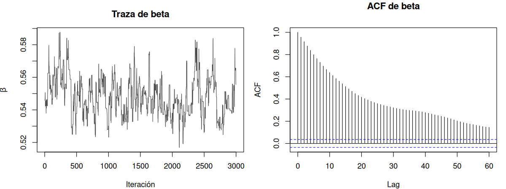
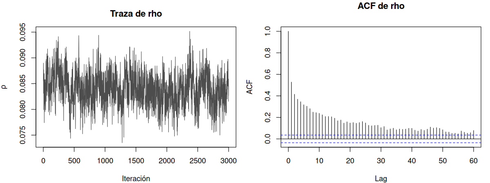
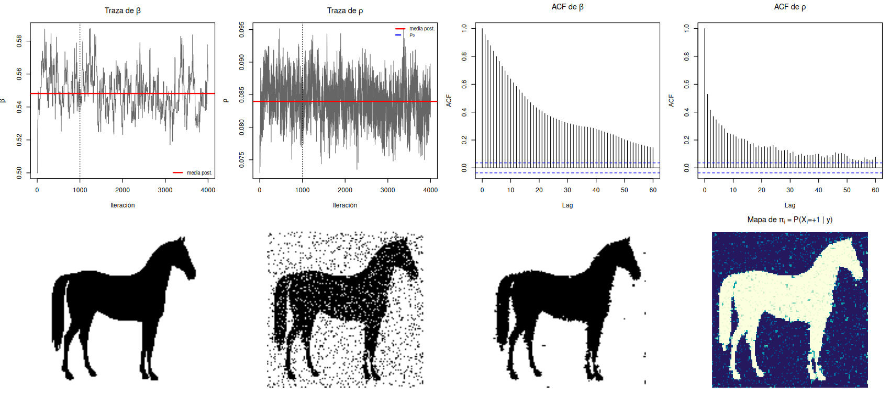
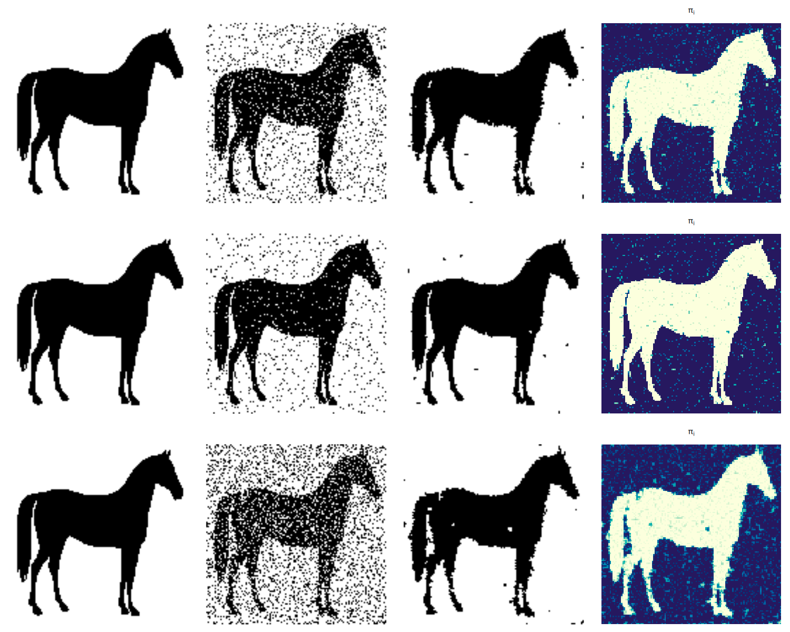

# Objetivo y planteamiento

Se dispone de una imagen binaria verdadera $\boldsymbol{X}^{(0)}$ de $128\times128$
píxeles (la silueta `horse_binaria.png`). Se contamina artificialmente volteando
cada píxel de forma independiente con probabilidad $\rho_0\in\{0.05,\,0.10,\,0.20\}$,
lo que produce una imagen observada $\boldsymbol{Y}$. El problema es **estimar
$\boldsymbol{X}$ a partir de $\boldsymbol{Y}$ únicamente**, junto con la fuerza de la
dependencia espacial $\beta$ y el nivel de ruido $\rho$, y cuantificar la
incertidumbre de la reconstrucción.

La imagen original se usa solo para generar la contaminación y para evaluar el
resultado (precisión, MSE, SNR); nunca interviene en la inferencia ni en la
elección de hiperparámetros o ajustes del algoritmo.

El documento tiene dos partes. La **primera** (secciones 2 a 6) es la
formulación matemática: modelo, posterior conjunta, condicionales completas y el
algoritmo de intercambio con su justificación. La **segunda** (secciones 7 a 11)
es la parte computacional: cómo se implementa cada paso en `Code/3.2.R`, cómo se
eligieron los ajustes, cómo se diagnostica la convergencia y qué resultados se
obtuvieron.

# Formulación del modelo

## Representación de la imagen como grafo

Sea $P = MN = 16{,}384$ el número de píxeles. La imagen se representa con el
grafo $G=(V,E)$, donde cada píxel es un vértice y dos píxeles son vecinos
($i\sim j$) si comparten un lado. $N_i$ denota el conjunto de vecinos de $i$ y
$d_i = |N_i|\in\{2,3,4\}$ su grado (esquinas, bordes e interior). El número de
aristas es

$$
|E| = M(N-1) + N(M-1) = 2\cdot128\cdot127 = 32{,}512 .
$$

Los píxeles se ordenan por columnas, $k = (c-1)M + r$, y la imagen se trata como
un vector $\boldsymbol{x}\in\{-1,+1\}^P$, donde $x_i=+1$ representa el negro
(silueta) y $x_i=-1$ el blanco (fondo). Con la matriz de adyacencia
$\mathbf{A}$ (simétrica, $A_{ij}=1$ si $i\sim j$) se define el estadístico

$$
S(\boldsymbol{x}) = \sum_{i\sim j} x_i x_j = \tfrac12\,\boldsymbol{x}^\mathsf{T}\mathbf{A}\boldsymbol{x},
$$

donde el factor $\tfrac12$ corrige que $\boldsymbol{x}^\mathsf{T}\mathbf{A}\boldsymbol{x}$ cuenta cada arista dos veces.

::: {#prp-S}
## Interpretación de $S$
Sea $D(\boldsymbol{x}) = \#\{i\sim j : x_i\neq x_j\}$ el número de aristas
*discordantes* (pares de vecinos con distinto color). Entonces
$$
S(\boldsymbol{x}) = |E| - 2D(\boldsymbol{x}).
$$
:::

::: {.proof}
Cada arista concordante aporta $x_ix_j=+1$ y cada discordante aporta $-1$. Luego
$S = (|E|-D) - D = |E| - 2D$.
:::

$S$ es por tanto un índice de homogeneidad: vale $|E|$ en una imagen de un solo
color y $-|E|$ en un tablero de ajedrez. Para la imagen verdadera,
$S(\boldsymbol{x}^{(0)}) = 30{,}612$, es decir $D = 950$: solo el 2.9 % de las
aristas separan píxeles de distinto color.

## Modelo de observación

Dado el estado verdadero, cada píxel observado se voltea independientemente con
probabilidad $\rho$:

$$
\textsf{Pr}(Y_i = y_i\mid X_i = x_i,\rho) =
\begin{cases}
1-\rho, & y_i = x_i,\\
\rho, & y_i\neq x_i,
\end{cases}
\qquad\text{equivalentemente}\qquad
\textsf{Pr}(Y_i = y_i\mid x_i,\rho) = (1-\rho)^{\mathbb{I}(y_i=x_i)}\rho^{\,\mathbb{I}(y_i\neq x_i)} .
$$

Con $d_y(\boldsymbol{x}) = \sum_{i=1}^P \mathbb{I}(x_i\neq y_i)$, el número de
desacuerdos entre $\boldsymbol{x}$ y lo observado, la verosimilitud es

$$
p(\boldsymbol{y}\mid\boldsymbol{x},\rho) = \rho^{\,d_y(\boldsymbol{x})}(1-\rho)^{P-d_y(\boldsymbol{x})} .
$$

## Distribución previa de la imagen: modelo de Ising

$$
p(\boldsymbol{x}\mid\beta) = \frac{1}{Z(\beta)}\exp\{\beta S(\boldsymbol{x})\},
\qquad
Z(\beta) = \sum_{\boldsymbol{z}\in\{-1,+1\}^P} \exp\{\beta S(\boldsymbol{z})\},
\qquad \beta>0 .
$$

Por la @prp-S, $p(\boldsymbol{x}\mid\beta)\propto\exp\{-2\beta D(\boldsymbol{x})\}$:
**cada arista discordante multiplica la probabilidad previa por $e^{-2\beta}$**.
La previa no contiene información sobre la forma de la silueta; solo expresa que
las configuraciones con regiones homogéneas y pocos bordes son más probables, y
$\beta$ regula la intensidad de esa preferencia:

- $\beta=0$: $p(\boldsymbol{x}\mid 0) = 2^{-P}$, píxeles independientes y equiprobables.
- $\beta$ por encima del valor crítico de la rejilla cuadrada infinita,
  $\beta_c = \tfrac12\log(1+\sqrt2)\approx 0.4407$ (Onsager, 1944), las
  configuraciones típicas presentan grandes regiones de un mismo color.
- $\beta\to\infty$: la masa se concentra en las dos imágenes constantes.

La constante $Z(\beta)$ es una suma sobre $2^{16{,}384}$ configuraciones y no
puede calcularse. Esta es la dificultad central del modelo.

::: {#prp-markov}
## Propiedad de Markov
Para todo píxel $i$,
$$
p(x_i\mid\boldsymbol{x}_{-i},\beta)\;\propto\;\exp\Big\{\beta\,x_i\,s_i\Big\},
\qquad s_i = \sum_{j\in N_i} x_j .
$$
En particular, $X_i$ es condicionalmente independiente del resto de la imagen dados sus vecinos.
:::

::: {.proof}
Separando en $S(\boldsymbol{x})$ las aristas que contienen a $i$,
$S(\boldsymbol{x}) = x_i s_i + S_{-i}$, donde $S_{-i}$ no depende de $x_i$.
Al condicionar en $\boldsymbol{x}_{-i}$, tanto $e^{\beta S_{-i}}$ como $Z(\beta)$
son constantes y se absorben en la proporcionalidad.
:::

## Distribuciones previas de los parámetros

$$
\beta\sim\textsf{G}(a_\beta,b_\beta),\qquad
\rho\sim\textsf{Beta}(a_\rho,b_\rho)\ \text{truncada en }(0,\tfrac12),
$$

independientes a priori, con densidades

$$
p(\beta)\propto\beta^{a_\beta-1}e^{-b_\beta\beta}\,\mathbb{I}(\beta>0),
\qquad
p(\rho)\propto\rho^{a_\rho-1}(1-\rho)^{b_\rho-1}\,\mathbb{I}(0<\rho<\tfrac12).
$$

::: {#prp-ident}
## Necesidad de la truncación de $\rho$
Sin la restricción $\rho<\tfrac12$, la posterior es invariante bajo la
transformación $(\boldsymbol{x},\rho)\mapsto(-\boldsymbol{x},1-\rho)$.
:::

::: {.proof}
Como $d_y(-\boldsymbol{x}) = P - d_y(\boldsymbol{x})$,
$p(\boldsymbol{y}\mid -\boldsymbol{x},1-\rho) = (1-\rho)^{P-d_y}\rho^{\,d_y} = p(\boldsymbol{y}\mid\boldsymbol{x},\rho)$.
Además $S(-\boldsymbol{x}) = S(\boldsymbol{x})$, luego $p(-\boldsymbol{x}\mid\beta)=p(\boldsymbol{x}\mid\beta)$.
:::

Sin truncación habría dos modos simétricos (la imagen correcta con poco ruido y
la imagen invertida con mucho ruido) y el modelo no sería identificable. Restringir
$\rho$ a $(0,\tfrac12)$, es decir, suponer que un píxel se conserva con mayor
probabilidad de la que se voltea, elimina el modo espurio.

La estructura de dependencia del modelo es el grafo dirigido

$$
\beta\;\longrightarrow\;\boldsymbol{X}\;\longrightarrow\;\boldsymbol{Y}\;\longleftarrow\;\rho ,
$$

de modo que $\boldsymbol{Y}\perp\beta\mid\boldsymbol{X}$ y $\rho\perp\beta$ a priori.

# Distribución posterior conjunta

Por el teorema de Bayes y la estructura anterior,

$$
p(\boldsymbol{x},\beta,\rho\mid\boldsymbol{y})
= \frac{p(\boldsymbol{y}\mid\boldsymbol{x},\rho)\,p(\boldsymbol{x}\mid\beta)\,p(\beta)\,p(\rho)}{p(\boldsymbol{y})}
\;\propto\;
p(\boldsymbol{y}\mid\boldsymbol{x},\rho)\,p(\boldsymbol{x}\mid\beta)\,p(\beta)\,p(\rho),
$$

y sustituyendo cada factor,

$$
\boxed{\;
p(\boldsymbol{x},\beta,\rho\mid\boldsymbol{y})\;\propto\;
\rho^{\,d_y(\boldsymbol{x})+a_\rho-1}(1-\rho)^{P-d_y(\boldsymbol{x})+b_\rho-1}\,\mathbb{I}(0<\rho<\tfrac12)
\;\cdot\;
\frac{\exp\{\beta S(\boldsymbol{x})\}}{Z(\beta)}
\;\cdot\;
\beta^{a_\beta-1}e^{-b_\beta\beta}\;}
$$

::: {.callout-important}
## $Z(\beta)$ no es una constante de la posterior
Solo pueden omitirse los factores que no dependen de ninguna incógnita, como
$p(\boldsymbol{y})$. $Z(\beta)$ depende de $\beta$, que es desconocido, y debe
permanecer. Es el único factor de la posterior que no puede evaluarse.
:::

**Interpretación.** Para $\beta$ y $\rho$ fijos, por la @prp-S,

$$
\log p(\boldsymbol{x}\mid\boldsymbol{y},\beta,\rho)
= -2\beta\,D(\boldsymbol{x}) \;-\; \log\!\Big(\frac{1-\rho}{\rho}\Big)\,d_y(\boldsymbol{x}) \;+\;\text{cte}.
$$

La posterior equilibra dos costos: cada arista discordante cuesta $2\beta$
(suavidad) y cada desacuerdo con la observación cuesta $\log\frac{1-\rho}{\rho}$
(fidelidad a los datos). Con $\beta=0.55$ y $\rho=0.10$, una arista discordante
cuesta $1.1$ y un desacuerdo $2.2$. Un píxel aislado (cuatro aristas
discordantes, costo $4.4$) se corrige porque cambiarlo cuesta un solo desacuerdo
($2.2$). Un píxel en un borde recto (una arista discordante, costo $1.1$) se
conserva porque cambiarlo costaría tres aristas y un desacuerdo ($5.5$).

# Condicionales completas

::: {#prp-cond-x}
## Condicional de $X_i$
$$
\textsf{Pr}(X_i=+1\mid\boldsymbol{x}_{-i},\beta,\rho,\boldsymbol{y})
= \operatorname{expit}\!\Big(2\beta s_i + y_i\log\tfrac{1-\rho}{\rho}\Big),
\qquad \operatorname{expit}(u) = \frac{1}{1+e^{-u}} .
$$
Es una distribución de Bernoulli (sobre $\{-1,+1\}$) que depende solo de los
vecinos $\{x_j\}_{j\in N_i}$, de la observación $y_i$ y de $(\beta,\rho)$.
:::

::: {.proof}
De la posterior conjunta, los factores que contienen a $x_i$ son el término
$i$-ésimo de la verosimilitud y, por la @prp-markov, $e^{\beta x_i s_i}$:
$$
p(x_i\mid\cdot)\propto(1-\rho)^{\mathbb{I}(y_i=x_i)}\rho^{\,\mathbb{I}(y_i\neq x_i)}\,e^{\beta x_i s_i}.
$$
La razón de probabilidades entre los dos estados es
$$
\frac{p(+1\mid\cdot)}{p(-1\mid\cdot)}
= e^{2\beta s_i}\cdot\frac{\textsf{Pr}(y_i\mid X_i=+1)}{\textsf{Pr}(y_i\mid X_i=-1)}
= e^{2\beta s_i}\Big(\frac{1-\rho}{\rho}\Big)^{y_i},
$$
porque el cociente de verosimilitudes vale $\frac{1-\rho}{\rho}$ si $y_i=+1$ y
$\frac{\rho}{1-\rho}$ si $y_i=-1$. Tomando logaritmo se obtiene el logit, y
aplicando $\operatorname{expit}$ la probabilidad.
:::

La actualización de $X_i$ depende únicamente de sus vecinos y de $y_i$ porque
la verosimilitud factoriza por píxel y la previa de Ising es un campo de Markov
de primer orden (@prp-markov). $Z(\beta)$ no interviene porque no depende de $\boldsymbol{x}$.

::: {#prp-cond-rho}
## Condicional de $\rho$
$$
\rho\mid\boldsymbol{x},\boldsymbol{y}\;\sim\;\textsf{Beta}\big(a_\rho + d_y(\boldsymbol{x}),\ b_\rho + P - d_y(\boldsymbol{x})\big)\ \text{truncada en }(0,\tfrac12).
$$
:::

::: {.proof}
Los factores de la posterior que contienen a $\rho$ son
$\rho^{\,d_y+a_\rho-1}(1-\rho)^{P-d_y+b_\rho-1}\mathbb{I}(0<\rho<\tfrac12)$, el
núcleo de la Beta indicada restringida a $(0,\tfrac12)$. La previa Beta es
conjugada de la verosimilitud binomial; la truncación se hereda.
:::

Los hiperparámetros actúan como conteos previos: $a_\rho$ se suma a los píxeles
volteados y $b_\rho$ a los no volteados.

::: {#prp-cond-beta}
## Condicional de $\beta$
$$
p(\beta\mid\boldsymbol{x},\rho,\boldsymbol{y}) = p(\beta\mid\boldsymbol{x})
\;\propto\;\beta^{a_\beta-1}e^{-b_\beta\beta}\;\frac{\exp\{\beta S(\boldsymbol{x})\}}{Z(\beta)} .
$$
No pertenece a ninguna familia conocida y no puede evaluarse, ni siquiera salvo
constante, por la presencia de $Z(\beta)$.
:::

La condicional no depende de $\boldsymbol{y}$ ni de $\rho$: $\beta$ solo "ve" los
datos a través de la imagen latente.

**Por qué $Z(\beta)$ no puede ignorarse.** Si se omitiera, el núcleo sería
$\beta^{a_\beta-1}\exp\{-\beta(b_\beta - S(\boldsymbol{x}))\}$. Como
$S(\boldsymbol{x})\approx 3\times10^4\gg b_\beta$, el exponente es positivo y la
"densidad" no es integrable: $\beta$ se iría a infinito. En realidad,
$Z(\beta)\ge 2e^{\beta|E|}$ (las dos configuraciones constantes), de modo que
$$
\frac{e^{\beta S(\boldsymbol{x})}}{Z(\beta)}\le\tfrac12\,e^{-\beta(|E|-S(\boldsymbol{x}))} = \tfrac12\,e^{-2\beta D(\boldsymbol{x})},
$$
que decae exponencialmente. $Z(\beta)$ es precisamente lo que mantiene a $\beta$
finito: compara la homogeneidad de $\boldsymbol{x}$ con la que tendría una imagen
típica del modelo con ese $\beta$.

Un Metropolis–Hastings estándar con propuesta simétrica $\beta^*$ necesitaría

$$
\alpha = \min\Big\{1,\ \frac{p(\beta^*)}{p(\beta)}\,e^{(\beta^*-\beta)S(\boldsymbol{x})}\,\frac{Z(\beta)}{Z(\beta^*)}\Big\},
$$

que contiene el cociente $Z(\beta)/Z(\beta^*)$, desconocido. Este es el problema
que resuelve el algoritmo de intercambio.

# Algoritmo de intercambio

## Idea

El algoritmo de intercambio (Murray, Ghahramani y MacKay, 2006) introduce una
variable auxiliar: una imagen $\boldsymbol{x}^*$ simulada del propio modelo de
Ising con el parámetro propuesto $\beta^*$. Las constantes de normalización de la
imagen real y de la auxiliar aparecen en la razón de aceptación con signos
opuestos y se cancelan.

Un paso del algoritmo, dado el estado actual $(\beta,\boldsymbol{x})$:

1. Proponer $\beta^*\sim q(\cdot\mid\beta)$, con $q$ simétrica:
   $\beta^* = \beta+\varepsilon$, $\varepsilon\sim\textsf{N}(0,\delta^2)$.
2. Simular $\boldsymbol{x}^*\sim p(\cdot\mid\beta^*)$ (Ising puro, sin usar $\boldsymbol{y}$).
3. Aceptar $\beta^*$ con probabilidad
$$
\alpha = \min\Big\{1,\ \frac{p(\beta^*)}{p(\beta)}\exp\big[(\beta^*-\beta)\{S(\boldsymbol{x})-S(\boldsymbol{x}^*)\}\big]\Big\}.
$$

## Justificación

::: {#thm-exchange}
## Validez del algoritmo de intercambio
Si $\boldsymbol{x}^*$ se simula exactamente de $p(\cdot\mid\beta^*)$, el paso
anterior deja invariante la condicional $p(\beta\mid\boldsymbol{x})$, y la razón
de aceptación no depende de $Z(\cdot)$.
:::

::: {.proof}
Se considera la distribución aumentada sobre $(\beta,\beta^*,\boldsymbol{x}^*)$
$$
\pi(\beta,\beta^*,\boldsymbol{x}^*) = p(\beta\mid\boldsymbol{x})\,q(\beta^*\mid\beta)\,p(\boldsymbol{x}^*\mid\beta^*),
$$
cuya marginal en $\beta$ es $p(\beta\mid\boldsymbol{x})$, porque los dos últimos
factores integran 1. Los pasos 1 y 2 muestrean $\beta^*$ y $\boldsymbol{x}^*$ de
sus condicionales exactas bajo $\pi$ (pasos de Gibbs), que dejan $\pi$ invariante.
El paso 3 es un Metropolis–Hastings que propone el intercambio determinista
$(\beta,\beta^*)\mapsto(\beta^*,\beta)$ manteniendo $\boldsymbol{x}^*$. Como el
intercambio es su propia inversa, la razón de aceptación es
$\pi(\beta^*,\beta,\boldsymbol{x}^*)/\pi(\beta,\beta^*,\boldsymbol{x}^*)$:
$$
\frac{p(\beta^*\mid\boldsymbol{x})\,q(\beta\mid\beta^*)\,p(\boldsymbol{x}^*\mid\beta)}
     {p(\beta\mid\boldsymbol{x})\,q(\beta^*\mid\beta)\,p(\boldsymbol{x}^*\mid\beta^*)}
=
\frac{p(\beta^*)\,\dfrac{e^{\beta^*S(\boldsymbol{x})}}{\color{red}{Z(\beta^*)}}\cdot\dfrac{e^{\beta S(\boldsymbol{x}^*)}}{\color{blue}{Z(\beta)}}}
     {p(\beta)\,\dfrac{e^{\beta S(\boldsymbol{x})}}{\color{blue}{Z(\beta)}}\cdot\dfrac{e^{\beta^* S(\boldsymbol{x}^*)}}{\color{red}{Z(\beta^*)}}}
=
\frac{p(\beta^*)}{p(\beta)}\exp\big[(\beta^*-\beta)\{S(\boldsymbol{x})-S(\boldsymbol{x}^*)\}\big],
$$
usando $q(\beta\mid\beta^*)=q(\beta^*\mid\beta)$ y que las constantes
$p(\boldsymbol{x})$ de $p(\beta\mid\boldsymbol{x})$ se cancelan. $Z(\beta)$ y
$Z(\beta^*)$ aparecen una vez en el numerador y una vez en el denominador.
:::

**Interpretación de la razón.** $S(\boldsymbol{x}^*)$ es la homogeneidad de una
imagen típica del modelo con parámetro $\beta^*$. Si $\beta^*>\beta$ y la imagen
actual es más homogénea que la típica bajo $\beta^*$
($S(\boldsymbol{x})>S(\boldsymbol{x}^*)$), la propuesta tiende a aceptarse: hace
falta más dependencia para explicar $\boldsymbol{x}$. Si la imagen típica bajo
$\beta^*$ es más homogénea que $\boldsymbol{x}$, $\beta^*$ es demasiado grande y
tiende a rechazarse. La imagen auxiliar reemplaza, con una sola simulación, el
cociente $Z(\beta)/Z(\beta^*)$.

**Propuestas no positivas.** Si $\beta^*\le0$, $p(\beta^*)=0$ y $\alpha=0$;
rechazarlas directamente, sin simular $\boldsymbol{x}^*$, es el mismo paso y
ahorra cómputo. Como la propuesta normal es simétrica en todo $\mathbb{R}$, la
razón sigue siendo válida.

## Aproximación con $K$ barridos finitos

El @thm-exchange exige una muestra **exacta** de $p(\cdot\mid\beta^*)$. Murray et
al. (2006) la obtienen con muestreo perfecto (*coupling from the past*, Propp y
Wilson, 1996), que es muy costoso cerca o por encima de $\beta_c$. El caso usa en
su lugar $K$ barridos del muestreador de Gibbs del Ising puro con parámetro
$\beta^*$, partiendo de la imagen actual $\boldsymbol{x}$ (arranque en caliente).
Si $P_{\beta^*}$ denota el núcleo de un barrido, entonces
$\boldsymbol{x}^*\sim P_{\beta^*}^K(\boldsymbol{x},\cdot)$ en lugar de
$p(\cdot\mid\beta^*)$.

- Como el muestreador de Gibbs es ergódico,
  $\|P_{\beta^*}^K(\boldsymbol{x},\cdot) - p(\cdot\mid\beta^*)\|_{\text{TV}}\to0$
  cuando $K\to\infty$, de modo que el algoritmo **converge al exacto** al crecer
  $K$.
- Con $K$ finito la cancelación del @thm-exchange no es exacta: la cadena tiene
  una distribución estacionaria cercana, pero no igual, a la posterior. El
  resultado es un **algoritmo de intercambio aproximado**.
- El arranque en caliente acelera la llegada al equilibrio cuando $\beta^*$ está
  cerca de los valores posteriores, pero introduce dependencia entre
  $\boldsymbol{x}^*$ y $\boldsymbol{x}$: con $K$ pequeño,
  $S(\boldsymbol{x}^*)\approx S(\boldsymbol{x})$ y la razón queda dominada por la
  previa. Por eso la media posterior de $\beta$ puede depender de $K$.
- Cerca de $\beta_c$, el muestreador de Gibbs de un sitio mezcla lentamente
  (*critical slowing down*), lo que aumenta el $K$ necesario.

Se usó $K=25$ como compromiso entre costo (cada barrido auxiliar cuesta lo mismo
que un barrido de la cadena principal) y aproximación. Una verificación
recomendable es repetir con $K=50$ y comparar la posterior de $\beta$.

# Algoritmo MCMC completo

El muestreador combina pasos de Gibbs exactos para $\boldsymbol{x}$ y $\rho$
con el paso de intercambio para $\beta$ (un esquema *Metropolis dentro de Gibbs*).
Cada paso deja invariante la condicional correspondiente, y por tanto la
composición deja invariante la posterior conjunta (exacta salvo por la
aproximación de $K$ finito).

> **Algoritmo 1.** MCMC para el modelo de Ising
>
> **Entrada:** $\boldsymbol{y}$, hiperparámetros $(a_\beta,b_\beta,a_\rho,b_\rho)$, $B$, burn-in, $\delta$, $K$.
>
> **Inicializar:** $\boldsymbol{x}^{(0)}=\boldsymbol{y}$, $\beta^{(0)}=0.5$, $\rho^{(0)}=0.10$.
>
> **Para** $t=1,\dots,B$:
>
> 1. **Imagen.** Para cada color del tablero, $\mathcal{C}_1$ y luego $\mathcal{C}_2$, y simultáneamente para todo $i$ de ese color: $x_i\sim$ Bernoulli con $\textsf{Pr}(x_i=+1)=\operatorname{expit}(2\beta s_i + y_i\log\frac{1-\rho}{\rho})$.
> 2. **Ruido.** $d_y=\sum_i\mathbb{I}(x_i\neq y_i)$; $\rho\sim\textsf{Beta}(a_\rho+d_y,\,b_\rho+P-d_y)$ truncada en $(0,\frac12)$.
> 3. **Dependencia.** $\beta^*=\beta+\textsf{N}(0,\delta^2)$. Si $\beta^*\le0$, rechazar. Si no: $\boldsymbol{x}^*\leftarrow\boldsymbol{x}$; aplicar $K$ barridos de Gibbs del Ising puro con $\beta^*$; aceptar $\beta^*$ con probabilidad $\alpha$.
> 4. Si $t\le$ burn-in, adaptar $\delta$. Si $t>$ burn-in, acumular $\mathbb{I}(x_i=+1)$ para cada píxel.
>
> **Salida:** cadenas de $\beta$ y $\rho$; estimaciones $\hat\pi_i$.

---

# Implementación computacional

Todo el código está en `Code/3.2.R`. Se usa el paquete `Matrix` para las
matrices dispersas, `png` para leer la imagen y `coda` para los diagnósticos.

## Estructura espacial dispersa

$\mathbf{A}$ es una matriz $16{,}384\times16{,}384$; densa ocuparía unos 2 GB,
pero solo tiene $2|E| = 65{,}024$ entradas no nulas. Se construye sin bucles,
generando de una vez todas las aristas horizontales y verticales:

```r
construir_adyacencia <- function(M, N) {
  idx <- matrix(seq_len(M * N), M, N)                    # índice k de cada píxel (r, c)
  i <- c(as.vector(idx[, -N]), as.vector(idx[-M, ]))     # extremo 1: (r,c)
  j <- c(as.vector(idx[, -1]), as.vector(idx[-1, ]))     # extremo 2: (r,c+1) y (r+1,c)
  A <- sparseMatrix(i = c(i, j), j = c(j, i), x = 1, dims = c(M * N, M * N))
  as(A, "generalMatrix")
}

S_concordancia <- function(x, A) as.numeric(crossprod(x, A %*% x)) / 2   # S(x) = x'Ax / 2
```

Con esta matriz, el vector de sumas de vecinos $\boldsymbol{s} = \mathbf{A}\boldsymbol{x}$
se obtiene con un producto disperso de costo $O(P)$.

## Partición en tablero de ajedrez

::: {#prp-tablero}
## Actualización por bloques
Sean $\mathcal{C}_1=\{i: r_i+c_i \text{ par}\}$ y $\mathcal{C}_2=\{i: r_i+c_i\text{ impar}\}$ los dos
colores del tablero. Dados $\boldsymbol{x}_{\mathcal{C}_2}$, $\beta$, $\rho$ y $\boldsymbol{y}$,
las variables $\{X_i\}_{i\in\mathcal{C}_1}$ son independientes, cada una con la condicional
de la @prp-cond-x. Lo mismo vale intercambiando $\mathcal{C}_1$ y $\mathcal{C}_2$.
:::

::: {.proof}
Toda arista une un píxel de $\mathcal{C}_1$ con uno de $\mathcal{C}_2$ (moverse a un vecino cambia la
paridad de $r+c$). Por eso $S(\boldsymbol{x}) = \sum_{i\in\mathcal{C}_1}x_i s_i$ con
$s_i$ función solo de $\boldsymbol{x}_{\mathcal{C}_2}$, y la verosimilitud factoriza por píxel.
Entonces
$p(\boldsymbol{x}_{\mathcal{C}_1}\mid\boldsymbol{x}_{\mathcal{C}_2},\cdot)\propto\prod_{i\in\mathcal{C}_1}\textsf{Pr}(y_i\mid x_i,\rho)\,e^{\beta x_is_i}$,
un producto de factores que dependen cada uno de un solo $x_i$.
:::

Por tanto, actualizar todos los píxeles de un color a la vez es un paso de Gibbs
por bloques **exacto**, no una aproximación. Un barrido completo son dos
"medios barridos" vectorizados en lugar de 16,384 actualizaciones secuenciales.

```r
preparar_tablero <- function(A, M, N) {
  k <- seq_len(M * N)
  r <- (k - 1) %% M + 1;  c <- (k - 1) %/% M + 1
  grupos <- list(k[(r + c) %% 2 == 0], k[(r + c) %% 2 == 1])
  # verificación: ningún color tiene aristas internas
  stopifnot(sum(A[grupos[[1]], grupos[[1]]]) == 0, sum(A[grupos[[2]], grupos[[2]]]) == 0)
  list(idx = grupos, A_sub = lapply(grupos, function(g) A[g, , drop = FALSE]))
}
```

`A_sub[[g]]` contiene las filas de $\mathbf{A}$ del color $g$, de modo que
`A_sub[[g]] %*% x` da las sumas de vecinos $s_i$ de todos los píxeles de ese color.

## Barrido de Gibbs para la imagen

Implementación directa de la @prp-cond-x sobre el tablero:

```r
barrido_gibbs <- function(x, beta, tab, y = NULL, rho = NULL) {
  lrat <- if (!is.null(y)) log((1 - rho) / rho) else 0
  for (g in 1:2) {                                     # dos medios barridos
    ig  <- tab$idx[[g]]
    eta <- 2 * beta * drop(tab$A_sub[[g]] %*% x)       # 2 * beta * s_i
    if (!is.null(y)) eta <- eta + lrat * y[ig]         # + y_i log((1-rho)/rho)
    x[ig] <- 2 * (runif(length(ig)) < plogis(eta)) - 1 # Bernoulli en {-1,+1}
  }
  x
}
```

- `plogis` es la función $\operatorname{expit}$, numéricamente estable.
- `2 * (U < p) - 1` transforma un Bernoulli $\{0,1\}$ en $\{-1,+1\}$.
- El segundo medio barrido usa los valores del primer color ya actualizados,
  como corresponde a un Gibbs por bloques.
- **Con `y = NULL`** se omite el término de verosimilitud y la función muestrea
  del Ising puro. La misma función genera la imagen auxiliar
  $\boldsymbol{x}^*$ del algoritmo de intercambio.

## Paso de $\rho$: Beta truncada por inversión

Para muestrear de una Beta truncada en $(0,\tfrac12)$ se usa el método de la
transformada inversa: si $F$ es la función de distribución de la Beta sin truncar
y $U\sim\textsf{Unif}(0,F(\tfrac12))$, entonces $F^{-1}(U)$ tiene la distribución
truncada. No hay rechazo: cada intento produce una muestra.

```r
muestrear_rho <- function(x, y, a_r, b_r) {
  d_y <- sum(x != y)                              # desacuerdos con lo observado
  a_p <- a_r + d_y;  b_p <- b_r + length(x) - d_y
  u   <- runif(1) * pbeta(0.5, a_p, b_p)          # U ~ Unif(0, F(1/2))
  qbeta(u, a_p, b_p)                              # F^{-1}(U)
}
```

## Paso de $\beta$: intercambio aproximado

```r
paso_beta <- function(beta, x, S_x, A, tab, cfg) {
  beta_p <- beta + rnorm(1, 0, cfg$delta)                       # 1. propuesta
  if (beta_p <= 0) return(list(beta = beta, S_x = S_x, acepta = FALSE))
  x_aux <- x                                                    # arranque en caliente
  for (k in seq_len(cfg$K)) x_aux <- barrido_gibbs(x_aux, beta_p, tab)   # 2. X* (sin y)
  S_aux <- S_concordancia(x_aux, A)
  log_alpha <- dgamma(beta_p, cfg$a_beta, cfg$b_beta, log = TRUE) -      # 3. log alpha
               dgamma(beta,   cfg$a_beta, cfg$b_beta, log = TRUE) +
               (beta_p - beta) * (S_x - S_aux)
  if (log(runif(1)) < log_alpha) list(beta = beta_p, S_x = S_x, acepta = TRUE)
  else                           list(beta = beta,   S_x = S_x, acepta = FALSE)
}
```

La aceptación se evalúa en escala logarítmica: $\log U<\log\alpha$ equivale a
$U<\alpha$ y evita desbordamientos, porque $(\beta^*-\beta)\{S(\boldsymbol{x})-S(\boldsymbol{x}^*)\}$
puede ser del orden de cientos.

## Bucle principal

En cada iteración se ejecutan los tres pasos del Algoritmo 1. Además:

- **Adaptación de $\delta$ solo durante el calentamiento.** Cada 50 iteraciones
  se calcula la tasa de aceptación del bloque: si supera 35 %, $\delta\leftarrow1.2\,\delta$;
  si es menor que 15 %, $\delta\leftarrow0.85\,\delta$. Al terminar el
  calentamiento $\delta$ se congela. Adaptar durante toda la cadena rompería la
  propiedad de Markov y la validez de la distribución estacionaria.
- **Estimación de $\pi_i$ sin guardar todas las imágenes.** Tras el
  calentamiento se acumula `conteo_mas <- conteo_mas + (x == 1)`; al final
  $\hat\pi_i$ = conteo / número de iteraciones.
- **Cadena de píxeles adelgazada.** Se guarda una de cada 10 imágenes, en bytes
  0/1 (`as.raw`), para calcular el tamaño efectivo de muestra de cada $\hat\pi_i$.
  Guardar las 3,000 imágenes como números reales ocuparía unos 390 MB por escenario.
- **Semillas.** `set.seed(2026 + k)` en el escenario $k$; los resultados son
  exactamente reproducibles.

## Costo computacional

Cada iteración realiza $1+K = 26$ barridos de Gibbs (uno de la cadena y 25 de la
imagen auxiliar). Cada barrido son dos productos dispersos de costo $O(P)$, así
que el costo por iteración es $O\big((1+K)P\big)$ y está dominado por el paso de
$\beta$. En la práctica, unos 0.4 s por iteración, es decir, unos 26 minutos por
escenario de 4,000 iteraciones. El costo crece linealmente con el número de
píxeles, pero el $K$ necesario y la autocorrelación también crecen con el tamaño
de la imagen, por lo que el método escala peor que linealmente.

# Elección de hiperparámetros y ajustes

Se distinguen tres niveles. Los **parámetros** $(\boldsymbol{x},\beta,\rho)$ no
se eligen: se estiman con la posterior. Los **hiperparámetros** se fijan antes de
ver los datos. Los **ajustes del algoritmo** se eligen con diagnósticos y no
cambian el modelo.

| Elemento | Valor | Justificación |
|:--|:--|:--|
| $\beta\sim\textsf{G}(a_\beta,b_\beta)$ | $\textsf{G}(2,4)$ | Media $0.5$, DE $0.35$, moda $0.25$; IC 95 % previo $[0.06,\,1.39]$; $\textsf{Pr}(\beta>\beta_c)\approx0.47$. Densidad nula en $\beta=0$; neutral respecto a la transición de fase. |
| $\rho\sim\textsf{Beta}(a_\rho,b_\rho)$ | $\textsf{Beta}(1,1)$ truncada | Uniforme en $(0,\tfrac12)$: ningún nivel de ruido es favorecido. |
| Iteraciones $B$ | 4,000 | CVMC de $\beta$ y $\rho$ muy por debajo del 5 %. |
| Calentamiento | 1,000 | Se descarta el tránsito desde el valor inicial; quedan 3,000 muestras. |
| $\delta$ inicial | 0.02 | Adaptado en el calentamiento hacia 15–35 % de aceptación. Valores finales: 0.021, 0.029 y 0.017 para $\rho_0=0.10,\,0.05,\,0.20$. |
| $K$ | 25 | Compromiso costo/aproximación (sección 5.3). |
| Inicialización | $\boldsymbol{x}=\boldsymbol{y}$, $\beta=0.5$, $\rho=0.10$ | Punto de partida razonable que acorta el calentamiento. |
| Adelgazamiento de píxeles | 10 | Memoria. |

**Sensibilidad a la previa.** La DE posterior de $\beta$ es $\approx0.011$, unas
30 veces menor que la previa ($0.35$); en $\rho$, los conteos previos $a_\rho=b_\rho=1$
son despreciables frente a $P=16{,}384$. Las conclusiones no dependen de forma
apreciable de los hiperparámetros.

# Estimación posterior y restauración

## Probabilidades marginales $\pi_i$

$$
\pi_i = \textsf{Pr}(X_i=+1\mid\boldsymbol{y}),
\qquad
\hat\pi_i = \frac{1}{T}\sum_{t=1}^{T}\mathbb{I}\big(x_i^{(t)}=+1\big),
$$

donde $x_i^{(t)}$ son los estados tras el calentamiento ($T=3{,}000$). Por el
teorema ergódico, $\hat\pi_i\to\pi_i$ casi seguramente cuando $T\to\infty$.
$\hat\pi_i$ integra la incertidumbre sobre $\beta$ y $\rho$, porque cada
iteración usa los valores muestreados de ambos.

## Regla de restauración

$$
\hat x_i = \begin{cases}+1, & \hat\pi_i\ge\tfrac12,\\ -1, & \hat\pi_i<\tfrac12.\end{cases}
$$

Esta regla minimiza el número esperado de píxeles mal clasificados (pérdida de
Hamming):
$\textsf{E}\big[\sum_i\mathbb{I}(\hat x_i\neq X_i)\mid\boldsymbol{y}\big]=\sum_i\textsf{Pr}(X_i\neq\hat x_i\mid\boldsymbol{y})$,
que se minimiza píxel a píxel eligiendo el estado más probable.

::: {.callout-note}
## Precisión terminológica
En el código y en el enunciado esta imagen se llama "MAP". En sentido estricto es
el estimador de **moda marginal posterior** (MPM): maximiza cada marginal por
separado. El MAP conjunto, $\arg\max_{\boldsymbol{x}}p(\boldsymbol{x}\mid\boldsymbol{y})$,
es la configuración completa más probable y puede ser distinto (Greig, Porteous y
Seheult, 1989, lo calculan exactamente con cortes de grafos). Para la tasa de
píxeles correctos, el MPM es el estimador óptimo.
:::

## Incertidumbre por píxel

En la escala $\{-1,+1\}$, $\textsf{Var}(X_i\mid\boldsymbol{y}) = 4\pi_i(1-\pi_i)$,
máxima cuando $\pi_i=\tfrac12$. El mapa de $\hat\pi_i$ muestra en tonos
intermedios los píxeles donde el modelo duda; se concentran en los bordes de la
silueta, donde los vecinos no coinciden y el término $2\beta s_i$ se acerca a cero.

## Métricas de evaluación (con la verdad conocida)

- **Precisión:** proporción de píxeles con $\hat x_i = x_i^{(0)}$, global, en
  regiones homogéneas (todos los vecinos verdaderos del mismo color que el píxel)
  y en bordes (algún vecino de distinto color; 9 % de los píxeles).
- **MSE** en escala de imagen $\{0,1\}$ (0 negro, 1 blanco), con el estimador
  bayesiano bajo pérdida cuadrática, la media posterior $1-\hat\pi_i$:
  $\text{MSE}=\frac1P\sum_i(1-\hat\pi_i - x^{(0),\text{img}}_i)^2$.
  Para la imagen contaminada, el MSE es la fracción de píxeles volteados.
- **SNR** $=10\log_{10}\big(\overline{(x^{(0),\text{img}})^2}/\text{MSE}\big)$ y
  **PSNR** $=10\log_{10}(1/\text{MSE})$, en decibelios.

# Diagnósticos de convergencia

Para cada parámetro escalar $\theta\in\{\beta,\rho\}$ se reporta:

- **Traza:** el valor en cada iteración. Una cadena estacionaria oscila alrededor
  de un nivel fijo, sin tendencias ni saltos de régimen.
- **ACF:** autocorrelación entre $\theta^{(t)}$ y $\theta^{(t+h)}$. Si decae lento,
  las muestras son redundantes.
- **Tamaño efectivo de muestra:**
  $n_{\text{eff}} = T\big/\big(1+2\sum_{h\ge1}\rho_h\big)$, el número de muestras
  independientes equivalentes.
- **Error de Monte Carlo:** $\text{EMC}=\text{DE}/\sqrt{n_{\text{eff}}}$, el error
  numérico de la media posterior.
- **CVMC** $=100\,\text{EMC}/|\text{media}|$, con criterio de aceptación < 5 %.
- **Geweke $z$:** compara la media del primer 10 % con la del último 50 % de la
  cadena; bajo estacionariedad es aproximadamente $\textsf{N}(0,1)$.

{#fig-beta}

{#fig-rho}

**Lectura de las figuras.** La traza de $\beta$ (@fig-beta) oscila alrededor de
0.545 sin tendencia sostenida, aunque permanece algo más alta (0.55–0.58) durante
las primeras ~400 iteraciones posteriores al calentamiento y repite una excursión
similar cerca de la iteración 2,400. Su ACF decae muy lentamente (≈0.15 en el
retardo 60), lo que explica $n_{\text{eff}}=67$ sobre 3,000 muestras: $\beta$ se
mueve con pasos pequeños y depende de toda la imagen. La cadena de $\rho$
(@fig-rho) mezcla mucho mejor, con una ACF que cae rápidamente.

| $\rho_0$ | Parámetro | Media | DE | $n_{\text{eff}}$ | EMC | CVMC (%) | IC 95 % | Geweke $z$ | Acept. $\beta$ |
|--:|:--|--:|--:|--:|--:|--:|:--|--:|--:|
| 0.05 | $\beta$ | 0.5861 | 0.0113 | 95 | 0.0012 | 0.20 | [0.566, 0.612] | −1.56 | 21.2 % |
| 0.05 | $\rho$ | 0.0378 | 0.0021 | 355 | 0.0001 | 0.29 | [0.034, 0.042] | −2.57 | |
| 0.10 | $\beta$ | 0.5482 | 0.0118 | 67 | 0.0014 | 0.26 | [0.528, 0.573] | 3.25 | 25.6 % |
| 0.10 | $\rho$ | 0.0840 | 0.0032 | 233 | 0.0002 | 0.25 | [0.078, 0.090] | 4.39 | |
| 0.20 | $\beta$ | 0.5095 | 0.0104 | 54 | 0.0014 | 0.28 | [0.489, 0.530] | −1.71 | 24.9 % |
| 0.20 | $\rho$ | 0.1803 | 0.0043 | 143 | 0.0004 | 0.20 | [0.172, 0.189] | −1.46 | |

: Diagnóstico de $\beta$ y $\rho$ (3,000 muestras tras el calentamiento). {#tbl-diag}

Todos los CVMC están por debajo del 0.3 %, y las tasas de aceptación de $\beta$
(21–26 %) están en el rango recomendado. Sin embargo, el estadístico de Geweke
supera 2 en valor absoluto para $\beta$ y $\rho$ con $\rho_0=0.10$ y para $\rho$
con $\rho_0=0.05$. Un CVMC pequeño indica que la media de *esta* cadena está bien
calculada, no que la cadena haya alcanzado la distribución estacionaria. A la
luz de las trazas, la causa más probable es la combinación de alta
autocorrelación con la excursión inicial, más que una falta de convergencia
sostenida. Para respaldarlo se recomienda alargar el calentamiento o correr
varias cadenas desde valores iniciales distintos y calcular el estadístico de
Gelman–Rubin.

# Resultados

| $\rho_0$ | Píxeles volteados | Volteos implícitos en $\hat\rho$ | Contaminada (% correctos) | Restaurada (% correctos) | Homogéneas | Bordes | MSE | SNR (dB) |
|--:|--:|--:|--:|--:|--:|--:|--:|--:|
| 0.05 | 818 (4.99 %) | ≈ 620 | 95.01 | 99.43 | 99.77 | 96.00 | 0.0062 | 20.36 |
| 0.10 | 1,674 (10.22 %) | ≈ 1,376 | 89.78 | 98.77 | 99.70 | 89.36 | 0.0111 | 17.81 |
| 0.20 | 3,336 (20.36 %) | ≈ 2,954 | 79.64 | 97.79 | 99.36 | 81.98 | 0.0188 | 15.53 |

: Calidad de la restauración por nivel de contaminación. La SNR de la imagen contaminada es 11.28, 8.17 y 5.17 dB, respectivamente. {#tbl-res}

{#fig-panel}

{#fig-comp}

**Calidad de la restauración.** En los tres niveles, la proporción de errores se
reduce en torno al 88–89 %: de 5.0 % a 0.6 %, de 10.2 % a 1.2 % y de 20.4 % a
2.2 %. Las regiones homogéneas se recuperan casi perfectamente (> 99.3 %) en
todos los casos. Los bordes concentran los errores y son los más sensibles al
ruido: su precisión baja de 96 % a 82 % entre $\rho_0=0.05$ y $\rho_0=0.20$,
mientras que en las regiones homogéneas solo baja de 99.8 % a 99.4 %. El mapa de
$\hat\pi_i$ (@fig-panel) muestra que la incertidumbre se ubica en el contorno de
la silueta y en detalles finos como las patas.

**Influencia de $\beta$.** Las tres medias posteriores (0.51–0.59) están por
encima de $\beta_c\approx0.44$, coherente con una imagen formada por grandes
regiones homogéneas. $\hat\beta$ disminuye al aumentar el ruido: la imagen
latente que la cadena reconstruye conserva más irregularidades, y el modelo
infiere menos homogeneidad. Un $\beta$ grande limpia mejor las regiones
homogéneas pero tiende a redondear esquinas y borrar detalles de un píxel de
ancho; un $\beta$ pequeño conserva detalles pero deja más ruido. En el primer
caso los errores se ubican en los bordes.

**Estimación de $\rho$.** $\rho$ se subestima sistemáticamente y el IC 95 % no
contiene el valor simulado en ninguno de los tres niveles. Parte de los píxeles
contaminados son indistinguibles de estructura real (por ejemplo, dos píxeles
vecinos volteados a la vez, o un píxel volteado adyacente a un borde). El modelo
los incorpora a $\boldsymbol{x}$ en lugar de atribuirlos al ruido, con lo que
$d_y(\boldsymbol{x})$ es menor que el número real de volteos: con $\rho_0=0.10$,
unos 1,376 frente a 1,674. A esto puede sumarse el sesgo del intercambio con $K$
finito. Es una limitación del modelo (la previa de Ising de primer orden no
distingue grupos pequeños de ruido de detalles reales), no un error de
implementación.

# Limitaciones y recomendaciones

1. **Aproximación del intercambio.** Con $K=25$ el algoritmo no es exacto.
   Comparar con $K=50$ o $K=100$ cuantificaría el sesgo en $\beta$.
2. **Mezcla lenta de $\beta$.** $n_{\text{eff}}$ entre 54 y 95 y estadísticos de
   Geweke elevados en un escenario. Varias cadenas independientes y el
   diagnóstico de Gelman–Rubin darían más respaldo.
3. **Costo.** El paso de $\beta$ domina el costo ($K$ barridos por iteración) y
   la mezcla del Gibbs de un sitio empeora con el tamaño de la imagen cerca de
   $\beta_c$. Para imágenes grandes serían preferibles algoritmos de clústeres
   (Swendsen–Wang) o aproximaciones de la verosimilitud como la
   pseudo-verosimilitud de Besag.
4. **Modelo.** El Ising de primer orden con un único $\beta$ trata igual todas
   las direcciones y regiones; vecindades de segundo orden o $\beta$ variable
   espacialmente podrían preservar mejor esquinas y detalles finos.

# Referencias

Besag, J. (1974). Spatial interaction and the statistical analysis of lattice
systems. *Journal of the Royal Statistical Society: Series B*, 36(2), 192–236.

Geman, S., y Geman, D. (1984). Stochastic relaxation, Gibbs distributions, and
the Bayesian restoration of images. *IEEE Transactions on Pattern Analysis and
Machine Intelligence*, 6(6), 721–741.

Geweke, J. (1992). Evaluating the accuracy of sampling-based approaches to the
calculation of posterior moments. En J. M. Bernardo et al. (Eds.), *Bayesian
Statistics 4* (pp. 169–193). Oxford University Press.

Greig, D. M., Porteous, B. T., y Seheult, A. H. (1989). Exact maximum a
posteriori estimation for binary images. *Journal of the Royal Statistical
Society: Series B*, 51(2), 271–279.

Murray, I., Ghahramani, Z., y MacKay, D. J. C. (2006). MCMC for doubly-intractable
distributions. En *Proceedings of the 22nd Conference on Uncertainty in
Artificial Intelligence* (pp. 359–366).

Onsager, L. (1944). Crystal statistics. I. A two-dimensional model with an
order-disorder transition. *Physical Review*, 65(3–4), 117–149.

Propp, J. G., y Wilson, D. B. (1996). Exact sampling with coupled Markov chains
and applications to statistical mechanics. *Random Structures & Algorithms*,
9(1–2), 223–252.
