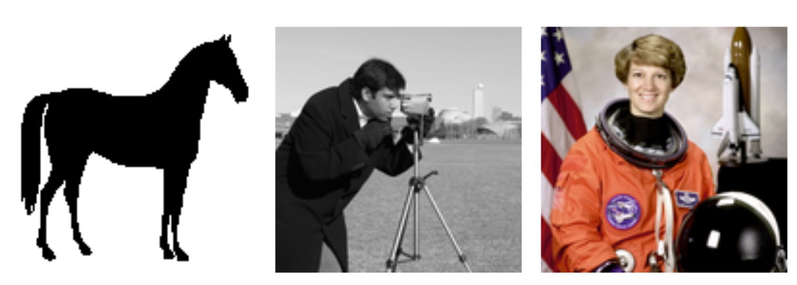
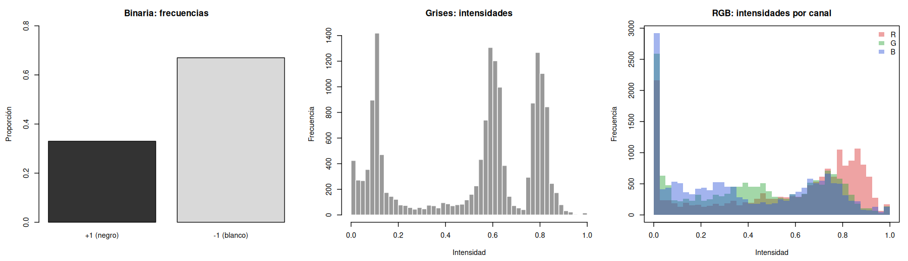

# Objetivo

Este documento completa la serie de explicaciones del caso, junto con los
documentos del modelo de Ising (3.2), del GMRF en escala de grises (3.3) y del
GMRF multivariado RGB (3.4). Tiene dos partes:

- **Parte A (punto 3.1, `Code/3.1.R`).** Es la base de todo: cómo una imagen se
  convierte en un grafo y en un vector, qué es la Laplaciana y por qué tiene las
  propiedades que usan los tres modelos, y qué dice la exploración de las imágenes.
- **Parte B (punto 4, `Code/4.R`).** La tabla comparativa global y la discusión
  que pide el caso: calidad de la restauración, papel de la dependencia espacial,
  dónde está la incertidumbre, comparación de modelos y ventajas y limitaciones del MCMC.

# Parte A — El grafo de vecindad

## Definición

Una imagen de $M\times N$ píxeles se representa con el grafo no dirigido
$G=(V,E)$: cada píxel es un vértice ($|V|=P=MN$) y dos píxeles son **vecinos**
($i\sim j$) si comparten un lado. Es la *vecindad de 4 vecinos* (arriba, abajo,
izquierda, derecha). $N_i$ es el conjunto de vecinos de $i$ y $d_i=|N_i|$ su grado.

::: {#prp-grados}
## Grados y número de aristas
En la rejilla $M\times N$ con $M,N\ge2$:

| Tipo de píxel | Grado | Cantidad | Con $M=N=128$ |
|:--|:--:|:--|--:|
| Esquina | 2 | $4$ | 4 |
| Borde (no esquina) | 3 | $2(M-2)+2(N-2)$ | 504 |
| Interior | 4 | $(M-2)(N-2)$ | 15,876 |

y el número de aristas es $|E|=M(N-1)+N(M-1)$, que con $M=N=128$ da $32{,}512$.
:::

::: {.proof}
Un píxel en la fila $r$ y la columna $c$ tiene vecino arriba si $r>1$, abajo si
$r<M$, a la izquierda si $c>1$ y a la derecha si $c<N$. En una esquina fallan dos
de estas condiciones, en un borde una y en el interior ninguna; contar las
posiciones da la tabla. Las aristas horizontales unen $(r,c)$ con $(r,c+1)$:
hay $M$ filas con $N-1$ cada una. Las verticales unen $(r,c)$ con $(r+1,c)$: $N$
columnas con $M-1$. Comprobación: $\sum_id_i=4\cdot2+504\cdot3+15{,}876\cdot4=65{,}024=2|E|$,
como debe ser, porque cada arista aporta 1 al grado de cada uno de sus extremos.
:::

`3.1.R` verifica exactamente esta tabla: obtiene 4, 504 y 15,876 píxeles de
grado 2, 3 y 4, y 32,512 aristas.

## Matrices de adyacencia, grados y Laplaciana

::: {#def-matrices}
## Matrices del grafo
- **Adyacencia** $\mathbf{A}$ ($P\times P$): $A_{ij}=1$ si $i\sim j$ y 0 en otro caso.
- **Grados** $\mathbf{D}=\operatorname{diag}(d_1,\dots,d_P)$, con $d_i=\sum_jA_{ij}$.
- **Laplaciana** $\mathbf{L}=\mathbf{D}-\mathbf{A}$, es decir, $L_{ii}=d_i$, $L_{ij}=-1$ si $i\sim j$ y 0 en otro caso.
:::

::: {#prp-lap}
## Propiedades de la Laplaciana
1. $\mathbf{L}$ es simétrica y cada fila suma cero: $\mathbf{L}\boldsymbol1=\boldsymbol0$.
2. $\boldsymbol x^\mathsf{T}\mathbf{L}\boldsymbol x=\sum_{i\sim j}(x_i-x_j)^2\ge0$: es semidefinida positiva.
3. Como el grafo es conexo, el valor propio 0 es simple y su vector propio es $\boldsymbol1$.
4. $\operatorname{tr}(\mathbf{L})=\sum_id_i=2|E|$.
5. Sus valores propios son $w_{k\ell}=4\sin^2\!\big(\frac{\pi k}{2M}\big)+4\sin^2\!\big(\frac{\pi\ell}{2N}\big)$,
   $k=0,\dots,M-1$, $\ell=0,\dots,N-1$, todos en $[0,8)$.
:::

::: {.proof}
(1) y (4) son inmediatas de la definición. (2) y (3) están demostradas en el
documento del 3.3: $\boldsymbol x^\mathsf{T}\mathbf{D}\boldsymbol x=\sum_{i\sim j}(x_i^2+x_j^2)$
y $\boldsymbol x^\mathsf{T}\mathbf{A}\boldsymbol x=2\sum_{i\sim j}x_ix_j$; la suma
de cuadrados se anula solo si $\boldsymbol x$ es constante. (5) también está en el
documento del 3.3: $\mathbf{L}$ es la suma de Kronecker de dos Laplacianas de
camino, cuyos vectores propios son los de la transformada coseno discreta.
:::

**Por qué importa cada propiedad en los modelos:**

| Propiedad | Dónde se usa |
|:--|:--|
| $\boldsymbol x^\mathsf{T}\mathbf{L}\boldsymbol x=\sum_{i\sim j}(x_i-x_j)^2$ | Es la penalización de suavidad de los GMRF (3.3 y 3.4). Con $\boldsymbol x\in\{-1,+1\}^P$, $\boldsymbol x^\mathsf{T}\mathbf{L}\boldsymbol x=4D(\boldsymbol x)$, cuatro veces el número de aristas discordantes del Ising. |
| $\mathbf{L}\boldsymbol1=\boldsymbol0$ | La previa no penaliza el nivel medio; por eso hace falta $\tau>0$ (3.3) o el término $\mathbf{I}$ (3.4) para que sea propia, y por eso $\mu$ desaparece del término de suavidad. |
| Semidefinida positiva | Garantiza que $\tau\mathbf{I}+\lambda\mathbf{L}$ y $(\mathbf{I}+\lambda\mathbf{L})\otimes\mathbf{\Omega}$ sean definidas positivas. |
| Valores propios explícitos | Cálculo exacto y rápido de $\log|\mathbf{Q}|$ y explicación espectral de los resultados del 3.3 y 3.4. |
| $\mathbf{A}$ con $\le4$ unos por fila | Las sumas de vecinos $\mathbf{A}\boldsymbol x$ cuestan $O(P)$. |

## Dispersión

$\mathbf{A}$ tiene $2|E|=65{,}024$ entradas no nulas de $P^2\approx2.7\times10^8$
(el 0.024 %); $\mathbf{L}$ tiene $65{,}024+16{,}384=81{,}408$. Guardadas como
matrices densas ocuparían unos 2 GB cada una; en formato disperso (`Matrix::sparseMatrix`)
ocupan menos de 1 MB. Por eso todos los scripts usan matrices dispersas, y por eso
los productos $\mathbf{A}\boldsymbol x$ y $\mathbf{L}\boldsymbol x$ son baratos.

```r
construir_laplaciana <- function(M = 128, N = 128) {
  P <- M * N
  idx <- matrix(1:P, nrow = M, ncol = N)                 # índice k de cada píxel (r, c)
  i <- c(as.vector(idx[, -N]), as.vector(idx[-M, ]))     # extremo (r, c)
  j <- c(as.vector(idx[, -1]), as.vector(idx[-1, ]))     # extremo (r, c+1) y (r+1, c)
  A <- sparseMatrix(i = c(i, j), j = c(j, i), x = 1, dims = c(P, P))   # simétrica
  d <- rowSums(A)
  L <- Diagonal(x = d) - A
  list(L = L, A = A, d = d, grid_idx = idx, n_aristas = length(i))
}
```

La construcción no usa bucles: `idx[, -N]` y `idx[, -1]` son los píxeles de
todas las columnas salvo la última y salvo la primera, y emparejarlos elemento a
elemento produce todas las aristas horizontales de una vez (análogamente con las
filas para las verticales). Cada arista se escribe en las posiciones $(i,j)$ y
$(j,i)$, lo que hace a $\mathbf{A}$ simétrica.

## El grafo es bipartito: el tablero de ajedrez

::: {#prp-bipartito}
## Bipartición
Sean $\mathcal{C}_1=\{(r,c):r+c\text{ par}\}$ y $\mathcal{C}_2=\{(r,c):r+c\text{ impar}\}$.
Toda arista une un vértice de $\mathcal{C}_1$ con uno de $\mathcal{C}_2$.
:::

::: {.proof}
Moverse a un vecino cambia $r$ o $c$ en exactamente una unidad, y por tanto
cambia la paridad de $r+c$.
:::

Esta propiedad, puramente del grafo, es la que permite en los tres modelos
actualizar la mitad de la imagen a la vez de forma exacta: en los tres, la
condicional de un píxel solo depende de sus vecinos, que son todos del otro color.

## Vectorización

Los modelos trabajan con vectores, no con matrices. Se usa el **orden por columnas**
de R:

$$
k=(c-1)M+r\quad\Longleftrightarrow\quad r=((k-1)\bmod M)+1,\qquad c=\lfloor(k-1)/M\rfloor+1 .
$$

Es una biyección entre $\{1,\dots,M\}\times\{1,\dots,N\}$ y $\{1,\dots,P\}$, y es
exactamente lo que hacen `as.vector(mat)` y `matrix(vec, M, N)`. En este orden,
los vecinos verticales de $k$ son $k\pm1$ (misma columna) y los horizontales
$k\pm M$ (misma fila). Lo esencial es que **la imagen y la Laplaciana usen el
mismo orden**: `construir_laplaciana` numera los píxeles con
`matrix(1:P, M, N)`, que es el mismo orden por columnas.

```r
matriz_a_vector <- function(mat) as.vector(mat)
vector_a_matriz <- function(vec, M = 128, N = 128) matrix(vec, nrow = M, ncol = N)
```

`3.1.R` verifica con `stopifnot` que ir y volver no cambia nada.

## Codificación de cada tipo de imagen

**Binaria.** El archivo trae 0 (silueta negra) y 1 (fondo blanco); el Ising usa
$+1$ para el negro y $-1$ para el blanco. La transformación es $x=1-2v$, es decir,
$0\mapsto+1$ y $1\mapsto-1$ (`binario_a_ising`).

**Escala de grises.** Se conserva la intensidad $x_i\in[0,1]$ tal cual. El ruido
gaussiano puede sacar los valores de ese intervalo; los modelos los usan sin
recortar (el GMRF vive en $\mathbb{R}$) y solo se recortan para dibujar.

**RGB.** El arreglo $M\times N\times3$ se convierte en una matriz $\mathbf{X}$ de
$P\times3$, con una fila por píxel y una columna por canal (`rgb_a_matriz_canales`).
Para escribir el modelo como un vector de $3P$ hay dos órdenes posibles:

| Orden | Vector | Precisión del 3.4 en ese orden |
|:--|:--|:--|
| Por píxel (el usado) | $\operatorname{vec}(\mathbf{X}^\mathsf{T})=(R_1,G_1,B_1,R_2,G_2,B_2,\dots)$ | $(\mathbf{I}_P+\lambda\mathbf{L})\otimes\mathbf{\Omega}$ |
| Por canal | $\operatorname{vec}(\mathbf{X})=(R_1,\dots,R_P,G_1,\dots,B_P)$ | $\mathbf{\Omega}\otimes(\mathbf{I}_P+\lambda\mathbf{L})$ |

Ambos describen el mismo modelo; solo cambia el orden de las filas (una
permutación). El enunciado escribe $(\mathbf{I}_P+\lambda\mathbf{L})\otimes\mathbf{\Omega}$,
que corresponde al orden por píxel. En el código nunca se construye la matriz de
$3P\times3P$: se trabaja con $\mathbf{X}$ de $P\times3$ y con bloques de $3\times3$.

# Parte A — Exploración de las imágenes

{#fig-originales}

{#fig-explor}

| Imagen | Media | DE | Mín. | Máx. | Correlación entre vecinos |
|:--|--:|--:|--:|--:|--:|
| Binaria (escala 0/1) | 0.670 | — | 0 | 1 | — (950 aristas discordantes, 2.9 %) |
| Grises | 0.506 | 0.285 | 0 | 1 | 0.961 |
| RGB, canal R | 0.555 | 0.317 | 0 | 1 | 0.940 |
| RGB, canal G | 0.415 | 0.295 | 0 | 1 | 0.925 |
| RGB, canal B | 0.379 | 0.300 | 0 | 1 | 0.926 |

: Resumen de las tres imágenes ($128\times128$). {#tbl-explor}

**Binaria.** 5,408 píxeles negros ($+1$, 33.0 %) y 10,976 blancos ($-1$, 67.0 %).
Solo 950 de las 32,512 aristas separan colores distintos: la imagen está formada
por dos grandes regiones homogéneas con un contorno. Es justo el tipo de imagen
que favorece la previa de Ising.

**Grises.** El histograma (@fig-explor) es **trimodal**: un pico cerca de 0.1 (el
abrigo oscuro), otro cerca de 0.6 (el pasto) y otro cerca de 0.8 (el cielo). Por
eso la mediana (0.596) está lejos de la media (0.506). Una sola "intensidad de
referencia" $\mu$ no describe bien la imagen, lo que anticipa que el modelo
estime $\tau\approx0$. La correlación entre vecinos es 0.96 y la diferencia
absoluta media entre vecinos es solo 0.034: hay muchísima dependencia espacial que
aprovechar, que es lo que justifica el GMRF.

**RGB.** Hay un pico enorme en 0 en los tres canales (el fondo negro del espacio)
y un pico del canal R alrededor de 0.85 (la piel y el traje anaranjado). Los
canales están muy correlacionados ($r_{RG}=0.84$, $r_{GB}=0.96$, $r_{RB}=0.72$).
Un análisis de componentes principales muestra que **el 89 % de la variabilidad
de color está en una sola dirección**, $\approx(0.58,0.58,0.57)$: el **brillo**.
Por eso conviene modelar los canales conjuntamente con $\mathbf{\Omega}$, y por
eso, como se explica en el documento del 3.4, el ruido en esa dirección es el más
difícil de separar de la imagen.

**Diferencias entre las representaciones.**

| | Binaria | Grises | RGB |
|:--|:--|:--|:--|
| Valor por píxel | $\{-1,+1\}$ | $[0,1]$ (modelo en $\mathbb{R}$) | $[0,1]^3$ (modelo en $\mathbb{R}^3$) |
| Dimensión de $\boldsymbol x$ | 16,384 | 16,384 | 49,152 |
| Tipo de ruido | volteos (discreto) | aditivo gaussiano | aditivo gaussiano por canal |
| Previa espacial | Ising | GMRF | GMRF multivariado |
| Dependencia entre canales | — | — | sí ($\mathbf{\Omega}$, $\mathbf{\Sigma}$) |

# Parte B — Tabla comparativa global

`4.R` no ejecuta MCMC: lee los resultados de 3.2, 3.3 y 3.4, arma la tabla, la
escribe en LaTeX (`Code/resultados/4/tabla_global.tex`) y genera un resumen de
hallazgos (`discusion.txt`).

| Modelo | Ruido | Tiempo (min) | $n_{\text{eff}}$ mín. | CVMC (%) | MSE | SNR (dB) | PSNR (dB) | Precisión (%) |
|:--|:--|--:|--:|--:|--:|--:|--:|--:|
| Ising | $\rho_0=0.05$ | 29.5 | 66 | 0.24 | 0.00616 | 20.36 | 22.10 | 99.43 |
| Ising | $\rho_0=0.10$ | 98.5 | 32 | 0.25 | 0.01110 | 17.81 | 19.55 | 98.77 |
| Ising | $\rho_0=0.20$ | 26.0 | 37 | 0.24 | 0.01875 | 15.53 | 17.27 | 97.79 |
| GMRF grises | $\sigma_0=0.05$ | 8.2 | 116 | 0.16 | 0.00220 | 21.85 | 26.57 | — |
| GMRF grises | $\sigma_0=0.10$ | 8.3 | 245 | 0.24 | 0.00446 | 18.78 | 23.51 | — |
| GMRF grises | $\sigma_0=0.20$ | 7.2 | 77 | 0.34 | 0.00623 | 17.33 | 22.06 | — |
| GMRF RGB | $\sigma_0=0.05$ | 26.1 | 26 | 0.82 | 0.00158 | 22.78 | 28.01 | — |
| GMRF RGB | $\sigma_0=0.10$ | 42.8 | 13 | 1.28 | 0.00427 | 18.48 | 23.70 | — |
| GMRF RGB | $\sigma_0=0.20$ | 25.4 | 14 | 1.03 | 0.01214 | 13.93 | 19.16 | — |

: Tabla global (`tabla_global.tex`). $n_{\text{eff}}$ mínimo sobre parámetros escalares y píxeles; CVMC medio sobre los parámetros escalares. {#tbl-global}

::: {.callout-warning}
## Cómo leer (y cómo no leer) esta tabla
- **Los MSE no son comparables entre modelos.** En el Ising el MSE se calcula en
  escala $\{0,1\}$ con $1-\hat\pi_i$; en los GMRF, sobre intensidades continuas.
  Además, las imágenes son distintas: un MSE menor en RGB que en grises no
  significa que el modelo RGB sea "mejor".
- **Lo comparable es la mejora relativa** frente a la imagen contaminada de cada modelo:

| Modelo | Ruido bajo | Ruido medio | Ruido alto |
|:--|--:|--:|--:|
| Ising (reducción de errores de clasificación) | 89 % | 88 % | 89 % |
| GMRF grises (reducción del MSE) | 9 % | 55 % | 84 % |
| GMRF RGB (reducción del MSE) | 36 % | 57 % | 69 % |

- **Los tiempos dependen de la carga de la máquina.** El Ising hace el mismo
  trabajo en los tres escenarios, así que la diferencia de $\rho_0=0.10$ (98.5 min
  frente a 26–30) no se debe al algoritmo. Lo relevante es el orden de magnitud.
:::

# Parte B — Discusión

## Calidad de la restauración

- **Binaria (Ising).** Es el caso más exitoso: recupera el 97.8–99.4 % de los
  píxeles y reduce los errores en torno al 88 % en los tres niveles. Las regiones
  homogéneas quedan casi perfectas (> 99.3 %); los errores se concentran en el
  contorno (82–96 % de acierto en bordes) y en detalles delgados como las patas.
- **Grises (GMRF).** La mejora crece mucho con el ruido: 9 %, 55 % y 84 %. Con
  poco ruido casi no se suaviza, porque el modelo confunde el ruido con textura
  de la imagen (sección 12 del documento del 3.3). Con mucho ruido, la imagen
  restaurada es limpia pero borrosa.
- **RGB (GMRF multivariado).** Mejora 36–69 %, de forma pareja en los tres canales.
  Elimina bien el ruido de color y conserva parte del ruido de brillo.

## Papel de la dependencia espacial

La dependencia espacial es lo que hace posible la restauración: sin ella
($\beta=0$ o $\lambda=0$), cada píxel solo tendría su propia observación y la
mejor estimación sería la imagen contaminada. Conviene precisar qué significa
aquí "dependencia espacial": es una **suposición de regularización de la
previa** (suavidad en los GMRF, segmentación en el Ising), no un hallazgo
empírico de procesos espaciales en los datos. Los parámetros $\beta$,
$\lambda$ y $\mathbf{\Omega}$ describen esa regularización; las asociaciones
que se reportan (por ejemplo, cómo cambia $\hat\beta$ con el ruido) se leen
dentro del modelo simulado, no como efectos causales.

| Aspecto | Ising | GMRF (grises y RGB) |
|:--|:--|:--|
| Regiones homogéneas | casi perfectas | ruido eliminado casi por completo |
| Bordes | **preservados**: la penalización por arista discordante es la misma ($2\beta$) sea cual sea el contraste, y un borde recto cuesta poco | **difuminados**: la penalización $(x_i-x_j)^2$ crece con el cuadrado del salto, así que los saltos grandes se suavizan |
| Detalles finos | se pierden los de 1–2 píxeles (se confunden con ruido) | se pierden progresivamente al aumentar el ruido |
| Colores | — | se preservan: $\mathbf{\Omega}$ obliga a los canales a variar juntos y elimina el ruido cromático |

El parámetro de dependencia se adapta al ruido de forma coherente:
$\hat\beta$ baja de 0.59 a 0.51 y $\hat\lambda$ de 47 a 27 (grises) al aumentar el
ruido. Pero, en los GMRF, lo que determina cuánto se suaviza es el producto
$\sigma^2\lambda$, que **sube** de 0.013 a 0.905: con más ruido, más suavizado.

## Píxeles con mayor incertidumbre

- **Ising:** los píxeles inciertos ($\hat\pi_i\approx\frac12$) están en el
  **contorno de la silueta** y en los detalles finos. La incertidumbre depende del
  contenido de la imagen: un píxel es dudoso cuando sus vecinos no coinciden.
  La clasificación MAP ($\hat\pi_i\ge 0.5$) no usa esa distancia: los píxeles
  ambiguos ($\hat\pi_i\in[0.4,0.6]$) son solo el 0.7–1.4 % del total, pero
  **concentran el 22–28 % de los errores** del MAP (precisión 54–82 % en
  ambiguos frente a más del 98 % en el resto). El mapa de $\hat\pi_i$ incorpora
  la incertidumbre de la asignación que el MAP deja fuera.
- **GMRF:** la DE posterior es casi uniforme y aumenta en el **marco de la imagen**
  (bordes y esquinas, que tienen 3 y 2 vecinos). No depende del contenido: en un
  modelo gaussiano con parámetros fijos, la varianza posterior
  $(\sigma^{-2}\mathbf{I}+\mathbf{Q})^{-1}$ no depende de $\boldsymbol y$, solo de
  la geometría del grafo y de los parámetros.
- En ambos casos la incertidumbre **crece con el ruido**. Pero en los GMRF está
  **mal calibrada** con poco ruido (cobertura del 49 % en grises y 57–77 % en RGB),
  porque el modelo subestima la varianza del ruido.

## Comparación de los tres modelos

1. El Ising es el que mejor restaura en términos relativos y el único que preserva
   bordes. Su previa encaja muy bien con una silueta formada por dos regiones.
2. Los GMRF son más versátiles (intensidades continuas, colores) y
   computacionalmente más baratos por iteración. Pero su penalización cuadrática
   difumina bordes y su varianza del ruido se confunde con la textura.
3. El modelo RGB añade una ventaja real: aprovechar la correlación entre canales
   para separar el ruido de color, lo que mejora mucho el caso de ruido bajo frente al gris.

Estas son comparaciones de **comportamiento**, no un contraste estadístico
sobre los mismos datos: cada modelo se aplica a una imagen distinta (binaria,
grises, RGB) y no comparten verosimilitud. Las diferencias numéricas se
reportan con su magnitud (MSE, SNR, PSNR) y no se califican de despreciables
ni de decisivas sin un análisis formal; la "mejora" del Ising, por ejemplo, se
sostiene en la eliminación del 88–89 % de los errores, no en una etiqueta.

## Ventajas y limitaciones de los algoritmos MCMC

**Ventajas.** Inferencia completa: medias, DE, intervalos por píxel y mapas de
incertidumbre, no solo una imagen restaurada. La incertidumbre de los parámetros
($\beta$, $\rho$, $\sigma^2$, $\lambda$, ...) se propaga a la restauración. Las
condicionales se derivan de forma sistemática, la mayoría son conjugadas y el
tablero de ajedrez permite vectorizar.

**Convergencia.** El punto débil de los tres modelos son los parámetros
"globales" que dependen de toda la imagen:

| Modelo | Parámetro más lento | $n_{\text{eff}}$ (de 3,000 o 22,000) | Causa |
|:--|:--|--:|:--|
| Ising | $\beta$ | 54–95 de 3,000 | pasos pequeños; cada paso exige simular una imagen auxiliar |
| Grises | $\lambda$, $\sigma^2$ | 77–1,447 de 22,000 | dependen de la imagen completa, que cambia lento |
| RGB | $\lambda$ | 13–26 de 22,000 | cresta $(\lambda,\mathbf{\Omega})$: solo el producto está bien identificado |

Todas las cadenas cumplen el criterio CVMC < 5 %, pero eso confirma la
precisión de la media de *cada cadena*, no la convergencia. La batería de
tests sobre las trazas (split-$\widehat R$ por rangos, Heidelberger–Welch,
Raftery–Lewis y Geweke; `convergencia.R`) ordena las alertas por modelo: el
GMRF de grises queda **confirmado** ($\widehat R$ 1.00–1.03; solo las colas de
$\sigma^2$ con $\sigma_0=0.05$ y de $\lambda$ con $\sigma_0=0.20$ piden más
iteraciones para cuantiles finos); en el Ising, $\beta$ queda en
$\widehat R$ 1.02–1.05 con Raftery–Lewis por encima de las iteraciones
disponibles; y en el RGB, $\boldsymbol\mu$ y $\mathbf{\Sigma}$ quedan
confirmados ($\widehat R\le1.06$) pero $\lambda$ (1.05–1.18) y
$\mathbf{\Omega}$ no se estabilizan entre segmentos. El respaldo definitivo
—$\widehat R$ multicaso con cadenas independientes— queda declarado como
pendiente en los tres modelos.

**Sensibilidad de las previas.** Comprobada en el 3.3 con la misma semilla de
ruido y **cinco variantes de previa** (base, débil, informativa, Jeffreys
$p(\theta)\propto1/\theta$ e información unitaria para $\sigma^2$):
$\mu$, $\lambda$ y $\sigma^2$ se mueven menos de un 1 %, $\tau$ cambia un
orden de magnitud (es el único parámetro con información débil), y el MSE de
restauración varía menos de un 1 %. Los criterios de comparación acompañan:
las diferencias de DIC son de a lo más 6 puntos (la previa informativa queda
algo peor, porque los datos prefieren $\tau$ pequeño) y las de WAIC, leves al
pesarlas por observación. Ninguna conclusión cambia con la previa; el valor
numérico de $\tau$ sí es interpretable solo con cautela.

**Verificación bayesiana del ajuste.** Además de los tests de convergencia,
se añadieron los chequeos estándar del curso (`verificaciones.R`):

- **Log-verosimilitud marginal y DIC** (GMRF): trazas estables sin deriva y
  $p_D$ de 2.3–13.8 (de 4 y 16 escalares): los datos dominan las previas.
- **Probabilidades de contrastes:** $\Pr(\sigma^2<\sigma_0^2\mid y)=1$ y
  $\Pr(\Sigma_{cc}<\sigma_0^2\mid y)=1$ en todos los escenarios — las
  subestimaciones del ruido son **seguras a posteriori**, no artefactos
  puntuales; $\Pr(\beta>\beta_c\mid y)=1$ (fase de regiones homogéneas) y
  $\Pr(\rho<\rho_0\mid y)=1$ (volteos absorbidos por el campo).
- **Chequeo predictivo previo:** las previas cubren las escalas observadas
  (salvo una tensión leve en la DE del 3.3, señalada en su documento).
- **Chequeo predictivo posterior (ppp):** las réplicas del modelo reproducen
  la **media** de los datos (ppp 0.4–0.6) pero **nunca** su DE (ppp = 1.00) ni
  su contraste local con poco ruido (ppp = 0.00): los chequeos detectan sin
  verdad de referencia lo mismo que las limitaciones declaraban — el
  suavizado cuadrático no cubre el rango dinámico ni el mixto de regiones
  planas y bordes de las imágenes reales.

**Costo y resolución mayor.**

- Cada barrido de Gibbs cuesta $O(P)$, gracias a las matrices dispersas y al
  tablero. Pero el **número de barridos necesario crece con el tamaño**: la
  información se propaga un píxel por barrido, así que en una imagen de
  $1024\times1024$ la mezcla sería mucho más lenta.
- **Ising:** el algoritmo de intercambio necesita $K$ barridos auxiliares por
  iteración ($26\times$ el costo de un barrido), y el $K$ necesario crece con la
  imagen y cerca de $\beta_c$.
- **GMRF:** $\log|\mathbf{Q}|$ por Cholesky cuesta del orden de $P^{3/2}$ en
  rejillas 2D. La fórmula espectral es $O(P)$, pero solo vale para rejillas
  rectangulares completas.
- Alternativas para imágenes grandes: muestreo de la imagen completa en bloque
  (Cholesky disperso de la precisión posterior), algoritmos de clústeres para el
  Ising (Swendsen–Wang), aproximaciones como INLA para GMRF, o métodos de
  optimización (MAP) cuando no se necesita la incertidumbre.

## Respuesta a la pregunta central

> **¿Cuánto mejora la restauración al incorporar dependencia espacial y qué
> información aporta la distribución posterior cuando aumenta el ruido?**

**Cuánto mejora.** Mucho, y más cuanto más ruido hay: entre el 88 y el 89 % de
los errores eliminados en la imagen binaria, y entre el 55 y el 84 % del MSE en
las imágenes continuas con ruido medio y alto. Con ruido bajo, la mejora en los
GMRF es pequeña (9 % en grises), porque el modelo no logra distinguir el ruido de
la textura real.

**Qué aporta la posterior.** Además de la imagen restaurada, dice **dónde** confiar
en ella: los mapas de $\hat\pi_i$ y de DE señalan bordes, detalles y el marco de la
imagen, y la incertidumbre crece con el ruido. Y al comparar con la verdad
conocida, la posterior revela las limitaciones de cada modelo: $\rho$ y $\sigma^2$
subestimados, intervalos demasiado angostos con poco ruido, y en RGB la dirección
de brillo como la más difícil. Que se puedan diagnosticar es una ventaja del
enfoque bayesiano completo frente a un método que solo entrega una imagen.

# Nota de reproducibilidad

::: {.callout-important}
## Reproducibilidad: la corrida rápida que sobrescribió `Code/resultados/` (resuelta)
Al preparar estos documentos se encontró que `Code/resultados/3.3/3.3_resultados.rds`,
`3.3_resumen.csv`, `Code/resultados/3.4/3.4_resultados.rds` y `3.4_resumen.csv`
habían quedado como una **corrida rápida** (`CDE_RAPIDO=TRUE`: 400 iteraciones, un
solo nivel de ruido), no como la corrida final de 24,000 iteraciones; varias
figuras también eran de esa corrida rápida. Los logs `log_3.3.txt` y
`log_3.4.txt` y `tabla_global.tex` sí correspondían a la corrida final.

El problema quedó **resuelto**: el 3.3 se restauró copiando la corrida final de
`corrida/3.3/` (idéntica byte a byte), y el 3.4 se **re-corrió con las mismas
semillas** y `CDE_LOGDET=espectral` (noviembre de 2026), reproduciendo los
números documentados exactamente (ver `log_3.4_recuperado.txt`). Ahora
`Code/resultados/` vuelve a contener las corridas finales de 3.2, 3.3 y 3.4,
con las **trazas completas** de los parámetros escalares que usa
`convergencia.R`, y `corrida/` guarda las copias de referencia (`.rds`,
`.csv` y figuras de los tres niveles de ruido).
:::
